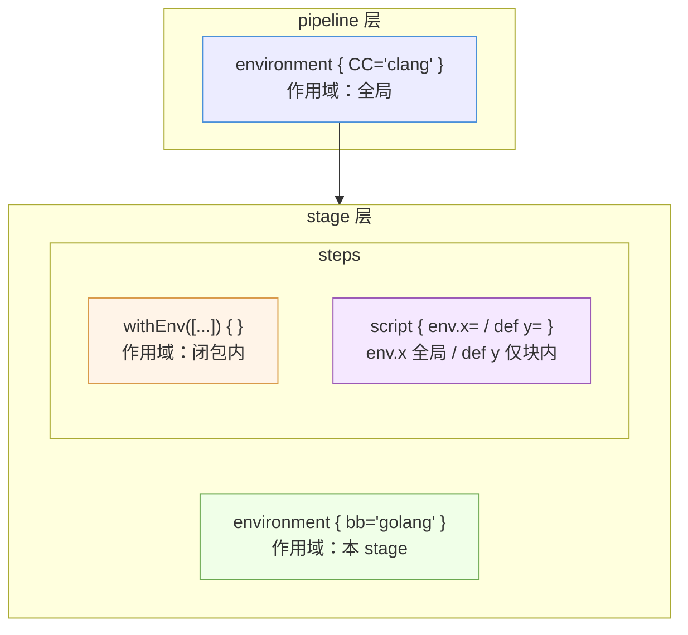

## 纲要

- **环境变量和 shell 里一样**：Jenkins Pipeline 的环境变量机制与 shell 脚本一致，但有**四种定义位置**，作用域完全不同
- **四种方式按作用域排**：`pipeline.environment`（全局）→ `stage.environment`（单 stage）→ `env.VAR=`（script 内、全局可见）→ `def` Groovy 变量（仅 script 块内）
- **最容易错的一点**：在某个 stage 里定义的局部变量，**其他 stage 引用会直接报错**（`No such property`）
- **`withEnv` 是临时注入**：只在闭包内存活，适合一次性传参，不会污染后续步骤
- **`env.VAR=` 是动态提升**：在 `script` 块里赋值后，**后续 stage 也能读到**——这是它和 `def` 的本质区别
- **凭据是敏感信息的唯一入口**：SSH 私钥、API token、用户名密码全部进凭据库，流水线只通过 ID 引用
- **Jenkins 有自动脱敏机制**：`VAR_USR` 明文输出，`VAR_PSW` 在控制台显示为加密——这是凭据优于硬编码的关键证据
- **实战铁律**：任何密码、token、私钥都不许出现在 `Jenkinsfile` 里

## 一、环境变量：四种定义方式与作用域

Jenkins Pipeline 的环境变量，**其实跟你使用 shell 脚本的环境变量是一样的**。但 Jenkins 提供了**多种定义方式**，区别全在**作用域**。

### 1.1 方式一：`pipeline` 层 `environment` —— 全局环境变量

**只需要在 `pipeline` 块里面定义 `environment` 块，块里面再定义变量名，通过等号赋值即可。**

```groovy
pipeline {
    agent any
    environment {
        CC = 'clang'              // 全局环境变量
        SERVICE_CREDS = credentials('gitlab')
    }
    stages {
        stage('Example') {
            steps {
                echo "CC = ${CC}"     // 任意 stage 都能引用
            }
        }
    }
}
```

**作用域：整条流水线，所有 stage、所有 step 都能引用。**

### 1.2 方式二：`stage` 层 `environment` —— 局部环境变量

```groovy
stage('Example') {
    environment {
        bb = 'golang'            // 局部环境变量
    }
    steps {
        echo "bb = ${bb}"        // 本 stage 内可用
    }
}
```

**作用域：仅该 stage 内部。**

> **这是最容易踩的坑**：在 stage A 的 `environment` 里定义的变量，在 stage B 里引用会**直接报错**。课件里实测——跨 stage 引用局部变量，控制台报"没有这样属性"（`No such property`）。
>
> **记住**：**一个 stage 里声明的变量只能够在该 stage 里面被调用，其他的 stage 引用了这个 stage 的变量是会报错的。**

### 1.3 方式三：`withEnv` —— 临时注入

`withEnv` 是**闭包式的临时环境变量**，变量只在闭包内部存活：

```groovy
steps {
    withEnv(['name1=join', 'name2=jack']) {
        echo "my name is ${env.name1}"      //  Groovy 侧读
        sh 'echo my name is ${name2}'       //  shell 侧读
    }
    // 出了闭包，name1 / name2 即失效
}
```

**特点**：

- **不影响闭包外的任何步骤**，适合一次性传参；
- Groovy 侧要用 `${env.name1}` 读，shell 侧直接用 `${name2}`。

### 1.4 方式四：`env.VAR=` 与 `def` —— 两种 script 块写法

在 `script` 块里还有两种写法，**作用域完全不同**，这是最容易被混淆的地方：

```groovy
steps {
    script {
        env.name3 = "peter"        // ① env. 前缀
        def name4 = "lisha"        // ② Groovy def 局部变量
    }
    echo "my name is ${env.name3}" // ✅ 可以读到（全局可见）
    sh 'echo my name is ${name4}'  // ❌ 读不到（仅 script 块内）
}
```

| 写法 | 作用域 | 能否跨 stage |
|---|---|---|
| `env.VAR = 'x'`（带 `env.` 前缀） | **全局可见**，动态设置 | ✅ 后续 stage 也能读 |
| `def VAR = 'x'`（Groovy 局部变量） | **仅该 script 块内** | ❌ 外部引用报错 |

**这个区别非常实用**：当你需要根据运行时条件动态决定一个变量（比如从接口返回里取版本号），并让后续所有 stage 都用它，就必须用 `env.VAR =` 而不是 `def`。

### 1.5 四种方式横向对比

| 方式 | 定义位置 | 作用域 | 典型用途 |
| --- | --- | --- | --- |
| `environment`（pipeline 层） | `pipeline { }` 内 | **全局** | 镜像名、仓库地址、全局开关 |
| `environment`（stage 层） | `stage { }` 内 | **单 stage** | 仅某阶段用的临时配置 |
| `withEnv([...])` | step 外层闭包 | **闭包内** | 一次性传参，不污染后续 |
| `env.VAR =` | `script { }` 内 | **全局**（动态） | 运行时计算出的值 |
| `def VAR =` | `script { }` 内 | **仅 script 块** | 纯 Groovy 中间变量 |



### 1.6 两个实操细节

**① 每种方式都要能"输出"才算验证通过。** 课件里反复出现一个现象：定义完变量后在控制台看不到输出——多数是因为没加 `echo`。`env` 块和 Groovy 变量都需要显式 `echo` 才能看到值。

**② 双引号与单引号的选择。** Groovy 变量展开（`${VAR}`）必须用**双引号**；单引号是纯字符串字面量，不做展开。课件里就是因为双引号写错导致构建失败，改对后才通过。

**③ 变量还能在 shell 脚本里直接引用。** `sh` 步骤中可以直接用 `${VAR}`，Jenkins 会把环境变量注入到 shell 进程——这也是环境变量机制"和 shell 一样"的体现。

## 二、凭据：敏感信息的唯一合法入口

### 2.1 凭据是什么

**凭据（Credentials）就是用于存储和管理敏感信息的**，比如：

- **SSH 密钥**
- **API 密钥**
- **用户名密码**
- 证书、kubeconfig、webhook secret

**凭据的配置是在系统管理里面添加的**（系统管理 → 凭据管理 → 添加凭据），前面已详细讲过七种默认类型与插件扩展。

### 2.2 在流水线中调用

标准写法是 **`credentials()` 方法**：

```groovy
environment {
    GIT_CREDS = credentials('gitlab')     // 'gitlab' 是凭据的 ID
}
```

三步理解：

1. **先定义方法**：`credentials('ID')`；
2. **方法里面引用之前已经定义好的凭据 ID**；
3. **把它赋值给一个变量名**，之后通过调用这个变量名输出它的用户名密码。

### 2.3 三个自动派生的变量

Jenkins 会根据你起的变量名，**自动派生出三个可用变量**：

| 派生变量 | 内容 |
|---|---|
| `GIT_CREDS` | `用户名:密码` 拼接串（适合 `curl -u`、`git clone`） |
| `GIT_CREDS_USR` | **用户名** |
| `GIT_CREDS_PSW` | **密码** |

SSH 私钥类型则不同——变量本身是**私钥文件路径**：

```groovy
environment {
    SSH_CREDS = credentials('my-ssh-key')
}
steps {
    sh 'echo "SSH private key is located at $SSH_CREDS"'   // 文件路径
    sh 'echo "SSH user is $SSH_CREDS_USR"'
    sh 'echo "SSH passphrase is $SSH_CREDS_PSW"'
}
```

### 2.4 关键：Jenkins 的自动脱敏机制

课件里做了一个非常有说服力的实验——**分别输出用户名和密码，看控制台显示什么**：

```groovy
sh 'echo "username: $GIT_CREDS_USR"'     // 加 _USR 尾缀输出用户名
sh 'echo "password: $GIT_CREDS_PSW"'     // 加 _PSW 尾缀输出密码
```

**控制台结果**：

- **用户名**：**明文输出**；
- **密码**：**做了加密处理**，不明文显示。

这就是 Jenkins 的**保护机制**——**它不让你在控制台看到明文密码**。

> **这个机制的价值**：即使有人不小心把密码打印到日志，日志里也是脱敏的。而如果密码硬编码在 `Jenkinsfile` 里，`echo` 一下就是明文，且已经进了 Git 历史，**永远删不掉**。

### 2.5 凭据使用的完整范式

```groovy
pipeline {
    agent any
    environment {
        // 全局：整条流水线可用
        GIT_CREDS = credentials('gitlab')
    }
    stages {
        stage('Clone') {
            steps {
                // 直接用拼接串
                sh 'git clone http://$GIT_CREDS@gitlab.example.com/golang/go.git'
            }
        }
        stage('Test Creds') {
            steps {
                // 分别取用户名与密码（密码在日志中自动脱敏）
                sh 'echo "user is $GIT_CREDS_USR"'
                sh 'echo "pass is $GIT_CREDS_PSW"'
            }
        }
        stage('Deploy') {
            environment {
                // 局部：仅本 stage 可用
                KUBE_CREDS = credentials('kubeconfig')
            }
            steps {
                sh 'kubectl --kubeconfig=$KUBE_CREDS apply -f k8s/'
            }
        }
    }
}
```

## 三、常见报错与排查

| 现象 | 根因 | 解法 |
| --- | --- | --- |
| 跨 stage 引用局部变量报 `No such property` | 变量定义在别的 stage 的 `environment` 里 | 提升到 `pipeline` 层，或用 `env.VAR=` |
| `${VAR}` 不展开 | 用了单引号 | 改双引号 |
| `env` 块里定义了但看不到输出 | 没加 `echo` | 显式 `echo` 验证 |
| 控制台密码显示为 `****` | **正常现象**，Jenkins 自动脱敏 | 不是 bug，是保护机制 |
| `credentials('xxx')` 报找不到 | 凭据 ID 写错，或作用域不对 | 核对 ID；局部凭据不能跨 stage |
| SSH 凭据变量内容是路径不是密钥 | SSH 类型特性 | 用文件路径，别 `cat` 内容 |

## 四、面试考点与追问

**Q1：Jenkins Pipeline 定义环境变量有哪几种方式？作用域有何不同？**
五种写法：`pipeline` 层 `environment`（全局）、`stage` 层 `environment`（单 stage）、`withEnv` 闭包（闭包内）、`env.VAR=`（script 内、全局可见）、`def` Groovy 变量（仅 script 块内）。选择依据是作用域需求。

**Q2：`env.VAR = 'x'` 和 `def VAR = 'x'` 的区别？**
`env.VAR=` 是**动态设置 Jenkins 环境变量**，赋值后全局可见，后续 stage 也能读；`def` 是 **Groovy 局部变量**，仅存在于该 script 块，外部引用报 `No such property`。需要跨 stage 共享运行时计算值时必须用前者。

**Q3：为什么跨 stage 引用局部环境变量会报错？**
因为 `stage` 层 `environment` 的作用域被严格限定在该 stage 内。这是 Jenkins 的有意设计——避免变量隐式跨阶段传递导致的状态混乱。需要共享就提升到 `pipeline` 层或用 `env.VAR=`。

**Q4：`credentials()` 调用后会派生出哪些变量？**
三个：变量名本身是 `用户名:密码` 拼接串；`变量名_USR` 是用户名；`变量名_PSW` 是密码。SSH 私钥类型例外——变量名本身是私钥**文件路径**。

**Q5：Jenkins 对凭据有什么安全保护？**
控制台自动脱敏——`_USR` 明文显示，`_PSW` 显示为加密值，即使脚本打印密码也不会泄露到日志。这是凭据机制相对硬编码的核心优势之一（另一个是集中管理与轮换）。

**Q6：为什么密码绝对不能硬编码在 Jenkinsfile 里？**
三个原因：① 进 Git 历史后永远删不掉，任何有仓库权限的人都能看到；② 改密码要改所有流水线；③ `echo` 出来就是明文，无脱敏保护。凭据机制同时解决这三点。

## 📎 文本↔代码关联

本篇对应课件源码（`code/3-基础-Jenkins/`，已做去品牌化处理）：

| 代码文件 | 正文提及 | 内容 |
| --- | --- | --- |
| `code/3-基础-Jenkins/课件/教学课件.md` | 第 1.1~1.4 节 | 环境变量五种写法完整示例：全局 `environment`、stage 局部、`withEnv`、`env.name3=`、`def name4` |
| `code/3-基础-Jenkins/课件/教学课件.md` | 第 2.2~2.5 节 | `credentials()` 调用范式，含 Username/Password 与 SSH private key 两种类型 |
| `code/3-基础-Jenkins/Jenkinsfile/Jenkinsfile-流水线基础（基础课程所有笔记都在此文件）` | 第 2.5 节 | 含 `environment` 块与 `credentials('gitlab')` 的生产级用法 |

**技术点总结**：环境变量五种写法按作用域分层——`pipeline.environment` 全局、`stage.environment` 单 stage、`withEnv` 闭包内、`env.VAR=` script 内但全局可见、`def` 仅 script 块内；**跨 stage 引用局部变量必然报错**，需要共享就用 `env.VAR=`。凭据是敏感信息唯一合法入口，`credentials('ID')` 派生三个变量（拼接串/`_USR`/`_PSW`），且 **Jenkins 控制台对密码自动脱敏**——这是硬编码永远给不了的保护。
