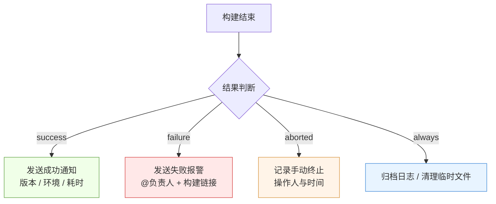

## 纲要

- **`post` 解决"构建结束后该做什么"**：成功要通知、失败要报警、手动终止要记录——统一由 `post` 的条件块承接
- **五个条件块语义要记准**：`always` 无论成败、`success` 成功才执行、`failure` 失败才执行、`aborted` 手动终止、`unstable` 不稳定（测试失败但未报错）
- **`post` 可配在 `pipeline` 外层（全局）或 `stage` 内（局部）**：都配时**局部先触发、全局也触发，会输出两次**——所以只配一处
- **报警是 `post` 的第一大用途**：成功报什么、失败报什么、无论成败报什么，三种话术分别放不同条件块
- **为什么必须清理工作空间**：上次构建遗留的代码会**污染本次构建**，这是间歇性构建失败的经典根因
- **`cleanWs()` 是内置方法**：配在第一个 stage、拉代码之前，先清后拉
- **验证方式很直接**：建个 `a.txt`，构建一次能看到，`cleanWs` 后再构建就消失——肉眼可证

## 一、post：构建结束后的条件化处理

### 1.1 先想清楚要解决什么问题

在构建流水线的过程当中，我们经常需要判断：

- 整个管道有没有运行成功？
- 某个阶段有没有执行成功？
- **执行成功了，需要做某些操作**（比如发通知"上线完成"）；
- **执行失败了，又需要做某些操作**（比如报警"构建失败，谁去看看"）。

这时候就用 **`post`**。

> **`post` 的定义位置**：它定义在**管道或者阶段运行完成之后**。所以它写在整个 `pipeline` 的后面，或者某个 `stage` 的后面。

### 1.2 五个条件块

```groovy
pipeline {
    agent any
    stages {
        stage('Example') {
            steps {
                echo 'Hello World'
            }
        }
    }
    post {
        always {
            echo 'always'
        }
        success {
            echo 'success'
        }
        failure {
            echo 'failure'
        }
        aborted {
            echo 'aborted'
        }
        unstable {
            echo 'unstable'
        }
    }
}
```

逐个说明语义：

| 条件块 | 触发时机 | 典型用途 |
|---|---|---|
| **`always`** | **不管管道或阶段执行成功或失败，都会执行** | 清理临时文件、归档日志、发送基础通知 |
| **`success`** | **成功才会执行** | "构建成功，版本 x.y.z 已发布到测试环境" |
| **`failure`** | **失败才会执行** | 报警通知@负责人、上传失败日志 |
| **`aborted`** | **构建过程中手动点击终止** | 记录"谁取消了这次构建" |
| **`unstable`** | 构建未报错但测试失败等 | 测试不达标通知 |

**`aborted` 的语义值得单独说**：当你在构建过程当中**手动点击终止**，流水线会进入"终止"状态，此时 **`aborted` 条件块里的内容就会输出**。这与 `failure` 是两回事——`failure` 是命令执行失败，`aborted` 是人为中断。

### 1.3 全局 post 与局部 post

`post` 有两个配置位置：

- **全局**：写在 `pipeline { }` 外层、`stages { }` 之后；
- **局部**：写在某个 `stage { }` 内部。

**当全局和局部都配置了 `post` 时，会发生什么？**

课件实测结论：**局部的 `post` 优先生效，然后全局的也会执行，所以会输出两次。**

```text
stage 内 post: failure → 先触发（局部优先）
pipeline 内 post: failure → 也触发（全局照常）
结果：同一条 echo 输出两次
```

> **实践建议：要么全配全局，要么全配局部，不要混配。** 混配的结果是通知重复发送——报警群里同一条消息来两遍，很快就会被当成噪音忽略，真正重要的报警反而被淹没。

### 1.4 第一大用途：报警通知

`post` 最典型的应用就是**报警**。课件的原话逻辑是：

> 我们平时构建流水线，就会通过 `post` 来进行报警——**成功了报什么内容，失败了又报什么内容，而不管成功还是失败，又报什么内容。**

三类话术分别放不同条件块：

```groovy
post {
    success {
        // 钉钉 / 飞书 / 企业微信
        sh '''
            curl -X POST 'https://oapi.dingtalk.com/robot/send?access_token=xxx' \
              -H 'Content-Type: application/json' \
              -d '{"msgtype":"text","text":{"content":"✅ 构建成功\\n项目: app\\n版本: ${BUILD_TAG}"}}'
        '''
    }
    failure {
        sh '''
            curl -X POST 'https://oapi.dingtalk.com/robot/send?access_token=xxx' \
              -H 'Content-Type: application/json' \
              -d '{"msgtype":"text","text":{"content":"❌ 构建失败\\n项目: app\\n请检查: ${BUILD_URL}"}}'
        '''
    }
    always {
        echo "构建结束，耗时: ${currentBuild.durationString}"
    }
}
```



## 二、清理工作空间：为什么、怎么做、怎么验证

### 2.1 为什么必须清理

这是很多新手忽略、但**直接导致间歇性构建失败**的问题。

**问题的形成过程**：

1. 每一次构建的时候，都需要把代码拉下来，**而这个代码就拉到了当前构建的工作空间里面**；
2. 每一个构建都有一个工作空间，**每个构建的工作空间都是独立的**；
3. **但是每一次构建完之后，拉下来的代码都会保存在工作空间里面**；
4. **等到我们下一次构建的时候，上一次构建保留下来的代码，会影响到我们这一次的构建。**

典型的污染场景：

- 上次构建生成了 `target/` 编译产物，这次增量编译用了旧产物 → 出现"改了代码却没生效"的灵异 bug；
- 上次失败留下半成品文件，这次脚本误判文件已存在 → 跳过关键步骤；
- 上次调试时手动建的临时文件，这次被当成输入 → 结果不可复现。

> **所以每一次在构建之前，都需要把上一次构建所遗留下来的代码目录给清理掉。不能让上一次遗留下来的代码，影响到我们这一次的构建。**

### 2.2 清理方法：`cleanWs()`

Jenkins 提供了内置方法 **`cleanWs()`**：

- **`clean`** = 清除；
- **`WS`** = **workspace**（工作空间）的简写；
- 这是**内置方法**，不需要装插件。

**使用方法**：把它配在**整个管道的第一个阶段里，先清除工作空间，再把代码拉下来**。

```groovy
pipeline {
    agent any
    stages {
        stage('Clean') {
            steps {
                cleanWs()                 // ① 先清空工作空间
            }
        }
        stage('Clone') {
            steps {
                git branch: 'main',
                    url: 'http://gitlab.example.com/golang/go.git'   // ② 再拉代码
            }
        }
        stage('Build') {
            steps {
                sh 'go build -o app ./...'
            }
        }
    }
}
```

> **顺序很重要**：一定是**先 `cleanWs()`，后拉代码**。反过来就白清了。

### 2.3 怎么验证它真的生效

课件给了一个**肉眼可证**的验证方法：

**① 先不清，建个文件看效果。**

```groovy
stage('Demo') {
    steps {
        sh 'touch a.txt'        // 建一个测试文件
        sh 'ls -la'             // 能看到 a.txt
    }
}
```

第一次构建，控制台 `ls` 输出里**能看到 `a.txt`**。

**② 打开 `cleanWs()`，再构建一次。**

```groovy
stage('Clean') {
    steps {
        cleanWs()               // 清空
    }
}
stage('Demo') {
    steps {
        sh 'touch a.txt'
        sh 'ls -la'
    }
}
```

第二次构建，控制台 `ls` 输出里 **`a.txt` 不见了**——证明上一次的工作空间已被清掉，这个文件是本次新建的。

**③ 反过来验证污染存在。** 如果不加 `cleanWs()`，反复构建会发现第一次之后 `a.txt` 一直在——这就是上次遗留影响本次的直接证据。

### 2.4 `script` 块与内置方法

课件的操作里提到一个细节：执行 `cleanWs()` 时要放在 **`script` 块**（或 `steps`）里，因为：

- `script` 块**可以执行 Groovy 脚本或者一些流水线内置的方法**；
- 同时它**也可以执行 `sh` 命令**。

```groovy
steps {
    script {
        cleanWs()                       // 内置方法
        sh 'touch a.txt && ls -la'      // shell 命令
    }
}
```

## 三、常见报错与排查

| 现象 | 根因 | 解法 |
| --- | --- | --- |
| 报警收到两条一样的消息 | 全局和局部都配了 `post` | 只配一处 |
| 手动取消后没触发通知 | 只配了 `failure` 没配 `aborted` | 补 `aborted` 条件块 |
| `cleanWs()` 报方法不存在 | 没放 `script` 块，或插件缺失 | 放 `script { }` 内；确认装了 Workspace Cleanup 插件 |
| 清理了但代码还是旧的 | `cleanWs()` 放在了拉代码之后 | 调整顺序：先清后拉 |
| 构建结果间歇性不可复现 | 工作空间被上次构建污染 | 第一个 stage 加 `cleanWs()` |
| `post` 不执行 | 写在了 `stages` 内部而非之后 | `post` 必须在 `stages { }` 之后（全局）或 `stage` 内（局部） |

## 四、面试考点与追问

**Q1：`post` 的五个条件块分别是什么？触发时机？**
`always`（无论成败都执行）、`success`（成功才执行）、`failure`（失败才执行）、`aborted`（手动终止时执行）、`unstable`（构建未报错但测试失败等不稳定状态）。`aborted` 与 `failure` 的区别是人为中断 vs 命令失败。

**Q2：全局 `post` 和局部 `post` 都配会怎样？**
**局部的先触发，全局的也照常触发，同一条动作会执行两次。** 所以实践中不要混配，要么全全局要么全局部，否则会出现重复报警。

**Q3：为什么要在流水线第一个阶段清理工作空间？**
因为每个构建的工作空间是独立但持久保留的，上次构建遗留的代码/产物会污染本次构建，导致"改了代码不生效""结果不可复现"等间歇性故障。第一个阶段 `cleanWs()` 先清后拉，保证每次构建起点一致。

**Q4：`cleanWs()` 为什么要放在 `script` 块里？**
因为它是流水线的**内置方法**而非 step，需要在 Groovy 执行上下文里调用。`script` 块既能执行 Groovy 脚本和内置方法，也能执行 `sh` 命令。

**Q5：如何验证 `cleanWs()` 真的生效？**
建一个测试文件（如 `a.txt`）并 `ls` 查看。不加 `cleanWs()` 反复构建，文件会一直存在（上次遗留）；加上后再构建，文件消失（本次新建）。这个对比肉眼可证。

**Q6：生产流水线的 `post` 通常怎么配？**
至少三块：`success` 发成功通知（含版本、环境、耗时）、`failure` 发失败报警（@负责人 + 构建链接）、`always` 做收尾（归档日志、清理临时文件、打印耗时）。高危流水线再加 `aborted` 记录人为中断，便于审计。

## 📎 文本↔代码关联

本篇对应课件源码（`code/3-基础-Jenkins/`，已做去品牌化处理）：

| 代码文件 | 正文提及 | 内容 |
| --- | --- | --- |
| `code/3-基础-Jenkins/课件/教学课件.md` | 第 1.2 / 1.4 节 | `post` 五条件块完整示例（always/success/failure/aborted/unstable） |
| `code/3-基础-Jenkins/课件/教学课件.md` | 第 2.2~2.4 节 | `cleanWs()` 与 `script` 块执行内置方法的用法 |
| `code/3-基础-Jenkins/Jenkinsfile/Jenkinsfile-流水线基础（基础课程所有笔记都在此文件）` | 第 2.3 节 | 含 `post` 与构建后处理的完整生产级 Jenkinsfile |

**技术点总结**：`post` 是构建结束后的条件化处理器，五个条件块中 `always`/`success`/`failure` 是生产三件套，`aborted` 与 `failure` 的区别是人为终止 vs 命令失败；**全局与局部 `post` 混配会导致动作执行两次**，只配一处。清理工作空间用内置方法 `cleanWs()`，必须放在**第一个 stage、拉代码之前**，并用"建文件→构建→看文件是否消失"的方式肉眼验证。
