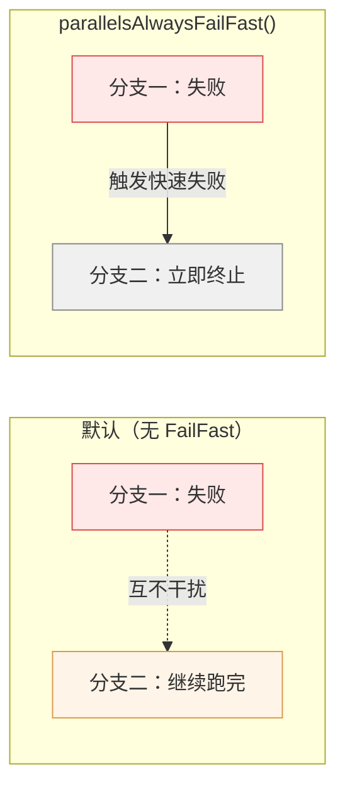

## 纲要

- **串行是效率瓶颈**：一个步骤跑完才跑下一个，构建时长是所有步骤之和——而很多步骤之间没有依赖，完全可以并行
- **`parallel` 块是并行入口**：在外层 `stage` 里写 `parallel { }`，里面放多个带名字的 `stage`，这些 stage 会同时执行
- **层级不能错**：`parallel` 必须嵌在 `stage` 内，`parallel` 内的每个 `stage` 也必须有名字，否则语法报错
- **并行失败的默认行为**：一个分支失败**不影响**另一个分支继续跑，直到各自成功或失败——这有时是浪费
- **`parallelsAlwaysFailFast()` 改掉这个行为**：任一分支失败，其他还没跑完的分支**立即终止**
- **Blue Ocean 是并行的"可视化刚需"**：经典视图看不出并行，Blue Ocean 能清楚展示两个分支同时跑、各自输出独立
- **判断并行是否生效的可靠方法**：看 Blue Ocean 的分支视图，或对比构建总耗时是否接近"最长分支"而非"分支之和"
- **生产建议**：无依赖的测试、扫描、打包应并行；有依赖关系的必须串行并用 `runAfter`/依赖表达

## 一、为什么需要并行执行

在构建流水线的过程当中，有些需求我们是需要**将两个步骤或者三个步骤并行执行**的。

而之前学的都是**串行执行**——只能执行完一个步骤再执行下一个步骤。这种串行执行过程的**效率非常低**。

算一笔账就明白了。假设一条流水线有四个无依赖的步骤，各需 3 分钟：

```text
串行：3 + 3 + 3 + 3 = 12 分钟
并行：max(3, 3, 3, 3) = 3 分钟
```

**四倍差距。** 而且步骤越多、单步越久，并行的收益越大。

> 关键前提：**步骤之间没有依赖关系**。如果步骤 B 依赖步骤 A 的产物，那必须串行。并行的价值在于识别出"其实没有依赖、却被习惯性串起来"的那些步骤。

典型的可并行场景：

- 单元测试 + 代码扫描 + 镜像构建（三者都只依赖代码，互不依赖）
- 多模块各自打包
- 不同环境的校验任务

## 二、`parallel` 语法：三层结构

### 2.1 标准写法

```groovy
pipeline {
    agent any
    stages {
        stage('Non-Parallel Stage') {
            steps {
                echo 'This stage will be executed first.'
            }
        }
        stage('Parallel Stage') {
            parallel {
                stage('Branch A') {
                    steps {
                        echo "On Branch A"
                    }
                }
                stage('Branch B') {
                    steps {
                        echo "On Branch B"
                    }
                }
            }
        }
    }
}
```

### 2.2 三层结构不能错

```text
stage('Parallel Stage')        ← ① 外层 stage，必须有名字
    └── parallel {             ← ② parallel 块，必须嵌在 stage 内
            └── stage('Branch A')   ← ③ 内层 stage，也必须有名字
                    └── steps { ... }
```

**三条硬规则**：

1. **`parallel` 必须在外层 `stage` 里面**，不能直接挂在 `stages` 下；
2. **外层 `stage` 要有名称**；
3. **`parallel` 里面的每个 `stage` 也要有名称**——`steps` 也一样不能省。

> 课件原话：你可以加一个到多个，这个是没有限制的，但是**一定要在外层的 stage 里面再写 parallel，parallel 里面再写多个 stage**。

### 2.3 三个分支以上

```groovy
stage('Test Parallel') {
    parallel {
        stage('Unit Test') {
            steps { sh 'go test ./unit/...' }
        }
        stage('Integration Test') {
            steps { sh 'go test ./integration/...' }
        }
        stage('Lint') {
            steps { sh 'golangci-lint run' }
        }
    }
}
```

三个分支同时跑，总耗时约等于最慢的那个。

### 2.4 怎么确认真的并行了

**经典视图的问题**：课件实测发现——"他这里边已经并行构建了，同时在 34 分 38 秒并行执行这两个构建"，**但是这样看是看不出来他已经并行执行了**。

经典（Classic）UI 会把并行的两个分支折叠在一个 stage 下，视觉上分不清。

**两个可靠的判断方法**：

| 方法 | 操作 |
|---|---|
| **看构建总耗时** | 若约等于"最慢分支"而非"分支之和"，说明并行了 |
| **用 Blue Ocean 看** | 分支视图清晰展示并行结构与各自输出 |

## 三、Blue Ocean：让并行肉眼可见

### 3.1 它是什么

**通过安装 Blue Ocean 插件，我们可以在页面上点击"打开 Blue Ocean 项目"**，这就是蓝海项目的 UI。

它的核心价值：**能清楚看到两个项目都在并行执行**，每个分支的日志、耗时、触发方式独立展示。

### 3.2 安装注意

**插件管理 → 可用插件 → 搜索 `Blue Ocean` → 安装。**

课件提到一个常见状况：**第一次安装可能会有比较多的依赖插件**，其中**一些可能会安装失败**。

**处理办法**：

- 回"可选插件"重新粘贴插件名再装一次；
- 或在"已安装插件"里把它卸载，再去"可选插件"重新安装。

### 3.3 Blue Ocean 能看到什么

课件实测展示的信息：

- **并行执行的多个步骤**，每个步骤可单独展开看输出；
- **提交的分支**；
- **运行了多长时间**、多少分钟之前运行的；
- **由哪个用户运行的**，或者**由定时器运行的**；
- 左上角是**构建名称**，点流水线名可回到构建页面；
- 点运行可产生新构建，点日志图标看输出；
- 可**收藏项目**；
- 可点"返回经典页面"退回经典 UI。

> **选型建议**：想好看一点、清晰一点、看整个流程的话，**可以使用 Blue Ocean**。尤其是并行流水线——经典 UI 基本看不清并行结构。

## 四、`parallelsAlwaysFailFast()`：并行失败的处理策略

这是并行执行最容易被忽略、但**直接影响资源浪费**的配置。

### 4.1 默认行为：互不干扰

前面讲过 `parallelsAlwaysFailFast()` 这个 options 配置项，现在结合并行理解它的意义。

**默认情况下**，并行运行的多个阶段**相互不干扰**：

> 比如说上面这个阶段运行失败了，但是它下面这个阶段并不会影响它运行，它会持续地运行，直到成功运行完成为止或者失败。这两个是并行执行的，**他们两个的构建相互不干扰**。

**这带来的问题**：上面那个分支已经报错了，下面那个分支还在跑——**既然已经失败，继续跑完全没意义**，纯粹浪费 executor 和时间。

### 4.2 加上 FailFast：一个失败，全部终止

```groovy
pipeline {
    agent any
    options {
        parallelsAlwaysFailFast()
    }
    stages {
        stage('Parallel Stage') {
            parallel {
                stage('one') {
                    steps {
                        sh 'hello'          // 命令不存在，必然失败
                    }
                }
                stage('two') {
                    steps {
                        sh 'sleep 3'        // 延长运行时间，便于观察
                        sh 'echo done'
                    }
                }
            }
        }
    }
}
```

课件实测：

- **不加 FailFast**：第一个步骤报错，但第二个步骤**照样跑完**；
- **加上 FailFast**：第一个步骤失败后，第二个阶段**还没运行完成就被终止**。

**语义**：不管哪一个分支，**当其中一个运行失败之后，另外一个如果还没有运行完成，它都必须要终止**——你再运行下去已经没有意义了，因为都已经报错了。



### 4.3 一个重要的观察陷阱

课件里有一个很细致的观察：加上 FailFast 后，**有时看起来第二个分支还是"成功"了**。

原因：**第二个分支在第一个分支失败之前就已经运行完成了**——所以看不出来被终止。

> **验证方法**：把并行分支的运行时间**故意延长**（如 `sleep 3`），让失败分支先失败，才能在 Blue Ocean 里清楚看到第二个分支被终止。

这是做技术验证时的重要意识：**现象没出现，先怀疑是不是观测条件不够**，而不是立刻怀疑配置无效。

### 4.4 选型建议

| 场景 | 建议 |
|---|---|
| 分支间无依赖、失败一个整体就没意义（如同一应用的测试套） | **加 FailFast** |
| 分支间独立、需要看全部结果（如多环境巡检） | 不加，让每个分支跑完出完整报告 |
| 分支耗时差异大 | 加 FailFast 省资源 |

## 五、常见报错与排查

| 现象 | 根因 | 解法 |
| --- | --- | --- |
| `parallel` 语法报错 | `parallel` 没嵌在 `stage` 内，或内层 stage 无名 | 检查三层结构 |
| 内层 stage 不执行 | 内层 stage 漏了名字 | 每个内层 stage 都要命名 |
| 看不出是否并行 | 经典 UI 折叠展示 | 看总耗时；或装 Blue Ocean |
| 一分支失败另一分支还在跑 | 未配 FailFast | `options { parallelsAlwaysFailFast() }` |
| 加了 FailFast 但没看到终止 | 另一分支已先跑完 | 延长分支运行时间再观察 |
| Blue Ocean 装不上 | 依赖插件安装失败 | 重装或卸载后重装 |
| 并行分支抢资源整体变慢 | 并行度过高 | 减少并行分支数，或分配不同 agent |

## 六、面试考点与追问

**Q1：`parallel` 的语法结构是什么？有哪些硬性要求？**
三层：外层 `stage`（必须有名字）→ `parallel { }` → 多个内层 `stage`（也必须有名字，内含 `steps`）。`parallel` 不能直接挂在 `stages` 下，内层 stage 数量不限但都要命名。

**Q2：并行执行的收益怎么算？**
串行总耗时 = 各步骤耗时之和；并行总耗时 ≈ 最慢分支的耗时（加上调度开销）。所以并行收益 = 1 − (最慢分支 / 各分支之和)。分支越多、单步越久，收益越大。

**Q3：并行分支中一个失败，默认会发生什么？**
**默认互不干扰**——失败的分支标记失败，其他分支继续运行直到各自成功或失败。这会造成资源浪费（已失败还继续跑无关分支）。

**Q4：`parallelsAlwaysFailFast()` 的作用？**
让并行分支**快速失败**：任一分支失败时，其他尚未完成的分支立即终止。适用于分支间无依赖、一个失败整体就无意义的场景；不适用于需要看全部分支结果的巡检类任务。

**Q5：为什么验证 FailFast 时要延长分支运行时间？**
因为如果另一个分支在失败分支之前已经跑完，就观察不到"被终止"的现象，容易误判配置无效。延长耗时是为了构造"失败先发生"的观测条件。

**Q6：Blue Ocean 相对经典 UI 的核心价值？**
并行结构可视化——经典 UI 会把并行分支折叠在一个 stage 下，看不出并行关系与各自输出；Blue Ocean 清晰展示分支、耗时、触发源（用户/定时器）、提交分支，并支持按分支查看日志。对并行流水线几乎是刚需。

## 📎 文本↔代码关联

本篇对应课件源码（`code/3-基础-Jenkins/`，已做去品牌化处理）：

| 代码文件 | 正文提及 | 内容 |
| --- | --- | --- |
| `code/3-基础-Jenkins/课件/教学课件.md` | 第 2.1 / 2.3 节 | 并行执行完整示例：`Non-Parallel Stage` + `Parallel Stage` 内含 `Branch A` / `Branch B` |
| `code/3-基础-Jenkins/课件/教学课件.md` | 第 4.2 节 | `options { parallelsAlwaysFailFast() }` 与并行组合用法 |
| `code/3-基础-Jenkins/Jenkinsfile/Jenkinsfile-流水线基础（基础课程所有笔记都在此文件）` | 第 4.2 节 | 含 `options`（`parallelsAlwaysFailFast` / `disableConcurrentBuilds` 等）的完整生产模板 |

**技术点总结**：并行执行用三层结构（外层命名 `stage` → `parallel { }` → 多个命名内层 `stage`）把无依赖步骤同时跑，耗时从"步骤之和"降到"最慢分支"。默认情况下分支失败互不干扰（会造成浪费），加 `options { parallelsAlwaysFailFast() }` 可实现"一个失败、其余立即终止"。经典 UI 看不出并行，**Blue Ocean 是并行可视化的刚需**；验证 FailFast 时必须延长分支耗时，否则会因"另一分支已先跑完"而误判配置无效。
