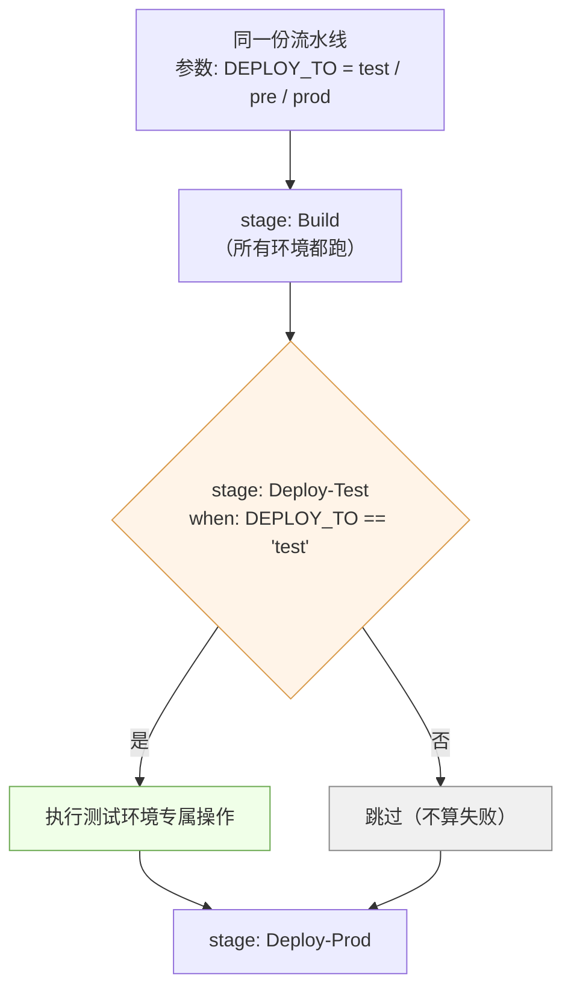
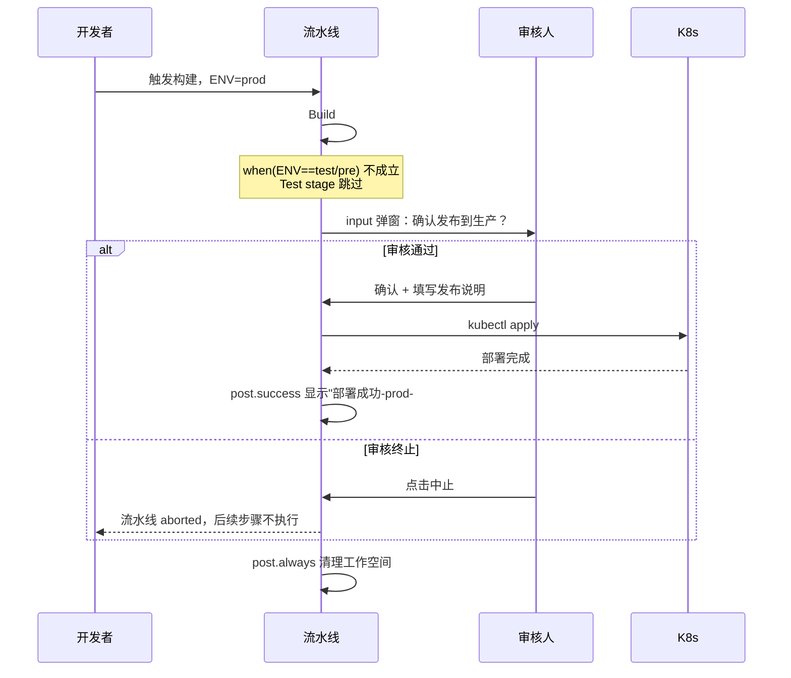

## 纲要

- **`when` 解决"这一步要不要执行"**：同一份流水线要部署测试/预发/生产多个环境，差异步骤靠 `when` 判断是否该跑
- **`anyOf` 是"或"逻辑**：多个条件中只要一个为真就执行；与之对应的还有 `allOf`（与）、`not`（非）、`expression`（Groovy 表达式）
- **三种条件写法**：`environment name/value`（比环境变量）、`equals expected/actual`（比两个值）、`expression { }`（任意 Groovy 表达式）
- **`when` 判断失败时步骤被"跳过"而非"失败"**：控制台该 stage 显示为空白/灰色，流水线整体仍算成功
- **`input` 是流水线里的人工闸门**：点确认才继续，点终止则整条流水线结束——生产发布的最后一道保险
- **`input` 能带参数**：审核时填的值会作为变量传给后续步骤（如发布版本号、发布原因）
- **`input` 可配超时**：超过设定时间没人审核，流水线自动终止，不会永久挂起占资源
- **生产必配 `input` 的场景**：生产环境部署、数据库变更、破坏性操作——凡是"不可逆"的步骤都该有人工确认

## 一、when：让同一份流水线服务多个环境

### 1.1 先看痛点

假设你的构建集成了**测试环境、预生产环境、生产环境**三个环境，构建时可以勾选部署哪一个。

问题来了：**三个环境共用一个流水线，可能会有一些差异性的问题。**

> 课件的例子：由于环境问题，**测试环境有一些操作是需要额外做的**，在某个 step 里要专门针对测试环境操作；而另外两个环境不需要这个操作。

**那要怎么判断这个操作应不应该执行？** 这就是 `when` 的用武之地。

> `when` 就是通过对你的变量进行判断，或者对你的一些参数进行判断。**当判断成功之后，再执行某些操作。** 这样就可以针对多个环境共用一个流水线，差异化的配置用 `when` 判断到底要不要执行。

**核心价值**：差异化逻辑被隔离在单个 stage 内，**不会影响其他环境的构建**。



### 1.2 `anyOf`：多个条件，一个为真即执行

**`anyOf` 就是在你多个条件的判断下，只要有一个条件为真，判断成功，它就会执行下面的 step 步骤。**

```groovy
pipeline {
    agent any
    environment {
        DEPLOY_TO = 'production'
    }
    stages {
        stage('Example Build') {
            steps {
                echo 'Hello World'
            }
        }
        stage('Example Deploy') {
            when {
                anyOf {
                    environment name: 'DEPLOY_TO', value: 'production'
                    expression { BRANCH_NAME ==~ /(production|master)/ }
                    expression {
                        return params.BUILD.NUMBER >= 1
                    }
                }
            }
            steps {
                echo 'Deploying'
            }
        }
    }
}
```

**三个条件分别是三种写法**：

| 条件 | 写法 | 含义 |
|---|---|---|
| ① | `environment name: 'DEPLOY_TO',value: 'production'` | 环境变量 `DEPLOY_TO` 等于 `production` |
| ② | `expression { BRANCH_NAME ==~ /(production|master)/ }` | Groovy 表达式：分支名匹配正则 `production` 或 `master` |
| ③ | `expression { return params.BUILD.NUMBER >= 1 }` | Groovy 表达式：**当前构建数 ≥ 1** |

**只要任一为真，`Deploying` 就会输出。**

课件实测三种情况：

- `DEPLOY_TO = production` → 条件①成立 → 输出 `Deploying`；
- 改成 `DEPLOY_TO = produces`（拼错）→ 条件①不成立，且当时构建号小于 100，条件③也不成立 → **该 stage 直接跳过，控制台显示空白**；
- 把条件③改成 `>= 1`，构建号是 3 → 条件③成立 → 即使条件①不成立，**照样输出** `Deploying`。

> **`expression` 里可以直接用内置变量**，比如 `BRANCH_NAME`、`params.BUILD.NUMBER`、`currentBuild.result` 等，这是 `when` 表达能力的关键。

### 1.3 `equals` 与 `not`：相等判断与非判断

```groovy
pipeline {
    agent any
    parameters {
        choice choices: ['master', 'pre', 'test'], name: 'build_branch'
    }
    stages {
        stage('deploy') {
            when {
                not {
                    equals expected: build_branch, actual: 'master'
                }
            }
            steps {
                echo "deploy success"
            }
        }
    }
}
```

**语义**：当 `build_branch` **不等于** `master` 时，才执行 `deploy success`。

- `equals expected: X,actual: Y`：比较两个值是否相等；
- `not { }`：取反。

课件实测：构建参数选 `test` → 不等于 `master` → 输出；选 `master` → 条件不成立 → **该 stage 被跳过，不执行**。

> **典型用途**：`not { equals ... 'master' }` 表达"非主干分支才执行某操作"，比写一堆嵌套更直观。

### 1.4 `when` 判断失败是"跳过"不是"失败"

这一点极其重要，新手常误解：

> 不匹配的话，那他下边就不会执行，他下边这个颜色不匹配……我们可以看到这边是一个空白的，**就是直接跳过，他没有帮我们执行**。

| 结果 | 表现 |
|---|---|
| `when` 条件不成立 | 该 stage **被跳过**，控制台对应区域空白/灰色，**流水线整体仍算成功** |
| stage 内命令执行失败 | 该 stage **失败**，流水线整体失败 |

打开 Blue Ocean 看更清楚：**这一步是直接跳过**——如果执行了，会绿色打勾或红色打叉。

**这个特性非常有用**：它让你能在一条流水线里安全地放"仅某环境需要"的步骤，而不会因为环境不匹配导致构建失败。

### 1.5 四种条件写法速查

| 写法 | 用途 |
|---|---|
| `environment name: 'X',value: 'Y'` | 判断环境变量是否等于某值 |
| `equals expected: X,actual: Y` | 判断两个值是否相等 |
| `expression { ... }` | 任意 Groovy 表达式，能力最强 |
| `not { ... }` | 对内部条件取反 |

**组合逻辑**：`anyOf { }`（或）、`allOf { }`（与）、可嵌套。

## 二、input：流水线里的人工审核闸门

### 2.1 它解决什么问题

**`input` 用于对你的构建进行一个提示，就是让你做一个审核。**

> 当你点击通过确认之后，它才会进行后面的构建。**如果你点击终止的话，那整个流水线就会终止不再执行了。**

**为什么需要它？** 因为有些操作是不可逆或高风险的——生产部署、数据库变更、删除资源。这些步骤**必须有人看一眼**，不能全自动跑完。

**`input` 就是流水线里的最后一道人工保险。**

### 2.2 标准写法

```groovy
pipeline {
    agent any
    stages {
        stage('Example') {
            input {
                message "这个构建你自已确认吗?"
                ok "是的，我确认."
                parameters {
                    string(name: 'PERSON',
                           defaultValue: '我要发布',
                           description: '你是为什么什么原因要构建呢?")
                }
            }
            steps {
                echo "Hello, ${PERSON}, nice to meet you."
            }
        }
    }
}
```

**四个字段**：

| 字段 | 作用 |
|---|---|
| `message` | **提示标题**，构建时会弹出（如"这个构建你自己确认吗？"） |
| `ok` | **确认按钮的文字**（如"是的，我确认"） |
| `parameters` | **审核时要填的参数**（可选） |
| `submitter` | 限定谁可以审核（可选，未在课件演示） |

### 2.3 input 能带参数，且参数可被后续使用

课件实测：审核弹窗里除了确认按钮，还有一个输入框（发布版本，默认值 `我要发布`）和描述（"你是什么原因要构建呢？"）。

**点确认后**，填的值会**赋值给参数名 `PERSON`**，后续 `steps` 里直接 `${PERSON}` 引用：

```text
控制台输出：Hello, 我要发布, nice to meet you.
```

**这个机制非常实用**：

- 让审核者**在审批的同时填写关键信息**（版本号、发布原因、工单号）；
- 这些信息可以写进 `currentBuild.description`，让构建页直接显示"这次发的是什么、为什么发"。

### 2.4 参数不是必填

课件演示了**把 `parameters` 那一行注释掉**的效果：

- 弹窗只剩标题和确认/终止按钮；
- 点确认后，后续步骤**不能引用 `${PERSON}`**——因为变量不存在了；
- 所以注释掉 `parameters` 时，**也要同步把引用该变量的代码注释掉**，否则报错。

### 2.5 点终止的后果

课件实测：点"中止"后：

- **整个流水线立即终止**；
- 后续步骤**全部不再执行**——包括后面的"清理工作空间"那一步；
- 构建结果标记为 `aborted`。

> **注意这个副作用**：终止会跳过所有后续步骤。如果 `post` 里配了 `always` 的清理逻辑，那还会执行；但如果清理是普通 step，就会被跳过。**生产环境建议把清理放 `post { always { } }`**，这样即使人工终止也能收尾。

### 2.6 input 配超时（生产建议）

课件提到：**我们还可以配置流水线超时，当你超过这么长时间还没有审核的话，流水线也会自动终止。**

```groovy
stage('Approve') {
    options {
        timeout(time: 30, unit: 'MINUTES')
    }
    steps {
        input {
            message "确认发布到生产环境?"
            ok "确认发布"
        }
    }
}
```

> **为什么重要**：没有超时的 `input` 会**永久挂起**，占着 executor 不释放。半夜挂一个没人点的审核，第二天早上就是一排僵尸构建。

## 三、when 与 input 的组合：生产发布的完整范式

```groovy
pipeline {
    agent any
    parameters {
        choice choices: ['test', 'pre', 'prod'], name: 'ENV'
    }
    stages {
        stage('Build') {
            steps { sh 'go build -o app ./...' }
        }
        stage('Test') {
            when {
                anyOf {
                    environment name: 'ENV', value: 'test'
                    environment name: 'ENV', value: 'pre'
                }
            }
            steps { sh 'go test ./...' }
        }
        stage('Approve') {
            when {
                environment name: 'ENV', value: 'prod'
            }
            steps {
                input {
                    message "确认发布到生产环境？"
                    ok "确认发布"
                    parameters {
                        string(name: 'RELEASE_NOTE', defaultValue: '', description: '发布说明')
                    }
                }
            }
        }
        stage('Deploy') {
            steps {
                sh "kubectl apply -f k8s/${ENV}/"
            }
        }
    }
    post {
        always { cleanWs() }
        success {
            script {
                currentBuild.displayName = "部署成功-${ENV}-#${BUILD_NUMBER}"
            }
        }
    }
}
```

**这段的逻辑**：测试/预发自动跑测试；**只有选 prod 时才弹出人工审核**；审核通过才部署；无论结果如何都清理工作空间。



## 四、常见报错与排查

| 现象 | 根因 | 解法 |
| --- | --- | --- |
| stage 没执行但流水线成功了 | `when` 条件不成立，被跳过 | **正常现象**，检查条件是否符合预期 |
| `${PERSON}` 报未定义 | 注释了 `parameters` 但没删引用 | 同步注释掉引用处 |
| `input` 弹窗不出现 | `input` 没放在 `steps` 内 | `input` 是 step，必须在 `steps { }` 里 |
| 点了中止后续清理没跑 | 清理写成了普通 step | 清理移到 `post { always { cleanWs() } }` |
| 构建一直挂在审核 | `input` 没配超时 | stage 加 `options { timeout(...) }` |
| `expression` 里取不到参数 | 参数名写错 | 用 `params.XXX` 访问构建参数 |
| 任何人都能审核生产 | 没配 `submitter` | 加 `submitter 'ops-team,lead'` 限定 |

## 五、面试考点与追问

**Q1：`when` 的作用？条件不成立时流水线会失败吗？**
`when` 用于按条件决定某个 stage 是否执行，是多环境共用一份流水线的关键。**条件不成立时该 stage 被跳过（不算失败）**，流水线整体仍可能成功。这与 stage 内命令失败有本质区别。

**Q2：`when` 支持哪些条件写法？**
`environment name/value`（比环境变量）、`equals expected/actual`（比两个值）、`expression { }`（任意 Groovy 表达式，能力最强）、`not { }`（取反）。组合逻辑用 `anyOf`（或）与 `allOf`（与）。

**Q3：`anyOf` 和 `allOf` 的区别？**
`anyOf` 是**或**——多个条件中只要一个为真就执行；`allOf` 是**与**——所有条件都为真才执行。两者可嵌套使用。

**Q4：`input` 的作用？为什么生产环境必须配？**
`input` 在流水线中插入人工审核点：点确认才继续，点终止则整条流水线结束（后续步骤不执行）。生产部署、数据库变更、破坏性操作不可逆，必须有人看一眼——这是防止误操作的最后一道保险。

**Q5：`input` 能带参数吗？有什么实际用途？**
能。审核弹窗可配 `parameters`（如 string 类型），审核者填写后该值作为变量传给后续步骤。实际用途：让审核者在审批同时填写发布版本、发布原因、工单号，并可写入 `currentBuild.description` 让构建页直接展示。

**Q6：`input` 不配超时会有什么问题？**
会**永久挂起**占着 executor 不释放。半夜挂一个没人点的审核，第二天就是一排僵尸构建。必须给 `input` 所在 stage 配 `timeout`，超时自动终止。另外人工终止会跳过后续所有普通 step，所以清理逻辑应放 `post { always { } }`。

## 📎 文本↔代码关联

本篇对应课件源码（`code/3-基础-Jenkins/`，已做去品牌化处理）：

| 代码文件 | 正文提及 | 内容 |
| --- | --- | --- |
| `code/3-基础-Jenkins/Jenkinsfile/Jenkinsfile-when语法2与input的使用` | 第 1.2 / 1.3 / 2.2 节 | `when { anyOf { ... } }` 三种条件 + `not { equals ... }` + `input` 带参数的完整示例 |
| `code/3-基础-Jenkins/课件/教学课件.md` | 第 1.2~1.5 / 2.2 节 | `when`（`anyOf`/`environment`/`expression`）、`not { equals }`、`input`（message/ok/parameters）标准语法 |
| `code/3-基础-Jenkins/Jenkinsfile/Jenkinsfile-流水线基础（基础课程所有笔记都在此文件）` | 第 2.6 节 | 含 `parameters`、`options`（timeout）与 `post` 的完整生产级模板 |

**技术点总结**：`when` 让一份流水线服务多环境——`anyOf`（或）/`allOf`（与）/`not`（非）配合 `environment`、`equals`、`expression` 三种条件写法；**关键特性是条件不成立时 stage 被跳过而非失败**，所以能安全放置环境专属步骤。`input` 是流水线里的人工审核闸门，点确认才继续、点终止则整条流水线 aborted；它可带参数让审核同时填写版本/原因，**但必须配超时**否则永久挂起占资源，且清理逻辑要放 `post { always { } }` 以应对人工终止。
