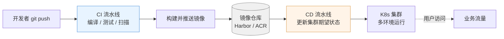
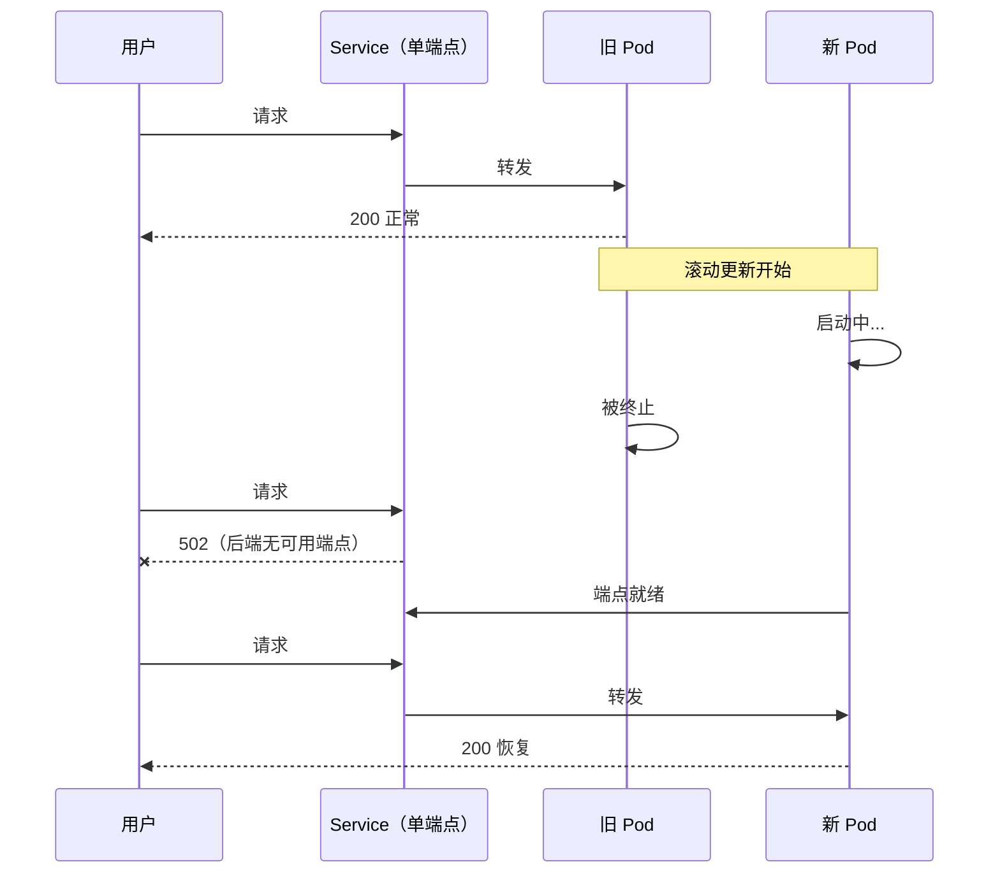
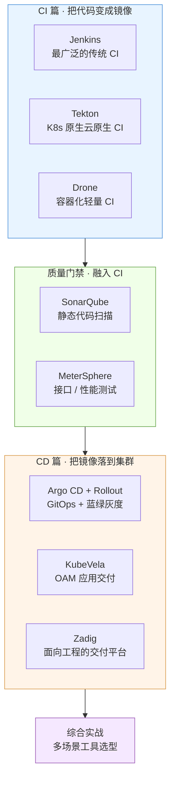

## 纲要

- **CI/CD 到底是什么**：持续集成解决"代码怎么安全地变成镜像"，持续交付解决"镜像怎么安全地落到集群"，两者合起来才是完整的交付链路
- **为什么必须上云原生 CI/CD**：纯 `kubectl apply` 的手工发布在多服务、多环境场景下会撞上四堵墙——YAML 散落难管理、单 Pod 滚动更新断连返回 502、回滚只能改镜像标签、发布过程无人可见
- **本课程的知识版图**：三套 CI 工具（Jenkins / Tekton / Drone）+ 两套质量门禁（SonarQube / MeterSphere）+ 三套 CD 工具（Argo CD / KubeVela / Zadig），最后用综合实战串成闭环
- **前置门槛只有一条**：Kubernetes。课程里所有流水线最终都落在 K8s 上运行，不懂 K8s 会被工具语法牵着走
- **一条正确的学习路径**：一次只吃透一个软件，看完视频必须过一遍官方文档，然后动手敲——只看不敲等于没学

## 一、先搞清楚：CI 和 CD 分别解决什么问题

很多初学者把 CI/CD 当成一个词，其实它是**两段独立但衔接的工作**。

**CI（Continuous Integration，持续集成）** 回答的问题是：*开发者提交的代码，如何自动地、可重复地变成一个可信的镜像？* 它的输入是源代码，输出是容器镜像，中间要跑编译、单元测试、代码扫描、镜像构建。

**CD（Continuous Delivery / Deployment，持续交付/部署）** 回答的问题是：*这个镜像，如何安全地部署到集群里的多个环境？* 它的输入是镜像，输出是运行中的服务，中间要处理环境差异、发布策略、流量切换、失败回滚。

两者的接缝就是**镜像仓库**：

> **一句话记住**：CI 管"从代码到制品"，CD 管"从制品到运行"。任何一边缺失，交付都是断的。

## 二、没有 CI/CD 时，你会撞上哪四堵墙

课程导学里抛出的问题非常典型，值得每个新手在装第一个工具之前就想明白。假设你直接用 `kubectl apply` 管理发布：

### 墙一：多服务 × 多环境的 YAML 怎么管？

公司里有十几个微服务，每个服务又要部署到开发、测试、预发、生产四套环境。如果每套环境的 YAML 都单独放一份，很快就会出现"改了测试环境忘了预发"的经典事故。**没有统一的配置管理，环境差异就是事故源。**

### 墙二：单 Pod 服务的滚动更新会断连

如果一个服务只有 **一个 Pod**，滚动更新的过程是：先起新 Pod → 等新 Pod Ready → 删旧 Pod。在"新 Pod 已就绪但旧 Pod 刚被删"的窗口里，Service 的后端端点会出现**短暂空窗**，用户请求直接拿到 **502**。

**解法不是没有**：把副本数调到 2 以上让滚动更新有缓冲、加就绪探针精细控制流量摘除、或者用蓝绿/灰度发布从流量层面彻底规避。这些正是课程后半段要讲的内容。

### 墙三：回滚只能"改镜像标签再 apply"

K8s 原生回滚的做法是：找到上一个版本的镜像 tag → 改 Deployment YAML → `kubectl apply`。听起来能跑，但三个问题很致命：

- **你得知道上一个版本是什么**——镜像 tag 如果是 `latest` 或者覆盖推送，历史就丢了；
- **改 YAML 是手工操作**——出故障时手抖改错字段，等于二次事故；
- **回滚过程不可见**——谁回滚的、什么时候回滚的、回滚到哪个版本，没有审计。

而 CI/CD 平台给的答案是：**发布记录即版本历史，回滚就是点一下按钮选中旧版本**。这是课程里 Argo CD 的核心价值。

### 墙四：发布过程是个黑盒

代码什么时候构建的？构建物是什么？测试过没有？谁批准上生产的？——纯手工发布下这些问题一个都答不上来。CI/CD 把发布变成**有记录、有门禁、可回溯**的工程活动。

## 三、本课程的知识版图

课程按"先 CI、再 CD、后实战"推进，覆盖的工具栈如下：

**三套 CI 工具不是重复，而是三种设计哲学**，对比着学收益最大：

| 工具 | 设计哲学 | 核心抽象 | 适合场景 |
| --- | --- | --- | --- |
| Jenkins | 插件生态 + 自由式灵活 | Job / Pipeline（Groovy DSL） | 存量项目、复杂历史包袱 |
| Tekton | K8s 原生 CRD | Task / Pipeline / TaskRun | 已全面容器化、想用 K8s 声明式管理流水线 |
| Drone | 容器即步骤 | Pipeline（YAML） | 轻量、与 Git 平台深度集成 |

**三套 CD 工具同理**：Argo CD 是 GitOps 事实标准，KubeVela 主打 OAM 应用模型，Zadig 更贴近工程团队的交付平台体验。

## 四、前置门槛：只有 K8s 这一条

课程明确要求**先把 Kubernetes 搞懂**，原因很直接：

- Tekton 的 Task/Pipeline 本身就是 **CRD**，不懂 K8s 自定义资源就读不懂 YAML；
- Jenkins 的动态 agent 要跑在 K8s Pod 上，涉及 SA、RBAC、PVC；
- Drone 的 Runner 是 K8s Deployment；
- Argo CD 干的就是"持续比对集群状态与 Git 声明"。

**不懂 K8s 学 CI/CD，等于不懂计算机网络学 HTTP 框架**——能抄配置，但排不了错。

## 五、学完你能拿到什么

按课程导学列出的能力清单，翻译成可验证的技能：

1. **用 GitOps 方式做服务管理与持续交付**——Git 仓库即唯一事实源，集群状态自动对齐；
2. **静态代码分析与缺陷检测落地**——SonarQube 质量门禁卡在流水线里，烂代码进不了主干；
3. **高级发布方式**——蓝绿发布、灰度发布、基于指标分析的自动回滚；
4. **CI/CD 全流程的构建与管理能力**——从触发、构建、测试、扫描到部署的完整链路；
5. **测试与性能评估能力**——MeterSphere 接口测试接入流水线；
6. **容器化构建与部署技能**——Docker / Kaniko 构建、镜像仓库管理。

## 六、给新手的学习建议（很实在，照做就行）

课程导学最后给了几条建议，我按重要性重排：

**① 一次只吃透一个软件，再碰下一个。** 课程涉及十几个软件，并行学必然混为一谈。Jenkins 没搞清楚之前看 Tekton，只会得出"都是 YAML 有什么不同"的错误结论。

**② 看完视频，必须过一遍官方文档。** 视频是压缩过的经验传递，官方文档才是完整语义。尤其是 Tekton 的 CRD 字段、Argo CD 的 Application spec，视频里讲的只是常用子集。

**③ 加社群、多交流。** CI/CD 的坑大量集中在环境细节（网络、存储类、权限），这些在文档里搜不到，但在别人踩过的坑里。

**④ 一定要动手敲，不能光看。** "看着会，一上手寸步难行"是这类工具课的通病。笔记和课件是参考，**自己敲出来的配置才是你的**。

## 七、这门课适合谁

- **开发人员**：想知道自己的代码怎么变成线上服务，想自己搭一条流水线；
- **运维 / SRE**：正在被手工发布折磨，想建标准化交付平台；
- **对云原生 CI/CD 感兴趣的人**：想系统入行，而不是碎片化收集命令。

## 八、面试考点与追问

**Q1：CI 和 CD 分别解决什么问题？两者的接缝是什么？**
CI（持续集成）回答"代码如何自动变成可信镜像"，输入源代码、输出容器镜像，中间跑编译、测试、扫描、构建；CD（持续交付/部署）回答"镜像如何安全落到集群"，输入镜像、输出运行中的服务，中间处理环境差异、发布策略、流量切换、回滚。**两者的接缝是镜像仓库**——这也是必须先学 CI 再学 CD 的原因。

**Q2：没有 CI/CD 时，手工发布会撞上哪几堵墙？**
四堵：① 配置与 YAML 散落难管理，多服务多环境下环境差异就是事故源；② 单 Pod 滚动更新有端点空窗，用户拿到 502；③ 回滚只能"改镜像 tag 再 apply"，历史易丢、手工易错、过程不可见；④ 发布是黑盒，无法回答"什么时候构建的、测过没、谁批准的"。

**Q3：什么是"可靠性部署"？**
指**在流水线中集成第三方测试工具**（代码扫描、接口测试、性能测试），构建过程中自动执行，**一旦发现问题流水线立即异常终止**，确保有问题的代码不会被打包成镜像、更不会部署到服务器。它是一套**机制**，不是某个具体工具的名字。

**Q4：为什么学云原生 CI/CD 必须先会 K8s？**
因为流水线的运行载体与部署目标都是 K8s：Tekton 的 Task/Pipeline 是 CRD，Jenkins 动态 agent 是 Pod，Drone Runner 是 Deployment，Argo CD 持续比对集群与 Git 声明。**不懂 K8s 就无法理解这些工具的设计，也无法排错**——能抄配置，但出问题定位不了。

**Q5：Git 在 CI/CD 里只用来存代码吗？**
不是。Git 同时承载**运维配置**（K8s YAML、Helm values、流水线定义）。这是 GitOps 的基础——**Git 是唯一事实源**，集群状态由工具自动对齐，人的变更通过 MR 进入，可 Review、可回溯、可回滚。

**Q6：三套 CI 工具（Jenkins/Tekton/Drone）的设计哲学差异？**
Jenkins 是插件帝国（主控节点 + 长驻 agent + Groovy DSL，生态最全但重）；Tekton 是 K8s 原生 CRD（Task 即 Pod、Pipeline 即 Task 编排，声明式可 GitOps）；Drone 是容器即步骤（每个 step 一个容器，YAML 简洁、与 Git 深度集成）。**三者不是替代关系，对比着学收益最大。**

**Q7：课程给新手的四条学习建议，你认为哪条最容易被忽视？**
最容易被忽视的是"**用不到的知识点也必须看得懂**"。技术选型因公司而异，现在用不到 `input`，下一家可能全靠它做审批；看不懂别人的 Jenkinsfile 就无法排查、无法 Review、无法接手维护。底线要求是"一眼认出这是干什么的、参数大概什么意思"，而不是精通每个细节。

## 📎 文本↔代码关联

本篇为课程导学，无配套代码。后续章节的代码统一放在 `code/` 目录，按章组织：

- `code/3-基础-Jenkins/`、`code/4-进阶-Jenkins/`、`code/5-实战-Jenkins/`：Jenkins 的 Jenkinsfile 与部署清单
- `code/6-Tekton/`：Tekton 的 task / pipeline / trigger 等 CRD 清单
- `code/7-Drone/`：Drone 的 `.drone.yml` 流水线定义
- `code/8-Kubevela/`：KubeVela 的 Application 与 CUE 定义
- `code/9-Zadig/`：Zadig 的安装脚本与模板
- `code/10-Argocd/`：Argo CD 的 Application、灰度蓝绿与流量分析配置

**技术点总结**：CI 负责"代码 → 镜像"，CD 负责"镜像 → 运行"，两者以镜像仓库为接缝；纯手工 `kubectl apply` 会撞上配置难管、单 Pod 断连 502、回滚靠改标签、过程黑盒四堵墙，而 CI/CD 平台用流水线、门禁、GitOps 和高级发布策略逐一破解。
