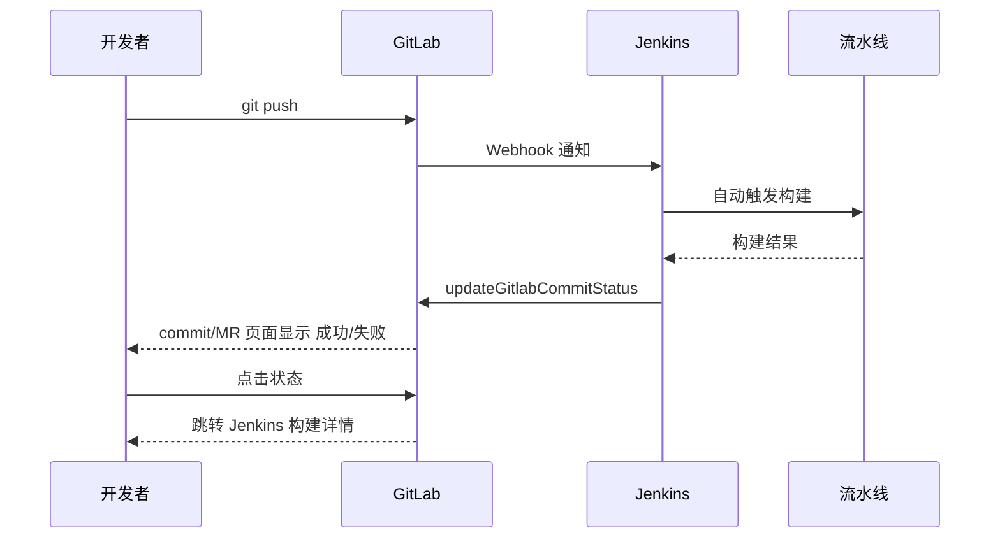
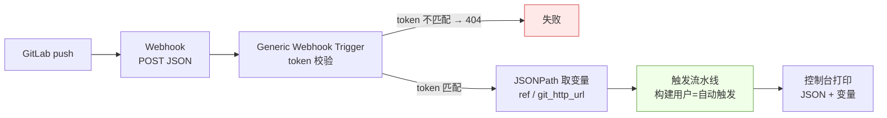

## 纲要

- **状态回写让 GitLab 成为交付看板**：构建成功/失败/取消直接显示在 GitLab 的 commit 与 MR 页面，点一下跳转 Jenkins 日志——不用两边切换
- **回写链路六步**：GitLab 建 API token → Jenkins 装 GitLab 插件 → 凭据管理加 `GitLab API token` → 系统配置加 GitLab 连接 → 流水线配 `gitLabConnection('同名')` → `post` 里 `updateGitlabCommitStatus`
- **`gitLabConnection('名称')` 必须与系统配置里的连接名完全一致**，差一个字符就静默失效（不报错但就是不回写）
- **`updateGitlabCommitStatus` 的四种状态**：`success` / `failed` / `canceled` / `running`，分别配在 `post` 各条件块
- **状态回写的前提是注释掉 `skipDefaultCheckout()`**——不自动拉分支代码就拿不到 commit 上下文
- **Webhook 让推送即构建**：GitLab push → 调 Jenkins generic-webhook-trigger → 自动触发流水线
- **生成器产出的 DSL 可能有 bug**：`genericTrigger` 外层少一个括号，直接抄会报错——必须查插件帮助页验证
- **token 必须两端一致**：Jenkins 触发器里配的 token 与 GitLab webhook URL 里的 `?token=` 不匹配会返回 404
- **多分支状态回写的正解是多分支流水线**：给每个分支手工建构建不可持续

## 一、为什么要做 GitLab 集成

构建完成之后，Jenkins 会显示成功/失败/终止状态。但这个状态**只存在于 Jenkins**——开发在 GitLab 上提了 MR，想知道 CI 过没过，还得切到 Jenkins 翻。

**集成的价值**：把构建状态**回写到 GitLab**，让 GitLab 仓库页面也能看到构建状态：

- commit 页面显示 ✅ / ❌，**点击直接跳到 Jenkins 构建**；
- MR 页面能看到流水线状态，不用离开 GitLab 做合并决策；
- 分支、commit id、阶段信息一目了然。



**两条链路的分工**：

| 链路 | 方向 | 作用 |
|---|---|---|
| **状态回写** | Jenkins → GitLab | 让 GitLab 看到构建结果 |
| **Webhook 触发** | GitLab → Jenkins | 让 push 自动触发构建 |

两条一起配，才形成"**push → 自动构建 → 状态回写 → MR 可见**"的完整闭环。

## 二、链路一：GitLab 构建状态回写

### 2.1 链路总览

```text
① GitLab 建 API token
      ↓
② Jenkins 装 GitLab 插件
      ↓
③ Jenkins 凭据管理添加「GitLab API token」类型
      ↓
④ Jenkins 系统配置添加 GitLab 连接（名称 + URL + 选凭据）→ Test 连接
      ↓
⑤ 流水线 options 配 gitLabConnection('同名')
      ↓
⑥ 流水线 post 里 updateGitlabCommitStatus 更新状态
```

### 2.2 ① GitLab 建访问令牌

**头像 → 偏好设置 → 访问令牌（Access Tokens）→ 添加新令牌**：

| 字段 | 填法 |
|---|---|
| 令牌名称 | 随意（如 `jenkins-ci`） |
| 到期时间 | **可以不选**（不选即永不过期） |
| 勾选权限 | **`api`（对 API 的完全读写访问权）** |

> **只勾 `api` 就够了**，其他 scope 不用勾。创建后**立刻复制 token**——离开页面后不再显示。

**令牌的作用范围**：个人访问令牌以创建者身份调用 GitLab API，所以 Jenkins 能用它更新该用户可见项目的 commit 状态。**生产建议用专门的机器人账号建令牌**，不要用个人账号（人离职令牌就失效了）。

### 2.3 ② 安装 GitLab 插件

**系统管理 → 插件管理 → 可选插件**，搜索 `GitLab`，安装。

> **这个插件是后续一切的前提**：没装它，凭据类型里根本不会出现 `GitLab API token`，系统配置里也不会有 GitLab 区块。

### 2.4 ③ 添加凭据

**系统管理 → 凭据管理 → 添加凭据**：

- 类型选 **`GitLab API token`**（**没装插件前这个类型不显示**）；
- **API token** 粘贴刚从 GitLab 复制的 token；
- **ID** 填一个（如 `gitlab-api-token`）；
- 描述随意；
- 创建。

### 2.5 ④ 系统配置添加 GitLab 连接

**系统管理 → 系统配置 → GitLab**：

| 字段 | 填法 |
|---|---|
| **Connection name**（连接名） | 随意起，如 `jenkins-gitlab`——**后面流水线里要用同一个名字** |
| **Gitlab host URL** | GitLab 地址 |
| **Credentials** | 选刚建的 `gitlab-api-token` |

填完点 **Test Connection**，显示连接成功再保存。

### 2.6 ⑤ 流水线配置连接名

```groovy
options {
    gitLabConnection('jenkins-gitlab')     // 必须与系统配置里的连接名一致
}
```

> **最常见的失败原因**：这里的名字和系统配置里的 Connection name 不一致。这是**静默失败**——不报错，但状态就是不回写，排查起来很费时间。

### 2.7 ⑥ 更新构建状态

在 `post` 里按结果更新 GitLab commit 状态：

```groovy
pipeline {
    agent any
    options {
        gitLabConnection('jenkins-gitlab')
        // 注意：skipDefaultCheckout() 必须注释掉！
    }
    stages {
        stage('Build') {
            steps { sh 'go build -o app ./...' }
        }
    }
    post {
        always {
            updateGitlabCommitStatus name: 'build', state: 'running'
        }
        success {
            updateGitlabCommitStatus name: 'build', state: 'success'
        }
        failure {
            updateGitlabCommitStatus name: 'build', state: 'failed'
        }
        aborted {
            updateGitlabCommitStatus name: 'build', state: 'canceled'
        }
    }
}
```

**四种 state 取值**：

| state | 对应 post 块 | GitLab 页面显示 |
|---|---|---|
| `running` | 构建中（可放 `always` 或流水线开头） | 运行中 |
| `success` | `success` | ✅ 已通过 |
| `failed` | `failure` | ❌ 失败 |
| `canceled` | `aborted` | 已取消 |

> **`name` 字段**是这次状态更新的名称，会显示在 GitLab 上（如 `build`）。可以给不同阶段用不同 name（`build` / `test` / `deploy`），GitLab 上就能分别看到各阶段状态。

### 2.8 效果与关键前提

构建完成后去 GitLab 仓库查看，**commit 页面显示"已通过"状态**，点击跳转到 Jenkins 流水线页面，能看到：

- **作业（Job）**
- **分支**
- **commit id**
- **哪个阶段**

再点可跳蓝海项目。

**关键前提（极易踩坑）**：**必须把 `skipDefaultCheckout()` 注释掉**。

> 课件原话：**在构建的时候，必须要让它自动去拉取你当前分支的代码，它才会显示出这个状态。如果说我们把这个注释打开的话，它就不会自动帮我们去拉这个代码下来，那它就没有办法去更新 Jenkins 这个状态到 GitLab。**

**根因**：`updateGitlabCommitStatus` 需要知道"这次构建对应哪个仓库的哪个 commit"，这个信息来自 Jenkins 自动拉取 SCM 代码时获得的 Git 元数据。打开 `skipDefaultCheckout()` 后不自动拉，就拿不到 commit 上下文，自然无法回写。

**多分支的限制**：如果 Jenkins 只配了 `main` 分支的 Jenkinsfile，那**只有 main 分支能看到状态**，切到 test 分支就看不到了。

> 解法有两种：① 给每个分支建一个构建、指定对应分支的 Jenkinsfile（**不可持续**，分支一多就要手工建一堆，还容易漏）；② **用多分支流水线自动扫描分支并自动创建构建**（推荐，前面已讲）。

### 2.9 状态回写的生产价值

| 场景 | 没有状态回写 | 有状态回写 |
|---|---|---|
| MR 合并决策 | 要去 Jenkins 翻构建记录 | MR 页面直接看 ✅/❌ |
| 谁弄挂了主干 | 查 Jenkins 日志 | commit 上直接看到 ❌ 与责任人 |
| 发布评审 | 口头问"测过没" | commit 状态即证据 |
| 分支保护 | 靠人守规矩 | GitLab 可配"必须 CI 通过才允许合并" |

> **最后一条是关键**：有了 commit 状态，GitLab 的 **Protected Branch + 必须通过 CI** 才能真正生效——这是把"质量门禁"从口头约定变成强制约束的唯一途径。

## 三、链路二：Webhook 触发自动构建

### 3.1 它解决什么问题

当我们在提交代码的时候，希望**提交之后通过 Webhook 触发对应的 Jenkins 项目自动构建**，减少人工手动构建，提高开发与部署效率。

**没有 Webhook**：开发 push 完要手动去 Jenkins 点构建——忘点就漏构建，派人盯不现实。
**有了 Webhook**：push 即构建，全程无人干预，且**触达率 100%**。

### 3.2 安装插件

**系统管理 → 插件管理 → 可选插件**，搜索 **`Generic Webhook Trigger`**，安装。

> 只有装好这个插件，流水线的 `triggers` 里才会出现"通用 Webhook 触发器"选项。

### 3.3 生成触发器 DSL（推荐用生成器）

**流水线语法（Pipeline Syntax）→ Snippet Generator → 触发器 → 选 `Generic Webhook Trigger`**。

配置项：

| 配置 | 值 | 说明 |
|---|---|---|
| **Token** | `ABC-123`（随意起） | **让 GitLab 有权限访问 Jenkins 的凭证**，两端必须一致 |
| **Request content parameters / variables** | 添加变量，用 **JSONPath** 取值 | 如 `$.ref` 取分支、`$.project.git_http_url` 取仓库 URL |
| **Print contributed variables** | ✅ 勾选 | 把变量打印到控制台 |
| **Print post content** | ✅ 勾选 | 把请求的 JSON 内容打印到控制台 |
| **正则过滤**（可选） | `^(refs/heads/(main\|test))` | 只有匹配的分支才触发 |

生成的 DSL：

```groovy
triggers {
    genericTrigger(
        causeString: 'Triggered by $ref',
        genericVariables: [
            [key: 'ref', value: '$.ref'],
            [key: 'git_http_url', value: '$.project.git_http_url']
        ],
        token: 'ABC-123',
        printContributedVariables: true,
        printPostContent: true,
        regexpFilterText: '$ref',
        regexpFilterExpression: '^(refs/heads/(main|test))'
    )
}
```

### 3.4 最大的坑：生成器产出的 DSL 少一个括号

课件里专门强调了这个坑：

> 我们可以看到上面的这一个触发器配置，跟下边的这个触发器配置是不是**少了一个小括号**？我之前在配置的时候，我也是用这个配置，在构建的时候就报错了。**所以说这个流水线语法在这边生成的 DSL 语法也并不一定是正确的。**

> 后来我查看了相关的插件帮助页面，说是我们这个配置**还要加上这个小括号才算正常**。

**即：`genericTrigger` 后面必须加 `()`，把里面所有内容包裹起来**，这样流水线语法才正确。

> **教训**：**生成器产出不等于一定正确**，尤其是插件类配置。抄完必须实际构建验证，必要时查插件帮助页。这是使用 Jenkins 生成器的基本纪律——生成器降低了记忆成本，但不免除验证责任。

### 3.5 在 GitLab 配 Webhook

**项目 → Settings → Webhooks → 添加新 Webhook**：

| 字段 | 填法 |
|---|---|
| **URL** | `http://<jenkins>/generic-webhook-trigger/invoke?token=ABC-123` |
| **Trigger** | 选 **推送事件（Push events）**（也可选合并事件、标签推送） |
| **分支过滤** | 用正则，多个分支用**竖线**分隔，如 `^(main\|test)$` |
| **SSL 验证** | **去掉勾选**（内网 http 时） |

> **URL 里的 token 必须与 Jenkins 触发器里配的 token 一致**，否则请求失败。

**JSONPath 速查**（调试时最有用）：

| 路径 | 取到 |
|---|---|
| `$.ref` | `refs/heads/main`（完整 ref） |
| `$.project.git_http_url` | 仓库 HTTP 地址 |
| `$.commits[0].id` | 最新 commit id |
| `$.user_name` | 推送者用户名 |

### 3.6 测试与验证

点 Webhook 的 **Test → Push events**：

| 返回 | 含义 |
|---|---|
| **404** | **失败**——最常见原因是 token 不匹配 |
| **200 / 成功** | 成功，Jenkins 自动触发一次构建 |

课件实测：第一次点测试返回 404，查下去发现是旧配置残留的 token 值不匹配，改成一致的 token 后**测试成功，流水线自动触发**。

**验证自动触发成功**：

- Jenkins 出现一次新构建，**构建用户显示"自动触发"**（不是手动点的）；
- 控制台能看到**打印出来的 JSON 内容与变量**（因为勾选了 `printPostContent` 和 `printContributedVariables`）。

### 3.7 变量是怎么取到的

勾选打印后，控制台会显示 GitLab 传来的完整 JSON。变量对应关系：

| 配置的变量 | JSONPath | JSON 里的位置 |
|---|---|---|
| `ref` | `$.ref` | 顶层 `ref` 字段，值是 `refs/heads/main` |
| `git_http_url` | `$.project.git_http_url` | `project` 对象下的 `git_http_url` 字段 |

**取这两个值的用途**：拿到分支与仓库地址，用于拉取**对应的仓库与分支**进行构建。



### 3.8 生产环境的安全加固

上面的配置是"能跑"，生产还要补三件事：

**① token 当密码管。** 它是 Jenkins 的唯一准入凭证，泄露意味着任何人都能触发你的构建。**不要用 `ABC-123` 这种弱 token**，定期轮换。

**② 加正则过滤，别让所有 push 都触发。** 配 `regexpFilterExpression` 限定只有 `main` / `release/*` 才触发，避免每个 feature 分支 push 都跑一遍完整流水线。

**③ 网络层收紧。** Jenkins 的 `/generic-webhook-trigger/invoke` 端点应对 GitLab 服务器 IP 白名单开放，不要暴露在公网。

## 四、生产级完整示例：两条链路一起配

```groovy
pipeline {
    agent any
    options {
        gitLabConnection('jenkins-gitlab')      // ① 状态回写连接
        // skipDefaultCheckout() 必须保持注释！
        buildDiscarder(logRotator(numToKeepStr: '20'))
        timestamps()
    }
    triggers {
        genericTrigger(                          // ② Webhook 触发
            causeString: 'Triggered by $ref',
            genericVariables: [
                [key: 'ref', value: '$.ref'],
                [key: 'git_http_url', value: '$.project.git_http_url']
            ],
            token: 'ABC-123',
            printContributedVariables: true,
            printPostContent: true,
            regexpFilterText: '$ref',
            regexpFilterExpression: '^(refs/heads/(main|release/.*))$'
        )
    }
    stages {
        stage('Build') {
            steps { sh 'go build -o app ./...' }
        }
        stage('Test') {
            steps { sh 'go test ./...' }
        }
    }
    post {
        success {
            updateGitlabCommitStatus name: 'ci', state: 'success'
        }
        failure {
            updateGitlabCommitStatus name: 'ci', state: 'failed'
        }
        aborted {
            updateGitlabCommitStatus name: 'ci', state: 'canceled'
        }
    }
}
```

**这段覆盖的生产要点**：状态回写连接 + Webhook 触发 + 分支正则过滤 + 构建历史保留 + 日志时间戳 + 三种终态回写。

### 4.1 与 GitLab MR 的深度配合

配好状态回写后，GitLab 侧还能进一步收紧流程。三个层层递进的配置：

**① Protected Branch + 必须 CI 通过。** 给 `main` 开分支保护，勾选"合并前必须通过 CI"。此时任何 MR 只要 commit 状态是 ❌，**合并按钮直接禁用**——质量门禁从"口头约定"变成"系统强制"。

**② MR Pipeline 只跑增量。** 给 MR 事件单独配一个轻量 pipeline（只跑 lint + 单测，不构建镜像、不部署），全量流水线留给 `main` 推送。这样 MR 反馈从分钟级降到秒级，开发愿意用，门禁才推得动。

**③ 多阶段状态分别回写。** 用不同 `name` 回写各阶段：

```groovy
stage('Build') {
    steps {
        updateGitlabCommitStatus name: 'build', state: 'running'
        sh 'go build -o app ./...'
        updateGitlabCommitStatus name: 'build', state: 'success'
    }
}
stage('Test') {
    steps {
        updateGitlabCommitStatus name: 'test', state: 'running'
        sh 'go test ./...'
        updateGitlabCommitStatus name: 'test', state: 'success'
    }
}
```

GitLab commit 页面会显示 `build ✅` / `test ✅` 两条独立状态，**哪一环挂了一眼定位**，不用进 Jenkins 翻日志。

> **推行顺序建议**：先上"状态回写 + Protected Branch"（收益最大、成本最低），再上 MR 轻量 pipeline，最后做多阶段分别回写。一上来就全配，团队适应成本高，容易半途而废。

## 五、常见报错与排查

| 现象 | 根因 | 解法 |
| --- | --- | --- |
| GitLab 页面看不到构建状态 | `gitLabConnection` 名称与系统配置不一致 | 核对两处名称完全相同 |
| 凭据类型里没有 GitLab API token | 没装 GitLab 插件 | 装插件后 `/restart` |
| Test Connection 失败 | URL 错或 token 无效 | 核对 URL 与 token 权限（需 `api`） |
| 状态回写不生效 | `skipDefaultCheckout()` 生效，没拉分支代码 | 注释掉 `skipDefaultCheckout()` |
| 只有 main 分支有状态 | 只配了 main 的 Jenkinsfile | 用多分支流水线，或给每分支建构建 |
| Webhook 测试返回 404 | **token 两端不一致** | 核对 Jenkins 触发器 token 与 URL `?token=` |
| `genericTrigger` 语法报错 | 生成器少产出外层括号 | `genericTrigger(...)` 补 `()` |
| 自动触发后变量为空 | 没勾 `printContributedVariables` | 勾选打印，对照 JSON 找路径 |
| 自动触发构建分支不对 | `regexpFilterExpression` 配错 | 检查正则与分支名 |
| 每个 feature 分支都触发完整流水线 | 没配正则过滤 | 加 `regexpFilterExpression` 限定分支 |
| 个人离职后状态回写全失效 | 用了个人账号的 token | 改用专用机器人账号建令牌 |

## 六、面试考点与追问

**Q1：Jenkins 构建状态回写 GitLab 的完整配置链路？**
① GitLab 建带 `api` 权限的访问令牌；② Jenkins 装 GitLab 插件；③ 凭据管理添加 `GitLab API token` 类型并粘贴 token；④ 系统配置添加 GitLab 连接（名称+URL+选凭据）并 Test Connection；⑤ 流水线 `options { gitLabConnection('同名') }`；⑥ `post` 里 `updateGitlabCommitStatus name: 'x',state: '...'`。**前提是注释掉 `skipDefaultCheckout()`**。

**Q2：`gitLabConnection('name')` 的 name 有约束吗？配错会怎样？**
必须与系统配置 → GitLab → Connection name **完全一致**。配错是**静默失败**——不报错，但状态就是不回写，这是最高频的排查难点。

**Q3：`updateGitlabCommitStatus` 支持哪些状态？分别对应什么场景？**
`running`（构建中）、`success`（成功，配 `post.success`）、`failed`（失败，配 `post.failure`）、`canceled`（取消，配 `post.aborted`）。`name` 字段可区分不同阶段（`build`/`test`/`deploy`），GitLab 上可分别查看。

**Q4：为什么状态回写要求注释掉 `skipDefaultCheckout()`？**
`updateGitlabCommitStatus` 需要知道"这次构建对应哪个仓库的哪个 commit"，该信息来自 Jenkins 自动拉取 SCM 代码时获得的 Git 元数据。打开 `skipDefaultCheckout()` 后不自动拉，就拿不到 commit 上下文，无法回写。

**Q5：Webhook 自动触发的完整链路？**
GitLab push → 调 Jenkins `/generic-webhook-trigger/invoke?token=XXX` → Generic Webhook Trigger 插件校验 token → 用 JSONPath 从请求体取变量（分支、仓库 URL）→ 触发对应流水线。**token 两端必须一致**，否则 404。

**Q6：为什么说"生成器产出的 DSL 不一定正确"？**
课件实战遇到 `genericTrigger` 生成的结果**少一个外层括号**，直接抄进流水线构建报错，查插件帮助页才发现要补 `()`。**纪律是：生成器产出必须实际构建验证**，不能假定正确。这适用于所有插件类配置——生成器降低记忆成本，但不免除验证责任。

**Q7：多分支都要显示构建状态，最佳方案是什么？**
用**多分支流水线**——它自动扫描仓库分支，发现分支里有 Jenkinsfile 就自动创建对应构建。给每个分支手工建构建不可持续（分支一多就要建一堆，且容易漏）。

**Q8：状态回写在生产环境的真正价值是什么？**
不只是"看得方便"，而是让 **GitLab 的分支保护能真正生效**——配置"必须 CI 通过才允许合并"后，质量门禁从口头约定变成强制约束。这是把 CI 接入研发流程的关键一环。

## 📎 文本↔代码关联

本篇对应课件源码（`code/3-基础-Jenkins/`，已做去品牌化处理）：

| 代码文件 | 正文提及 | 内容 |
| --- | --- | --- |
| `code/3-基础-Jenkins/Jenkinsfile/Jenkinsfile-将jenkins构建状态发送到GitLAB` | 第 2.7 节 | 含 `gitLabConnection` 与 `updateGitlabCommitStatus` 的状态回写流水线 |
| `code/3-基础-Jenkins/Jenkinsfile/Jenkinsfile-trigger使用` | 第 3.3 / 3.8 节 | `genericTrigger` 触发器配置，含 `genericVariables`（JSONPath）与 token |
| `code/3-基础-Jenkins/Jenkinsfile/Jenkinsfile-流水线基础（基础课程所有笔记都在此文件）` | 第四节 | 含 `triggers` / `options` / `parameters` / `environment` 的完整生产级模板，可与两条链路组合 |
| `code/3-基础-Jenkins/课件/教学课件.md` | 第 3.3 节 | `options` 标准语法与 JSONPath 取值示例 |

**技术点总结**：GitLab 集成两条链路——**状态回写**（GitLab 建 api token → Jenkins 装插件 → 加 `GitLab API token` 凭据 → 系统配置连接 → `gitLabConnection('同名')` + `post` 里 `updateGitlabCommitStatus`，前提是注释掉 `skipDefaultCheckout()`）与 **Webhook 触发**（装 Generic Webhook Trigger → 配 token 与 JSONPath 变量 → GitLab Webhook 填 `invoke?token=`）。三个致命坑：**连接名两端必须一致**（配错是静默失败）、**`genericTrigger` 生成器少产出外层括号必须手补**、**token 两端必须一致**（否则 404）。生产价值在于让 GitLab 分支保护的"必须 CI 通过"真正生效。
