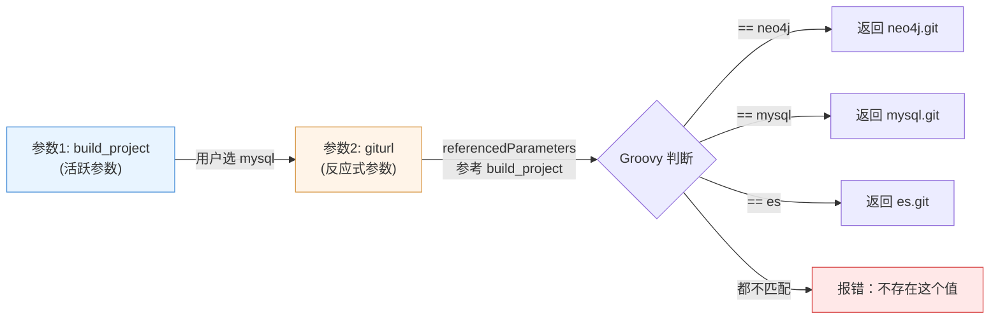

## 纲要

- **参数化构建让一条流水线服务多个场景**：选分支、选项目、传打包命令——构建前交互输入，值赋给变量供流水线引用
- **语法不用手写不用背**：全部用「流水线语法 → 参数」生成，**但必须会看**——看变量名、默认值就能判断类型
- **五种基础参数**：`string` 字符串、`text` 多行文本、`choice` 单选下拉、`boolean` 布尔、`password` 密码（控制台不显示）
- **扩展选择参数（Extended Choice）**：支持单选/多选/单选按钮/复选框/文本框，可控制显示数量与分隔符
- **时间参数（Date Parameter）**：默认值可用 `localDateNow` 直接取当前时间，免写脚本
- **活跃参数（Active Choice）**：用 Groovy 脚本动态返回选项列表，支持搜索过滤
- **反应式参数（Reactive Choice）**：**以上游参数值为参考**动态返回值——多项目共用一条流水线的关键
- **典型场景**：多个项目流水线逻辑相同，把项目名放第一个参数，第二个参数根据项目名返回对应仓库地址
- **脚本类参数要勾"加入沙盒"**，否则执行受限

## 一、参数化构建解决什么问题

在构建过程当中，**我们需要选择不同的构建参数来满足需求**。

典型诉求：

- 构建 **test / pre / master** 哪个分支？
- 打包用什么命令？
- 部署到哪个环境？
- 构建哪个项目？

**做法**：构建前在页面输入/选择值 → 值赋给某个变量 → 流水线里引用这个变量。

```groovy
stage('Deploy') {
    steps {
        echo "部署分支: ${build_branch}"
        sh "kubectl apply -f k8s/${ENV}/"
    }
}
```

## 二、五种基础参数

> **重要认知**：这些语法**不是手写的，也不要去死记硬背**——用「流水线语法 → 参数」生成即可。
> **但必须会看**：通过变量名、默认值判断它是哪种类型参数。看得懂，是底线要求。

### 2.1 string（字符串）

```groovy
string defaultValue: 'peter', name: 'name'
```

构建时提供一个输入框，可修改。课件实测：默认 `peter`，改成 `napeter` 后构建，输出成功。

### 2.2 text（文本）

```groovy
text defaultValue: '', name: 'description'
```

**可以输入多行**，构建时提供一个文本框，可随意输出多行内容。

### 2.3 choice（选项）

```groovy
choice choices: ['master', 'pre', 'test'], name: 'build_branch'
```

构建时提供**下拉框，只能选一个**。**每行一个选项，第一行是默认选项**。

### 2.4 boolean（布尔）

```groovy
booleanParam defaultValue: true, name: 'debug_build'
```

只有 `true` / `false` 两种。勾上=true，不勾=false。

### 2.5 password（密码）

```groovy
password defaultValue: 'secret', name: 'credential'
```

**在控制台上输入是看不到的**——控件做了隐藏。构建日志里也不会明文显示。

### 2.6 五种参数速查

| 类型 | 生成语法关键字 | 控件 | 备注 |
|---|---|---|---|
| 字符串 | `string` | 单行输入框 | |
| 文本 | `text` | 多行文本框 | |
| 选项 | `choice` | 下拉框 | 单选，第一行默认 |
| 布尔 | `booleanParam` | 复选框 | true/false |
| 密码 | `password` | 密码框 | **输入不可见** |

## 三、扩展选择参数（Extended Choice Plugin）

装 **Extended Choice Parameter** 插件后，参数类型大幅扩展：

| 参数类型 | 控件 |
|---|---|
| 单选下拉框（Single Select） | 只能选一个 |
| **多选（Multi Select）** | **按住 Ctrl 选多个** |
| 单选按钮（Radio Button） | 只能选一个 |
| **复选框（Check Box）** | 可多选 |
| 文本框（Text Box） | 直接输入 |

**两个实用配置**：

- **显示数量**：配 2 就只显示 2 个复选框，其余要拉滚动条；
- **值分隔符**：配逗号，多选值就以逗号分隔（如 `A,B`）。

课件实测：配 `A,B,C,D,E` 五个值、逗号分隔、显示 2 个 → 页面只出 2 个复选框，多选 AA 和 BB → 输出 `AA,BB`。

## 四、时间参数（Date Parameter）

装 **Date Parameter** 插件。

**默认值可用 `localDateNow` 直接取当前时间**——这样就不需要再写 Groovy 脚本获取。

```groovy
// 生成器产出，默认值 localDateNow = 当前时间
```

还可以配**输出格式**（如只输出年月）。课件实测：构建后输出当前具体时间，格式可切换。

## 五、活跃参数与反应式参数（重点）

这两个是**多项目共用一条流水线**的核心手段。

### 5.1 先看需求

> 这种需求一般用在我有多个项目，但是我流水线的逻辑都是一样的。所以我可以把多个项目的名字放在第一个变量，然后通过不同的项目名来获取到不同的仓库，然后通过这个仓库来进行拉取代码、构建。

**即**：项目 A、B、C 的流水线逻辑完全相同，只有"仓库地址"不同。如果为每个项目建一条流水线，维护三份；用反应式参数，**一条流水线搞定**。

### 5.2 活跃参数（Active Choice）

装 **Active Choices** 插件。**用 Groovy 脚本动态返回选项列表**：

```groovy
activeChoice choiceType: 'PT_MULTI_SELECT',
    description: '这是一个构建项目',
    filterLength: 1, filterable: true,
    name: 'build_project',
    script: groovyScript(
        fallbackScript: [classpath: [], oldScript: '', sandbox: true, script: 'return ["error"]'],
        script: [classpath: [], oldScript: '', sandbox: true, script: 'return ["neo4j","mysql","es"]']
    )
```

| 配置 | 作用 |
|---|---|
| `choiceType` | `PT_MULTI_SELECT` 多选 / `PT_SINGLE_SELECT` 单选 / 单选按钮 / 复选框 |
| `filterLength` + `filterable` | **开搜索过滤**——选项多时输入字符才显示匹配项 |
| `script` | Groovy 脚本，`return` 选项数组 |
| `fallbackScript` | **脚本失败时执行的兜底脚本** |
| `sandbox` | 是否进沙盒 |

课件实测：返回 `["neo4j","mysql","es"]` → 页面列出三个项目，输入 `n` 搜索出 neo4j、输入 `m` 搜索出 mysql。

> **搜索过滤很实用**：项目多达几十个时，没有过滤的下拉框体验极差。

### 5.3 反应式参数（Reactive Choice）

**以上游参数的值作为参考**，动态决定自己的返回值：

```groovy
reactiveChoice choiceType: 'PT_SINGLE_SELECT',
    description: '这是一个 giturl 地址',
    filterLength: 1, filterable: false,
    name: 'giturl',
    referencedParameters: 'build_project',        // ← 参考上游参数
    script: groovyScript(
        fallbackScript: [...],
        script: [classpath: [], oldScript: '', sandbox: true, script:
            '''if (build_project.equals("neo4j")){
                return ["http://neo4j.git"]
            } else if (build_project.equals("mysql")){
                return ["http://mysql.git"]
            } '''']
    )
```

**工作流程**：



**课件实测现象**：选 `neo4j` → `giturl` 返回 neo4j 仓库；选 `mysql` → 返回 mysql 仓库；**选一个脚本里没判断的值 → 直接报错"不存在这个值"**。

> **所以脚本必须覆盖所有可能取值**，或用 `else` 兜底。漏一个值就是一次构建失败。

### 5.4 完整落地：多项目共用流水线

```groovy
pipeline {
    agent any
    parameters {
        activeChoice choiceType: 'PT_SINGLE_SELECT', name: 'build_project',
            script: groovyScript(script: [script: 'return ["neo4j","mysql","es"]'])
        reactiveChoice choiceType: 'PT_SINGLE_SELECT', name: 'giturl',
            referencedParameters: 'build_project',
            script: groovyScript(script: [script:
                '''if (build_project.equals("neo4j")) return ["http://neo4j.git"]
                   else if (build_project.equals("mysql")) return ["http://mysql.git"]
                   else if (build_project.equals("es")) return ["http://es.git"]
                   else return ["error"]'''])
    }
    stages {
        stage('Checkout') {
            steps {
                checkout([$class: 'GitSCM',
                    userRemoteConfigs: [[url: "${giturl}"]]])
            }
        }
        stage('Build') {
            steps { sh 'go build -o app ./...' }
        }
    }
}
```

**效果**：选项目 → 自动带出仓库地址 → 拉对应代码 → 构建。**一条流水线服务 N 个项目，新增项目只改脚本里的数组，不动流水线结构。**

### 5.5 参数与 `when` 配合：按环境走不同分支

参数的价值不只是"传值"，配合 `when` 能做**流程级分支**：

```groovy
pipeline {
    agent any
    parameters {
        choice choices: ['test', 'pre', 'prod'], name: 'ENV'
    }
    stages {
        stage('Build') { steps { sh 'go build -o app ./...' } }
        stage('Test') {
            when { anyOf { environment name: 'ENV', value: 'test'
                           environment name: 'ENV', value: 'pre' } }
            steps { sh 'go test ./...' }
        }
        stage('Approve') {
            when { environment name: 'ENV', value: 'prod' }
            steps {
                input {
                    message "确认发布到生产环境？"
                    ok "确认发布"
                    parameters {
                        string(name: 'RELEASE_NOTE', defaultValue: '', description: '发布说明')
                    }
                }
            }
        }
        stage('Deploy') {
            steps { sh "kubectl apply -f k8s/${ENV}/" }
        }
    }
}
```

**三段式控制**：测试/预发自动跑测试；**只有选 prod 才弹人工审核**；部署目录由参数动态决定。**一条流水线覆盖三个环境，且生产有人工闸门**——这是参数化最经典的组合用法。

### 5.6 参数化 + 共享库：把常用参数模板化

如果每个项目的参数结构类似，可以把参数定义也抽进共享库：

```groovy
// vars/standardParams.groovy
def call(body) {
    pipelineParams = [
        choice(choices: ['test', 'pre', 'prod'], name: 'ENV', description: '部署环境'),
        string(defaultValue: '', name: 'GIT_URL', description: '仓库地址'),
        booleanParam(defaultValue: false, name: 'SKIP_TEST', description: '跳过测试')
    ]
}
```

好处：**参数规范由平台统一管控**，不会出现"A 项目用 `ENV`、B 项目用 `env`"的混乱。

### 5.7 生产使用参数的四条纪律

| 纪律 | 原因 |
|---|---|
| **参数名全大写且语义明确** | `ENV` / `GIT_URL`，避免与局部变量混淆 |
| **默认值必须安全** | 默认 `test` 而非 `prod`，防止手滑直接发生产 |
| **敏感值用 `password` 类型** | 控制台不显示、日志不明文 |
| **参数必填项要校验** | 空值进入流水线应在第一步就 fail fast，别等到部署才报错 |

> **最后一条最容易被忽略**：参数给了默认空串，用户不填就直接往下跑，往往到 `kubectl apply` 才因空路径报错，浪费时间。**在流水线第一步校验参数完整性，是最划算的投资。**

```groovy
stage('Validate') {
    steps {
        script {
            if (!params.ENV?.trim()) {
                error("ENV 参数不能为空")
            }
            if (!params.GIT_URL?.startsWith('http')) {
                error("GIT_URL 格式不正确: ${params.GIT_URL}")
            }
        }
    }
}
```

### 5.8 参数化构建 vs 多分支流水线：别用错场景

两者都能实现"一套逻辑多场景复用"，但适用面不同：

| 维度 | 参数化构建 | 多分支流水线 |
|---|---|---|
| 触发方式 | **手动选参数** | **push 自动** |
| 场景区分 | 靠参数值（选 test/prod） | 靠**分支**（main/test） |
| 分支隔离 | 无（同一 Job 切参数） | **天然隔离**（每分支独立 Job） |
| GitLab 状态回写 | 只回写到触发那个 commit | **每分支各自回写** |
| 适合 | 一次性发布、人工决策 | **日常 CI、多人协作** |

**选型判据**：

- **日常开发提交流水线** → 多分支流水线（push 即构建，状态回写清晰）；
- **发布/运维操作流水线** → 参数化构建（要人选环境、要人审核、要传版本号）；
- **多项目共用一套构建逻辑** → 参数化 + 反应式参数（项目名→仓库地址）。

> **常见误用**：把日常 CI 做成参数化构建，要求开发每次手点"选分支"再构建——既失去了自动化，又容易忘。**参数化是给"需要人决策"的场景准备的，不是给"应该全自动"的场景准备的。**

### 5.9 从脚本触发参数化构建

参数化构建不只是页面上点，脚本同样能触发——这对"定时发布""批量发布"很有用：

```bash
# Jenkins CLI 带参数触发
java -jar jenkins-cli.jar -s http://jenkins.example.com -auth admin:pwd \
     build my-release-job \
     -p ENV=prod -p GIT_URL=http://gitlab.example.com/app.git -p SKIP_TEST=false
```

**注意 `-p` 的 key 必须是 `parameters { }` 里定义的参数名**，否则 Jenkins 忽略该参数用默认值。

**结合 crontab 做定时发布**：

```groovy
triggers {
    cron('H H(9-16)/2 * * 1-5')      // 工作日 9-16 点每 2 小时
}
```

配合 `when { environment name: 'ENV',value: 'test' }`，就能实现"工作时间自动部署测试环境、生产仍需人工触发"的混合策略。

## 六、常见报错与排查

| 现象 | 根因 | 解法 |
|---|--- --- | --- |
| 参数不显示 | `parameters { }` 块位置错 | 放 `pipeline` 层、`agent` 之后 |
| 密码框能看见 | 类型选错 | 用 `password` 类型 |
| choice 只有一个选项 | 每行一个配错 | `choices: ['a','b','c']`，第一个是默认 |
| 反应式参数报"不存在这个值" | **脚本没覆盖该取值** | 补判断分支或加 `else` 兜底 |
| 活跃参数选项不显示 | 脚本报错 | 配 `fallbackScript` 兜底 |
| 脚本类参数不生效 | 没勾"加入沙盒" | 勾选沙盒，或去脚本批准 |
| 选项太多难找 | 没开过滤 | `filterLength: 1,filterable: true` |
| 多选值挤在一起 | 没配分隔符 | 配逗号分隔 |

## 七、面试考点与追问

**Q1：参数化构建的价值？**
让一条流水线服务多个场景（分支、环境、项目、命令），构建前交互输入，值赋给变量供流水线引用。避免为每个场景复制一条流水线。

**Q2：五种基础参数类型？密码参数的特殊之处？**
`string`、`text`、`choice`、`booleanParam`、`password`。密码参数特殊在**控制台输入不可见**、日志不明文，适合传敏感值。

**Q3：这些参数的语法需要手写吗？怎么快速判断类型？**
**不需要手写**，用「流水线语法 → 参数」生成。判断类型看变量名与默认值——`booleanParam` 一看就是布尔，`choice` 有 `choices` 列表，`password` 有密码语义。**要求是看得懂，不是背得出。**

**Q4：活跃参数与反应式参数的区别？**
**活跃参数（Active Choice）**用 Groovy 脚本动态返回自己的选项列表；**反应式参数（Reactive Choice）**以上游参数值为参考（`referencedParameters`）动态返回值。前者独立，后者依赖。

**Q5：如何用一条流水线服务多个项目？**
项目名放第一个参数（活跃参数，脚本 `return ["proj1","proj2"]`），仓库地址放第二个参数（反应式参数，`referencedParameters` 指第一个，脚本按项目名 `return` 对应仓库）。新增项目只改脚本数组。

**Q6：反应式参数报"不存在这个值"怎么解？**
脚本没覆盖用户选的那个值。要么补齐所有分支，要么加 `else return ["默认值"]` 兜底。这是多选值场景的必然要求。

## 📎 文本↔代码关联

本篇对应课件源码（`code/4-进阶-Jenkins/`，已做去品牌化处理）：

| 代码文件 | 正文提及 | 内容 |
| --- | --- | --- |
| `code/4-进阶-Jenkins/Jenkinsfile/Jenkinsfile-参数化构建` | 第 5.3 / 5.4 节 | `activeChoice`（多选 + 过滤）+ `reactiveChoice`（`referencedParameters` 参考上游 + Groovy 判断返回仓库地址）完整示例 |
| `code/4-进阶-Jenkins/课件/教学课件.md` | 第二节 | 五种基础参数的标准语法与 `withEnv` / `environment` 用法 |
| `code/3-基础-Jenkins/Jenkinsfile/Jenkinsfile-流水线基础（基础课程所有笔记都在此文件）` | 第 5.4 节 | 含 `parameters { choice }` 与 `environment` 的生产级模板 |

**技术点总结**：参数化构建让一条流水线服务多场景，五种基础参数（string/text/choice/booleanParam/password）语法**全部由生成器产出，要求看得懂而非背得出**。扩展选择参数支持多选/复选框/文本框并可配显示数量与分隔符；时间参数默认值用 `localDateNow` 免写脚本。**活跃参数与反应式参数是"多项目共用一条流水线"的核心**——项目名做活跃参数、仓库地址做反应式参数（`referencedParameters` 参考上游），但**脚本必须覆盖所有取值**，否则报"不存在这个值"。
