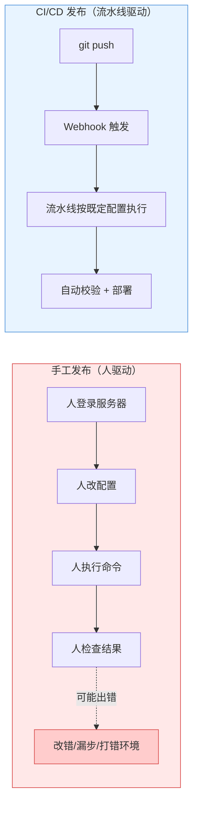
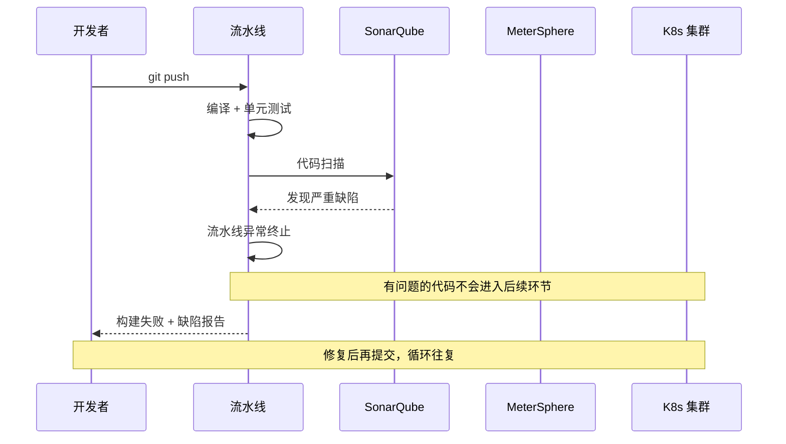
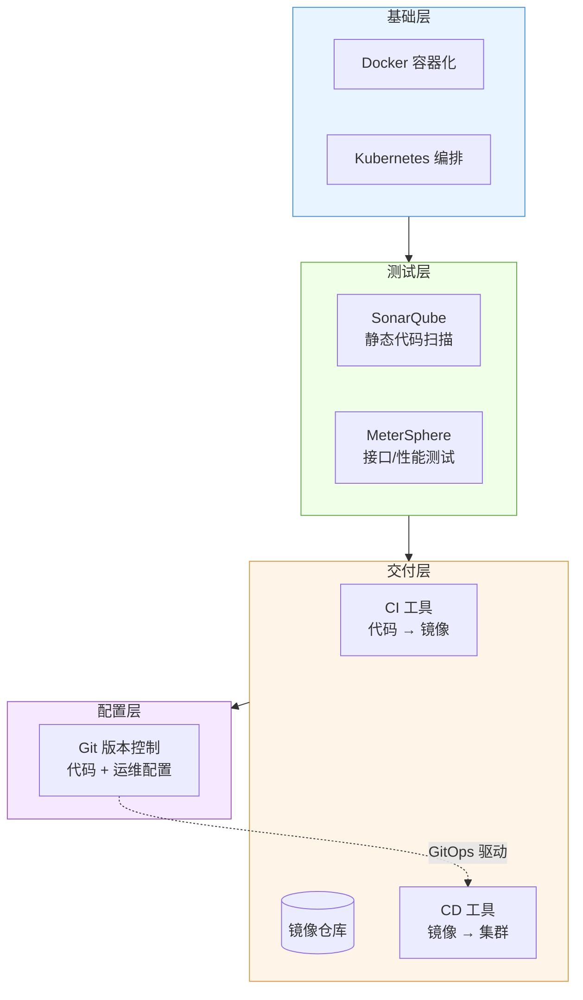

## 纲要

- **效率与错误率**：手工部署的低级错误（改错配置、操作错服务器）在自动化流水线里被结构性消除，人只负责写代码不看守发布
- **软件质量前置**：把 SonarQube 扫描、接口测试、性能测试嵌进流水线，问题在部署前就被拦下，而不是到线上才爆
- **响应速度**：一个 webhook 触发整条流水线，代码提交到新版本上线的周期从"天"压到"分钟"
- **四块技术版图**：容器基础（Docker + K8s）→ 测试平台 → CI/CD 工具 → 版本控制，四块齐了才算入门
- **"可靠性部署"的真实含义**：不是某个工具的名字，而是"流水线里集成第三方测试工具，发现问题就异常终止"的这套机制

## 一、先看反面：手工发布到底在浪费什么

很多团队对 CI/CD 的认知停留在"自动化部署，省事"。但如果只看到省事，就低估了它。我们先把手工发布的代价摊开。

**① 低级错误无法根除。** 人不是机器，重复操作必然出错。最常见的三类：

- **改错配置**：本该改测试环境，手滑改了生产；本该关调试开关，忘了关；
- **操作错服务器**：集群里十几台机器，`kubectl apply` 打到了错误的 namespace 或错误的集群；
- **步骤遗漏**：发版 checklist 有八项，做到第六项被拉去开会，回来接着做第七项——漏掉的那两项就是事故。

这些错误的共同点是：**不是能力问题，是注意力问题**。而注意力问题靠"再仔细点"是治不好的，只能靠**把人从重复操作里摘出去**。

**② 质量完全依赖人的自觉。** 手工发布时，跑不跑测试、扫不扫描代码，全看发布人记不记得。忙起来就容易跳过——而跳过的那次，往往就是出问题的那次。

**③ 反馈周期长到失真。** 代码提交后要等排期、等窗口、等人工执行，等真正上线可能已经过了几天。这时候如果发现问题，上下文早就丢了，定位成本成倍上升。

## 二、三个真实收益：CI/CD 到底改变了什么

### 收益一：提高开发效率，降低错误率

引入 CI/CD 之后，**流水线是完全自动化的**。从拉代码、编译、测试、打镜像、推仓库到部署，一条流水线跑完，人不需要在中间干预。

关键在于：**配置不再"临场改"，而是"事先写"**。所有配置——构建参数、部署目标、环境变量——都以代码形式固化在 `Jenkinsfile` / `Pipeline` YAML 里，进 Git 管理。发布时流水线读的是同一份配置，不存在"这次改一点、那次改一点"的漂移。



### 收益二：提升软件质量，而且是在部署之前

这是最容易被忽略、但价值最大的一点。CI/CD 的真正威力不是"自动"，而是**把质量门禁嵌进了流程**。

一条完整的流水线通常长这样：

```text
拉代码 → 编译 → 单元测试 → 代码扫描(SonarQube) → 接口测试(MeterSphere) → 构建镜像 → 推送仓库 → 部署到 K8s
                        ↑___________ 质量门禁区 ___________↑
```

**在质量门禁区里，任何一个环节失败，整条流水线立即异常终止**，有问题的代码根本不会被打包成镜像，更不会被部署到服务器上。

这意味着：**缺陷被发现的位置，从"线上"前移到了"提交后几分钟内"**。而缺陷发现得越早，修复成本越低——这是软件工程里被反复验证的规律。



### 收益三：快速响应变化

当开发修改了代码版本，**通过一个钩子（webhook）触发整条流水线自动运行**，快速迭代出新版本。开发只管提交代码，后续的构建、测试、部署全部自动完成。

这样一来，**整个产品周期、代码周期、更新迭代都会非常快**。今天改的需求，今天就能上线验证；线上发现问题，回滚或热修都能在分钟级完成。

> **一句话总结三个收益**：效率是"把人摘出来"，质量是"把门禁嵌进去"，速度是"把触发连起来"。

## 三、学习前的四块技术版图

课程开始前先给一张地图，避免学着学着迷路。云原生 CI/CD 涉及四块技术，缺一块都会卡住。

### 第一块：容器技术——Docker 与 K8s 是必须的基础

既然学的是**云原生** CI/CD，那么 **Docker 和 Kubernetes 就是必须要会的基础**，没有例外。

原因很直接：流水线的产物是**容器镜像**，部署的目标是**K8s 集群**。Tekton 的 Task/Pipeline 本身就是 K8s 的 CRD，Jenkins 的动态 agent 跑在 K8s Pod 上，Drone 的 Runner 是 K8s Deployment，Argo CD 干的就是"持续比对集群状态与 Git 声明"。**不懂 K8s，后面每个工具都只能抄配置、不能排错。**

### 第二块：测试平台工具——SonarQube 与 MeterSphere

课程会讲 **SonarQube**（静态代码扫描）和 **MeterSphere**（接口/性能测试），但不限于这两个。

这里要专门澄清一个概念：课程里提到的**"可靠性部署"，不是某个工具的名字，而是指"在流水线当中集成其他第三方测试工具"这套机制**。

```text
可靠性部署 = 流水线 + 质量门禁
            = 构建过程中自动跑代码扫描 / 接口测试 / 性能测试
            = 一旦发现问题 → 流水线异常终止
            = 有问题的代码不会被部署到服务器
```

### 第三块：CI 工具与 CD 工具——分工不同，别混为一谈

| 类型 | 职责 | 输入 → 输出 |
| --- | --- | --- |
| **持续集成工具（CI）** | 把代码打包成镜像，推送到镜像仓库 | 源代码 → 容器镜像 |
| **持续交付工具（CD）** | 利用 CI 打好的镜像，部署到 K8s 集群 | 容器镜像 → 运行中的服务 |

两者以**镜像仓库**为接缝。这也是为什么课程先讲 CI 再讲 CD——镜像还没构建出来，谈不上交付。

### 第四块：版本控制系统

版本控制系统（Git）不只是开发用来存代码的，**运维人员同样用它来存储相关的运维配置**。

这就是 GitOps 思想的根基：**Git 仓库是唯一事实源**。集群应该长什么样，写在 Git 里；实际长什么样，由 CD 工具持续对齐。人想改集群？先改 Git，提 MR，Review 通过后自动生效。



## 四、给新手的学习路径建议

理解了四块版图后，学习的顺序就自然浮现了：

**① 先夯实容器基础，不要跳过。** Docker 的镜像分层与构建、K8s 的核心对象（Pod/Deployment/Service/Ingress）与控制器模型，这是后面一切的地基。

**② 先学 CI，再学 CD。** 因为没有镜像就没有交付。CI 阶段把"代码怎么变成可信镜像"彻底搞懂，CD 阶段会轻松很多。

**③ 每学一个工具，配齐它的测试集成。** 单独学会"能跑流水线"是不够的，要把 SonarQube、MeterSphere 嵌进去，形成质量门禁，才算真正落地。

**④ 最后用 Git 把配置管起来。** 从"页面点配置"进化到"配置即代码"，这是从业余到专业的分界线。

## 五、面试考点与追问

**Q1：CI/CD 的核心价值是什么？只答"自动化"为什么不完整？**
只答自动化只看到了执行层。完整答案应包含三层：**效率**（把人从重复操作中摘除，消除注意力型错误）、**质量**（质量门禁前移，缺陷在部署前被拦截）、**速度**（webhook 触发，迭代周期从天到分钟）。自动化只是实现手段，不是目的。

**Q2：什么是"可靠性部署"？**
指在流水线中集成第三方测试工具（代码扫描、接口测试、性能测试），构建过程中自动执行，**一旦发现问题流水线立即异常终止**，确保有问题的代码不会被部署到服务器。它是一套机制，不是某个具体工具。

**Q3：CI 和 CD 的分工边界是什么？**
CI 的输入是源代码、输出是容器镜像，核心动作是编译、测试、扫描、构建、推仓库；CD 的输入是容器镜像、输出是运行中的服务，核心动作是环境差异管理、发布策略、流量切换、回滚。两者以镜像仓库为接缝。

**Q4：为什么学云原生 CI/CD 必须先会 K8s？**
因为流水线的运行载体和部署目标都是 K8s：Tekton 的 Task/Pipeline 是 CRD，Jenkins 动态 agent 是 Pod，Drone Runner 是 Deployment，Argo CD 持续比对集群与 Git 声明。不懂 K8s 就无法理解这些工具的设计，也无法排错。

**Q5：Git 在 CI/CD 里只用来存代码吗？**
不是。Git 同时承载**运维配置**（K8s YAML、Helm values、流水线定义）。这是 GitOps 的基础——Git 是唯一事实源，集群状态由工具自动对齐，人的变更通过 MR 进入，可 Review、可回溯。

## 📎 代码关联

本篇为方向与认知篇，无配套代码。后续章节的代码统一放在 `code/` 目录，按工具分章组织（`3-基础-Jenkins/`、`4-进阶-Jenkins/`、`5-实战-Jenkins/`、`6-Tekton/`、`7-Drone/`、`8-Kubevela/`、`9-Zadig/`、`10-Argocd/`）。

**技术点总结**：CI/CD 的价值是三层的——效率上把人从重复发布中摘除、质量上把门禁嵌进流水线让缺陷在部署前终止、速度上用 webhook 把提交与上线连起来；学习前需备齐四块版图（Docker+K8s 基础、SonarQube/MeterSphere 测试平台、CI/CD 工具、Git 版本控制），其中"可靠性部署"指的是流水线集成测试工具并在失败时异常终止的机制，而非某个工具名。
