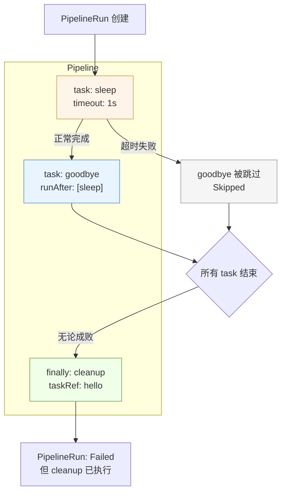
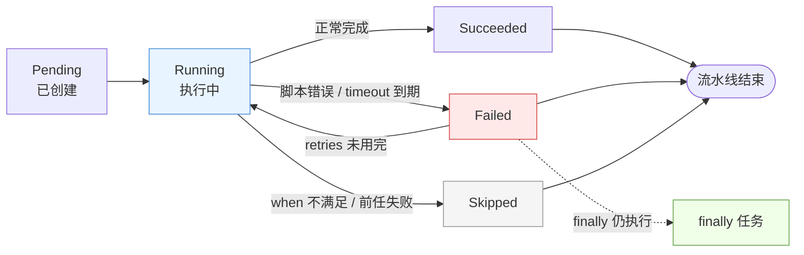

## 纲要

- **五件套各管一段生命周期**：`when` 管「要不要跑」、`timeout` 管「跑多久」、`retries` 管「失败重来」、`runAfter` 管「依赖谁」、`finally` 管「无论如何都收尾」
- **`when` 与 Jenkins 的 when 同款心智**：`input` + `operator` + `values` 三要素，条件不满足的步骤显示 `Skipped`，不阻塞流水线
- **`timeout` 是 task 级熔断**：超时的 TaskRun 标记失败，依赖它的后续步骤全部跳过，但 `finally` 照常执行
- **`retries` 只治瞬时抖动**：网络闪断、临时 5xx 值得重试；逻辑错误重试三次还是失败，且**每次重试都受 timeout 约束**
- **`runAfter` 是唯一推荐的显式依赖**：不写就并行，依赖链上前任失败后任直接跳过
- **`finally` = Jenkins post always**：报警通知、清理工作空间这类「成败都要做」的动作必须放这里

## 一、场景引入：流水线不是「一条道跑到黑」

前面我们把 Task 编排成了 Pipeline，但那样画出来的产线是「死」的：每个 Task 无条件执行、无限期等待、失败即整体崩盘。真实生产要的是「活」的流程控制：

- **条件跳过**：只在发布 tag 上才执行部署步骤，普通 push 跳过——这是 `when`；
- **超时熔断**：某个 Task 卡死 10 分钟，不能无限占着集群资源——这是 `timeout`；
- **失败重试**：拉镜像时网络抖了一下，重试两次就成功，不该让整条流水线陪葬——这是 `retries`；
- **依赖编排**：测试必须等编译产物，部署必须等测试通过——这是 `runAfter`；
- **兜底收尾**：无论成败，报警要发、工作空间要清、临时资源要回收——这是 `finally`。

这五个字段全部写在 Pipeline 的 `spec.tasks[]`（`finally` 写在 `spec.finally`）上，是**声明式的流程控制**——不写一行 Groovy，纯 YAML 描述。这也是 Tekton 区别于 Jenkins 脚本式流水线的核心体验之一。

## 二、核心概念与原理

### 2.1 五件套全景图



对应关系一张表：

| 字段 | 位置 | 解决什么问题 | 不配的默认行为 |
| --- | --- | --- | --- |
| `when` | `tasks[]` / `finally[]` | 条件执行 | 无条件执行 |
| `timeout` | `tasks[]` | 超时熔断 | 永不超时，跑到天荒地老 |
| `retries` | `tasks[]` | 失败重试 | 失败一次即标记失败 |
| `runAfter` | `tasks[]` | 显式依赖 | 与所有 task 并行 |
| `finally` | `spec.finally[]` | 兜底收尾 | 无收尾动作 |

### 2.2 when：条件判断三要素

```yaml
- name: hello
  taskRef:
    name: hello
  when:
    - input: "foos"
      operator: "in"
      values: ["foos", "bar"]
```

- **`input`**：参与判断的值，可以是字面量，也可以是 `$(params.xxx)`、`$(tasks.<t>.results.<r>)` 这类变量；
- **`operator`**：比较运算符，常用 `in`（在列表中）、`notin`（不在列表中）；
- **`values`**：候选值列表。

语义是「`input` 的值命中 `values` 中的任意一个 → 执行，否则 → `Skipped`」。课件里把 `input` 改成不匹配的值时，Dashboard 上 `hello` 步骤显示**灰色暂挂/跳过**，`goodbye` 步骤正常执行——**被跳过的步骤不会阻塞流水线**，这是它和「失败」的本质区别。

### 2.3 timeout：task 级超时熔断

```yaml
- name: sleep
  timeout: 2s
  taskRef:
    name: sleep
```

`sleep` Task 内部 `sleep 5`，而这里 `timeout: 2s`——2 秒到期，Tekton 直接**取消**该 TaskRun 的 Pod，标记为 `TaskRunTimeout` 失败。课件实测现象：

- **配了 timeout 的步骤**：超时即取消，状态变红；
- **没配 timeout 的步骤**：`goodbye` 不管执行多久都不会被终止；
- **超时会传染**：超时步骤标记失败后，`runAfter` 它的后续步骤被跳过，整条流水线以 `Failed` 收场——**但 `finally` 仍然执行**。

 duration 字符串支持 `s` / `m` / `h` 组合，如 `30s`、`5m`、`1h30m`。

### 2.4 retries：失败重试

```yaml
- name: sleep
  timeout: 2s
  retries: 3
  taskRef:
    name: sleep
```

`retries: 3` 表示最多重试 3 次。课件这个组合很「魔鬼」但极具教学价值：Task 里 `sleep 5`，`timeout: 2s`——**每次尝试都会在 2 秒时超时**，于是重试 3 次、失败 3 次，最终该步骤标记失败。它揭示了两条规则：

1. **retries 与 timeout 是乘积关系**：重试 N 次，每次都是一个全新的、独立受 timeout 约束的执行；
2. **重试不拯救逻辑错误**：如果是编译报错、脚本写错，重试一万次也没用。retries 的正确战场是**瞬时故障**——网络闪断、镜像仓库 502、DNS 瞬时失败。

无依赖的后续步骤不受重试失败影响，照常执行——课件里 `goodbye` 在 `sleep` 三次重试全败后依然跑完，就是这个语义。

### 2.5 runAfter：显式依赖

```yaml
- name: goodbye
  taskRef:
    name: goodbye
  runAfter:
    - sleep
```

`runAfter` 的值是**步骤名数组**（`tasks[].name`），可配多个。语义：

- **不配 `runAfter`**：该 Task 与其他无依赖 Task 并行启动；
- **配了 `runAfter`**：等数组里所有步骤**成功完成**后才启动；前任失败 → 本步骤 `Skipped`。

Dashboard 上的直观差异：并行步骤的时钟同时出现；有依赖的步骤，时钟要等前任完成才现身。**生产上依赖关系一律显式写 `runAfter`**，不要靠「前一个 Task 写文件、后一个 Task 读文件」这种隐式数据依赖——文件没出现时后一个 Task 报的错很难排查。

### 2.6 finally：无论如何都收尾

```yaml
spec:
  tasks:
    - name: sleep
      taskRef:
        name: sleep
      timeout: 1s
    - name: goodbye
      taskRef:
        name: goodbye
      runAfter:
        - sleep
  finally:
    - name: cleanup
      taskRef:
        name: hello
```

`finally` 与 `tasks` **同级**，是独立的任务列表，支持 `taskRef` / `taskSpec` / `when` / `workspaces` 等全部字段。语义：

- **前面所有 tasks（含 finally 之外的被跳过步骤）都结束后，finally 才启动**——它是真正的「最后」；
- **无论前面成功、失败、超时、跳过，finally 都执行**；
- finally 里的 Task 自己失败，不会改变「已执行」的事实，但会让流水线状态更难看。

课件实测：`sleep` 1 秒超时失败 → `goodbye`（runAfter sleep）被跳过 → `cleanup`（finally）**照常执行**。这个「失败也要兜底」的能力，对应 Jenkins 的 `post { always { } }`，是报警通知和资源清理的标准位置。

## 三、动手实践：五个文件一次讲透

课件把五件套拆成了五个独立 Pipeline，建议按顺序 apply + 观察：

```bash
# 0. 前置：sleep / hello / goodbye 三个 Task 必须已存在
kubectl get task

# 1. when：条件跳过
kubectl apply -f pipeline/pipeline4-when.yaml

# 2. timeout：超时熔断
kubectl apply -f pipeline/pipeline5-timeout.yaml

# 3. retries：失败重试
kubectl apply -f pipeline/pipeline6-retries.yaml

# 4. runAfter：显式依赖
kubectl apply -f pipeline/pipeline7-runAfter.yaml

# 5. finally：兜底收尾
kubectl apply -f pipeline/pipeline8-finally.yaml
```

每个 Pipeline 都可以用前面的三种方式运行，调试期推荐 `tkn`：

```bash
tkn pipeline start pipeline-when
tkn pipelinerun logs -f
```

### 3.1 完整代码对照表

| 文件 | 演示字段 | 关键配置 | 预期现象 |
| --- | --- | --- | --- |
| `pipeline4-when.yaml` | `when` | `input: "foos"` / `operator: in` / `values: ["foos","bar"]` | 命中 → hello 执行；改成不命中值 → hello `Skipped`，goodbye 正常 |
| `pipeline5-timeout.yaml` | `timeout` | sleep 配 `timeout: 2s`，Task 内 `sleep 5` | 2 秒取消，TaskRun 失败；无超时限制的 goodbye 不受影响 |
| `pipeline6-retries.yaml` | `retries` | `timeout: 2s` + `retries: 3` | 每次 2 秒超时，重试 3 次全败；goodbye 并行不受影响 |
| `pipeline7-runAfter.yaml` | `runAfter` | goodbye `runAfter: [sleep]` | goodbye 等 sleep 成功后才启动；sleep 失败则 goodbye 跳过 |
| `pipeline8-finally.yaml` | `finally` | sleep `timeout: 1s` + finally cleanup | sleep 超时失败、goodbye 跳过，cleanup 仍然执行 |

五件套的最小样板（把上面所有字段合到一条流水线里长这样）：

```yaml
apiVersion: tekton.dev/v1beta1
kind: Pipeline
metadata:
  name: pipeline-all-controls
spec:
  tasks:
    - name: build
      taskRef:
        name: hello
      timeout: 10m        # 熔断：最多跑 10 分钟
      retries: 2          # 重试：瞬时故障自动重来
    - name: deploy
      taskRef:
        name: goodbye
      runAfter:           # 依赖：等 build 成功
        - build
      when:               # 条件：仅生产分支部署
        - input: "$(params.branch)"
          operator: in
          values: ["main", "release"]
  finally:
    - name: notify
      taskRef:
        name: hello       # 实际项目换成报警/通知 Task
```

### 3.2 观察状态的语言

```bash
# 看每个 TaskRun 的状态与原因
kubectl get taskrun

# 看 PipelineRun 的汇总状态
kubectl get pipelinerun

# 某个 TaskRun 的详细事件（超时/取消的原因在这里）
kubectl describe taskrun $NAME
```

状态机对照：



## 四、生产实践要点

### 4.1 报警与清理：finally 的两个标准用法

| 场景 | finally 里放什么 | 注意点 |
| --- | --- | --- |
| 构建失败报警 | 飞书/钉钉/企业微信 Webhook Task | 报警内容带 `$(params.git-url)`、`$(context.pipelineRun.name)` 定位 |
| 清理工作空间 | 删除临时文件/缓存目录 | 若用 VCT workspace，流水线结束卷自动回收，不必手动清 |
| 回收临时资源 | 删除调试用的 Pod/Service | 用 `$(context.pipelineRun.uid)` 做标签过滤，别误删正式资源 |
| 遗留锁释放 | 删除分布式锁 | 锁 Key 与 PipelineRun 名绑定，防止误删他人锁 |

### 4.2 timeout 的设置方法论

**拍脑袋设 timeout 是线上事故的常见来源**。推荐算法：

1. 统计该 Task 正常运行的 **P99 耗时**；
2. 乘 **1.5~2 倍**安全系数得到 task timeout；
3. 再在 PipelineRun 层设一个**总 timeout**（所有 task 之和 × 1.3），防止单 task 都没超时但整体卡死的场景；
4. 涉及外部依赖（拉大镜像、克隆大仓库）的步骤单独放宽，并优先用 `retries` 对抗抖动。

区分两个层级：**task 级 `timeout`** 管单个步骤；**PipelineRun 级**超时在 `spec.timeout` 或 Dashboard 创建时填写，管整条流水线。两个都配，task 级优先触发。

### 4.3 retries 的使用边界

- **值得重试**：镜像拉取失败（仓库抖动）、git clone 超时（网络闪断）、外部 API 5xx；
- **不该重试**：编译错误、测试断言失败、参数缺失——这些重试纯属浪费集群资源；
- **Tekton 没有内置退避间隔**：如果对方需要「冷却」，在 Task 脚本里加 `sleep $((RANDOM % 10))` 之类随机退避，避免多实例同时重试打挂下游；
- **重试会放大耗时**：`timeout × (retries + 1)` 是该步骤的最坏耗时，算资源配额时按这个上限申请。

### 4.4 when 的高级用法：与 results 联动

`when` 的 `input` 不限于参数，还可以引用**上游 Task 的输出结果**：

```yaml
- name: deploy
  taskRef:
    name: deploy-task
  runAfter:
    - test
  when:
    - input: "$(tasks.test.results.coverage)"
      operator: in
      values: ["pass"]
```

「单测通过才部署」「代码覆盖率达标的才发生产」这类门禁，靠的就是 `results` + `when` 的组合，不需要任何脚本判断。results 的完整用法在后续展开。

### 4.5 取消与删除：finally 的一个版本差异

生产中要中断一条跑偏的流水线，**优先删除 PipelineRun 资源**（`kubectl delete pipelinerun <name>`），而不是 `tkn pipelinerun cancel`——取消语义在各 Tekton 版本间有演进差异，而删除的行为始终明确。finally 的「必执行」保证的是**任务自然结束**（成功/失败/超时）后的兜底，这一点在所有版本中一致。

## 五、报错排查表

| 现象 | 根因 | 解法 |
| --- | --- | --- |
| 步骤显示 `Skipped`，流水线却是绿的 | `when` 条件不满足 | 检查 input 值与 values 列表；用 `$(params.xxx)` 时确认参数真的传进来了 |
| TaskRun 状态 `Failed`，原因 `TaskRunTimeout` | task `timeout` 到期 | 放宽 timeout 或优化 Task 本身耗时；`kubectl describe taskrun` 确认超时值 |
| 重试 3 次都失败 | 不是瞬时故障，或 timeout 短于任务耗时 | 看日志定位根因；`timeout × (retries+1)` 是否合理 |
| `runAfter` 的步骤一直不启动 | 前任还在跑或已失败 | `kubectl get taskrun` 看前任状态；前任失败时本步骤被跳过是预期行为 |
| `runAfter` 写错的步骤名 | 把 `taskRef.name` 当成了 `runAfter` 的值 | `runAfter` 要填 `tasks[].name`（步骤名），不是被引用的 Task 名 |
| finally 步骤没执行 | 整个 PipelineRun 被 cancel 而非自然结束；或 finally Task 自身配置错 | 改用 delete 终止流水线；`kubectl describe` 看 finally Task 的 Events |
| 流水线整体失败但finally 成功了，通知没发出去 | 报警 Task 里的 Webhook 地址/Secret 配错 | 单独跑一次报警 Task 验证；地址不要写死进镜像 |
| timeout 字符串解析报错 | 写了 `2sec` / `2s30` 这类非法格式 | 用合法 duration：`30s`、`5m`、`1h30m` |

## 六、面试考点与追问

**Q1：Tekton 控制 Task 执行方式的五个字段是什么？各自的作用？**
`when`（条件执行，不满足则 Skipped）、`timeout`（task 级超时熔断）、`retries`（失败重试次数）、`runAfter`（显式依赖，等前任成功）、`finally`（流水线收尾，无论成败都执行）。这五个全部声明式配置，无需脚本。

**Q2：`retries` 和 `timeout` 一起配会发生什么？**
两者是**乘积关系**：`retries: 3` + `timeout: 2s` 意味着最多 4 次尝试（1 次原始 + 3 次重试），每次独立受 2 秒超时约束。最坏耗时 = `timeout × (retries + 1)`。课件里 `sleep 5` 配 `timeout 2s` + `retries 3` 的结果就是四次全部超时失败。

**Q3：`finally` 和 Jenkins 的 `post { always { } }` 有什么区别？**
语义几乎一一对应：都是「无论前面成败都执行」。差异在于 Tekton 的 finally 是 `spec.finally[]` 任务列表，支持 taskRef/taskSpec/workspaces/when 全套字段，本质是普通 Task；Jenkins 的 post always 是脚本块。另外 finally 必须等**所有** tasks 结束后才启动，是真正的最后一步。

**Q4：一个 Task 失败了，整条流水线一定会失败吗？**
不一定。如果失败 Task 没有下游依赖，其他并行步骤照常完成；但 PipelineRun 的最终状态会是 `Failed`。若失败 Task 有 `runAfter` 它的下游，那些下游会被 `Skipped`；`finally` 不受影响照常执行。需要「允许失败不影响整体」时，应改造流程（如把非关键检查移到 finally 之外独立流水线），而不是指望 Tekton 自动容错。

**Q5：`runAfter` 可以配多个值吗？和 workspace 数据依赖相比有什么优势？**
可以，值是步骤名数组，等**所有**前任成功才启动。相比「用文件/workspace 传递做隐式依赖」，`runAfter` 是显式声明：顺序意图写在 YAML 里，评审可见；前任失败时语义明确（跳过而非报一个莫名的文件不存在错误）。

**Q6：如何实现「只在 main 分支部署、其他分支跳过」？**
部署 Task 配 `when`：`input: "$(params.branch)"`、`operator: in`、`values: ["main"]`。参数由 PipelineRun 传入（或触发器从 Webhook 事件提取）。比在脚本里写 `if [ "$branch" = main ]` 更声明式，Dashboard 上也直接可见跳过原因。

**Q7：task 级 timeout 和 PipelineRun 级 timeout 有什么区别？都该配吗？**
task 级管单个步骤，触发时该 TaskRun 取消、下游跳过、finally 执行；PipelineRun 级管整条流水线总时长，触发时整体终止。**都该配**：task 级防止单步骤卡死，PipelineRun 级防止「每步都不超时但整体无限跑」的叠加场景。

## 📎 文本↔代码关联

本篇对应课件源码（`code/6-Tekton/`，已做去品牌化处理）：

| 代码文件 | 正文提及 | 内容 |
| --- | --- | --- |
| `code/6-Tekton/pipeline/pipeline4-when.yaml` | 第 2.2、3.1 节 | `when` 条件判断：input/operator/values 三要素 |
| `code/6-Tekton/pipeline/pipeline5-timeout.yaml` | 第 2.3、3.1 节 | sleep Task 配 `timeout: 2s` 的超时熔断示例 |
| `code/6-Tekton/pipeline/pipeline6-retries.yaml` | 第 2.4、3.1 节 | `timeout: 2s` + `retries: 3` 的重试组合示例 |
| `code/6-Tekton/pipeline/pipeline7-runAfter.yaml` | 第 2.5、3.1 节 | goodbye `runAfter: [sleep]` 显式依赖示例 |
| `code/6-Tekton/pipeline/pipeline8-finally.yaml` | 第 2.6、3.1 节 | `spec.finally` 兜底收尾 + 前任超时失败的联动示例 |
| `code/6-Tekton/pipelinerun/pipelinerun2-all.yaml` | 第 3 节 | `pipelineSpec` 内联 PipelineRun，可直接改造用于五件套联调 |
| `code/6-Tekton/task/sleep-task.yaml` | 第 2.3、2.4 节 | 上述 Pipeline 引用的 `sleep` Task（`sleep 5`，用于制造超时/重试场景） |

**技术点总结**：Tekton 用五个声明式字段把流水线从「一条道跑到黑」变成「可条件、可熔断、可重试、可编排、可兜底」的生产级流程——**`when` 决定要不要跑、`timeout` 决定跑多久、`retries` 对抗瞬时故障、`runAfter` 表达显式依赖、`finally` 保证成败都收尾**；实践中最容易栽的三个坑是 `retries` 与 `timeout` 的乘积效应（最坏耗时成倍放大）、`runAfter` 填错成 Task 名而非步骤名、以及以为 finally 会救活已经失败的流水线（它只兜底，不改结局）。
