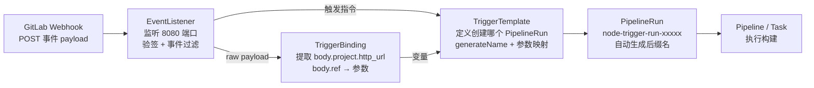

## 纲要

- **Trigger 是 Tekton 的「事件入口」**：代码 push、MR、tag 等仓库事件发生后，由 Webhook 把事件payload POST 给 EventListener，自动创建 PipelineRun——没有它，每条流水线都得手工 `tkn pipeline start`
- **三大核心组件各司其职**：**EventListener** 监听并接收事件（跑成一个 Pod + Service），**TriggerBinding** 把事件 payload 映射成参数变量，**TriggerTemplate** 定义「触发后执行哪个流水线、传什么参数」
- **部署是独立步骤**：Tekton Pipeline 装好不代表有触发器，`tekton-triggers` 要单独安装，Dashboard 上才会出现 EventListener / TriggerBinding / TriggerTemplate 资源
- **完整链路是八步**：SA（权限）→ Secret（token 校验）→ EventListener（监听）→ Ingress（暴露）→ TriggerBinding（收参数）→ TriggerTemplate（定流水线）→ Pipeline → Task
- **token 双向匹配是安全底线**：GitLab Webhook 里填的 Secret Token 必须和集群里 Secret 的值一致，否则事件直接 403，流水线纹丝不动
- **GitLab 拦截器自动验签 + 过滤事件类型**：`interceptors: gitlab` 负责校验 `X-Gitlab-Event` 头与 secret，`eventTypes: Push Hook` 只放行 push 事件，comment、MR 事件不触发

## 一、场景引入： push 代码之后，还要登服务器点「运行」？

到这篇为止，我们的流水线已经能跑得飞快，但启动方式始终是「人肉」的：开发 push 完代码，要么登上服务器敲 `tkn pipeline start`，要么在 Dashboard 上点创建。且不说每次构建都要人工介入，**「push 后多久跑构建」全看运维什么时候方便**，持续集成的「持续」二字名存实亡。

真正的 CI 应该是这个体感：开发 `git push` 推完代码，去接杯水，回来时构建已经在跑、镜像已经推好、质量报告已经生成。中间的「事件感知 → 参数提取 → 创建流水线」由谁完成？就是本篇的主角——**Tekton Trigger**。

可以把它理解为流水线的**自动门卫 + 登记处**：GitLab 的门铃（Webhook）一响，Trigger 核对暗号（Secret Token），登记来意（从事件 payload 提取仓库地址、分支），然后按下对应流水线的启动按钮。全程零人工，而且**多项目、多仓库可以共用一个监听入口**，靠不同触发规则分流到不同流水线。

## 二、核心概念与原理

### 2.1 触发器的定位：事件驱动的流水线启动器

Tekton Trigger 的官方定义：**在特定事件发生时触发流水线执行的机制**。这里的「特定事件」来自代码仓库，典型有三类：

| 事件 | 触发时机 | 典型用途 |
| --- | --- | --- |
| **代码提交（push）** | 开发 push 到分支 | 最常用：push 即构建、即扫描、即推镜像 |
| **合并请求（MR/Merge Request）** | 发起或更新 MR | 预构建校验：合并前先跑测试 |
| **标签推送（tag push）** | 打 tag（如 `v1.2.0`） | 发布构建：产出带版本号的正式镜像 |

事件流转路径：GitLab 检测到事件 → 按 Webhook 配置向目标 URL 发 HTTP POST（携带 JSON payload 与 token 头）→ EventListener 收到请求 → 验签通过后按绑定的 TriggerBinding / TriggerTemplate 创建 PipelineRun。**触发链路是纯 HTTP**，所以只要能收到 POST 请求，事件源不限于 GitLab——GitHub、Generic、Bitbucket 都有对应拦截器，自研系统也可以直接拼 payload 调过来。

### 2.2 三大核心组件：一份「监听 - 翻译 - 执行」分工



**EventListener（监听器）**：触发器的大门。它以 Deployment 形式运行一个 Pod，默认监听 **8080** 端口，把请求转给 Service（默认名 `el-event-listener`）。它的 `spec.triggers` 里配置多条触发规则，每条规则绑定一个 TriggerBinding 和一个 TriggerTemplate。**每个 namespace 需要一个 EventListener**——多项目自动构建，不是多建 Pod，而是在一个 Listener 下配多条 trigger，靠 binding 参数区分。

**TriggerBinding（参数绑定）**：事件 payload 的「翻译官」。GitLab POST 过来的 JSON 里字段成百上千（项目地址、分支、提交人、commit 列表……），Binding 用 `$(body.xxx)` 语法把需要的字段抠出来，命名成流水线参数。可以把 Webhook 理解成「外拨号」（外部拨入的请求），Binding 就是接电话的人——**它决定哪些外部数据值得听**。

**TriggerTemplate（触发模板）**：触发后动作的「剧本」。它内嵌一段 `resourcetemplates`（本质就是 PipelineRun 的 YAML 模板），定义：创建哪个 Pipeline（`pipelineRef`）、参数怎么从 Binding 结果注入（`$(tt.params.xxx)`）、workspace 怎么绑。`generateName` 字段让每次触发自动生成 `node-trigger-run-<随机串>` 这样的运行名——**只写前缀，后缀交给 Tekton**，杜绝重名覆盖。

三者的协作口诀：**Listener 收信，Binding 拆信，Template 按信执行**。

### 2.3 为什么要单独部署 Trigger

一个常见困惑：我明明装了 Tekton Pipeline 和 CLI，为什么 `kind: EventListener` 创建报 `no matches for kind`？因为 **Trigger 是独立组件 `tekton-triggers`**，不和 Pipeline 一起装。部署成功的标志有两个：`kubectl get deploy -n tekton-pipelines` 能看到 `tekton-triggers-controller`、`tekton-triggers-webhook` 等 Pod；**Dashboard 左侧出现 EventListener / TriggerBinding / TriggerTemplate 三类资源**——没装的话这些入口在页面上根本不存在。

## 三、动手实践：八步打通 GitLab 自动触发

按讲稿给出的操作清单，完整链路八步，每一步对应一个 YAML。以下按「为什么 → 是什么」逐个拆。

### 3.1 第一步：创建 SA 账户（权限地基）

```yaml
# trigger/sa.yaml
---
apiVersion: v1
kind: ServiceAccount
metadata:
  name: tekton-triggers-gitlab-sa
  namespace: default
---
apiVersion: rbac.authorization.k8s.io/v1
kind: ClusterRoleBinding
metadata:
  name: tekton-triggers-gitlab-binding
roleRef:
  apiGroup: rbac.authorization.k8s.io
  kind: ClusterRole
  name: cluster-admin
subjects:
- kind: ServiceAccount
  name: tekton-triggers-gitlab-sa
  namespace: default
```

EventListener 的 Pod 以这个 SA 身份运行。它要代建 PipelineRun、TaskRun，所以必须对相关资源有权限，这里直接绑 `cluster-admin`（演示环境省心做法，生产收紧见 4.4 节）。**EventListener 的 `serviceAccountName` 字段必须指向这个 SA**，否则触发时创建 PipelineRun 会 403。

### 3.2 第二步：创建 Secret（双向 token 暗号）

```yaml
# trigger/secret.yaml
apiVersion: v1
kind: Secret
metadata:
  name: go-gitlab-webhook-token
type: Opaque
stringData:
  SecretToken: "<在 GitLab Webhook 里填写的同一个 Secret Token>"
```

GitLab Webhook 支持配置 **Secret Token**：GitLab 每次 POST 会带 `X-Gitlab-Token` 头，服务端比对一致才认账。这个 Secret 就是服务端保存的「标准答案」，key 名 `SecretToken` 是 GitLab 拦截器的约定。**两边值必须一模一样**——这是纯字符串比对，多一个空格都不算匹配。

### 3.3 第三步：创建 EventListener（监听 + 验签 + 分流）

```yaml
# trigger/eventListener.yaml
apiVersion: triggers.tekton.dev/v1beta1
kind: EventListener
metadata:
  name: event-listener
spec:
  serviceAccountName: tekton-triggers-gitlab-sa
  triggers:
  - name: go-gitlab-push-events-trigger
    interceptors:
    - ref:
        name: "gitlab"
      params:
      - name: "secretRef"
        value:
          secretName: go-gitlab-webhook-token
          secretKey: SecretToken
      - name: "eventTypes"
        value:
          - "Push Hook"
    bindings:
    - ref: common-tb
    template:
      ref: go-tt
```

逐字段拆解：

| 字段 | 值 | 作用 |
| --- | --- | --- |
| `serviceAccountName` | `tekton-triggers-gitlab-sa` | 触发时以该 SA 身份创建 PipelineRun |
| `triggers[].name` | `go-gitlab-push-events-trigger` | 触发规则名，Dashboard 上按它区分 |
| `interceptors[].ref.name` | `gitlab` | 使用 GitLab 拦截器：验 token + 解析 payload |
| `interceptors.params.secretRef` | 指向 3.2 的 Secret | **验签依据**，token 不符直接拒绝 |
| `interceptors.params.eventTypes` | `Push Hook` | **只放行 push 事件**，tag push、comment 等事件不过滤进来 |
| `bindings[].ref` | `common-tb` | 事件数据交给哪个 TriggerBinding 翻译 |
| `template.ref` | `go-tt` | 触发后执行哪个 TriggerTemplate |

创建成功后自动生成 Pod 与 Service（`el-event-listener`，端口 **8080**）。触发失败时第一现场就在这里：`kubectl logs deploy/el-event-listener` 能看到请求是否到达、验签是否通过、绑定是否命中。

### 3.4 第四步：创建 Ingress（把监听端口暴露出去）

```yaml
# trigger/ingress.yaml
apiVersion: networking.k8s.io/v1
kind: Ingress
metadata:
  name: node-ingress
  namespace: default
spec:
  ingressClassName: nginx
  rules:
  - host: node-tekton.1853whitleyave.com
    http:
      paths:
      - pathType: Prefix
        path: "/"
        backend:
          service:
            name: el-event-listener
            port:
             number: 8080
```

链路要闭合：GitLab 在集群外，必须能 HTTP 打到 EventListener。Ingress 把域名 `node-tekton.1853whitleyave.com`（已解析到内网入口）的根路径转发到 `el-event-listener:8080`。**Webhook URL 就填 `http://<域名>:8080/`**，访问根路径即可，不需要子路径。

### 3.5 第五步：创建 TriggerBinding（提取 GitLab 参数）

```yaml
# trigger/binding.yaml
apiVersion: triggers.tekton.dev/v1beta1
kind: TriggerBinding
metadata:
  name: common-tb
spec:
  params:
  - name: git-repo-url
    value: $(body.project.http_url)
  - name: build-branch
    value: $(body.ref)
```

`$(body.xxx)` 指向事件 JSON 的字段：`project.http_url` 是仓库克隆地址（如 `http://gitlab.example.com/node/vue.git`），`ref` 是触发分支（如 `refs/heads/main`）。提取后命名为 `git-repo-url` 和 `build-branch` 两个**参数名**——这两个名字后面 Template 要原样引用，是binding 与 template 之间的约定接口。

调试技巧：GitLab Webhook 页面有「Test → Push events」按钮，点完可以在 EventListener 日志里看到完整 payload，对着 JSON 结构抠字段最稳。

### 3.6 第六步：创建 TriggerTemplate（定义触发的流水线）

```yaml
# trigger/triggertemplage.yaml
apiVersion: triggers.tekton.dev/v1beta1
kind: TriggerTemplate
metadata:
  name: go-tt
  namespace: default
spec:
  params:
  - name: git-repo-url
  - name: build-branch
  resourcetemplates:
  - apiVersion: tekton.dev/v1beta1
    kind: PipelineRun
    metadata:
      generateName: node-trigger-run-
    spec:
      pipelineRef:
        name: pipeline-tt
      params:
        - name: giturl
          value: $(tt.params.git-repo-url)
        - name: branch
          value:  $(tt.params.build-branch)
      workspaces:
        - name: code
          volumeClaimTemplate:
            spec:
              accessModes:
                - ReadWriteOnce
              resources:
                requests:
                  storage: 12M
              storageClassName: nfs-client
        - name: aliyun-image-registry-secert
          secret:
            secretName: aliyun-image-registry-secert
```

逐字段拆解：

| 字段 | 作用 |
| --- | --- |
| `spec.params` | 声明接收 Binding 传入的两个参数，**名字必须与 Binding 的 `params[].name` 一致** |
| `resourcetemplates` | 触发时创建的资源清单，本质是一段内嵌的 PipelineRun YAML |
| `metadata.generateName` | `node-trigger-run-`：只写前缀，**后缀由 Tekton 随机生成**（如 `node-trigger-run-9xk2f`），每次触发构建名唯一，Dashboard 上自动累加一条 |
| `pipelineRef.name` | `pipeline-tt`：指定触发的目标流水线 |
| `$(tt.params.xxx)` | **`tt` = trigger template 的缩写**，取本 Template 声明的参数值，再映射给 PipelineRun 的 `giturl` / `branch` 参数 |
| `workspaces` | 与手工 PipelineRun 完全一致的两种绑定：code 用 VCT，镜像仓库凭据用 Secret |

数据在这一步完成「缝合」：Binding 抠出的 GitLab 字段 → Template 参数 → PipelineRun 参数 → Pipeline 参数 → Task 参数，一路同名透传。

### 3.7 第七、八步：Pipeline 与 Task

```yaml
# trigger/pipeline.yaml
apiVersion: tekton.dev/v1beta1
kind: Pipeline
metadata:
  name: pipeline-tt
spec:
  params:
    - name: giturl
      type: string
    - name: branch
      type: string
  tasks:
    - name: clone
      taskRef:
        name: test-trigger
      params:
        - name: giturl
          value: "$(params.giturl)"
        - name: branch
          value: "$(params.branch)"
```

```yaml
# trigger/task.yaml
apiVersion: tekton.dev/v1beta1
kind: Task
metadata:
  name: test-trigger
spec:
  params:
    - name: giturl
    - name: branch
  steps:
    - name: list-file
      image: ubuntu
      imagePullPolicy: IfNotPresent
      script:
        echo $(params.giturl) $(params.branch)
```

这是一个**最小验证管线**：Pipeline `pipeline-tt` 声明 `giturl` / `branch` 参数透传给 Task；Task `test-trigger` 只做一件事——把收到的仓库地址和分支 echo 出来。它存在的意义是**用最低成本验证链路通不通**：触发后如果日志里打印出正确的仓库地址和分支，说明从 Webhook 到 Task 的整条参数链全通了，再把 `echo` 换成 git-clone、kaniko 构建就是实战管线。

### 3.8 GitLab 侧配置与验证

集群侧八步 `kubectl apply` 完毕后，到 GitLab 项目 → Settings → Webhooks 填写：

| 配置项 | 值 |
| --- | --- |
| URL | `http://node-tekton.1853whitleyave.com:8080/`（Ingress 域名 + 8080 端口 + 根路径） |
| Secret Token | 与 3.2 Secret 中 `SecretToken` **完全一致的值** |
| Trigger | 勾选 **Push events**，可按分支过滤（如只 `main`） |
| SSL verification | 内网 HTTP 场景可关闭 |

点「Add webhook」后先 Test 一次，然后到集群侧 `kubectl get pipelinerun` 观察：**自动出现一条 `node-trigger-run-<随机串>`**，进入 Task 日志能看到 `echo` 打出 `http://gitlab.example.com/node/vue.git refs/heads/main`——全链路打通。

### 3.9 多项目注意：一个 Listener，多条 Trigger

多个项目要自动构建时，**不需要每个项目建一个 EventListener**：同一 namespace 共用一个（默认每个 namespace 建一个即可），不同项目配不同 trigger 规则，通过 binding 提取不同字段、template 指向不同 pipeline 来分流。要守住两条线：**不同项目的触发条件（如分支）要能区分开**，否则同一 namespace 里两个项目可能命中同一条规则；**不同 namespace 的步骤要完整走一遍**——Listener 不跨 namespace 监听，A 项目的 Webhook 打不到 B namespace 的 Listener。

## 四、生产实践要点

1. **Ingress 必须加鉴权或内网隔离**。EventListener 根路径对公网敞开意味着「谁拿到 URL 就能触发构建」。生产上加 Ingress Basic Auth、IP 白名单或内网域名，Token 只是第一道，不是唯一一道。
2. **SA 权限按最小化收紧**。演示用 `cluster-admin` 图省事，生产应为 SA 定制 Role：仅授予 `pipelineruns`、`taskruns`、`pipelineruns/status` 等必要 verb，并按 namespace 隔离，防止一个项目的触发链能操作别的项目资源。
3. **Secret Token 用足够强度的随机串并定期轮换**。它是 Webhook 的唯一暗号，`openssl rand -hex 16` 生成；轮换时 GitLab 侧和集群 Secret **必须同窗口修改**，先改服务端会让过渡期触发失败，建议先 GitLab 后集群或双方短暂并存。
4. **eventTypes 精确过滤，防止事件风暴**。只勾 `Push Hook` 就够；若开了 MR、comment 等事件，一次批量操作（如批量改 issue）可能瞬间触发几十条构建，把集群 CI 队列打爆。
5. **generateName 是构建可回溯的关键**。每次触发唯一运行名 + 构建号 result 做镜像 tag，形成「GitLab commit → PipelineRun 名 → 镜像 tag」的可追溯链，出问题能顺藤摸瓜。
6. **拦截器按 Git 平台选型**。`gitlab` 拦截器只认 GitLab 的 payload 结构与验签方式；换 GitHub 用 `github` 拦截器（验签算法是 HMAC，不是裸 token 比对），自研系统用 `core` + cel 拦截器自定义。**别把 GitLab 的配置套到别的平台上**。
7. **触发失败排查三现场**：GitLab Webhook 页面的「Recent Deliveries」看响应码（403=token 不符，404=URL/端口错）；EventListener Pod 日志看请求是否到达、被哪条规则处理；`kubectl get pipelinerun` 看资源是否创建成功。三层定位，五分钟内必见分晓。

## 五、报错排查表

| 现象 | 根因 | 解法 |
| --- | --- | --- |
| GitLab 测试推送返回 403 / `no matching token` | Webhook Secret Token 与集群 Secret 值不一致（含首尾空格） | 两边逐字符对齐；`kubectl get secret go-gitlab-webhook-token -o jsonpath='{.data.SecretToken}' \| base64 -d` 核对实际值 |
| 返回 404 或连接超时 | URL 错、Ingress 未生效、EventListener 端口不是 8080 | `curl http://<域名>:8080/` 直连验证；查 Ingress backend 与 `el-event-listener` Service 端口 |
| 请求到达但流水线没动，日志无匹配记录 | `eventTypes` 不匹配（如触发的是 tag push，只配了 `Push Hook`）或 binding/template 名写错 | 核对 GitLab 事件类型；`kubectl describe el event-listener` 检查 `bindings.ref` / `template.ref` 名字 |
| `no matches for kind EventListener` | 没装 `tekton-triggers` | 单独部署触发器组件，Dashboard 出现三类资源即成功 |
| PipelineRun 创建失败 403 forbidden | EventListener 的 `serviceAccountName` 未配置或 SA 无权限 | 补 SA 与 Role/ClusterRoleBinding；确认 `spec.serviceAccountName` 名字没错 |
| 触发成功但 Task 里参数为空 | Binding 的 `$(body.xxx)` 字段名与 payload 不符，或 Template 参数名与 Binding 不一致 | 看 Listener 日志里的 payload 实际字段；Binding `params[].name` 与 Template `spec.params[].name` 逐字对齐 |
| `$(tt.params.xxx)` 不替换，Task 收到字面量 | 在 TriggerTemplate 外的地方误用 `tt.` 前缀 | `tt.params` 仅 TriggerTemplate 内有效；普通 PipelineRun 里用 `$(params.xxx)` |
| 多个项目同时被触发、构建串味 | 同一 namespace 多条 trigger 的条件重叠（如同分支） | 按分支/路径细化每条 trigger 的匹配条件，或按项目分 namespace |

## 六、面试考点与追问

**Q1：Tekton Trigger 的三个核心组件是什么？分别负责什么？**
EventListener 负责监听和接收事件（跑成 Pod + Service，默认 8080 端口），并做验签与事件过滤；TriggerBinding 负责把事件 payload 的字段映射成参数（`$(body.xxx)`）；TriggerTemplate 负责定义触发后创建什么资源（内嵌 PipelineRun 模板、指定 pipelineRef 与参数映射）。口诀：Listener 收信、Binding 拆信、Template 执行。

**Q2：EventListener 为什么要单独部署？装完 Pipeline 就能用触发器吗？**
不能。`tekton-triggers` 是独立组件，需要单独安装。装完后 Dashboard 才会出现 EventListener / TriggerBinding / TriggerTemplate 资源，`kubectl` 才能创建这些 CRD。判断标志：`tekton-pipelines` namespace 下出现 triggers 相关 Pod。

**Q3：GitLab Webhook 的 Secret Token 校验是怎么实现的？**
GitLab 每次 POST 带 `X-Gitlab-Token` 头；EventListener 的 gitlab 拦截器通过 `secretRef` 引用集群 Secret（key `SecretToken`），与请求头里的值做字符串比对，不一致直接拒绝（403）。两边值必须完全一致，这是防伪造触发的第一道闸。

**Q4：`$(body.project.http_url)` 和 `$(tt.params.xxx)` 的区别是什么？**
前者在 TriggerBinding 里使用，从**事件 payload JSON** 里取字段；后者在 TriggerTemplate 里使用，取**本 Template 声明的参数**（这些参数的值来自 Binding 的输出）。两者通过「参数名」衔接：Binding 输出的参数名必须与 Template `spec.params` 声明的名字一致。

**Q5：`generateName: node-trigger-run-` 有什么好处？**
每次触发由 Tekton 自动追加随机后缀生成唯一 PipelineRun 名，避免固定名重复创建冲突（K8s 资源同名创建会报 AlreadyExists），同时每次构建有唯一标识，便于日志追溯和与镜像 tag、commit 关联。

**Q6：多个项目需要多个 EventListener 吗？**
同一 namespace 不需要——共用一个 Listener，配多条 trigger 规则分流（不同 binding/template/pipeline）。但 Listener 不跨 namespace 工作，不同 namespace 需要各自部署一整套（SA、Secret、Listener、Ingress、Binding、Template、Pipeline、Task）。

**Q7：触发链路全通了但 Task 参数是空的，怎么排查？**
按三层查：① Listener Pod 日志里看 payload 实际 JSON 字段，核对 Binding 的 `$(body.xxx)` 路径（GitLab 的仓库地址在 `project.http_url`，分支在 `ref`）；② 核对 Binding 输出参数名与 Template `spec.params` 声明名逐字一致；③ 核对 Template 到 PipelineRun、Pipeline 到 Task 的参数名透传。三层任何一处名字不一致都会静默拿到空值。

## 📎 文本↔代码关联

| 代码文件 | 正文提及 | 内容 |
| --- | --- | --- |
| `code/6-Tekton/trigger/sa.yaml` | 3.1 节 | ServiceAccount `tekton-triggers-gitlab-sa` + ClusterRoleBinding（cluster-admin，演示用） |
| `code/6-Tekton/trigger/secret.yaml` | 3.2 节 | Secret `go-gitlab-webhook-token`，key `SecretToken`，与 GitLab Webhook 暗号一致（成文已掩码） |
| `code/6-Tekton/trigger/eventListener.yaml` | 3.3 节 | EventListener：SA、gitlab 拦截器验签、`Push Hook` 事件过滤、binding/template 引用 |
| `code/6-Tekton/trigger/ingress.yaml` | 3.4 节 | Ingress 暴露 `el-event-listener:8080`，域名转发到根路径 |
| `code/6-Tekton/trigger/binding.yaml` | 3.5 节 | TriggerBinding `common-tb`：提取 `body.project.http_url` 与 `body.ref` |
| `code/6-Tekton/trigger/triggertemplage.yaml` | 3.6 节 | TriggerTemplate `go-tt`：内嵌 PipelineRun，`generateName` + `$(tt.params.*)` 参数映射 |
| `code/6-Tekton/trigger/pipeline.yaml` | 3.7 节 | Pipeline `pipeline-tt`：giturl/branch 参数透传给 Task |
| `code/6-Tekton/trigger/task.yaml` | 3.7 节 | Task `test-trigger`：echo 验证 giturl 与 branch 全链路贯通 |

**技术点总结**：Tekton Trigger 用「EventListener + TriggerBinding + TriggerTemplate」三件套把「push 代码」变成「自动跑流水线」：Listener 以 Pod 形式守在内网入口，用 gitlab 拦截器完成 Secret Token 验签和 `Push Hook` 事件过滤；Binding 从事件 payload 里提取仓库地址与分支；Template 内嵌 PipelineRun 模板，靠 `generateName` 保证每次触发构建名唯一，靠 `$(tt.params.*)` 把外部数据一路送进 Task。落地顺序固定为八步：SA、Secret、EventListener、Ingress、Binding、Template、Pipeline、Task，GitLab 侧只填 URL + Token + Push events 三项。安全上记住：token 双向一致是底线，Ingress 隔离与 SA 最小权限是生产必选项。
