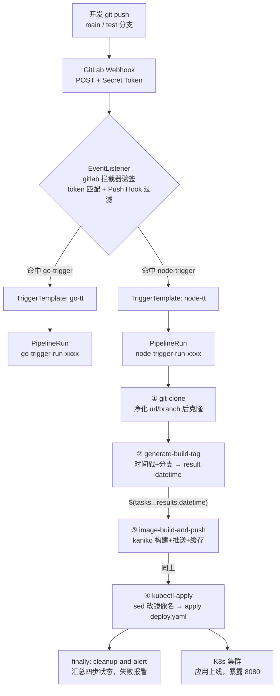

## 纲要

- **本篇是 Tekton 章的综合收官**：把前几篇的 Task / Pipeline / PipelineRun / Workspace / Results / Trigger 全部拼进一条真实可用的项目流水线，push 代码即自动完成「克隆 → 生成 tag → kaniko 构建推送 → kubectl 部署 → 收尾报警」
- **一个 EventListener 挂多条 trigger**：同一 Listener 下配置 go / node 两个项目各自的触发器，靠**不同 Secret Token** 分流——一个仓库的提交只会命中 token 匹配的那条，不会一提交触发所有流水线
- **giturl / branch 要做「净化」处理**：Binding 传过来的仓库地址带 `http://` 前缀、分支是 `refs/heads/main` 全路径，Task 里必须先用 `awk` 过滤，否则 git clone 直接失败
- **镜像 tag 用「时间戳 + 分支」组合**：`date +%Y%m%d-%H%M%S` 生成构建号，与分支名拼成 `node-20261014-172256-main`，经 Results 传给构建与部署两个下游 Task，全程唯一可追溯
- **kubeconfig 走 Secret workspace 挂载**：部署 Task 把 kubeconfig 挂到 `/root/.kube`，**不要把 config 打进镜像**——镜像被拉走等于交出集群管理员权限
- **finally 做统一收尾**：用 `$(tasks.xxx.status)` 把每个 Task 的成败状态传给收尾 Task，自动判定失败环节并输出报警信息，也可再接 Webhook 推送通知

## 一、场景引入：把零件组装成一辆能跑的车

前九篇我们造齐了零件：Task 会定义、Pipeline 会编排、Workspace 会传数据、Results 会传参数、Trigger 会听 Webhook。但企业里老板不会问「你的 Task 写得怎么样」，只会问：**「我 push 一行代码，到部署上线要几步？」**

答案应该是：一步。`git push`，然后没有然后——克隆、生成版本号、构建镜像、推送仓库、sed 改镜像名、kubectl apply 部署、失败报警，全部由流水线自动完成，全程无人工。本篇就是把这套「全自动发布流水线」完整搭出来。它也是前述 Tekton 的终篇，最后附本章知识总结，作为进入 Drone / KubeVela / Argo CD 等后续 CD 工具前的收官。

## 二、整体架构：一条 Trigger 驱动的四段式流水线



本篇以 **node 项目**为主线（project 目录），EventListener 里同时挂着 go 项目触发器做对照——重点演示**多项目共用一个监听入口、token 分流**的工程手法。

## 三、动手实践：从零搭一条全自动发布流水线

### 3.1 触发器层：一个 Listener，两条 trigger

```yaml
# project/eventListener.yaml
apiVersion: triggers.tekton.dev/v1beta1
kind: EventListener
metadata:
  name: event-listener
spec:
  serviceAccountName: tekton-triggers-gitlab-sa
  triggers:
  - name: go-gitlab-push-events-trigger
    interceptors:
    - ref:
        name: "gitlab"
      params:
      - name: "secretRef"
        value:
          secretName: go-gitlab-webhook-token
          secretKey: SecretToken
      - name: "eventTypes"
        value:
          - "Push Hook"
    bindings:
    - ref: common-tb
    template:
      ref: go-tt
  - name: node-gitlab-push-events-trigger
    interceptors:
    - ref:
        name: "gitlab"
      params:
      - name: "secretRef"
        value:
          secretName: node-gitlab-webhook-token
          secretKey: SecretToken
      - name: "eventTypes"
        value:
          - "Push Hook"
    bindings:
    - ref: common-tb
    template:
      ref: node-tt
```

结构要点：

| 设计 | 说明 |
| --- | --- |
| 两条 trigger 复用同一个 `common-tb` binding | 两个项目提取的字段一样（仓库地址、分支），**binding 无差异就共用**，不为差异化而差异化 |
| 每条 trigger 用**不同 Secret** | `go-gitlab-webhook-token` vs `node-gitlab-webhook-token`——**这是分流的核心**：token 值不同，一个仓库的 Webhook 只会命中自己那条 |
| 指向不同 TriggerTemplate | go → `go-tt`，node → `node-tt`，各自触发各自的流水线 |
| 共用 SA 与同一 Pod | **一个 namespace 只需一个 EventListener**，多项目 = 多 trigger，不多占资源 |

配套 Secret（node 项目用，值已掩码，实际部署时用随机串）：

```yaml
# project/secret.yaml
apiVersion: v1
kind: Secret
metadata:
  name: node-gitlab-webhook-token
type: Opaque
stringData:
  SecretToken: "<与 node 项目 GitLab Webhook 里填写的 Secret Token 一致>"
```

### 3.2 模板层：TriggerTemplate 定流水线

```yaml
# project/triggertemplage.yaml
apiVersion: triggers.tekton.dev/v1beta1
kind: TriggerTemplate
metadata:
  name: node-tt
  namespace: default
spec:
  params:
  - name: git-repo-url
  - name: build-branch
  resourcetemplates:
  - apiVersion: tekton.dev/v1beta1
    kind: PipelineRun
    metadata:
      generateName: node-trigger-run-
    spec:
      pipelineRef:
        name: pipeline-node-project
      params:
        - name: giturl
          value: $(tt.params.git-repo-url)
        - name: branch
          value:  $(tt.params.build-branch)
      workspaces:
        - name: code
          volumeClaimTemplate:
            spec:
              accessModes:
                - ReadWriteOnce
              resources:
                requests:
                  storage: 12M
              storageClassName: nfs-client
        - name: aliyun-image-registry-secert
          secret:
            secretName: aliyun-image-registry-secert
        - name: kubeconfig-secret
          secret:
            secretName: kubeconfig-secret
```

比前面的模板多了第三个 workspace：`kubeconfig-secret`——**部署 Task 需要操作 K8s 的凭证**，同样是 Secret 只读挂载。三个 workspace 的归属：code 传源码（VCT），aliyun secret 供 kaniko 推镜像，kubeconfig secret 供 kubectl 部署。**三条通道在 Template 里一次绑定，触发时自动带出**。

### 3.3 流水线层：四 Task + finally 的编排

```yaml
# project/pipeline.yaml
apiVersion: tekton.dev/v1beta1
kind: Pipeline
metadata:
  name: pipeline-node-project
spec:
  params:
    - name: giturl
    - name: branch
  workspaces:
    - name: code
    - name: aliyun-image-registry-secert
    - name: kubeconfig-secret
  tasks:
    - name: git-clone
      taskRef:
        name: git-clone
      params:
        - name: giturl
          value: "$(params.giturl)"
        - name: branch
          value: "$(params.branch)"
      workspaces:
        - name: code
          workspace: code
    - name: generate-build-tag
      taskRef:
        name: generate-build-tag
      params:
        - name: branch
          value: "$(params.branch)"
      runAfter:
        - git-clone
    - name: image-build-and-push
      taskRef:
        name: image-build-and-push
      params:
        - name: image-tag
          value: "$(tasks.generate-build-tag.results.datetime)"
      workspaces:
        - name: aliyun-image-registry-secert
          workspace: aliyun-image-registry-secert
        - name: code
          workspace: code
      runAfter:
        - generate-build-tag
    - name: kubectl-apply
      taskRef:
        name: kubectl-apply
      params:
        - name: image-tag
          value: "$(tasks.generate-build-tag.results.datetime)"
      workspaces:
        - name: kubeconfig-secret
          workspace: kubeconfig-secret
        - name: code
          workspace: code
      runAfter:
        - image-build-and-push
  finally:
    - name: cleanup-workspace-and-alert
      taskRef:
        name: cleanup-workspace-and-alert
      params:
        - name: task1Status
          value: "$(tasks.git-clone.status)"
        - name: task2Status
          value: "$(tasks.generate-build-tag.status)"
        - name: task3Status
          value: "$(tasks.image-build-and-push.status)"
        - name: task4Status
          value: "$(tasks.kubectl-apply.status)"
```

编排设计有三个值得学的点：

1. **`generate-build-tag` 只吃 branch 不吃 giturl**——它只负责拼版本号，不碰代码，所以不挂 code workspace，尽量让 Task 轻量；
2. **构建与部署两个 Task 都引用同一个 result**：`$(tasks.generate-build-tag.results.datetime)`。镜像 push 用的 tag 和部署 sed 替换的 tag **同源同值**，从机制上杜绝「推的是 A、部署的是 B」的事故；
3. **finally 里用 `$(tasks.xxx.status)`** 把四个 Task 的执行状态（Succeeded / Failed）取出传给收尾 Task——这是 Tekton 提供的内置状态变量，是做统一报警的标准手法。finally 无论前面成败都会执行，适合清理与通知。

### 3.4 Task ①：git-clone——先「净化」再克隆

```yaml
# project/task/01-git-clone.yaml
apiVersion: tekton.dev/v1beta1
kind: Task
metadata:
  name: git-clone
spec:
  description: Clone the code repository to the workspace.
  params:
    - name: giturl
    - name: branch
  workspaces:
    - name: code
  steps:
    - name: git-clone
      image: bitnami/git:latest      # ⚠️ 生产锁版本：改为具体 tag（形如 <版本号>-debian-12-r<修订>），latest 会随上游发布静默变更
      imagePullPolicy: IfNotPresent
      env:
        - name: git_username
          valueFrom:
            secretKeyRef:
              name: gitlab-secert
              key: username
        - name: git_password
          valueFrom:
            secretKeyRef:
              name: gitlab-secert
              key: password
      script: |
        url=$(params.giturl)
        new_url=$(echo $url | awk -F"http://" '{print $2}')
        branch=$(params.branch)
        build_branch=$(echo "$branch" | awk -F'/' '{print $NF}')
        echo ${build_branch} ${new_url} ${git_username}:${git_password}
        git clone -b ${build_branch} -v http://${git_username}:${git_password}@${new_url} $(workspaces.code.path)/node
    - name: list-file
      image: alpine
      imagePullPolicy: IfNotPresent
      command:
        - /bin/sh
      args: ['-c', 'ls -la $(workspaces.code.path)/node']
```

这是全流水线里**技巧含量最高**的一个 Task，三处关键设计：

| 设计 | 解决什么问题 |
| --- | --- |
| `awk -F"http://" '{print $2}'` | Binding 传过来的 `body.project.http_url` 带 `http://` 前缀，直接拼进 clone URL 会变成 `http://http://...`。**过滤出域名部分**得到干净的 `new_url` |
| `awk -F'/' '{print $NF}'` 处理 branch | `body.ref` 的格式是 `refs/heads/main`（还有 `refs/heads/test`），`git clone -b` 只认 `main`。**按 `/` 切分取最后一段**得到纯分支名 |
| 账号密码走 `secretKeyRef` 环境变量 | 私有仓库要鉴权。凭证从 Secret `gitlab-secert` 注入环境变量，**不硬编码在脚本里**，克隆 URL 用 `http://用户名:密码@域名` 形式拼接 |

最后 `list-file` step 做克隆结果验证：`ls -la` 确认代码真的落到了 workspace。**「每步可验证」是流水线可维护性的基础**，出问题时第一个 Task 的日志就能定位是「没克隆下来」还是「下游用错了路径」。

### 3.5 Task ②：generate-build-tag——Results 生成唯一版本号

```yaml
# project/task/02-generate-image-tag.yaml
apiVersion: tekton.dev/v1beta1
kind: Task
metadata:
  name: generate-build-tag
spec:
  params:
    - name: branch
  results:
    - name: datetime
  steps:
    - name: generate-datetime
      image: ubuntu
      imagePullPolicy: IfNotPresent
      script: |
        datetime=`date +%Y%m%d-%H%M%S`
        branch=`echo $(params.branch) | awk -F'/' '{print $NF}'
        buildId=node-${datetime}-${branch}
        echo -n ${buildId} | tee $(results.datetime.path)
```

在前面 `results-datetime` 基础上做了两处升级：

1. **分支同样要净化**：`refs/heads/main` 取 `main`，与 clone Task 同样的手法；
2. **tag 拼接分支维度**：`node-20261014-172256-main`——时间戳保证唯一，分支名让人一眼看出这条镜像来自哪个分支。**这个 result 就是全流水线的「版本号中枢」**：Pipeline 里两个下游 Task 都引用它，一个推镜像、一个改部署，版本严格一致。

### 3.6 Task ③：image-build-and-push——kaniko 带缓存构建

```yaml
# project/task/03-build-dockerfile-bush.yaml
---
apiVersion: tekton.dev/v1beta1
kind: Task
metadata:
  name: image-build-and-push
spec:
  workspaces:
    - name: code
    - name: aliyun-image-registry-secert
      mountPath: /kaniko/.docker
  params:
    - name: image-tag
  steps:
    - name: image-build-and-push
      image: gcr.io/kaniko-project/executor:latest   # ⚠️ 生产锁版本：kaniko 官方以 latest 滚动发布，固定到 v1.x.y 保证可追溯
      imagePullPolicy: IfNotPresent
      securityContext:
        # kaniko 官方镜像要求 root 读写 /kaniko 工作区；集群若启用 Pod Security
        # restricted 禁止 root，需换非 root 构建方案（BuildKit rootless）或为该 SA 申请豁免
        runAsUser: 0
      env:
        - name: DOCKER_CONFIG
          value: /kaniko/.docker
      command:
        - /kaniko/executor
      args:
        - --dockerfile=Dockerfile
        - --context=$(workspaces.code.path)/node
        - --destination=registry.cn-hangzhou.aliyuncs.com/tool-bucket/public:$(params.image-tag)
        - --cache=true
        - --cache-repo=registry.cn-hangzhou.aliyuncs.com/tool-bucket/public
        - --cache-copy-layers
      volumeMounts:
        - name: npm-cache
          mountPath: /usr/local/node
  volumes:
    - name: npm-cache
      persistentVolumeClaim:
        claimName: tekton-npm-cache-pvc
```

逐字段拆解：

| 字段 | 作用 |
| --- | --- |
| `mountPath: /kaniko/.docker` | 把镜像仓库凭证 Secret 挂到 kaniko 的默认读凭证位置，配合 `DOCKER_CONFIG=/kaniko/.docker` 实现免登录推送 |
| `--dockerfile` / `--context` | 指定构建上下文。**上下文路径必须是 clone Task 的落盘目录**（`$(workspaces.code.path)/node`），Dockerfile 在仓库根目录，与 clone 路径对应 |
| `--destination=...:$(params.image-tag)` | 目标镜像全名 + Task ② 传来的版本号，参数化 tag |
| `--cache=true` + `--cache-repo` + `--cache-copy-layers` | **镜像层缓存三件套**：开启缓存、缓存层推到指定仓库、构建时复制已有层，二次构建大幅加速 |
| `volumes: npm-cache → tekton-npm-cache-pvc` | 挂上篇的 npm 缓存卷到 `/usr/local/node`，与 Dockerfile 内 `COPY package.json /usr/local/node` 的路径**逐字节对应** |

同目录的 `task/build-dockerfile-bush.yaml` 是不带缓存卷的精简版（destination 写死 `test` tag），适合对照理解「缓存卷挂载」这一行的增量价值。

### 3.7 Task ④：kubectl-apply——sed 改镜像名后部署

```yaml
# project/task/04-kubectl-apply.yaml
---
apiVersion: tekton.dev/v1beta1
kind: Task
metadata:
  name: kubectl-apply
spec:
  workspaces:
    - name: code
    - name: kubeconfig-secret
      mountPath: /root/.kube
  params:
    - name: image-tag
  steps:
    - name: kubectl-apply
      image: registry.cn-hangzhou.aliyuncs.com/tool-bucket/tool:kubectl
      imagePullPolicy: IfNotPresent
      script: |
        tag=$(params.image-tag)
        cd $(workspaces.code.path)/node
        sed -i "s#image: .*#image: registry.cn-hangzhou.aliyuncs.com/tool-bucket/public:${tag}#" deploy.yaml
        kubectl apply -f deploy.yaml
```

三步走：取 tag → `cd` 进仓库目录（`deploy.yaml` 与代码同级）→ **`sed` 把 `deploy.yaml` 里的 `image:` 行替换成本次构建的镜像全名**，然后 `kubectl apply`。

两个工程细节：

- **kubeconfig 挂 `/root/.kube`**：kubectl 默认读这个目录，挂载即用，无需 `--kubeconfig` 参数。**绝不把 kubeconfig 打进构建镜像**——讲稿专门强调：镜像一旦被拉走，拿到 config 的人就拥有了操作集群的全部权限，这是 CI 安全的红线；
- **sed 用 `#` 作分隔符**：因为替换内容里全是 `/`（镜像路径），用 `/` 分隔要转义到崩溃，`#` 一行干净。

### 3.8 finally：cleanup-workspace-and-alert 统一收尾

```yaml
# project/task/05-finally.yaml
apiVersion: tekton.dev/v1beta1
kind: Task
metadata:
  name: cleanup-workspace-and-alert
  namespace: default
spec:
  params:
    - name: task1Status
    - name: task2Status
    - name: task3Status
    - name: task4Status
  steps:
    - name: task-alert
      image: curlimages/curl
      imagePullPolicy: IfNotPresent
      script: |
        if [ $(params.task1Status) == "Failed" ];then
          export status="Failed | reason: task1 git clone execute failed,please check"
          echo "$status"
        elif [ $(params.task2Status) == "Failed" ];then
          export status="Failed | reason: task2 generate-build-tag execute failed,please check"
          echo "$status"
        elif [ $(params.task3Status) == "Failed" ];then
          export status="Failed | reason: task3 build push execute failed,please check"
          echo "$status"
        elif [ $(params.task4Status) == "Failed" ];then
          export status="Failed | reason: task4 kubectl apply execute failed,please check"
          echo "$status"
        else
          status="success"
          echo "$status"
        fi
```

用 `if/elif` 链按顺序判定四个 Task 的状态：任一 `Failed` 就输出**带环节定位的失败原因**（精确到是 clone、生成 tag、构建推送还是部署失败）；全部成功输出 `success`。镜像选 `curlimages/curl` 是点睛之笔——**下一步就是把 `echo` 换成 `curl` 调报警 Webhook**（钉钉/飞书/企业微信），把状态推送出去。finally 无论如何都会执行，报警不会漏。

### 3.9 端到端验证：从 push 到上线

按顺序 apply：`sa.yaml`（若未建）→ Secret → eventListener → triggertemplate → pipeline → 五个 task。GitLab 侧 node 项目配置 Webhook：URL 指向 EventListener Ingress 域名，Secret Token 填 node 项目 Secret 里的值，事件勾 **Push events**、分支 `main`。

push 一次 `main`，观察四步：

1. **PipelineRun 自动出现**：`kubectl get pipelinerun` 新增 `node-trigger-run-<随机串>`，名字与上次不同（generateName 生效）；
2. **clone 成功**：日志里 `echo` 打出净化后的分支 `main` 与仓库地址，`ls -la` 可见 `deploy.yaml` 等文件（与代码仓库根目录结构一致）；
3. **tag 生成并贯穿**：第二步生成 `node-20261014-172256-main`，第三步 push 的镜像带同名 tag，第四步 sed 替换 `deploy.yaml` 的 `image:` 行用的也是它；
4. **部署生效**：`kubectl get deploy` 出现新 Pod 初始化，服务暴露 **8080** 端口；最后 finally 输出 `success`，四个 Task 状态全 Succeeded。

分支策略验证（讲稿实录）：只配 `main` 时，往 `test` 分支 push **无任何反应**（符合预期，过滤生效）；在 GitLab Webhook 的分支过滤里补上 `test` 后，test 分支 push 立即触发，且日志里分支显示 `test`。**注意：main 与 test 此时共用同一条流水线**——若要让不同分支走不同流水线，正确做法是分 namespace：main 用 main namespace、test 用 test namespace，各自部署一整套（SA/Secret/Listener/Ingress/Binding/Template/Pipeline/Task），**不同 namespace 的域名和 token 都不同**，从入口就完成分流；也可以同域名不同 token，Listener 凭 token 匹配调用不同流水线。

## 四、生产实践要点

1. **token 分流是多项目共存的铁律**。同一 Listener 下多个项目，Secret Token **必须两两不同**：token 相同会导致一个仓库提交触发多条流水线（讲稿明确警告）。名字可以带项目前缀（`node-gitlab-webhook-token`），值用 `openssl rand -hex 16` 各自生成。
2. **「净化三件套」要形成肌肉记忆**：GitLab payload 的 URL 带协议头、分支带 `refs/heads/` 前缀，任何直接把 payload 值拼进命令的写法都会踩坑。`awk -F"http://" '{print $2}'` 和 `awk -F'/' '{print $NF}'` 是本课最值得抄进模板的两行。
3. **tag 同源是版本一致性的命门**。push 的镜像 tag 和部署 sed 的 tag 必须来自同一个 result 变量，**严禁两处各生成一次时间戳**——差一秒就是「推了没部署」或「部署了不存在的版本」。
4. **kubeconfig 与镜像凭证只进 Secret，不进镜像**。部署 Task 挂 `/root/.kube`，构建 Task 挂 `/kaniko/.docker`，镜像里干干净净；CI 镜像泄露时集群和仓库都不沦陷。
5. **kaniko 缓存要配对**：`--cache=true`、`--cache-repo`（仓库可达）、`--cache-copy-layers` 三者在生产环境一起开，否则缓存写入但不复制，二次构建依然慢。缓存仓库选内网可达、配额充足的命名空间。
6. **npm 缓存卷与 kaniko 并行加速叠加**：`tekton-npm-cache-pvc` 省掉依赖网络拉取，kaniko 层缓存省掉重复层构建，两个机制叠加才是完整加速方案；单独任何一个都只解决一半问题。
7. **分支维度拆分 namespace 而非拆分 Listener**。项目多起来后按「环境/项目」维度分 namespace，每个 namespace 独立一整套触发链，权限、Secret、域名天然隔离；Listener 数量随 namespace 线性增长即可管理。
8. **报警 Task 是 finally 的标准形态**：把 `echo` 换成 `curl` 调 IM Webhook，把 PipelineRun 名、失败环节、commit 信息拼进消息体；失败时@值班人。CI 的价值一半在自动化，另一半在**失败时有人第一时间知道**。

## 五、报错排查表

| 现象 | 根因 | 解法 |
| --- | --- | --- |
| push 后所有项目的流水线都被触发 | 多个项目 Secret Token 值相同，Listener 多条 trigger 同时命中 | 每个项目用独立随机 token；GitLab 各项目 Webhook 填各自的值 |
| git clone 失败，URL 出现 `http://http://` | 没过滤 payload 里的 `http://` 前缀 | clone 脚本先 `awk -F"http://" '{print $2}'` 净化 new_url |
| clone 报 `unknown revision refs/heads/main` | 分支没取最后一段，`-b` 收到全路径 | `awk -F'/' '{print $NF}'` 取纯分支名 |
| kaniko 报 `context path does not exist` | `--context` 路径与 clone 落盘目录不一致 | 统一为 `$(workspaces.code.path)/node`，与 clone Task 的目录参数对齐 |
| sed 没替换掉镜像名，部署还是旧 tag | `deploy.yaml` 里 `image:` 行格式不匹配（如多空格、带引号） | 先 `cat deploy.yaml` 核对实际格式，收紧或放宽 sed 正则 |
| kubectl apply 报 `connection refused` / 无权限 | kubeconfig Secret 没挂或挂错路径 | workspace `mountPath: /root/.kube`；确认 Secret 内容是可用的 kubeconfig |
| test 分支 push 不触发 | GitLab Webhook 分支过滤只配了 main | Webhook 分支规则补 `test`（正则如 `^(main\|test)$`） |
| 构建成功但集群里 Pod 不更新 | sed 替换后的 tag 与推送 tag 不同源（两处各生成时间戳） | 构建与部署统一引用 `$(tasks.generate-build-tag.results.datetime)` |
| finally 里状态全是空 | `$(tasks.xxx.status)` 写错 Task 名 | 名字必须是 Pipeline 内 `tasks[].name`，与 taskRef.name 区分 |

## 六、面试考点与追问

**Q1：一条生产级 Tekton 流水线由哪些组件构成？**
触发器四件套（EventListener + TriggerBinding + TriggerTemplate + Secret）、Pipeline（编排）、若干 Task（clone / 生成 tag / 构建推送 / 部署）、finally 收尾 Task，外加 PV/PVC 缓存卷与 Secret workspace。触发链路：Webhook POST → Listener 验签 → Binding 提参 → Template 建 PipelineRun → Pipeline 编排 Task 执行。

**Q2：为什么一个 EventListener 可以服务多个项目？多个项目要注意什么？**
EventListener 的 `spec.triggers` 是列表，可挂多条 trigger，各自由 binding/template 指向不同流水线。关键注意点：**各项目的 Secret Token 必须不同**（token 是分流依据，相同会互相触发）；binding 可共用、template 必须区分；跨 namespace 不共享 Listener，需各自部署。

**Q3：GitLab 事件里的仓库地址和分支为什么不能直接用？**
`body.project.http_url` 带 `http://` 协议头，`body.ref` 是 `refs/heads/main` 全路径。直接拼进 `git clone -b` 会失败，Task 内必须用 `awk` 分别过滤：前者去掉协议头，后者取 `/` 分割的最后一段。

**Q4：镜像 tag 是怎么做到「推送的」和「部署的」严格一致的？**
generate-build-tag Task 用 `date +%Y%m%d-%H%M%S` 生成 `node-<时间戳>-<分支>` 写入 result `datetime`；Pipeline 里 image-build-and-push 与 kubectl-apply **两个 Task 都引用同一个 `$(tasks.generate-build-tag.results.datetime)`**，一处生成、两处消费，机制上杜绝不一致。

**Q5：kaniko 构建镜像的三个缓存参数是什么？npm 缓存卷又起什么作用？**
`--cache=true` 开缓存、`--cache-repo` 指定缓存层存储仓库、`--cache-copy-layers` 复制已有层，三者配合加速镜像层构建。npm 缓存卷（PV/PVC）解决的是**容器内依赖拉取**——`npm install` 命中外挂 NFS 卷上的 `node_modules`，省掉网络下载。一个管镜像层、一个管依赖包，叠加使用。

**Q6：kubeconfig 为什么用 Secret 挂载而不打进镜像？**
kubeconfig 是集群操作凭证，打进镜像等于把集群权限随镜像分发——任何能拉到镜像的人都可能拿到完整权限。挂载 `/root/.kube` 让 kubectl 默认读取，镜像本身零凭证，泄露风险可控。

**Q7：finally 里怎么知道哪个 Task 失败了？**
Pipeline 的 finally Task 用 `$(tasks.<task名>.status)` 取各 Task 的执行状态（Succeeded/Failed），作为参数传给收尾 Task；Task 内 if/elif 链逐个判定，输出带环节定位的失败原因，再调 curl 推送报警。finally 保证无论成败都执行，报警不遗漏。

**Q8：Tekton 章的知识主线是什么？**
四个核心资源的层级：**Task（定义任务）→ TaskRun（跑任务）；Pipeline（组合 Task）→ PipelineRun（跑流水线）**；再掌握 Task 的执行方式控制（when/timeout/retries/runAfter/finally）、数据传递（Workspace/Results/Volume）与触发器（Webhook 自动触发），Tekton 即可支撑企业级 CI。

## 📎 文本↔代码关联

| 代码文件 | 正文提及 | 内容 |
| --- | --- | --- |
| `code/6-Tekton/project/eventListener.yaml` | 3.1 节 | EventListener 双 trigger：go/node 两项目，共用 common-tb、不同 Secret token 分流 |
| `code/6-Tekton/project/secret.yaml` | 3.1 节 | Secret `node-gitlab-webhook-token`，与 node 项目 Webhook token 配对（成文已掩码） |
| `code/6-Tekton/project/triggertemplage.yaml` | 3.2 节 | TriggerTemplate `node-tt`：generateName 前缀 + 三个 workspace（VCT/aliyun/kubeconfig）绑定 |
| `code/6-Tekton/project/pipeline.yaml` | 3.3 节 | Pipeline `pipeline-node-project`：四 Task 串行 + result 传 tag + finally 收尾 |
| `code/6-Tekton/project/task/01-git-clone.yaml` | 3.4 节 | Task `git-clone`：awk 净化 url/branch、Secret 注入账号密码、克隆到 workspace/node |
| `code/6-Tekton/project/task/02-generate-image-tag.yaml` | 3.5 节 | Task `generate-build-tag`：`date` + 分支拼 buildId，`tee` 写入 result datetime |
| `code/6-Tekton/project/task/03-build-dockerfile-bush.yaml` | 3.6 节 | Task `image-build-and-push`：kaniko 构建推送、层缓存三参数、npm-cache 卷挂载 |
| `code/6-Tekton/project/task/04-kubectl-apply.yaml` | 3.7 节 | Task `kubectl-apply`：kubeconfig 挂 `/root/.kube`、sed 改 deploy.yaml 镜像名后 apply |
| `code/6-Tekton/project/task/05-finally.yaml` | 3.8 节 | Task `cleanup-workspace-and-alert`：四状态 if/elif 判定 + curl 镜像预留报警 |
| `code/6-Tekton/task/build-dockerfile-bush.yaml` | 3.6 节 | 无缓存卷的精简版构建 Task，对照理解缓存卷增量 |
| `code/6-Tekton/task/volume-build-dockerfile-bush.yaml` | 3.6 节 | 带 `tekton-npm-cache-pvc` 挂载的构建 Task，destination 指向 demo 仓库 |
| `code/6-Tekton/task/ls-npm-cache-task.yaml` | 3.6 节 | Task `ls-npm-cache`：挂载缓存卷并 `ls node_modules`，验证缓存生效 |

**技术点总结**：本篇把 Tekton 章的所有零件装配成一条完整的企业级流水线——EventListener 双 trigger + 不同 Secret token 实现多项目分流；TriggerBinding 提取 GitLab payload，TriggerTemplate 用 generateName 创建唯一 PipelineRun；Pipeline 串起「clone（URL/分支净化）→ 生成 tag（时间戳+分支写 result）→ kaniko 构建推送（层缓存+npm 缓存卷）→ kubectl 部署（kubeconfig 挂载 + sed 换镜像名）」四步，tag 同源保证推送与部署严格一致，finally 汇总四步状态输出可扩展的报警。至此前述收官：Task/TaskRun/Pipeline/PipelineRun 四件套 + 执行方式控制 + 三大数据机制 + Webhook 触发器，构成了 Tekton 企业落地的完整能力版图，后续进入 Drone、KubeVela、Argo CD 等 CD 工具时，这套「事件→参数→构建→部署→报警」的心智模型可以整体迁移。
