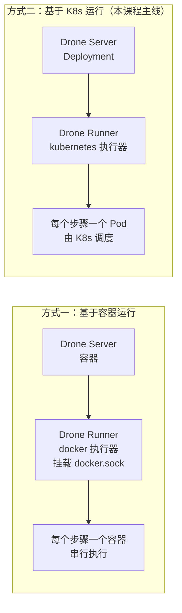
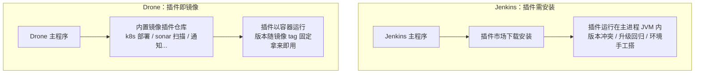
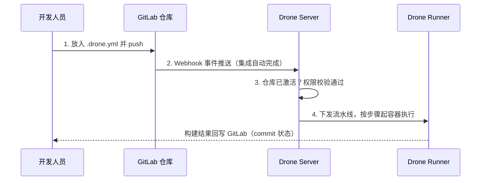

## 纲要

- **Drone 是开源、基于容器的 CI/CD 工具**：云原生血统，官方支持「容器」与「K8s」两种运行方式，本课程以 K8s 方式落地企业实践
- **最大杀器是「内置镜像插件」**：构建环境、部署动作、代码扫描等能力全部打成现成的容器镜像，拿来即用——不需要像 Jenkins 那样逐个装插件、搭环境
- **声明式配置 `.drone.yml`**：一个 YAML 文件就是一条完整流水线，放进仓库分支即可运行；对比 Jenkins 的 Groovy 脚本，配置简单、可读性强
- **与 GitLab 深度集成、权限零迁移**：登录走 GitLab OAuth，仓库与用户权限直接继承 GitLab，不需要另建一套账号体系
- **「零配置启动」的体感**：新项目只需把 `.drone.yml` 拷进仓库再微调，即可自动构建——不用手工建项目、配流水线、接 Webhook、配权限
- **默认自动化 + 可选人工审核**：push 代码即触发构建；也可以开启「受保护」模式，构建前必须人工点「通过」

## 一、场景引入：Jenkins 很好，但为什么还要学 Drone？

学完 Jenkins 三个章节（基础 → 进阶 → 企业级实战）和 Tekton 之后，很多读者会有个疑问：**CI 工具我已经会一个了，为什么还要再学一个？**

回想 Jenkins 的搭建过程：装插件、配凭据、写 Jenkinsfile（Groovy 脚本）、建构建项目、配 Webhook、配权限矩阵……一条流水线从零到能跑，前前后后几十项配置。**功能强是真的，重也是真的。** 当团队只想「push 代码后自动跑测试、构建镜像、发个通知」，为这点事养一套 Jenkins，投入产出比并不划算。

Drone 给出的答案是一个极简体感：**在仓库里放一个 `.drone.yml` 文件，push 代码，构建自动开始。** 没有「新建构建项目」这一步，没有 Webhook 手工配置，没有权限体系要从头搭——仓库即项目，配置文件即流水线。

本篇作为前述的开篇，先把 Drone 是什么、为什么值得学、和已知工具的差异讲清楚，后续再逐层深入部署、权限、管道与插件。

## 二、核心概念与原理

### 2.1 定位：容器原生的轻量级 CI/CD 平台

Drone 是一个**开源的、基于容器的持续集成与持续交付工具**。三个关键词拆开看：

| 关键词 | 含义 | 带来的直接好处 |
| --- | --- | --- |
| **基于容器** | 每个构建步骤都跑在独立容器里 | 环境隔离、依赖干净，不污染宿主机；工具链随镜像走 |
| **云原生** | 官方提供 K8s 运行方式，资源调度交给 K8s | 构建Pod 弹性伸缩，与集群内制品仓库、部署链路天然打通 |
| **轻量级** | 无插件安装体系，一个 YAML 驱动全部 | 学习成本、运维成本、启动成本三低 |

### 2.2 运行方式：容器与 K8s 两条路线

Drone 官方支持两种运行方式，课程主攻第二种：



- **基于容器运行**：Runner 以 Docker 容器方式部署，通过挂载 `docker.sock` 在宿主机上拉起步骤容器。简单直接，但构建任务固定在部署 Runner 的机器上。
- **基于 K8s 运行**：Runner 以 K8s 方式部署，每个构建步骤由 K8s 调成独立 Pod。**资源弹性、故障自愈、多节点分布**，是企业环境的标准姿势。

### 2.3 插件即镜像：与 Jenkins 插件体系的本质差异

这是 Drone 与 Jenkins 最核心的架构分野：



Drone **内置了大量已集成好的镜像插件**：K8s 部署、代码扫描（SonarQube）、镜像构建、通知报警等常用能力都有官方镜像。写流水线时引用插件镜像即可，**不需要自己一个镜像一个镜像地构建所需环境**。课程后续逐个使用这些插件完成「扫描 → 构建 → 部署 → 报警」全链路。

### 2.4 声明式配置：`.drone.yml` 与 Jenkinsfile 的对比

Jenkins 用 Groovy 写流水线，灵活但「写了一堆脚本，看起来很复杂」；Drone 用**声明式 YAML**，配置文件简洁美观：

```groovy
// Jenkins 声明式流水线（片段）
pipeline {
    agent any
    stages {
        stage('Build') {
            steps {
                sh 'go build ./...'
            }
        }
    }
}
```

```yaml
# Drone 等价流水线：.drone.yml
kind: pipeline
type: kubernetes
name: default

steps:
- name: build
  image: golang:1.19
  commands:
  - go build ./...
```

**同一个需求，YAML 的心智负担明显低于 Groovy**。而且 `.drone.yml` 存放在项目仓库里，天然进入 Git 版本管理，流水线变更走 MR 评审——「流水线即代码」在 Drone 里是默认姿势，不是额外追求。

### 2.5 与 GitLab 的深度集成：权限继承是杀手锏

Drone 与 GitLab 是「官方 CP」关系：部署时通过 GitLab OAuth 应用连接，连接后：

- **账户体系统一**：Drone 不存自己的用户密码，直接用 GitLab 账户登录（GitLab 若接了 LDAP，Drone 账号就是 LDAP 账号）
- **仓库权限继承**：GitLab 里对某仓库有权限，Drone 里才能看到、激活、构建它——**权限跟着 GitLab 走，不需要在 Drone 里再配一遍**
- **自动触发**：GitLab 配置好连接后，仓库 push 事件直达 Drone，Webhook 由集成自动处理

### 2.6 为什么要学 Drone：五个理由

1. **轻量级持续集成平台**：单二进制 Server + 轻量 Runner，资源占用与运维复杂度远低于 Jenkins。
2. **自助式集成服务**：内置镜像插件开箱即用，「自助」= 不依赖运维预先装环境。
3. **部署配置极简**：比 Jenkins、GitLab CI 都更简单直接，一条流水线一个文件。
4. **默认自动化触发**：添加项目、放入 `.drone.yml`，提交代码即自动构建部署；也支持配置成**人工审核后构建**（详见权限章节）。
5. **零门槛启动新项目**：不需要新建构建项目、不需要配置复杂流水线、不需要配 Webhook 和权限——**把 `.drone.yml` 扔过去、微调一下，构建立刻跑起来**。

## 三、动手实践：一个最小流水线的完整生命周期

本篇课件为导学篇，未提供配套代码文件。以下用课程内置插件生态中的最小示例，建立「配置文件即流水线」的直观认识。

### 3.1 最小 `.drone.yml`

```yaml
kind: pipeline      # 资源类型：pipeline
type: kubernetes    # 管道类型：kubernetes / docker / ssh / exec
name: default       # 管道名称

steps:
- name: hello        # 步骤名
  image: alpine      # 步骤执行环境：直接引用镜像
  commands:
  - echo "Hello Drone"
```

三个字段就构成一条流水线：**kind 固定 `pipeline`、type 选执行引擎、name 给流水线起名**；`steps` 下每个步骤由「镜像 + 命令」组成，步骤之间默认**串行**，前一个失败后一个不执行。

### 3.2 从放入文件到自动构建的四步



1. **放文件**：把 `.drone.yml` 提交到仓库根目录（文件名默认 `.drone.yml`，可在页面配置自定义）。
2. **同步**：Drone 页面点「Sync」，GitLab 的组与仓库同步过来。
3. **激活**：对该仓库有管理员权限的账户点「Activate」——激活是构建的前置开关。
4. **push 即构建**：之后每次 push，Drone 按 `.drone.yml` 自动执行，构建状态回写到 GitLab 的 commit 记录上。

**注意**：没有 `.drone.yml` 的仓库即使激活了也无法构建——页面点「New Build」能创建，但步骤为空会直接结束。这就是「配置文件即流水线」的含义。

## 四、生产实践要点

1. **选型先行**：Drone 不是 Jenkins 的全面替代，而是「轻场景优选」。团队已有重度的 Jenkins 共享库生态、复杂审批链时不必强迁；新项目、中小团队、GitLab 重度用户，Drone 的启动速度优势巨大。选型对比见下表：

 | 维度 | Jenkins | Drone | Tekton |
 | --- | --- | --- | --- |
 | 配置方式 | Groovy 脚本 | YAML 声明式 | YAML CRD |
 | 插件机制 | 需安装，跑在主进程 | 镜像插件，容器隔离 | Task 即容器 |
 | 运行方式 | 主机/容器 | 容器 / K8s | 仅 K8s |
 | 权限体系 | 自带 Role-Based | 继承 GitLab | 继承 K8s RBAC |
 | 上手成本 | 高 | 低 | 中 |

2. **`.drone.yml` 必须进 Git 并走评审**：流水线即代码，意味着改流水线 = 改生产部署动作。用 MR + Review 管住对它的修改，禁止页面上随意改配置。
3. **插件镜像固定版本 tag**：引用 `plugins/xxx:latest` 会随上游发布悄悄变更行为，生产一律锁定版本（如 `plugins/k8s-deploy:1.0.0`），升级插件 = 主动发版。
4. **权限继承是双刃剑**：好处是不用维护第二套账号；代价是**GitLab 侧权限管理必须严谨**——离职回收 GitLab 权限即回收 Drone 权限，但临时给某人开 GitLab 开发权限也等于开了 Drone 构建权限。
5. **一个 Drone Server 对一个 GitLab**：多 GitLab 实例（如集团多套）需要部署多个 Server，规划地址时预留扩展。
6. **与 K8s 集成时的资源规划**：每个构建步骤一个 Pod，构建并发上限 = Runner 容量 × 节点资源。流水线里显式声明资源请求（requests/limits），避免构建 Pod 挤占业务 Pod。

## 五、报错排查表

| 现象 | 根因 | 解法 |
| --- | --- | --- |
| GitLab 里新建了仓库，Drone 页面看不到 | 仓库建在**子组**下（Drone 只识别一级组下的仓库）；或没点 Sync | 在一级组下建仓库；页面点「Sync」同步 |
| 仓库能看到，但没有「激活」按钮 | 当前 GitLab 账户对该仓库不是**管理员**权限 | 在 GitLab 项目成员里把账户提到管理员（Maintainer 及以上），再 Sync |
| 激活后 push 不触发构建 | 仓库里没有 `.drone.yml`，或文件名/路径不对 | 确认仓库根目录存在 `.drone.yml`，YAML 语法合法 |
| 构建秒结束且没有任何步骤输出 | `.drone.yml` 为空或 `steps` 缺失 | 检查文件内容完整性，`kind/type/name/steps` 四要素齐全 |
| 点击登录后在 Drone 与 GitLab 之间循环跳转 | GitLab OAuth 应用的**回调 URL** 配错（少了 `/login` 后缀或协议/端口不对） | 回调 URL 改为 `http://<drone地址>/login`，保存后重试 |
| 换账户登录失败，始终停在旧账户 | 单点登录特性：GitLab 已登录的账户会被 Drone 直接复用 | **先退出 GitLab 账户，再退出 Drone**，重新登录即切换 |

## 六、面试考点与追问

**Q1：Drone 是什么？它和 Jenkins 最核心的区别是什么？**
Drone 是开源的、基于容器的 CI/CD 工具，支持容器与 K8s 两种运行方式。与 Jenkins 最核心的区别是插件机制：Jenkins 的插件需要安装且运行在主进程内；Drone 的插件就是容器镜像，容器隔离、版本随镜像 tag 固定、拿来即用。配置上 Drone 用声明式 YAML（`.drone.yml`），Jenkins 用 Groovy 脚本。

**Q2：Drone 的流水线配置存放在哪里？这带来什么工程价值？**
存放在 Git 仓库根目录的 `.drone.yml`（文件名可自定义）。工程价值：① 流水线即代码，变更走 Git 版本管理与 MR 评审；② 仓库即项目，新项目零配置启动；③ 配置随仓库分发，克隆仓库即得到完整构建定义。

**Q3：Drone 怎么做用户权限管理？**
Drone 自身不维护用户体系，通过 GitLab OAuth 连接，账户与权限完全继承 GitLab：GitLab 里能看到某仓库才能同步到 Drone；对仓库有管理员权限才能激活；有开发权限才能构建。切换登录账户需要同时退出 GitLab 与 Drone 两侧。

**Q4：「仓库激活」是什么？为什么需要它？**
激活是把 GitLab 仓库注册为 Drone 可构建项目的开关，且只有对该仓库有管理员权限的 GitLab 账户能操作。它是一道显式的授权闸：避免「仓库同步过来就能被任意触发构建」。未激活的仓库即使有 `.drone.yml` 也不会自动执行。

**Q5：Drone 的默认触发行为是什么？能改成人工审核吗？**
默认 push 即触发自动构建，构建状态回写 GitLab commit。可以改：在项目设置里开启「受保护（Protected）」而未配置验证签名时，流水线会被阻止，必须人工在页面点「通过」才放行——相当于零成本的人工审核卡点。

**Q6：Drone 支持哪些管道类型（pipeline type）？**
至少四种：`kubernetes`（每步骤一个 Pod，K8s Runner 执行）、`docker`（每步骤一个容器，Docker Runner 执行）、`ssh`（在远程主机执行）、`exec`（在 Runner 所在主机执行）。课程主线是 `kubernetes` 类型。

**Q7：一个 Drone Server 能连接多个 GitLab 实例吗？**
不能。一个 Server 通过一对 Client ID/Secret 连接一个 GitLab。多套 GitLab 需要部署多个 Drone Server，每个连一个，这是架构约束，规划地址与端口时预留。

## 📎 文本↔代码关联

本篇为**导学篇**，课件未提供配套代码文件（本章代码从 Drone 部署篇开始提供，如 `7-Drone/` 目录下的各类 `.drone.yml` 实例），如实标注、不虚构路径。后续章节将使用：

- `code/7-Drone/drone.yml-工作空间与步骤` —— 最小 pipeline 骨架与 step 定义，本篇 3.1 节示例的同源结构
- `code/7-Drone/drone.yml-镜像拉取方式与拉取私有镜像` —— kubernetes 管道的镜像拉取与私有仓库 secret 配置

**技术点总结**：Drone 是一个开源、基于容器的轻量级云原生 CI/CD 工具，支持容器与 K8s 两种运行方式（本课程主攻 K8s）。它的两大设计支柱：一是**插件即镜像**——构建环境、部署、扫描等能力全部内置为现成镜像插件，免去 Jenkins 式的插件安装与环境搭建；二是**声明式配置**——`.drone.yml` 一个文件就是一条流水线，放进仓库 push 即构建，配合 GitLab OAuth 实现账户与权限的零成本继承。对新团队而言，「扔个配置文件就能拉起流水线」的启动体感，正是它相对 Jenkins / Tekton 的差异化价值；而它的边界也同样清晰——单 Server 对单 GitLab、仓库必须在一级组下、构建权限完全跟随 GitLab，这些约束决定了它在企业多 GitLab 场景下的扩展方式。
