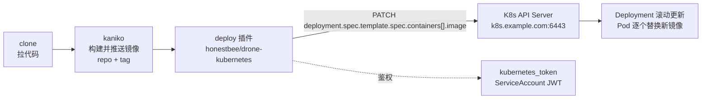

## 纲要

- **部署插件把流水线「最后一步」补齐**：`drone-kubernetes` 插件直接改写 Deployment 的镜像 tag——CI 到此闭环，构建产物自动上线，不需要再人工 `kubectl set image`
- **部署前置是「一把 K8s 令牌」**：建 ServiceAccount → 绑定集群角色 → `create token` 拿 JWT，连同 server / namespace / deployment / container / repo / tag 共七个字段
- **repo/tag 必须与构建步骤严格同源**：部署步骤的两个字段直接拷贝 kaniko 的产出，「改了构建忘了改部署」是经典手滑事故
- **SCP 传文件、SSH 执行脚本**：`appleboy` 系列两插件覆盖「产物分发到目标机」与「远程执行命令」两类需求，密码/密钥全部走 Secret
- **S3 插件是 AWS 专属**：云平台不是 AWS 就用不上（国内对应 OSS），课程只做概念介绍，不展开
- **报警双通道：钉钉 + Webhook**：钉钉机器人只配 token 与 type 两项；Webhook 插件**必须开 `debug: true`**，否则发送失败时页面看不到任何报错

## 一、场景引入：镜像构建完了，然后呢？

前四篇（#47~#51）我们把 Drone 流水线从「拉代码」一路搭到了「构建镜像」。但一条能用的流水线还差两块拼图：

1. **上线**：镜像 push 到仓库只是「造出了货」，还得把它部署到 K8s 集群里跑起来；
2. **通知**：流水线成功了没人知道、失败了没人管——构建结果必须主动推到人的眼前。

课程这三小节正好各管一块：**Deploy 插件**（部署到 K8s）、**SSH/SCP/S3 插件**（产物分发与远程执行）、**钉钉与 Webhook 插件**（构建报警）。到本篇结束，Drone 章节的所有「单点插件」就全部讲完，下面（#53）进入七步流水线的项目综合实战。

一个建立直觉的类比：**kaniko 是工厂（造产品），deploy 插件是物流（把货摆上货架），scp/ssh 是闪送（点对点送货上门），报警插件是短信通知（告诉你货到了没）**。工厂造得再好，物流和通知不通，整条链路就是断的。

## 二、核心概念与原理

### 2.1 drone-kubernetes 插件：七个字段改一次镜像

部署插件 `quay.io/honestbee/drone-kubernetes`（课程给出的插件地址，可直接去仓库查最新用法）的工作机制非常「轻」：**它不重新创建任何资源，只调用 K8s API 把目标 Deployment 的容器镜像 tag 改成新构建的 tag**。K8s 自身滚动更新机制会完成剩下的 Pod 替换。



七个 settings 字段，按「连哪、连谁、改什么」分组记忆：

| 分组 | 字段 | 含义 | 课程演示值 |
| --- | --- | --- | --- |
| 连哪 | `kubernetes_server` | K8s apiserver 访问地址（kubeconfig 里抄） | `https://k8s.example.com:6443` |
| 连谁 | `kubernetes_token` | ServiceAccount 的 JWT 令牌 | Secret 注入 |
| 改哪 | `namespace` | Deployment 所在命名空间 | `default` |
| 改哪 | `deployment` | 要更新的 Deployment 名称 | `nginx-deployment`（课件代码为 `golang-deployment`） |
| 改哪 | `container` | Deployment 里要换镜像的容器名 | `nginx`（课件代码为 `golang`） |
| 换成什么 | `repo` | 新镜像仓库路径 | 与 kaniko 的 `repo` 一致 |
| 换成什么 | `tag` | 新镜像 tag | 与 kaniko 的 `tag` 一致 |

**「容器名」这个字段最容易被忽视**：一个 Deployment 的 Pod template 里可以有多个容器（主容器 + sidecar），插件靠 `container` 字段定位改哪一个——写错容器名，要么改错镜像，要么报「找不到容器」。

### 2.2 令牌准备：ServiceAccount + 角色绑定 + create token

插件的 `kubernetes_token` 不是随便复制的。课程现场的标准三步：

```bash
# 1. 建 ServiceAccount（课程取名 drone）
kubectl create serviceaccount drone

# 2. 创建角色绑定：把集群管理员角色绑给这个 SA
kubectl create clusterrolebinding drone-admin \
  --clusterrole=admin \
  --serviceaccount=default:drone

# 3. 为该 SA 签发 JWT（K8s 1.24+ 不再自动生成永久 token，需显式签发）
kubectl create token drone
```

三个细节：

1. **角色绑定的命名空间**：`--serviceaccount=default:drone` 表示 SA 在 `default` 命名空间——与流水线要部署的 namespace 无关，SA 的归属和部署目标可以不同；
2. **`create token` 是有时效的**：默认 1 小时过期（`--duration` 可调）。流水线是持续跑的，**生产环境要么定期轮换 Secret，要么按插件版本改用长期凭证机制**，否则某天所有部署集体失效；
3. **课程绑定的是集群管理员（admin）**——教学环境图省事。**生产必须最小化**：只授「patch 指定 namespace 下 deployment」的权限（Role + RoleBinding，甚至限定 resourceNames），CI 令牌泄漏的爆炸半径就等于它的权限半径。

**server 地址从哪来**：登录服务器打开 `~/.kube/config`，搜 `server:` 即是 apiserver 地址与端口（课程为 `https://k8s.example.com:6443`）。注意三要素——**地址、令牌、目标资源（namespace/deployment/container）必须同时正确且可达**，缺一不可。

### 2.3 SCP 与 SSH 插件：产物分发与远程执行

不是所有系统都跑在 K8s 上。还有一批「传统虚拟机 + 部署目录」的环境，靠两个 `appleboy` 系列插件覆盖：

| | `appleboy/drone-scp` | `appleboy/drone-ssh` |
| --- | --- | --- |
| 定位 | 把构建产物**拷到**目标机 | 在目标机上**执行**命令/脚本 |
| 核心字段 | `host` / `username` / `password` / `port` / `target` / `source` | `host`（**列表**，可多机）/ `username` / `password` / `port` / `command_timeout` / `script` |
| 课程演示 | 仓库里的 `main.go` → `gitlab.example.com:/tmp` | 在 `gitlab.example.com` 上跑 `ls -ls /tmp` 与 `hostname` |

两个设计要点：

- **`source` / `target` 是「仓库相对路径 → 目标机绝对路径」**：`source: main.go` 指仓库根目录的文件，`target: /tmp` 指目标机目录；
- **`command_timeout`**（课程配 `2m`）防止脚本卡死拖垮整个流水线——SSH 对面那台机器挂了、网络分区了，超时让步骤快速失败，比无限等待健康得多。

### 2.4 S3 插件：AWS 专属，了解即可

`drone-s3` 插件把产物同步到 **AWS S3 存储桶**，settings 含 `access_key` / `secret_key`（平台预设后粘贴）、`region`（区域）、`bucket`（桶名）、`source`（原路径）、`target`（桶内路径）。

课程明确说：**如果用的云平台不是 AWS，这个插件基本用不上**——它在 AWS 生态之外没有对应场景（国内云的对象存储是阿里云 OSS、腾讯云 COS，用各自的 CLI 走 SSH 步骤或专用插件即可）。所以本小节只建立「有这么一个插件、大概怎么配」的概念，不展开。

### 2.5 报警双通道：钉钉机器人与 Webhook 插件

**钉钉插件** `lddsb/drone-dingtalk-message` 简单到只有两个字段：

```yaml
- name: dingtalk
  image: lddsb/drone-dingtalk-message
  settings:
    token: https://oapi.dingtalk.com/robot/send?access_token=<机器人access_token>
    type: markdown
```

`token` 就是钉钉群机器人的 Webhook URL（创建机器人后粘贴过来），`type: markdown` 让消息按 markdown 渲染，可读性远好于纯文本。

**Webhook 插件** `plugins/webhook` 更通用——任何收 JSON POST 的接口都能推（课程推的是**企业微信机器人**）：

```yaml
- name: send
  image: plugins/webhook
  settings:
    debug: true                          # 关键！发送失败时在页面显示报错
    urls:
      - https://qyapi.weixin.qq.com/cgi-bin/webhook/send?key=<机器人key>
    content_type: application/json
    template: |
      {
        "msgtype": "text",
        "text": {
         "content": "owner: {{ repo.owner }}\nRepo: {{ repo.name }}\nStatus: {{ build.status }}"
        }
      }
```

模板变量沿用 Drone 内置变量（#50）：`{{ repo.owner }}`（仓库组）、`{{ repo.name }}`（仓库名）、`{{ build.status }}`（构建状态）——一条消息把「谁的、哪个仓库、成没成」说清楚。

**`debug` 字段是本节最大的经验点**：默认 `false`，报警发送失败时流水线页面**不显示任何报错内容**，你只会看到「发了，但群里没收到」然后毫无线索；设 `true` 后失败原因会打在构建日志里。课程原话：不开启的话，即使报警发送失败，我们也看不到报错的内容。

## 三、动手实践：三个课件实例逐行拆解

### 3.1 实例一：Deploy 插件部署到 K8s

`code/7-Drone/drone.yml-deployment插件使用`（敏感值已掩码，实际以 Secret 注入）：

```yaml
kind: pipeline
type: kubernetes
name: default

clone:
  disable: true          # 克隆步骤显式关闭——本课件聚焦部署动作本身

steps:
- name: kaniko
  image: plugins/kaniko
  settings:
    username:
      from_secret: docker_username
    password:
      from_secret: docker_password
    repo: registry.cn-hangzhou.aliyuncs.com/cicd-demo/app
    tags: "${DRONE_REPO_NAME}-${DRONE_BRANCH}-${DRONE_BUILD_NUMBER}"

- name: deploy
  image: quay.io/honestbee/drone-kubernetes   # 境外源，国内建议先同步到内网仓库（见下方说明）
  settings:
    kubernetes_server: https://k8s.example.com:6443
    kubernetes_token: <ServiceAccount JWT，建议经 Secret 注入>
    namespace: default
    deployment: golang-deployment
    repo: registry.cn-hangzhou.aliyuncs.com/cicd-demo/app
    container: golang
    tag: "${DRONE_REPO_NAME}-${DRONE_BRANCH}-${DRONE_BUILD_NUMBER}"
```

逐字段要点：

| 字段 | 值 | 说明 |
| --- | --- | --- |
| `kubernetes_server` | `https://k8s.example.com:6443` | kubeconfig 里的 apiserver 地址，协议 https + 端口 6443 |
| `kubernetes_token` | JWT | `kubectl create token drone` 产出；**课件为内联演示，生产必须 `from_secret`** |
| `namespace` | `default` | 目标 Deployment 所在命名空间 |
| `deployment` | `golang-deployment` | 现场演示用 `nginx-deployment`，按实际目标改 |
| `container` | `golang` | Pod template 里被换镜像的容器名 |
| `repo` | `.../cicd-demo/app` | **与 kaniko 的 `repo` 一字不差** |
| `tag` | 三件套变量 | **与 kaniko 的 `tags` 一字不差**——这是「部署的就是刚构建的那个镜像」的保证 |

**现场执行时序**（课程第 117 次构建）：打开克隆（`clone.disable` 去掉或改为 depth）→ 第一步克隆成功 → 第二步 kaniko 构建镜像 → 第三步部署。**首次构建报「验证失败」**，原因是配置里少了仓库地址（registry 地址要补全到 `repo` 字段），补齐后重新构建即通过——所以排查此类问题的第一动作永远是**先核对构建与部署两步骤的 repo/tag 是否同源**。

> ⚠️ **境外插件镜像的国内落地**：`quay.io` 在国内访问不稳定（时快时慢，CI 里表现为偶发 `image pull backoff`）。生产做法：
> ```bash
> # 一次性同步到内网 Harbor/云厂商镜像仓库，再把 drone.yml 的 image 改成内网地址
> docker pull quay.io/honestbee/drone-kubernetes
> docker tag quay.io/honestbee/drone-kubernetes registry.internal.example.com/drone/drone-kubernetes:v1
> docker push registry.internal.example.com/drone/drone-kubernetes:v1
> ```
> 顺带两个生产纪律：**镜像锁版本别用 latest**（插件 latest 漂移会让某天流水线突然行为大变）；**`kubernetes_token` 走 `from_secret`**，课件里的内联 JWT 只是演示，真 token 落 git 等于把集群管理员交出去。

**效果验证**：部署前集群里 Pod 用的镜像是 `nginx:1.19.1`（讲稿演示的旧镜像）；部署完成后 `kubectl` 查看，镜像已被替换为本次构建产出的新 tag（`<仓库名>-<分支>-<构建号>` 形式）。Deployment 更新动作本身成功——但讲稿现场还留了个尾巴：**Pod 没能把新镜像拉下来**（私有仓库没有 imagePullSecrets），这是「部署成功 ≠ 服务可用」的经典案例，第四节细说。

### 3.2 实例二：SCP + SSH 组合

`code/7-Drone/drone.yml-ssh与scp插件使用`：

```yaml
kind: pipeline
type: kubernetes
name: default

clone:
  depth: 1

steps:
- name: scp files
  image: appleboy/drone-scp
  settings:
    host: gitlab.example.com      # 目标机地址
    username: root                # 登录用户
    password: <经 Secret 注入>     # 课件为内联演示
    port: 22                      # SSH 端口
    target: /tmp                  # 目标机目录
    source: main.go               # 仓库内待拷贝文件

- name: ssh
  image: appleboy/drone-ssh
  settings:
    host:
      - gitlab.example.com        # host 是列表：可同时推多台机
    username: root
    password: <经 Secret 注入>
    port: 22
    command_timeout: 2m           # 命令超时，防卡死
    script:
      - ls -ls /tmp               # 验证文件确实到了
      - hostname                  # 验证执行的是哪台机
```

课程第 119 次构建的现场证据链：克隆完成 → SCP 把 `main.go` 拷到 `gitlab.example.com` 的 `/tmp` → SSH 执行 `ls -ls /tmp` 能看到 `main.go`、`hostname` 返回 `test`（目标机主机名）。**「拷完再验」是个好习惯**：`ls` 证明文件到了，`hostname` 证明命令发对了机器——两条输出都是排查「文件去哪了」时的第一手证据。

### 3.3 实例三：钉钉 + Webhook 报警

`code/7-Drone/drone.yml-钉钉与企业微信报警插件使用`：

```yaml
kind: pipeline
type: kubernetes
name: default

clone:
  depth: 1

steps:
- name: dingtalk
  image: lddsb/drone-dingtalk-message
  settings:
    token: https://oapi.dingtalk.com/robot/send?access_token=<机器人access_token>
    type: markdown

- name: send
  image: plugins/webhook
  settings:
    debug: true                   # 发送失败时在构建日志输出报错内容
    urls:
      - https://qyapi.weixin.qq.com/cgi-bin/webhook/send?key=<企业微信机器人key>
    content_type: application/json
    template: |
      {
        "msgtype": "text",
        "text": {
         "content": "owner: {{ repo.owner }}\nRepo: {{ repo.name }}\nStatus: {{ build.status }}"
        }
      }
```

课程第 121 次构建现场：钉钉插件显示「发送成功」，Webhook 步骤返回 **HTTP 200 OK**——两个通道都通。报警步骤通常放在流水线**末尾**（且配合 `when` 条件只在失败/成功时触发，见 #48 触发器与 when），否则每一步都响一次，群消息噪音会逼着所有人把机器人静音——**报警的信誉比报警的渠道更稀缺**。

## 四、生产实践要点 / 常见坑

1. **令牌与密码全部 Secret 化**：`kubernetes_token`、SSH `password`、钉钉 `token`、企业微信 `key` 一律 `from_secret` 引用（#50 的组织级/仓库级 Secret 体系）。`.drone.yml` 进 Git，明文密钥等于公开密钥。
2. **「部署成功但服务 404」先查 imagePullSecrets**：讲稿现场 Deployment 已更新镜像 tag，Pod 却拉不到私有仓库镜像。deploy 插件只负责改镜像引用，**Pod 能不能拉到是另一回事**——私有仓库必须在 Deployment 所在命名空间配好 `imagePullSecrets`（或节点预登录），否则滚动更新卡在 `ImagePullBackOff`。
3. **repo/tag 同源是铁律**：构建用 kaniko 产出 `repo:tag`，部署必须抄同一对值。手改了一处，部署的就是「旧镜像的新 tag」或「新镜像的错 tag」，回滚时按 tag 反查构建记录全对不上。
4. **`create token` 有时效，生产要轮换**：默认 1 小时过期的 JWT 不适合长期流水线。要么 `--duration` 延长并定期轮换 Secret，要么评估插件的长期凭证支持；把「轮换日期」写进值班手册。
5. **权限最小化**：教学绑定 admin 集群角色；生产给「仅 patch 目标 namespace 的 deployment」的 Role，并把 SA、RoleBinding 的创建纳入 Terraform/Ansible 管理，避免「谁手动创建的没人记得」。
6. **SCP/SSH 优先密钥而非密码**：`appleboy` 两插件均支持 SSH key（`ssh_key` 经 Secret 注入），免密且可轮换；密码方式在等保/审计场景直接不合格。
7. **`command_timeout` 必配**：远程脚本可能卡死（等输入、网络分区、对端 hang），不配超时等于让流水线陪绑。
8. **报警降噪**：钉钉/Webhook 步骤配合 `when: status: [failure,changed]` 之类条件（#48），只在异常或状态变化时发；`debug: true` 常开——报警通道自身的故障必须是可见的。
9. **S3 插件按云平台裁剪**：非 AWS 环境不装；国内云用 OSS/COS 的 CLI 走 SSH 步骤即可，别为了「课程讲了」而引入用不上的插件。

## 五、报错排查表

| 现象 | 根因 | 解法 |
| --- | --- | --- |
| 构建在部署步骤报「验证失败」 | `repo` 缺 registry 地址（只写了仓库路径没写仓库主机） | 补全完整仓库地址，重新构建（讲稿现场即此） |
| Deployment 显示更新成功，Pod 却 `ImagePullBackOff` | 命名空间缺 `imagePullSecrets`，拉不了私有仓库 | 建 `docker-registry` Secret 并挂到 Deployment；或节点预登录 |
| 部署报 `401 Unauthorized` / `invalid token` | SA 令牌错误、过期或没绑角色 | `kubectl create token drone` 重新签发；核对 clusterrolebinding |
| 部署报 `connection refused` 连不上 apiserver | `kubernetes_server` 地址/端口错，或 Runner 网络不通 | 对照 kubeconfig 的 `server:`；从 Runner Pod 内 `curl` 验证可达 |
| 部署成功但镜像没变 | `repo`/`tag` 与构建步骤不同源；或 `container` 名写错改了别的容器 | 两步骤逐字段核对；`kubectl get deploy -o yaml` 确认 image 与容器名 |
| SCP 报 `Permission denied` | 目标机密码/密钥错误，或 Secret 未注入 | 核对 Secret 名与 `from_secret` 两层命名（#50） |
| 群里收不到报警、页面也无报错 | Webhook 插件 `debug` 默认 `false`，失败被静默 | 设 `debug: true` 重跑，看日志里的真实响应 |
| SSH 步骤卡住直到流水线超时 | 对端 hang / 等输入，未配 `command_timeout` | 配 `command_timeout`（如 `2m`）快速失败 |

## 六、面试考点与追问

**Q1：drone-kubernetes 部署插件有哪七个字段？各自作用？**
`kubernetes_server`（apiserver 地址）、`kubernetes_token`（SA 的 JWT）、`namespace` / `deployment` / `container`（定位目标 Deployment 与容器）、`repo` / `tag`（要切换的新镜像）。前两个解决「连谁」，中间三个解决「改哪」，后两个解决「换成什么」。

**Q2：kubernetes_token 怎么来的？生产环境怎么管？**
`kubectl create serviceaccount` 建 SA → `kubectl create clusterrolebinding` 绑角色（教学用 admin）→ `kubectl create token <sa>` 签 JWT。生产三点：权限最小化（只授 patch 目标 deployment）、令牌 `from_secret` 注入不明文、`create token` 默认 1 小时过期需定期轮换。

**Q3：为什么要求部署步骤的 repo/tag 与构建步骤「同源」？**
保证「部署的就是刚构建的那个镜像」。若两处不一致，会出现部署了旧 tag 或对不上构建记录的情况，出问题时按 tag 反查构建日志的链路断裂，回滚也失去依据。这是 CI 可追溯性的基本要求。

**Q4：SCP 与 SSH 插件怎么分工？各自的必要字段？**
SCP 管「送文件」：host/username/password/port/target/source；SSH 管「执行命令」：host（列表，可多机）/username/password/port/command_timeout/script。典型组合：SCP 把产物送到目标机，SSH 登上去执行重启/校验脚本。

**Q5：S3 插件适用于什么场景？你的云平台不是 AWS 怎么办？**
S3 插件用于把产物同步到 AWS S3 桶（access_key/secret_key/region/bucket/source/target）。非 AWS 平台用不上——国内云用 OSS/COS，通过其 CLI 以 SSH 步骤执行，或找对应插件，不必强装 S3 插件。

**Q6：钉钉报警插件配几个字段？type: markdown 的意义？**
两个：`token`（钉钉群机器人的 Webhook URL，创建机器人后粘贴）与 `type`（消息类型，`markdown` 渲染结构化消息，比纯文本可读性好）。报警内容由插件按构建结果自动生成，不需要自己写模板。

**Q7：Webhook 插件的 debug 字段是干什么的？不配会怎样？**
`debug: true` 时，报警发送失败会在构建页面/日志里显示具体报错内容；默认 `false` 时失败是静默的——流水线绿着，群里却什么都没有，排查毫无线索。生产应常开 `true`，报警通道自身的故障必须可见。

**Q8：「Deployment 更新成功但 Pod 拉不到镜像」怎么排查？**
deploy 插件只改 Deployment 的 image 引用，不负责镜像拉取权限。Pod `ImagePullBackOff` 说明目标命名空间缺 `imagePullSecrets`（私有仓库）：建 `docker-registry` 类型 Secret 并挂到 Deployment，或让节点预登录仓库。这也说明「部署成功」与「服务可用」是两回事，验证要到 Pod Ready 才算完。

## 📎 文本↔代码关联

| 代码文件 | 正文提及 | 内容 |
| --- | --- | --- |
| `code/7-Drone/drone.yml-deployment插件使用` | 2.1、3.1 节 | kaniko 构建 + `quay.io/honestbee/drone-kubernetes` 部署：server/token/namespace/deployment/container/repo/tag 七字段，repo/tag 与构建同源 |
| `code/7-Drone/drone.yml-ssh与scp插件使用` | 2.3、3.2 节 | `appleboy/drone-scp` 拷 `main.go` 到目标机 `/tmp` + `appleboy/drone-ssh` 执行 `ls` / `hostname`，`command_timeout: 2m` |
| `code/7-Drone/drone.yml-钉钉与企业微信报警插件使用` | 2.5、3.3 节 | `lddsb/drone-dingtalk-message`（token + markdown）与 `plugins/webhook`（debug: true、企业微信 URL、`{{ repo.owner }}` 等模板变量） |

**技术点总结**：本片把 Drone 流水线的「最后一公里」补齐——**部署侧**，`honestbee/drone-kubernetes` 插件以「改 Deployment 镜像 tag」这一最轻动作接入 K8s：server/token 解决鉴权（SA + 角色绑定 + `create token` 签 JWT，注意默认时效与最小权限），namespace/deployment/container 定位目标，repo/tag 与 kaniko 严格同源保证「部署的正是刚构建的」；讲稿现场两个坑——repo 缺仓库地址导致验证失败（补齐重试即过）、Deployment 更新成功但 Pod 拉不到私有镜像（imagePullSecrets 缺失，部署成功≠服务可用）。**分发侧**，`appleboy/drone-scp` / `drone-ssh` 覆盖非 K8s 环境：SCP 送产物（source→target）、SSH 跑脚本（host 列表 + command_timeout 防卡死），密码密钥走 Secret；S3 插件限 AWS 场景，非 AWS 云用 OSS/COS CLI 替代。**通知侧**，钉钉插件仅 token + type 两项，Webhook 插件靠 urls/content_type/template 推送任意 JSON 接口，模板变量 `{{ repo.owner }}`/`{{ repo.name }}`/`{{ build.status }}` 交代构建结果，**`debug: true` 是必须常开的自诊断开关**——报警失败必须可见。至此 Drone 单点插件全部讲完，下面进入七步流水线项目实战与三大 CI 工具横评。
