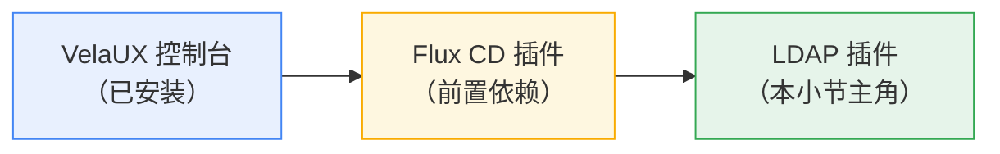
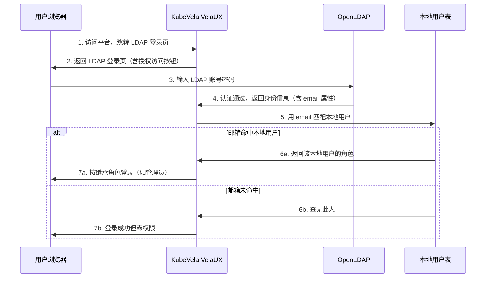

## 纲要

- **接入前提是插件三连**：VelaUX 已装 → 再装 Flux CD 插件 → 最后装 LDAP 插件，**依赖链顺序不能反**，UI 装不上时先检查前置插件
- **两种安装方式等价**：终端 `vela addon enable` 与图形界面「平台扩展 → 插件 → 搜索 → 启用」，UI 适合演示、CLI 适合自动化
- **LDAP 配置是一整串属性块**：管理员 DN、密码、主机与端口、SSL 开关、跳过安全认证、用户搜索过滤、email/id/name 属性映射、类型 `ldap`——可整串粘贴进「全局配置」
- **权限继承的唯一钥匙是「邮箱」**：LDAP 用户与 KubeVela 本地用户**靠邮箱相互关联**，邮箱填哪个本地用户的邮箱，就继承那个用户的权限
- **切换认证方式前必须换浏览器验证**：先在另一个浏览器确认 LDAP 能登录成功，再退出原账号——否则本地 admin 失效、LDAP 又没配对，**两头落空**
- **登录态默认零权限**：LDAP 用户首次登录「什么权限都没有」，要管理员权限就把邮箱改成本地管理员邮箱——这是设计而非 bug

## 一、场景引入：一个平台，凭什么记住我是谁？

先设想一个再普通不过的企业场景：公司已经有 OpenLDAP 目录服务，全公司的账号、密码、邮箱都归它管。运维同学一个账号走遍内网：GitLab、Jenkins、SonarQube、监控系统，全是「用 LDAP 账号登录」。

现在团队要上 KubeVela 做云原生交付。问题立刻来了：

- **账号体系分裂**：交付平台自己一套账号（默认 `admin`/`VelaUX12345`），LDAP 一套账号。每个人多记一个密码，离职时要在两个系统分别销号——**漏删任何一个都是安全洞**。
- **权限没法统一管**：LDAP 里给张三定的岗位是「测试负责人」，KubeVela 里还得单独再授权一遍。两套授权对不齐，就会出现「LDAP 里已经降权、平台里还是管理员」的窗口期。
- **新人入职成本**：每接入一个新系统，管理员就要在新系统里手工建号。系统越多，重复劳动越多，出错概率越大。

**统一认证（SSO 单点登录）就是为消灭这些重复劳动而生的**。对 KubeVela 来说，方案是：把登录入口从「本地账号」切换为「集成 LDAP 单点登录」——用户拿 LDAP 账号登录，平台用 LDAP 里的身份信息与本地权限体系做映射。身份归 LDAP 管，权限归平台管，中间用**邮箱**这根线缝合。

这一小节就讲清楚三件事：**装什么插件、配什么字段、按什么顺序操作才不把自己锁在门外**。

## 二、核心概念与原理

### 2.1 插件依赖链：为什么装 LDAP 之前要先装 Flux CD？

KubeVela 的插件（addon）不是一个个孤立的开关，而是**有依赖关系的模块**。LDAP 插件的依赖链是：



课程原话的逻辑是：**使用 OpenLDAP 功能之前要先装 LDAP 插件；装 LDAP 插件之前要先装 Flux CD 与 VelaUX 插件**；VelaUX 上一小节已经装过，所以本小节实际要补的是 **Flux CD + LDAP 两个插件**。

为什么会有这条链？可以这样理解：插件的本质是「一组 CRD + 控制器 + 前端界面」的打包体。Flux CD 插件在集群里提供了 GitOps 式的持续同步能力（这是 KubeVela 插件体系的常用底座），LDAP 认证能力构建在这套底座之上——**底座不在，上层插件装上也跑不起来**。所以 UI 上直接点 LDAP 的「启用」，系统会明确提示「请先安装 Flux CD」。

这个依赖链也解释了排查表里最高频的一条报错：LDAP 装不上，十有八九不是 LDAP 的问题，是**前置插件缺失或版本不兼容**。

### 2.2 两种安装方式：终端与图形界面

课程明确给出两条路，功能等价、场景不同：

| 维度 | 终端安装（CLI） | 图形界面安装（UI） |
| --- | --- | --- |
| 命令/路径 | `vela addon enable <插件名>` | 平台扩展 → 插件 → 搜索框输入插件名 → 点「启用」 |
| 版本控制 | `--version` 指定版本，不指定默认最新 | 版本不兼容时在弹窗里手动选版本（课程示例选 2.3.4） |
| 适合场景 | 自动化脚本、CI 里预置、批量集群 | 演示、手工探索、临时验证 |
| 卸载 | `vela addon disable <插件名>` | 同一位置点「禁用」 |
| 查看 | `vela addon list` / `vela history` | 插件列表页 |

UI 安装的**状态判据**很重要，课程专门强调过：插件卡片右下角**只显示「启用」= 没装过**；**显示「禁用」按钮（或「已升级」字样）= 装好了**。装好之后，「管理面板 → 全局配置」里才会冒出 LDAP 配置入口——**没装插件时，这个入口在全局配置里根本找不到**，这也是判断插件是否真正生效的硬指标。

### 2.3 LDAP 配置字段逐项拆解

LDAP（Lightweight Directory Access Protocol，轻量级目录访问协议）是「查用户账号的协议」。VelaUX 要接入它，必须知道四件事：**连哪台服务器、用什么身份查、按什么规则查、查出来哪个字段当邮箱**。课程把这整段配置称为「一串配置」，字段如下：

| 字段 | 作用 | 课程口径 |
| --- | --- | --- |
| 管理员域名 | 绑定 DN（Bind DN）——VelaUX 查目录时「扮演」的只读账号 | 第一行配置，LDAP 里一个有查目录权限的账号 DN |
| 密码 | 绑定 DN 对应的密码 | 第二行 |
| 主机 | LDAP 服务器地址 | OpenLDAP 的 IP + 端口，如 `10.0.7.x:389` |
| SSL | 是否走 TLS 加密通道 | 生产必开，内网测试可关 |
| 跳过安全认证 | 是否跳过证书校验（自签证书场景） | 测试环境自签证书才开，**生产不建议** |
| 用户搜索过滤 | 按用户域（Base DN）+ 过滤条件圈定「哪些条目算用户」 | 通过用户域搜索 |
| email 属性 | 目录里哪个字段是邮箱 | **权限继承的锚点**，必须填对 |
| id 属性 | 目录里哪个字段是用户唯一标识 | 通常 `uid` / `sAMAccountName` |
| 名字属性 | 目录里哪个字段是显示名 | 登录后平台显示的名字 |
| 用户名 | 登录时输入的账号字段 | 与 id 属性配合 |
| 类型 | 目录服务类型 | `ldap` |

配置入口在**管理面板 → 全局配置 → LDAP → 新增配置**；配置名随意起，类型选 `ldap`。课程演示了一个提效技巧：不必在表单里逐字段手填，**点「整串粘贴」按钮把完整配置一次糊上去**——批量部署或复制环境时这招能省掉逐项对字段的时间。

**email 属性是整份配置里最不能错的字段**——下面会看到，权限继承全靠它。

### 2.4 权限继承：邮箱即桥梁

这是本小节的**认知核心**，课程用一句话点破：

> LDAP 的用户邮箱与 KubeVela 本地登录用户的邮箱能够相互关联，LDAP 的用户将继承本地用户的权限。

翻译成大白话：

- 你在 KubeVela **本地**建过一个用户「张三」，角色是管理员，邮箱填的是 `admin@example.com`；
- LDAP 里也有个用户，登录名可能叫 `test`，只要**把它的邮箱也配成 `admin@example.com`**；
- 那么当这个人用 LDAP 账号登录 KubeVela 时，平台按邮箱匹配到本地「张三」，**张三的管理员权限就整套继承过去了**。



注意流程图的最后两步分叉——课程专门演示了**两种结局**：

1. **零权限结局**：LDAP 用户 `test` 的邮箱是 `test@example.com`，本地没这个邮箱的用户 → 登录成功，但「默认什么权限都没有」，面板上一片空白；
2. **管理员结局**：把 LDAP 里 `test` 的邮箱改成 `admin@example.com`（与本地管理员一致）→ 重新登录，立刻看到全部功能，「用户」页里能看到管理员账户与 test 用户并列。

**所以「想继承谁的权限，就把邮箱填成谁的」**——这句话就是整篇的操作口诀。顺带一提，课程里还观察到：LDAP 用户登录后**平台侧显示的名字是随机生成的**（因为本地没有对应条目，名字字段没有可继承的值），这不影响权限，但意味着「按名字找人」在纯 LDAP 用户身上不好使。

### 2.5 用户认证方式：本地登录 vs 集成 LDAP 单点登录

VelaUX 的「用户认证配置」提供两种模式：

- **本地登录（默认）**：账号密码存在平台自己库里，本小节之前的所有演示都走这条；
- **集成 LDAP 单点登录**：登录入口切到 LDAP，同时要配置 **VelaUX 的访问地址**（回跳地址，LDAP 侧要配回调）。

切换入口：**管理面板 → 设置 → 用户认证配置 → 选择「集成 LDAP 单点登录」→ 填 VelaUX 访问地址 → 确定**。

## 三、动手实践：从装插件到 LDAP 登录成功

按顺序操作，全程约十分钟：

**第 1 步：装 Flux CD 插件。**

```bash
# 方式一：终端（推荐写入初始化脚本）
vela addon enable fluxcd

# 方式二：UI —— 平台扩展 → 插件 → 搜索 fluxcd → 启用
# 版本不兼容时在弹窗中手动选择兼容版本（课程示例：2.3.4）
```

**第 2 步：装 LDAP 插件。**

```bash
vela addon enable ldap          # 不指定版本默认最新
vela addon list                 # 或 vela history，确认已安装
```

UI 路径同理：平台扩展 → 插件 → 搜索 `ldap` → 启用。装完后到「管理面板 → 全局配置」确认出现了 LDAP 配置项——**没有出现就是没装成功**。

**第 3 步：配置 LDAP 连接。** 管理面板 → 全局配置 → LDAP → 新增配置，名称随意（如 `corp-ldap`），类型 `ldap`，host 填 OpenLDAP 的 IP 与端口，保存。提效做法：点整串粘贴按钮，把下面这种结构的配置一次贴入（字段名以实际版本为准）：

```yaml
# VelaUX LDAP 配置示例（结构示意，字段值按实际目录服务替换）
ldap:
  host: k8s.example.com:389          # OpenLDAP 地址与端口
  bindDN: cn=readonly,dc=example,dc=com   # 管理员域名：只读绑定账号
  bindPassword: "<掩码-见生产实践节>"       # 绑定密码
  ssl: false                    # 内网测试关；生产开
  skipTLSVerify: false          # 自签证书测试才开
  userSearchBase: ou=people,dc=example,dc=com   # 用户域：圈定搜索范围
  userSearchFilter: "(objectClass=inetOrgPerson)" # 用户搜索过滤
  emailAttribute: mail          # 邮箱字段：权限继承的锚点
  idAttribute: uid              # 唯一标识字段
  nameAttribute: cn             # 显示名字段
  username: uid                 # 登录账号字段
  type: ldap                    # 目录服务类型
```

**第 4 步：切换认证方式。** 管理面板 → 设置 → 用户认证配置 → 选「集成 LDAP 单点登录」→ 填 VelaUX 访问地址 → 先不要点确定退出（原因见第四节的铁律）——按课程流程，此时应**先用另一个浏览器**打开 VelaUX 登录页。

**第 5 步：换浏览器验证 LDAP 登录。** 新浏览器打开平台，登录页已出现 LDAP 登录选项 → 点击 → 输入 LDAP 账号密码 → 点「授权访问」→ 登录成功。

**第 6 步：按邮箱授权。** 首次登录默认零权限。到 LDAP 侧把该用户的邮箱改成本地管理员账户的邮箱（如 `admin@example.com`）→ 重新登录 → 管理员功能全部可见。

**第 7 步：确认无误后再操作原会话。** 新浏览器验证通过后，原浏览器里的旧会话才可以退出、注销。

## 四、生产实践要点

**① 「先验证、后切换」铁律，本质是防锁死。** 课程反复强调：没测通 LDAP 登录前，不要退出原账号。因为一旦切到 LDAP 单点登录，**本地 admin 账号就登录不了**；此时若 LDAP 又没配对成功，就是「本地进不去、LDAP 也进不去」的双锁死。生产上还要多一手：**保留一个能改数据库/改配置的后路**——VelaUX 的用户认证配置落在集群里的配置资源中，极端情况下运维可以通过改集群内配置或重启相关组件把认证方式改回本地登录。这就是所有 SSO 切换的标准 SOP：**新通道验证通过，才拆旧通道**。

**② 绑定账号用只读 DN，权限最小化。** VelaUX 查 LDAP 只需要「读目录」，绑定 DN 绝对不要给写权限。生产上建议在 OpenLDAP 里单独建一个 `cn=velaux-readonly` 账号，ACL 只放通 `search` 与 `bind`——CI/CD 平台被攻破时，攻击者拿到的也只是一个只读凭据。

**③ email 属性是权限继承的唯一锚点，必须保证「目录内唯一 + 与本地邮箱口径一致」。** 如果 LDAP 里两个人的 mail 字段相同，邮箱匹配会命中同一个本地用户，**等于两人共享同一份权限**，这是隐蔽的越权通道。上线前用一条 `ldapsearch` 校验唯一性：

```bash
ldapsearch -x -H ldap://k8s.example.com:389 \
  -D "cn=readonly,dc=example,dc=com" -W \
  -b "ou=people,dc=example,dc=com" \
  "(objectClass=inetOrgPerson)" mail uid | sort | uniq -d | grep mail
# 有输出 = 存在重复邮箱，必须先治理再接入
```

**④ SSL 与证书校验的生产口径。** 内网自签证书环境下图省事关掉 SSL、打开「跳过安全认证」，等于把 LDAP 绑定密码和用户凭证以明文撒在局域网上。正确姿势是给 OpenLDAP 上正式证书（或内网 CA 签的证书），开启 SSL，关闭「跳过安全认证」；端口从 389 换 636（LDAPS）。

**⑤ 权限模型提前规划，别等上线后补。** 「邮箱匹配本地用户」意味着：**平台侧必须预建与 LDAP 邮箱一一对应的本地用户并分好角色**。接入前先拉一份 LDAP 花名册，按团队角色（查看 / 部署 / 管理员）在 KubeVela 本地建好用户、填对邮箱，否则接入后每个人都是零权限，工单会淹掉管理员。

**⑥ 与 Jenkins/SonarQube 的 LDAP 接入是同一套方法论。** 回顾前述 Jenkins 接 OpenLDAP、前述 SonarQube 接 LDAP——「装认证插件 → 配连接与搜索规则 → 邮箱/用户名映射 → 先验证后切换」四步完全同构。**认证体系要全平台统一规划**：邮箱字段选哪个、绑定 DN 怎么建、证书怎么签，最好一次性定标准，各平台复用，否则每个平台一套映射规则，后期对账是灾难。

## 五、报错排查表

| 现象 | 根因 | 解法 |
| --- | --- | --- |
| UI 点 LDAP「启用」无反应，提示缺依赖 | 前置 Flux CD 插件未安装 | 先 `vela addon enable fluxcd`，再装 LDAP |
| 插件安装失败、版本不兼容 | addon 版本与 KubeVela 核心版本不匹配 | 启用时手动选兼容版本（课程示例 2.3.4），或升级核心 |
| 「管理面板 → 全局配置」里找不到 LDAP 配置项 | 插件实际没装成功 | `vela addon list` 复核；看插件卡片右下角是否出现「禁用」按钮 |
| 登录页没有 LDAP 登录选项 | 用户认证配置还是「本地登录」 | 设置 → 用户认证配置 → 切到「集成 LDAP 单点登录」并填访问地址 |
| LDAP 登录成功但面板空白、零权限 | 邮箱未命中任何本地用户 | 把 LDAP 用户邮箱改成目标本地用户的邮箱（权限继承口诀） |
| 管理员切了 LDAP 后谁都登不进去 | 未验证就切换，本地 admin 已失效 | 从集群侧把用户认证配置改回本地登录；重新走「先验证后切换」 |
| 登录后显示名是随机串 | LDAP 用户无本地对应条目，名字字段无可继承值 | 属预期现象；需要规范显示名就在本地预建用户 |
| 填了配置保存报错 | host 格式/端口不可达、bindDN 写错 | 先用 `ldapsearch` 命令行验证连接与绑定，再回填平台 |

## 六、面试考点与追问

**Q1：KubeVela 接入 OpenLDAP 的插件依赖链是什么？**
装 LDAP 插件前必须先装 Flux CD 与 VelaUX 插件——LDAP 能力构建在 Flux CD 提供的插件底座之上，底座缺失则上层插件无法工作。依赖链顺序不能反。

**Q2：LDAP 配置里哪些字段是必管的？各自作用？**
主机与端口（连哪）、绑定 DN 与密码（用什么身份查）、用户搜索 Base DN 与过滤条件（查哪些条目算用户）、email/id/name 属性（查出来哪列当邮箱/唯一标识/显示名）、类型 `ldap`。

**Q3：KubeVela 的权限继承机制到底继承的是什么？怎么控制？**
LDAP 用户与 KubeVela 本地用户靠**邮箱**相互关联，LDAP 用户继承邮箱匹配到的本地用户的权限。想让某人是什么权限，就把他的 LDAP 邮箱改成对应本地用户的邮箱——权限本身仍在平台侧定义，LDAP 只出身份。

**Q4：为什么切换 LDAP 单点登录前必须换浏览器先验证？**
因为切换到 LDAP 单点登录后本地 admin 账号即失效。若不先验证 LDAP 登录可用就切换，会出现「本地进不去、LDAP 也没通」的双锁死。这是所有 SSO 切换的通用 SOP：新通道验证通过才拆旧通道。

**Q5：LDAP 用户首次登录后什么权限都没有，是 bug 吗？**
不是。这是设计——邮箱没命中本地用户时，平台无从判断该给什么角色，按最小权限原则给零权限。解法是按邮箱匹配规则预建本地用户并授权。

**Q6：绑定 DN 为什么要用只读账号？**
VelaUX 只需要检索目录，只读绑定遵循权限最小化原则：平台凭据泄露时，攻击者也无法通过该账号篡改目录数据。

**Q7：email 属性配错或目录内邮箱重复，会有什么后果？**
配错则所有 LDAP 用户都匹配不上本地用户，集体零权限；目录内邮箱重复则多个身份命中同一个本地用户，等于共享同一份权限，形成隐蔽越权。接入前应做唯一性校验。

## 📎 文本↔代码关联

本篇为**平台配置类篇目**，课件未提供配套代码文件（LDAP 配置在 VelaUX 控制台「管理面板 → 全局配置」中完成，无独立代码文件），如实标注、不虚构路径。可复用的命令行操作如下，与课件 `8-Kubevela/` 目录后续篇目共用同一套 `vela` CLI 体系：

- `vela addon enable fluxcd` —— 装前置 Flux CD 插件（本篇第 3.1 节）
- `vela addon enable ldap` —— 装 LDAP 插件（本篇第 3.2 节）
- `vela addon list` / `vela addon disable <插件名>` —— 查看已装插件 / 卸载（本篇 2.2 节）

**技术点总结**：KubeVela 接入 OpenLDAP 是一条「**插件依赖链 → 配置字段 → 权限继承 → 认证切换 → 登录验证**」的完整链路。**依赖链**：VelaUX → Flux CD → LDAP，顺序即依赖序，UI 装不上先查前置；**配置**：主机/绑定 DN/搜索规则/属性映射整串可粘贴，其中 **email 属性是权限继承的唯一锚点**；**继承规则**：LDAP 用户靠邮箱匹配本地用户、继承其权限，「想继承谁就填谁的邮箱」；**切换铁律**：切到 LDAP 单点登录后本地 admin 即失效，**必须先换浏览器验证 LDAP 登录成功、再退出原账号**，否则双锁死；**默认零权限是设计不是 bug**，接入前应按花名册预建本地用户并授权。这套「装认证插件 → 配连接 → 邮箱映射 → 先验证后切换」的方法论与 Jenkins、SonarQube 的 LDAP 接入完全同构，认证体系宜全平台统一规划。下面讲交付目标与接入 K8s 集群部署首个应用。
