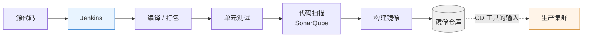
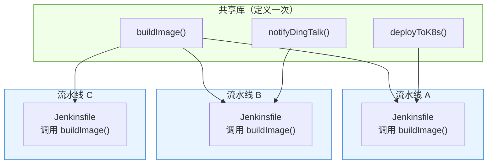
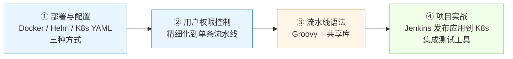

## 纲要

- **Jenkins 的定位**：一个开源的持续集成工具，核心动作是构建、测试、部署——它替代的是运维人员手工执行这三件事的低效与高错误率
- **能力一：把重复劳动自动化**：开发与运维团队的构建、测试、部署工作交给流水线，人从"执行者"变成"定义者"
- **能力二：插件生态**：Jenkins 是插件化的，**所有功能都需要插件来完成**——要 Git 就装 Git 插件，要流水线就装 Pipeline 插件，要集成第三方平台就装对应插件
- **能力三：共享库消除重复**：把常用逻辑抽到共享库，在 `Jenkinsfile` 里直接调用，避免几十条流水线复制同一段代码
- **本章学习地图**：部署（三种方式）→ 权限控制 → 流水线语法 + Groovy + 共享库 → 完整项目实战
- **本章的真正重点**：不是部署，而是**流水线语法与共享库**——部署一次就会，语法不熟则后面每一步都卡

## 一、Jenkins 到底是什么

**Jenkins 是一个开源的持续集成工具，我们可以用它来进行构建、测试和部署。**

这句话有三个信息点，逐个拆：

**① "开源"** —— 意味着免费、可自建、插件生态开放。这对企业来说是零许可成本，加上社区活跃，遇到问题容易找到答案。

**② "持续集成工具"** —— 它的职责边界是 CI：把源代码变成可信的制品（镜像），并在过程中跑测试与扫描。它**不直接负责**把镜像部署到生产集群（那是 CD 工具的活，如 Argo CD、KubeVela）。

**③ "构建、测试、部署"** —— 这三个词容易误解成"一条龙全包"。准确地说：构建指编译打包打镜像，测试指跑单元测试/接口测试/代码扫描，部署在 Jenkins 语境里通常指**部署到测试环境或开发环境**，生产环境的交付一般交给专业 CD 工具。

## 二、为什么必须学 Jenkins：三个不可替代的理由

### 理由一：它把运维从低效高错中解放出来

如果构建、测试、部署这些工作**由运维人员手工操作**，会有两个致命问题：

- **效率非常低**：每次发版都要登录服务器、敲一串命令、等结果、再敲下一串；
- **出错概率非常高**：前面章节讲过，改错配置、操作错服务器、步骤遗漏——这些不是能力问题是注意力问题。

Jenkins 的价值是**把这些固化成流水线**：一次定义，无限次重复执行，且每次执行的动作完全一致。

### 理由二：丰富的插件与集成能力

Jenkins 是**插件化架构**，这是它二十年不过时的根本原因。

> **关键认知：Jenkins 的所有功能都需要插件来完成。** 你需要什么样的功能，就需要安装对应的什么插件。

举个直接的例子：

| 你想做什么 | 装什么插件 |
| --- | --- |
| 从 Git 拉代码 | Git 插件 |
| 写声明式流水线 | Pipeline 插件 |
| 调用 K8s API 部署 | Kubernetes 插件 |
| 对接 SonarQube 扫描 | SonarQube Scanner 插件 |
| 发钉钉/飞书通知 | 对应通知插件 |

**这种设计带来两个好处**：① 功能按需装配，核心保持轻量；② **集成第三方平台的能力**——通过安装对应插件，就能使用第三方平台所提供的功能，不需要自己造轮子。

### 理由三：高度可扩展 + 共享库

Jenkins 具有高度的可扩展性，并且提供了一个**共享库（Shared Library）**机制。

共享库解决的是一个非常现实的问题：**几十条流水线里，总有一大段逻辑是重复的**——比如"构建镜像并推送"这段，每条流水线都要写一遍。

有了共享库，你可以：

1. 把平常需要重复使用的功能**定义到共享库中**（写成 Groovy 方法）；
2. 在 `Jenkinsfile` 里**直接调用这些共享库的功能**；
3. 从而**优化脚本**——流水线文件从几百行缩到几十行，且逻辑修改只需改共享库一处。

## 三、本章学习地图：四步走

课程把 Jenkins 拆成四块，按顺序推进：

### 第一步：部署与配置

用三种方式部署 Jenkins：**Docker、K8s Helm、K8s YAML**。三种方式覆盖了从"单机练手"到"生产集群"的完整光谱，下面会详细拆解。

### 第二步：用户权限控制

**当流水线多的时候，我们需要一个精细的权限控制。** 典型诉求是：

- 这条流水线**只允许哪些人查看**；
- 另一条流水线**只允许哪些人构建**；
- 还有的可能只允许特定角色触发部署。

Jenkins 默认的权限模型很粗（全局管理员/只读/匿名），要精确到"单条流水线级别"必须引入 **Role-Based Strategy 插件**，后续专门讲。

### 第三步：流水线语法 + Groovy + 共享库（本章重点）

课程明确说：**这一块是学习的重点。如果这一块掌握不好，Jenkins 也很难学习得好。**

原因很直接：部署是一次性动作，照着命令敲一遍就会了；但**流水线语法是每天都在写的**，不熟的话每写一条流水线都要查文档，效率极低。

这一块包含三部分：

| 内容 | 解决什么问题 |
| --- | --- |
| **声明式流水线语法** | 用结构化方式定义阶段、步骤、代理、选项 |
| **Groovy 语法** | 写条件逻辑、循环、字符串处理等动态部分 |
| **共享库** | 消除跨流水线的重复代码 |

### 第四步：项目实战

最后把前面学的全部用起来：**使用 Jenkins 发布一个应用到 K8s，并且集成相关的测试工具，形成一条完整的 demo 流水线。**

这条 demo 流水线就是后面企业级实战的雏形——从拉代码到部署上线的完整闭环。

## 四、新手的三个常见误区

**误区一：把 Jenkins 当成"部署工具"。** 它本质是 CI 工具，产出镜像；生产交付应该由 CD 工具（Argo CD 等）负责。混用会导致权限与审计边界不清。

**误区二：在部署上花太多时间，在语法上花太少。** 部署三小时，语法不入门，后面每条流水线都卡。**时间应该反过来分配。**

**误区三：一上来就抄现成 Jenkinsfile。** 抄能跑，但不懂 `agent` / `stages` / `steps` 的层次，改一处就全线崩。建议先手写最小流水线，再逐步加功能。

## 五、面试考点与追问

**Q1：Jenkins 是什么？它的职责边界在哪里？**
开源的持续集成（CI）工具，用于构建、测试、部署。职责边界：输入源代码，输出容器镜像，过程中执行编译、单元测试、代码扫描。它不负责生产环境的声明式交付（那是 Argo CD 等 CD 工具的职责）。

**Q2：Jenkins 的插件化架构有什么实际意义？**
所有功能都通过插件完成，核心保持轻量；需要什么装什么（Git 插件拉代码、Pipeline 插件写流水线、K8s 插件调 API）；同时获得了集成第三方平台的能力，无需自建。

**Q3：共享库解决什么问题？它是怎么做的？**
解决跨流水线的代码重复。做法：把常用逻辑（构建镜像、部署、通知）定义成共享库中的 Groovy 方法，在各 `Jenkinsfile` 中直接调用。收益是流水线文件大幅精简，且逻辑只需在共享库改一处。

**Q4：Jenkins 的流水线权限为什么需要插件支持？**
Jenkins 内置权限是全局维度（管理员/只读/匿名），无法表达"这条流水线只允许某些人查看、另一条只允许某些人构建"的诉求。需要 Role-Based Strategy 插件做基于角色的精细化授权。

**Q5：为什么说流水线语法比部署更重要？**
部署是一次性动作，三种方式照着做一遍即可；而流水线语法是日常高频使用，且是后续共享库、企业级实战的基础。语法不熟会导致每条流水线都卡在查阅文档上，也无法排查结构性问题。

## 📎 文本↔代码关联

本篇对应课件源码（`code/3-基础-Jenkins/`，已做去品牌化处理）：

| 代码文件 | 正文提及 | 内容 |
| --- | --- | --- |
| `code/3-基础-Jenkins/课件/教学课件.md` | 多处 | 单/多阶段流水线、构建代理、options、环境变量、凭据、post、when/input 等完整语法笔记 |
| `code/3-基础-Jenkins/Jenkinsfile/Jenkinsfile-流水线基础（基础课程所有笔记都在此文件）` | 多处 | 含 `triggers` / `options` / `parameters` / `environment` 的生产级流水线完整模板 |

**技术点总结**：Jenkins 是开源的持续集成工具，职责是把源代码变成可信镜像（构建/测试/扫描），不承担生产交付；它的三大价值是自动化替代手工、插件化获得功能与第三方集成能力、共享库消除跨流水线重复代码。本章重点是流水线语法与共享库而非部署——部署一次就会，语法不熟则步步卡。
