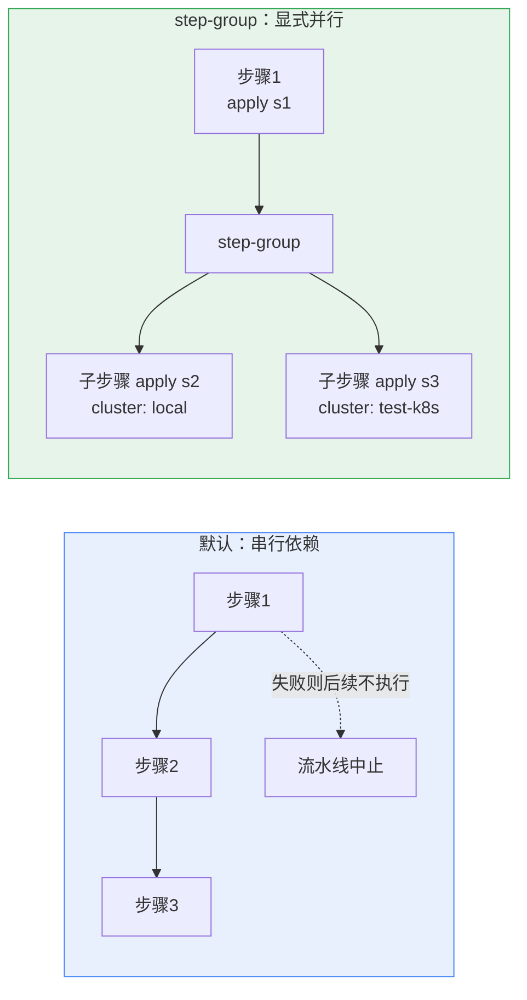
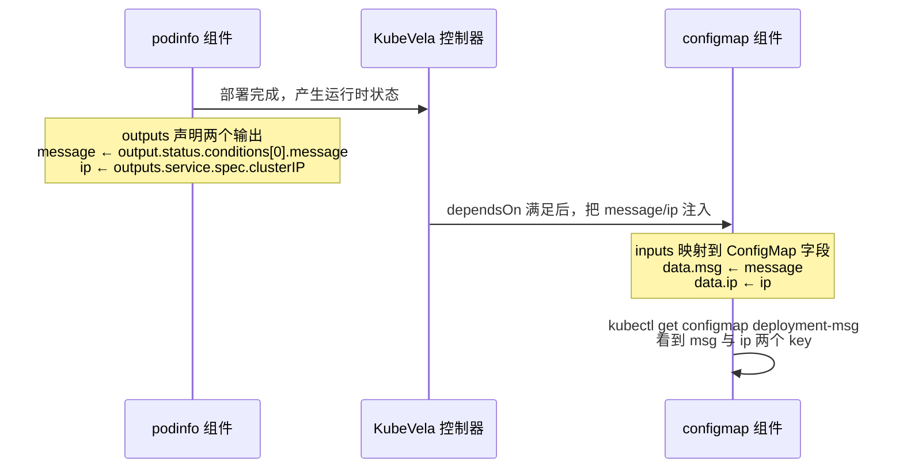

## 纲要

- **工作流五大操作**：暂停（`suspend`）、继续（`resume` 或控制台点击审核）、终止（控制台点击终止）、重启（`restart`）、查看日志（`vela logs`）——控制流水线生命周期的完整工具箱
- **步骤默认串行依赖**：每一步等上一步成功才执行，上一步失败则后续全部不执行；要并发必须显式用 `step-group` 把子步骤打包
- **条件判断用 `if` + `status.<步骤名>.succeeded/failed`**：这是固定语法，只有步骤真的成功/失败过，对应分支才会执行，否则直接跳过
- **步骤超时用 `timeout`**：如 `flushcdn` 步骤配 `timeout: 60s`——超时即中断整个流水线，防止「卡死的刷新任务拖死发布」
- **`vela-cli` 步骤类型是「步骤内执行 shell 指令」的唯一入口**：echo 刷新 CDN、调 CLI 都要靠它，`apply-component` 则是「部署指定组件」的入口，两者分工明确
- **组件编排靠 `dependsOn` + `inputs/outputs`**：B 组件 `dependsOn` A 组件保证顺序；A 组件的 `outputs` 把运行时值（消息、集群 IP）交给 B 组件的 `inputs` 写进 ConfigMap——跨组件参数传递的标准链路

## 一、场景引入：流水线不是「一条道走到黑」

前面我们让应用「一次部署到两个集群」，干净利落。但真实世界的发布链路从来不是直线：**要先刷新 CDN 再切换流量**（切换前必须确认刷新成功）、**三个服务要并行部署**（串行等三份太慢）、**部署结果要通知到人**（成功报喜、失败报警）、**上一步的运行时信息要传给下一步**（比如把服务的集群 IP 写进配置）。

这些诉求共同指向一个能力：**对流水线的精细控制**——步骤之间能并行、能条件分支、能超时熔断；组件之间能声明依赖、能传递参数。KubeVela 工作流（workflow）就是干这个的，本篇上半拆解 **if 条件 + timeout 超时** 这对控制双子星，下半打通 **组件编排与参数传递** 链路。

## 二、核心概念与原理

### 2.1 工作流操作全景：暂停、继续、终止、重启、日志

课程开篇给出 workflow 的五种操作，先建全局认知：

| 操作 | 触发方式 | 效果 |
| --- | --- | --- |
| **暂停** | 步骤类型 `suspend` 或控制台点击 | 流水线停在当前步，等待外部信号 |
| **继续** | `vela workflow resume <app>` 或控制台点击「审核」 | 从暂停处往下走（已在金丝雀篇演示） |
| **终止** | 控制台点击「终止」 | 流水线就此作废，不继续不重启 |
| **重启** | `vela workflow restart <app>` | 整个流水线从头再来一遍 |
| **查看日志** | `vela logs <app>` | 看各步骤执行日志，排查第一步 |

记忆锚点：**`suspend` 是「等人」，`terminate` 是「算了」，`restart` 是「重来」，`resume` 是「继续」**。人机协同式发布（金丝雀人工审核）就是 `suspend` + `resume` 的组合，前面已经用过；本篇重点在条件与超时。

### 2.2 依赖与并行：默认串行，并发要显式声明



规则两条：

- **串行是默认**：每个步骤都等上一步「成功完成」才执行；上一步失败，下一步直接不执行——这是发布安全的基本盘，防止带着错误往下滚；
- **并行靠 `step-group`**：把多个子步骤放进同一个 `type: step-group` 的 `subSteps` 数组，它们**同时运行**。课程用 `step-group.yaml`（应用名 `sub-success`）验证：三个 webservice 组件（express-server1/2/3），step1 单独部署 server1，step2 是一个 step-group，里面并行 apply server2（cluster `local`）和 server3（cluster `test-k8s`）——控制台能看到两个步骤并行执行并同时完成。

**注意子步骤的类型也必须是 `step-group` 兼容的步骤类型**（如 `apply-component`），且每个子步骤可以带自己的 `cluster` 字段——这就实现了「同一应用的不同组件，一次发布、分头落地到不同集群」。

### 2.3 条件判断：`if` + `status.<步骤名>.succeeded`

条件判断的语法固定为 `if: status.<步骤名>.succeeded` 或 `.failed`：

```yaml
- type: vela-cli
  name: alert
  if: status.flushcdn.succeeded     # 仅当 flushcdn 步骤成功，本步才执行
  properties:
    image: alpine
    command: ["/bin/sh", "-c", "echo 'alert success'"]
```

课程 `if-timeout.yaml` 的完整场景：**先刷新 CDN，刷新成功才发「成功报警」**。两个 `vela-cli` 步骤：

| 步骤 | 类型 | 关键字段 | 作用 |
| --- | --- | --- | --- |
| `flushcdn` | `vela-cli` | `image: alpine` + `command: echo 'flush cdn'` + **`timeout: 60s`** | 在生产环境执行 CDN 刷新，60 秒未完成即超时中断 |
| `alert` | `vela-cli` | **`if: status.flushcdn.succeeded`** + `echo 'alert success'` | 仅上一步成功才报警 |

三个必须记住的点：

1. **`vela-cli` 类型是步骤内跑 shell 的唯一入口**——课程明确「只有通过这种类型，我们才可以在步骤里面执行 shell 指令」；
2. **`status.<步骤名>` 引用的是上一步的执行状态**，`.succeeded` / `.failed` 二选一，课程称其为「固定语法」；
3. **条件不成立的步骤会被跳过**（不是失败）——报警篇的演示里，失败通知步就因为条件不成立被直接跳过，流水线整体仍是成功。

### 2.4 步骤超时：`timeout` 给流水线装上熔断器

`timeout: 60s` 的含义：**从步骤启动起 60 秒内没跑完，整个流水线中断**。课程的设计逻辑很直白——「不可能让它一直这样运行下去」：刷新 CDN 这类外部依赖可能因对方服务卡死而无限等待，没有超时，一条流水线能挂几天，占着工作流状态不释放。

生产建议：**所有涉及外部系统（CDN 刷新、远程 API 调用、镜像推送）的步骤都配 `timeout`**；纯本地部署步骤可不配或配长超时（如 300s）。

### 2.5 组件编排与参数传递：`dependsOn` + `outputs`/`inputs`

组件间的协作有两条独立通道，别混淆：

| 通道 | 字段 | 作用 | 类比 |
| --- | --- | --- | --- |
| **顺序依赖** | `dependsOn: [组件名]` | 被依赖组件部署完成后，本组件才执行 | 「等A建好再建B」 |
| **参数传递** | 上游 `outputs` + 下游 `inputs` | 把上游的运行时值注入下游的资源字段 | 「把A的IP写给B用」 |

课程 `cm-with-message.yaml` 把两条通道一次讲全，链路图：



两个细节值得展开：

- **`outputs.valueFrom` 是从「运行时状态」里挖值**：`output.status.conditions[0].message` 取 Pod 就绪条件里的消息文本，`outputs.service.spec.clusterIP` 取自动创建的 Service 的集群 IP——这些值部署前不存在，必须是「先部署、后提取、再传递」；
- **`inputs.parameterKey` 精确指定注入位置**：`data.msg`、`data.ip` 就是 ConfigMap 里最终出现的两个 key，课程实测 `kubectl get configmap deployment-msg -o yaml` 能看到 message 与 IP 两个字段——**参数传递的终点是「看得见的 ConfigMap 内容」**。

## 三、动手实践

### 3.1 `if-timeout.yaml`：完整代码与逐字段拆解

```yaml
apiVersion: core.oam.dev/v1beta1
kind: Application
metadata:
  name: if-timeout
  namespace: test-app
spec:
  components:
  - name: if-and-timeout
    type: webservice
    properties:
      image: nginx
      ports:
        - port: 80
  workflow:
    steps:
      - type: vela-cli
        name: flushcdn
        properties:
          image: alpine
          command:
          - /bin/sh  
          - -c  
          - echo 'flush cdn'
        timeout: 60s
      - type: vela-cli
        name: alert
        if: status.flushcdn.succeeded
        properties:
          image: alpine
          command:
          - /bin/sh  
          - -c  
          - echo 'alert success'
```

| 字段路径 | 值 | 作用 |
| --- | --- | --- |
| `components[0].name` | `if-and-timeout` | 被部署的 webservice 组件（nginx） |
| `components[0].properties.ports[0].port` | `80` | 声明容器端口 |
| `workflow.steps[0].type` | `vela-cli` | 步骤内执行 shell 指令的类型 |
| `workflow.steps[0].name` | `flushcdn` | **步骤名是 `if` 引用的锚点**，改名 = 改所有 `status.` 引用 |
| `workflow.steps[0].properties.command` | `echo 'flush cdn'` | 模拟「生产环境刷新 CDN」 |
| `workflow.steps[0].timeout` | `60s` | 超时熔断：60 秒未完成则流水线中断 |
| `workflow.steps[1].name` | `alert` | 报警步骤 |
| `workflow.steps[1].if` | `status.flushcdn.succeeded` | **仅 flushcdn 成功才执行**；失败则跳过 |
| `workflow.steps[1].properties.command` | `echo 'alert success'` | 模拟报警内容（生产换成飞书/钉钉 webhook，见报警篇） |

部署与验证：

```bash
vela up -f if-timeout.yaml -n test-app
vela status if-timeout -n test-app     # 预期流水线运行成功
```

课程实测：控制台环境列表点进去，`flushcdn` 步骤输出 `flush cdn`、`alert` 步骤输出 `alert success`——条件分支的「成功路径」完整可见。想验证失败路径，把 `echo 'flush cdn'` 改成 `exit 1`，`alert` 步骤会被跳过，同时可再加一个 `if: status.flushcdn.failed` 的失败通知步。

### 3.2 `step-group.yaml`：并行部署的完整代码

```yaml
apiVersion: core.oam.dev/v1beta1
kind: Application
metadata:
  name: sub-success
spec:
  components:
    - name: express-server1
      type: webservice
      properties:
        image: crccheck/hello-world
    - name: express-server2
      type: webservice
      properties:
        image: crccheck/hello-world
    - name: express-server3
      type: webservice
      properties:
        image: crccheck/hello-world

  workflow:
    steps:
      - name: step1
        type: apply-component
        properties:
          component: express-server1
        cluster: local
      - name: step2
        type: step-group
        subSteps:
          - name: step2-sub1
            type: apply-component
            properties:
              component: express-server2
            cluster: local
          - name: step2-sub2
            type: apply-component
            properties:
              component: express-server3
            cluster: test-k8s
```

| 字段路径 | 值 | 作用 |
| --- | --- | --- |
| `workflow.steps[0].type` | `apply-component` | 「部署指定组件」的步骤类型 |
| `workflow.steps[0].properties.component` | `express-server1` | 指名部署哪个组件 |
| `workflow.steps[0].cluster` | `local` | 步骤级集群覆盖：本步发到 local |
| `workflow.steps[1].type` | `step-group` | 并行组：其 `subSteps` 同时执行 |
| `workflow.steps[1].subSteps[0]` | apply server2 → `local` | 并行任务A |
| `workflow.steps[1].subSteps[1]` | apply server3 → **`test-k8s`** | 并行任务B，**不同集群**——并行 + 分簇一次到位 |

课程实测：部署后控制台可见两个子步骤**并行执行并同时完成**——若串行，总时长是两步之和；并行后约等于单步时长，3 个服务的发布收益立竿见影。

### 3.3 `cm-with-message.yaml`：组件编排 + 参数传递完整代码

```yaml
apiVersion: core.oam.dev/v1beta1
kind: Application
metadata:
  name: cm-with-message
spec:
  components:
    - name: podinfo
      outputs:
        - name: message
          valueFrom: output.status.conditions[0].message
        - name: ip
          valueFrom: outputs.service.spec.clusterIP
      properties:
        image: stefanprodan/podinfo:4.0.3
      type: webservice
      traits:
        - type: expose
          properties:
            port: [ 80 ]
    - name: configmap
      dependsOn:
        - podinfo
      properties:
        apiVersion: v1
        kind: ConfigMap
        metadata:
          name: deployment-msg
      type: raw
      inputs:
        - from: message
          parameterKey: data.msg
        - from: ip
          parameterKey: data.ip
  policies:
    - name: topo
      properties:
        clusters: [ "local"]
      type: topology
```

| 字段路径 | 值 | 作用 |
| --- | --- | --- |
| `components[0].outputs[0]` | `message` ← `output.status.conditions[0].message` | 上游输出①：Pod 就绪条件消息 |
| `components[0].outputs[1]` | `ip` ← `outputs.service.spec.clusterIP` | 上游输出②：Service 集群 IP |
| `components[0].traits[0]` | `expose`，port 80 | 暴露服务——**不暴露就没有 Service，`clusterIP` 无从取起** |
| `components[1].name` | `configmap` | 下游组件，消费参数 |
| `components[1].dependsOn` | `[podinfo]` | **顺序通道**：podinfo 部署完成才轮到它 |
| `components[1].type` | `raw` | 直接用现有 K8s 资源类型定义，无需 OAM 模型 |
| `components[1].properties` | ConfigMap `deployment-msg` | 最终落地的 ConfigMap 骨架 |
| `components[1].inputs[0]` | `from: message` → `data.msg` | **参数通道**：把 message 值写进 `data.msg` |
| `components[1].inputs[1]` | `from: ip` → `data.ip` | 把 IP 值写进 `data.ip` |

部署与验证：

```bash
vela up -f cm-with-message.yaml -n test-app

# 1) podinfo 组件先落地
kubectl get deployment podinfo -n test-app
kubectl get svc -n test-app

# 2) ConfigMap 后落地，且带着上游传进来的两个 key
kubectl get configmap deployment-msg -n test-app -o yaml
```

课程实测：`kubectl get configmap` 能看到 `deployment-msg` 里有 `msg` 与 `ip` 两个字段，值正是 podinfo 的就绪消息和集群 IP——**「A 部署完 → 提取运行时值 → 注入 B」的链路闭环成立**。

## 四、生产实践要点

1. **步骤名是 `if` 引用的唯一锚点**：`if: status.flushcdn.succeeded` 里的 `flushcdn` 必须与步骤的 `name` 完全一致；重构改名时忘了同步 `if`，条件会静默失效（步骤永远不执行）。
2. **`timeout` 与 `if` 是黄金搭档**：外部调用步骤配 `timeout`，后续步骤用 `if: status.<步>.failed` 兜底报警——「超时熔断 + 失败通知」才构成完整的容错闭环，只配一半都会漏场景。
3. **`step-group` 并行要评估资源与依赖**：并行步骤同时抢集群资源，镜像拉取、API 限流都可能相互影响；若子步骤间有隐式依赖（如都要写同一个 ConfigMap），并行反而制造竞态。
4. **`vela-cli` 步骤里别放长驻进程**：它是「跑完即退」的执行器，`tail -f`、`sleep infinity` 这类命令会直接把步骤挂到超时，日志里还看不出原因。
5. **`outputs` 取值路径要对齐 K8s 实际结构**：`output.status.conditions[0].message` 取的是 conditions 数组第一条的 message——若上游资源状态结构变化（字段改名、数组顺序变），取值会静默拿到空值，建议下游加默认值兜底。
6. **`dependsOn` 只保证顺序、不保证健康**：被依赖组件「部署动作完成」即触发下游，若需要「服务真正 ready 再传递 IP」，靠 `outputs` 从运行时状态取值天然满足——但要在 workflow 里显式加健康检查步更稳。

## 五、报错排查表

| 现象 | 根因 | 解法 |
| --- | --- | --- |
| `if` 条件步骤永远被跳过 | `status.<名称>` 与上游步骤 `name` 不一致（改名未同步） | 核对 `if` 引用与步骤名逐字符一致 |
| `vela-cli` 步骤执行失败但看不到输出 | 镜像内无 shell 或命令拼写错 | 用 `vela logs <app>` 看步骤日志；`/bin/sh -c` 包裹复杂命令 |
| 步骤长时间不结束，流水线卡住 | 未配 `timeout` 且命令长驻（如 `tail -f`） | 步骤加 `timeout`；命令改为一次性执行 |
| `step-group` 子步骤实际串行执行 | 子步骤没放进 `subSteps`，或外层类型不是 `step-group` | 检查 `type: step-group` + `subSteps` 数组结构 |
| ConfigMap 生成了但 `data` 为空 | `inputs` 的 `from` 与上游 `outputs.name` 对不上，或上游值本身为空 | 核对 `outputs`/`inputs` 名称；`kubectl get configmap -o yaml` 验值 |
| 取不到 `clusterIP`（inputs 注入空） | 上游没配 `expose`/`gateway`，压根没有 Service | 给上游组件加 `expose` 特征暴露端口 |
| 并行步骤相互影响（拉镜像超时） | 并行抢带宽/API 限流 | 拆分批次、给步骤配 `timeout` 与重试，或错峰启动 |

## 六、面试考点与追问

**Q1：KubeVela 工作流有哪些操作？分别怎么触发？**
A：暂停（`suspend` 步骤或控制台）、继续（`vela workflow resume` 或控制台审核）、终止（控制台终止）、重启（`vela workflow restart`）、查看日志（`vela logs`）。金丝雀发布的人工审核就是 `suspend` + `resume`。

**Q2：步骤默认的执行顺序是什么？怎么实现并行？**
A：默认串行——每步等上一步成功，上一步失败后续不执行。并行用 `type: step-group` 把子步骤收进 `subSteps` 数组，组内同时运行；每个子步骤可独立指定 `cluster`，实现「并行 + 分集群」。

**Q3：`if` 条件判断的语法？引用的是什么？**
A：`if: status.<步骤名>.succeeded` 或 `.failed`。`status.<步骤名>` 引用指定步骤的执行状态，条件不成立的步骤会被跳过而非失败。

**Q4：`timeout` 配在哪、什么效果？**
A：配在步骤上（如 `timeout: 60s`），步骤启动后超时未完成则中断整个流水线。用于防止外部调用卡死拖死发布，常与失败分支的 `if` 配合做熔断 + 报警。

**Q5：`vela-cli` 与 `apply-component` 两种步骤类型的分工？**
A：`apply-component` 部署指定组件（`properties.component` 指名）；`vela-cli` 在步骤内执行 shell 指令（如 echo 刷新 CDN、调外部 CLI）——前者管「部署」，后者管「执行」。

**Q6：组件间的顺序依赖和参数传递分别怎么实现？**
A：顺序用 `dependsOn: [上游组件]`；参数用上游 `outputs`（`valueFrom` 从运行时状态取值）+ 下游 `inputs`（`parameterKey` 指定注入位置）。两条通道独立，可单独使用也可组合。

**Q7：`outputs.valueFrom` 能从哪些位置取值？**
A：从组件部署后的运行时状态提取，如 `output.status.conditions[0].message`（Pod 状态消息）、`outputs.service.spec.clusterIP`（Service IP）。设计意图就是「先部署、后提取、再传递」，让下游消费上游的真实运行时值。

## 📎 文本↔代码关联

| 代码文件 | 正文提及 | 内容 |
| --- | --- | --- |
| `code/8-Kubevela/if-timeout.yaml` | 2.3/3.1 节完整引用 | `vela-cli` 两步：`flushcdn`（`timeout: 60s` 刷新 CDN）+ `alert`（`if: status.flushcdn.succeeded` 成功报警） |
| `code/8-Kubevela/step-group.yaml` | 2.2/3.2 节完整引用 | 应用 `sub-success`：step1 部署 server1，step2 为 `step-group` 并行部署 server2（local）/server3（test-k8s） |
| `code/8-Kubevela/cm-with-message.yaml` | 2.5/3.3 节完整引用 | `podinfo` 组件 `outputs`（message/ip）+ `configmap` 组件 `dependsOn` + `inputs` 注入 `data.msg`/`data.ip` |

**技术点总结**：本篇把 KubeVela 工作流从「会部署」推向「会控制」——**`if` + `timeout`** 让步骤具备条件分支与超时熔断，**`step-group`** 解锁并行与分集群并发，**`dependsOn` + `outputs/inputs`** 打通组件间的顺序与参数两条通道。心法只有一句：**步骤名是 `if` 的锚点、`subSteps` 是并行的入口、`outputs→inputs` 是参数的桥梁**。生产落地时给所有外部调用步骤配 `timeout`、给所有结果通知步骤配 `if` 分支，流水线就具备了「快得起、停得住、错不倒」的工程韧性。
