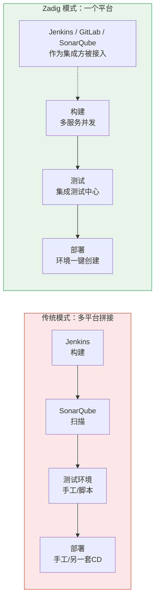
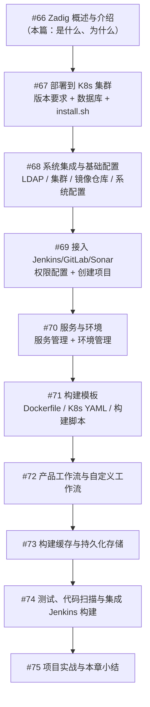

## 纲要

- **Zadig 是什么**：基于 K8s 设计的**开源分布式云原生交付系统**——把「持续集成 + 持续交付 + 测试环境」集成到**一个平台**，不用再把 CI 与 CD 拆成两套系统分开配置
- **解决的核心痛点**：微服务场景下，构建、测试、部署散落在多个工具里，配置复杂、环境拉起慢；Zadig 用**模板化**与**并发构建**把复杂配置简单化
- **与 Jenkins 的关键差异**：Jenkins 的多服务构建只能**一个一个排队**，Zadig 可以**勾选多个服务同时并发构建**——这是微服务时代的刚需
- **生态集成位**：Zadig 不重建轮子，**集成 Jenkins、GitLab、SonarQube** 等既有工具，各司其职
- **本章学习地图**：介绍与基础配置 → 接入集群 → 服务与模板管理 → 流水线创建 → 构建缓存加速
- **缓存是效率王牌**：前端等依赖型构建，配好缓存后**直接复用依赖包**，不必每次从公网拉取

## 一、场景引入：CI 与 CD 为什么总是「两张皮」？

先想象一个典型的公司技术栈现状：

- **构建**在 Jenkins：装插件、配节点、写 Jenkinsfile，一套；
- **代码扫描**在 SonarQube：质量门禁单独看，一套；
- **测试环境**靠测试同学手工 `kubectl apply` 或者另一套脚本；
- **部署**要么手工、要么另一套 CD 工具再配一遍集群、仓库、权限。

四个环节，四套配置，三四个登录入口。**每加一个微服务，所有环节都要重新配一遍**；每换一台集群，kubeconfig、镜像仓库地址、权限又得同步一遍。课程把这类问题概括为一句话：**配置复杂、环境拉起慢、工具之间各自为政**。

更隐蔽的代价在**微服务场景**被放大：一个中等规模的系统动辄几十个服务，用 Jenkins 做多服务构建时，只能**串行地一个任务一个任务跑**。十个服务排队构建，前面挂一个，后面全等——CI 时长随服务数线性增长，反馈慢就没人愿意认真看 CI 结果，质量文化随之崩坏。

Zadig 就是冲着这些痛点来的。课程给它的定位一句话：**一个基于 K8s 设计的、开源的、分布式的云原生交付系统**。

## 二、核心概念与原理

### 2.1 它到底是什么：一平台三合一

用课程的定义展开，Zadig 的关键词有三个：

- **基于 K8s 设计**：服务、环境、工作流全部以 K8s 资源为底座，部署动作最终都落到集群里的 Pod；
- **分布式**：多微服务**并发构建、并发部署**，构建任务天然分布到集群各节点执行；
- **交付系统（而不只是 CI 工具）**：它把**构建环境、测试环境、部署环境**整合成**一个系统**。

这意味着使用边界的变化：**持续集成与持续交付不再需要拆开**。传统认知里 CI（构建、扫描、单测）和 CD（部署到各环境）是两条流水线、两套配置；Zadig 把二者连同测试环境管理**装进同一个平台**——一个平台里，构建、测试、部署全部搞定，**不需要在不同平台之间来回切换配置**。

### 2.2 模板化：复杂配置简单化的核心手段

课程反复强调 Zadig 的第二个设计支柱是**模板**：

> 「它的模板功能就是我可以指定一个模板，那我所有的应用我都可以利用这样的模板来进行部署。我们也不需要写那么多复杂的脚本，它已经内置了一个构建和部署的功能。」

这句话的信息量很大，拆开看：

- **构建模板**：定义「一个服务怎么构建」——拉代码、编译、打镜像的标准动作写一次；
- **部署 YAML 模板**：定义「一个服务怎么部署」——Deployment/Service 的骨架写一次；
- **服务配置模板**：新服务接入时**从模板创建**，而不是从零写脚本。

类比：模板就是 CI/CD 世界的**「标准件」**。手写 Jenkinsfile + Dockerfile + K8s YAML 三件套是「定制家具」，每户一套；Zadig 模板是「精装房交付标准」——户型图（服务配置）填好，水电走线（构建部署逻辑）全部预埋。**不需要再编写大量复杂脚本、配置复杂环境**，这是课程对模板价值的原话结论。

### 2.3 并发构建：与 Jenkins 的正面对比

课程专门点出了一个 Jenkins 做不到的事：

> 「野地的自动化工作流，我们可以利用 Zadig 来选择多个不同的服务来进行并发构建。这个我们在 Jenkins 里面是做不到的，我们需要一个一个地起。但是在 Zadig 里面，我们可以选中我们需要并发构建的服务，从而实现并发构建。」

这个对比值得做成表：

| 维度 | Jenkins（传统用法） | Zadig |
| --- | --- | --- |
| 多服务构建 | 串行排队，一个完成再下一个（需自行搭并行 stage） | **勾选多个服务，同时并发构建** |
| 构建环境 | 自行准备节点/容器代理 | 基于 K8s，快速拉起构建环境 |
| 配置方式 | Jenkinsfile 脚本 + 插件 + 节点配置 | **模板化**，选模板即可部署 |
| 测试环境 | 第三方工具或手工 | 内置**测试环境管理**（测试中心） |
| 生态集成 | 插件体系庞大但配置重 | 预置 Jenkins / GitLab / SonarQube 集成位 |
| 上手成本 | 高（Groovy + 插件 + 节点） | 低（页面点选为主） |

注意这不是说 Jenkins 不能并行——Pipeline 里写 `parallel` 当然可以。差异在于**默认体验**：Jenkins 的并行是「你要额外写代码才能获得的能力」，Zadig 的并发是「勾选框点一下就有的一等公民」。对微服务团队，后者意味着 CI 时长从「服务数 × 单服务时长」降到「最慢那个服务的时长」。

### 2.4 与已有工具的关系：集成而非替代

Zadig 的定位是**交付平台**，不是又一个构建引擎。课程明确它「可以集成 Jenkins、SonarQube 这些软件」：

- **Jenkins**：已有 Jenkinsfile 资产沉淀的团队，Zadig 直接调 Jenkins 构建，资产不浪费；
- **SonarQube**：代码扫描作为工作流的一个步骤接入，质量门禁结果回显；
- **GitLab**：作为代码源，服务从仓库同步，Webhook 触发工作流。

这个「**集成位**」设计很关键：企业里 Jenkins 往往已经跑了几年，推倒重来成本极高。Zadig 把自己放在**编排层**——构建可以继续用 Jenkins，扫描继续用 Sonar，Zadig 负责把「构建 → 测试 → 部署」编排成一条可视、可并发、可复用的工作流。

### 2.5 本章学习地图

课程开篇给出了整章路线，本篇先建立全景，后续逐篇落地：

地图里有两个「效率关键词」先埋个伏笔：

- **构建缓存**：前端等构建要拉大量依赖包，用缓存直接复用，加快构建速度——#73 专门讲；
- **模板**：构建模板 + 部署模板 + 服务模板——#71 专门讲。

## 三、定位澄清：Zadig 适合谁，不适合谁

课程没有明说「选型边界」，但从前两节的定位可以推出三条判断，写在这里供选型参考：

| 你的现状 | Zadig 匹配度 | 理由 |
| --- | --- | --- |
| 微服务、已在 K8s、 Jenkins 串行构建太慢 | **高** | 并发构建 + 模板化直击痛点 |
| 已有 Jenkins/Sonar 资产，想加一层编排 | **高** | 集成位设计，存量资产可保留 |
| 强 GitOps 诉求，部署全部声明式 | 中 | 交付平台是「页面驱动」，GitOps 用 Argo CD 更纯粹（课程 #87 有三大 CD 工具对比） |
| 非 K8s 环境（虚机/物理机） | 低 | Zadig 深度绑定 K8s，虚机场景选主机项目需另评估 |

## 四、常见坑与生产实践要点

1. **版本选择有「功能分水岭」**：Zadig 1.18 是社区版功能最全的版本，**更高版本的不少功能转为付费**。学习与生产选型先确认版本功能矩阵，别默认追新（#67 会细讲）。
2. **先集成、后建项目**：集群、镜像仓库、账号系统这些**基础环境必须在建项目之前配好**，否则项目建完发现没集群可交付、没仓库可推镜像，返工成本高。
3. **并发数要按集群规格设**：并发构建很香，但每个构建都是 Pod。集群规格不足时并发开太高会资源争抢，按节点数与单构建资源请求核算上限（#68 系统配置细讲）。
4. **模板先行**：团队第一个项目就该把构建/部署模板定下来，后续服务从模板创建；边用边补模板，等于把 Zadig 用成了「图形化脚本工具」，浪费模板化红利。

## 五、面试考点与追问

**Q1：一句话描述 Zadig，它和 Jenkins 的本质区别是什么？**
Zadig 是基于 K8s 的开源云原生交付系统，把构建、测试、部署集成于一个平台。本质区别：Jenkins 是**通用 CI 引擎**（靠脚本与插件自由编排，灵活但重），Zadig 是**交付平台**（模板化 + 并发构建 + 环境管理，把 CI/CD 最佳实践产品化）。

**Q2：Zadig 为什么适合微服务场景？**
三个点：多服务**并发构建**（CI 时长不随服务数线性增长）、服务从**模板创建**（新服务接入成本趋近于零）、环境**一键创建**（测试环境不再是稀缺资源）。

**Q3：Zadig 与 K8s 的关系是什么？**
深度绑定：基于 K8s 设计，构建任务以 Pod 形式运行，环境即命名空间 + 资源集合，部署动作最终落到 K8s 资源。**没有 K8s 就没有 Zadig**。

**Q4：已有 Jenkins 的团队，上 Zadig 意味着替换吗？**
不是。Zadig 提供 Jenkins 集成位——构建继续用 Jenkins 执行，Zadig 负责编排、环境、模板与视图。替换与否取决于团队想保留多少 Jenkinsfile 资产。

**Q5：「模板」在 Zadig 里具体指什么？**
三类：构建模板（怎么构建一个服务）、部署 YAML 模板（K8s 资源骨架，用 `$T-Service$` 等占位符参数化）、服务配置模板（新服务从模板导入）。核心思想是**标准件复用**，消灭重复脚本。

**Q6：Zadig 的「分布式」体现在哪？**
构建任务分布到 K8s 集群多节点并行执行，多服务并发构建，天然利用集群算力；而非单机 Runner 排队。

## 📎 文本↔代码关联

本篇为**概述篇**，课件未提供配套代码文件（Zadig 的代码资产从部署篇开始提供：`install.sh` 一键安装脚本与 `minio-pv.yaml` 存储声明），如实标注、不虚构路径。后续章节将使用：

- `code/9-Zadig/install.sh` —— #67 部署篇的核心脚本，一键安装 Zadig 到 K8s 集群
- `code/9-Zadig/minio-pv.yaml` —— #67 部署篇的内置 MinIO 对象存储持久化 PV 声明
- `code/9-Zadig/模板/` —— #71 构建模板篇的 Dockerfile / K8s YAML / 构建脚本模板，印证本篇 2.2 节「模板化」设计

**技术点总结**：Zadig 是一个基于 K8s 的开源分布式云原生交付系统，最大特征是把持续集成、持续交付与测试环境**收拢到一个平台**，通过模板化消灭重复配置、通过并发构建消灭微服务 CI 排队，并通过预置 Jenkins / GitLab / SonarQube 集成位保护存量工具资产。它不与 Jenkins 竞争「构建引擎」角色，而是站在编排层把「构建 → 测试 → 部署」变成一条可视、可复用、可并发的工作流——这是它作为交付平台区别于一切 CI 工具的根本定位。
