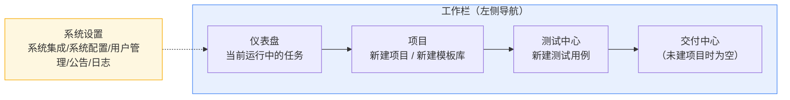

## 纲要

- **配置先于建项目**：集群、账号、镜像仓库这些**基础环境必须在新建项目之前配好**——否则项目建完没集群交付、没仓库推镜像，只能返工
- **系统集成四件套**：账号系统（OpenLDAP）、K8s 集群、镜像仓库，加上下面的 Jenkins/GitLab/Sonar——装完 Zadig 的第一件事就是逐个打通
- **LDAP 接入的关键在「组」**：用户按 OU 过滤、邮箱属性配 `mail`、**组 DN 必须预先在目录里建好**（OU=blue 下的 zadig 组），否则授权链断裂
- **集群接入两种连接方式**：代理连接（跑背景脚本）vs 直接连接（要 admin kubeconfig）——社区版提供商只能选「其他」，阿里云/腾讯云/华为云是企业版能力
- **镜像仓库四要素**：提供商 + 带协议的地址 + 命名空间 + 访问凭证；开 SSL 校验就必须用 HTTPS 且账号密码不能错
- **系统配置决定平台产能**：工作流任务并发数、单任务服务并发数（课程配 5）、历史任务保留 365 天、缓存清理 cron、邮件配置——每一项都直接影响团队使用体感

## 一、场景引入：装好 Zadig 只是拿到了「毛坯房」

前面我们把 Zadig 装进了集群，能打开登录页了。但此刻的平台还是个**毛坯房**：没有账号体系（谁都能注册）、没有集群（无处交付）、没有镜像仓库（构建产物推去哪）、没有邮件服务（密码找回不了）。课程把这一节定位得非常明确：

> 「我们在正式构建之前，都需要把这些基础环境先配置好。把我们的集群、我们的用户、镜像仓库这些基础的配置都配置好之后，我们才可以进行新建我们的流水线。」

这句话是整篇的行动纲领，也解释了 Zadig 的使用节奏：**先集成、后建项目**。顺序反了的代价很具体——项目建到一半要选集群，发现没接；要配镜像仓库，发现没加；用户要登录，发现还是本地账号体系。本篇按课程的实操顺序，把「账号系统 → K8s 集群 → 镜像仓库 → 系统配置」四块全部打通，为下面接入 Jenkins/GitLab/Sonar 并创建第一个项目扫清障碍。

## 二、页面总览：先认识 Zadig 的工作台

在动手配置前，先用课程实拍建立对平台整体布局的认知。登录 `http://node1.example.com:32760` 后（首次需注册管理员账号，密码注意**包含大写字母**），界面分为**工作栏**与**数据视图**两大区。

### 2.1 工作栏：五大模块

| 模块 | 课程说明 |
| --- | --- |
| **仪表盘** | 展示**当前正在运行的任务**；没有运行任务时为空 |
| **项目** | 核心工作区；可**新建项目**、**新建模板库**（未建项目时列表为空） |
| **测试中心** | 在此**新建测试用例**——Zadig 把测试管理内置为平台能力 |
| **交付中心** | 交付物管理入口；未建过项目时为空 |
| **数据视图** | 见 2.2，平台的「效能驾驶舱」 |

### 2.2 数据视图：三层效能观察

数据视图是 Zadig 区别于「一堆脚本」的标志性设计——它把团队的 CI/CD 健康度做成了可观测面板，分三层：

**第一层：数据概览**——平台资产与产出的总账：

- 资产侧：**多少个集群、多少个项目、多少个服务**，以及工作流、环境、交付物数量；
- 产出侧：**成功率、执行次数、测试用例数**；
- 自动化流程统计：**自动化构建**总次数与成功率、**自动化部署**总次数与成功率、**自动化测试**用例数/执行次数/成功率/**平均耗时**——全部可观测。

**第二层：效能观察**——构建、测试、部署三条线各自的效能：

| 效能维度 | 观测指标 |
| --- | --- |
| **构建效能** | 构建次数、成功、失败、**超时** |
| **测试效能** | 测试趋势、测试健康度、**每周测试收益**、执行次数、测试时长 |
| **部署效能** | 服务健康度、**微服务部署频次**、微服务部署次数统计 |

**第三层：健康度信号**——服务健康度与部署频次直接反映交付节奏是否失控（部署频次突然暴跌往往是流水线坏了，而不是团队变懒了）。

> **管理视角**：这套数据视图就是 DORA 指标（部署频率、变更前置时间、变更失败率、恢复时间）的产品化落地。向管理层汇报 CI/CD 成效时，不需要再手工拼报表——数据视图即答案。

## 三、系统集成之一：接入 OpenLDAP 统一认证

### 3.1 为什么要接 LDAP

Zadig 默认的本地注册账号有三个问题：密码散落在各人习惯里、离职账号无法统一回收、权限与公司目录脱节。接入 OpenLDAP 后，**账号体系归公司目录管**——入职开通、离职禁用、组织架构变动全部在 LDAP 侧完成，Zadig 只做认证转发。这也是前几章 Jenkins、SonarQube、KubeVela 都接 LDAP 的同一套逻辑，企业 CI/CD 平台的标配动作。

### 3.2 接入配置全字段

路径：**系统设置 → 系统集成 → 账号系统 → 添加 OpenLDAP**。

课程环境的目录结构（用目录管理工具预先查看确认）：

- `OU=users` 下有一个测试用户 `test`；
- `OU=blue` 下需要**新建一个名为 zadig 的组**（两个人的图标 = 组，一个人图标 = 个人）；
- 域名 DC 为课程自定义域名。

配置字段逐个说明：

| 字段 | 课程填法 | 说明 |
| --- | --- | --- |
| 服务器主机地址 | `gitlab.example.com` | LDAP 服务 IP |
| 端口 | `389` | 标准 LDAP 端口 |
| 管理员账号 | 目录管理员 DN（如 `cn=admin,...`） | 绑定查询用 |
| 管理员密码 | 目录管理员密码 | 敏感信息，保存后加密 |
| 基础 DN | 按用户 OU 过滤，默认即可 | 用户搜索基点 |
| 用户过滤器 | 默认 | 如 `(objectClass=person)` |
| 用户名属性 | 默认（`uid`/`cn`） | 登录用字段 |
| **用户邮箱属性** | **`mail`** | 用于通知与找回，必配且要与目录属性名一致 |
| **组的 DN** | `OU=blue,...`（即 zadig 组所在 DN） | **必须配置**——不配组，用户登录后没有任何权限 |
| 组过滤器 | `CN=zadig`（不用动） | 决定哪些组的人能登录 |
| 组名称属性 | `OU` | 从组 DN 中取组名的属性 |
| SSL | 不勾选 | 内网测试环境；生产必须上 LDAPS |

> **最容易翻车的一步**：组 DN。课程专门演示了「目录里没有 zadig 组 → 先去管理工具右键 `OU=blue` → new → 建组 zadig → 回页面填 `OU=blue,...`」的完整闭环。**Zadig 侧配的组 DN 必须在目录里真实存在**，否则认证能过、授权全空。

### 3.3 验证：第三方登录通道

配置保存后，**退出当前账号**，在登录页点「第三方登录 → LDAP」，用目录里的 `test` 账号登录：

- **登录成功 = LDAP 接入没问题**；
- 但 test **默认没有任何权限**（空权限用户）——这是预期行为：能认证不代表有授权，授权由下面的系统角色控制。

验证通过后退出，再用管理员账号登录，继续配下一项。

## 四、系统集成之二：接入 K8s 集群

### 4.1 两种连接方式的取舍

路径：**系统设置 → 系统集成 → K8s 集群 → 添加集群**。Zadig 提供两种连接方式，课程把区别讲得很清楚：

| 连接方式 | 工作原理 | 适用场景 | 权限要求 |
| --- | --- | --- | --- |
| **代理连接** | 在**被接入集群**里执行一个背景脚本，脚本回连 Zadig，执行完查看状态，正常即接入成功 | 被接集群网络隔离、Zadig 够不着它 | 被接集群的部署权限 |
| **直接连接** | 填写集群基本信息 + **外接集群的 kubeconfig**，Zadig 直连 API Server | **Zadig 所在集群可以访问外接集群** | 外接集群的 **admin 权限** kubeconfig |

课程选择**直接连接**——因为 Zadig 就在目标集群里，直连最简单，不需要装任何背景脚本。

### 4.2 添加集群实操

| 字段 | 课程填法 | 说明 |
| --- | --- | --- |
| 集群名称 | 自定义 | 建议带环境/位置语义，如 `prod-hz` |
| 集群提供商 | **其他** | 阿里云/腾讯云/华为云**灰色不可选 = 企业版功能**；自建集群统一选「其他」 |
| 描述 | 可空 | — |
| 生产集群 | **否** | 社区版只能选否 |
| kubeconfig | 粘贴外接集群内容 | 直接连接模式必填 |

保存后列表显示**正常**即接入成功。课程特别说明：演示中粘贴的「外部集群 kubeconfig」实际用的就是**本地集群的 kubeconfig**——本地集群与目标集群是同一个，直接用本地配置构建即可。这揭示了一个常见实践：**Zadig 所在集群本身就是一个交付目标**，接入自己的集群是最短路径。

> **权限最小化提醒**：直接连接用的是 admin 级 kubeconfig，权限极大。生产上建议为 Zadig 单独建 ServiceAccount 并按命名空间收敛权限，别把集群管理员的 kubeconfig 明文贴进平台。

## 五、系统集成之三：接入镜像仓库

### 5.1 前置：阿里云镜像仓库侧准备

课程使用阿里云容器镜像服务（个人版），实拍里有三个仓库——两个公开仓库 + 一个**私有仓库**，同属一个命名空间。接入私有库需要在阿里云侧先做两件事：

1. **访问凭证设置固定密码**：控制台 → 镜像仓库 → 访问凭证 → 右上角「设置固定密码」——Docker 客户端登录与 Zadig 接入用的都是这个固定密码（默认密码可直接用，但生产必须改）；
2. **记录公网地址**：控制台「概览」页复制的仓库公网地址，**必须包含 `https://` 协议头**。

### 5.2 Zadig 侧接入配置

路径：**系统设置 → 系统集成 → 镜像仓库 → 添加**：

| 字段 | 课程填法 | 说明 |
| --- | --- | --- |
| 提供商 | **阿里云** | 与仓库实际归属一致 |
| 镜像仓库地址 | 阿里云公网地址（**含 https:// 协议**） | 从概览页复制 |
| 命名空间 | 仓库所属命名空间 | 与阿里云侧创建时一致 |
| 用户名 | 阿里云账号邮箱 | 访问凭证对应的用户名 |
| Docker 密码 | 固定密码 | 上一步在访问凭证设置 |
| SSL 校验 | **开启** | 开启后**必须用 HTTPS**，且用户名密码不能输错 |
| 证书 | 不填 | 私有 CA 场景才需要 |

保存成功即接入完成。**镜像仓库是构建工作流的「产线出口」**——不接仓库，构建出的镜像无处可推，后续所有涉及镜像的工作流全部瘫痪，这也是本篇把它列为「建项目前必配」的原因。

## 六、系统配置：平台产能与运维开关

路径：**系统设置 → 系统配置**。课程逐项演示了六个配置区，每一项都对应一类真实运维场景：

### 6.1 任务配置（并发产能，最重要）

| 配置项 | 含义 | 课程设置 |
| --- | --- | --- |
| **工作流任务并发数** | 整个平台同时运行的**工作流任务**上限 | 按集群规格设 |
| **单任务服务并发数** | 一条工作流内**多个微服务同时构建**的上限 | **5** |

单任务服务并发数是 Zadig 并发构建能力的落地旋钮：一条流水线勾选十个微服务，若上限配 5，则**最多 5 个同时构建**，其余排队。配多少取决于两个约束的平衡——集群节点数 × 单构建资源请求。课程选 5 是一个保守稳妥的演示值；生产上建议先用 `kubectl describe node` 算清可分配资源，再乘以 0.7 安全系数。

### 6.2 历史任务保存策略

课程设置**保留 365 天**。这是构建记录的生命周期：保留越久，审计追溯能力越强，但 MongoDB 的存储压力越大（构建日志全在库里）。生产建议按合规要求分级——普通记录 90 天、发布相关记录 1 年以上，并配下面的缓存清理协同治理。

### 6.3 缓存清理

镜像与依赖缓存随时间膨胀，两项能力：

- **一键清理**：手动点击，立即清理系统镜像缓存；
- **定时清理**：配置 **cron 表达式**周期自动清理。

缓存是 Zadig 加速构建的核心资产（#73 专题讲构建缓存），但**缓存不等于只进不出**——没有清理策略的缓存分区迟早写满，写满那一刻所有构建一起失败。定时清理是生产必配项。

### 6.4 代理配置

「一般我们很少用得到，一般网络不好的情况下，我们可能需要使用到这个代理配置。」——用于集群访问外网（拉基础镜像、依赖包）需要走 HTTP 代理的场景。内网自建仓库的团队可以跳过。

### 6.5 快捷链接

把常用系统（监控、告警、制品库）添加到快捷链接，减少团队跳转成本。小功能，大体验。

### 6.6 邮件配置

填写**邮件服务器地址、端口、用户名、密码**以及**发送地址、显示名称**。课程点明两个用途：**消息通知**（构建结果、审批提醒）与**账户密码找回**。不配邮件的平台，密码找回只能靠管理员手工重置——团队规模一大就是运维灾难。

## 七、系统设置全景：集成之外还有什么

配置过程中课程顺带把**系统设置**的完整菜单过了一遍，这张地图每个模块都要知道：

| 模块 | 内容 | 课程说明 |
| --- | --- | --- |
| **系统集成** | 账号系统 | 活动目录 / OpenLDAP 接入 |
| | 软件包管理 | 自行添加软件包：**名称、版本、路径、安装包地址、安装脚本**；构建时**选择指定软件包安装**，帮助文档有每步详解 |
| | 自定义镜像管理 | 定义**构建用基础镜像**，可在镜像里**预装必要软件包**（编译工具链、语言 SDK） |
| | 工作流任务 | 使用较少，可跳过 |
| **系统配置** | 见第六节六项 | 任务并发/历史保留/缓存清理/快捷链接/邮件 |
| **用户管理** | 用户 + **系统角色** | 角色定义权限 → 赋予用户；**admin 角色拥有系统中所有操作的权限** |
| **公告管理** | 系统提醒 | 停服通知、规范宣导的发布位 |
| **操作日志** | 审计 | 记录对系统的操作，安全审计依据 |

两个值得展开的点：

- **软件包管理**解决「构建环境一致性」：把 node、go、python 等 SDK 打成带安装脚本的软件包，构建时按需选用，构建机不用预装一切；
- **自定义镜像管理**解决「基础镜像治理」：团队统一维护带工具链的基础镜像，避免每个 Dockerfile 各自 `apt install` 一遍，构建快且可复现。

## 八、生产实践要点

1. **LDAP 组先建后配**：Zadig 侧填的组 DN 必须在目录里真实存在；目录侧先建组（`OU=blue` 下的 zadig 组），平台侧再填 DN，顺序不能反。
2. **生产必须上 LDAPS**：课程为演示关闭了 SSL，生产环境 389 端口明文传输密码等于裸奔，换 636 + 有效证书。
3. **kubeconfig 最小权限**：直接连接用的是 admin 级凭据；生产为 Zadig 建专用 ServiceAccount，按命名空间授权，并定期轮换。
4. **并发数按集群规格核算**：单任务服务并发 5 不是万能值；资源不足时并发过高会导致构建集体变慢甚至 OOM，按节点可分配资源 × 0.7 设定。
5. **邮件配置尽早做**：它是通知与密码找回的地基；SMTP 密码用专用应用密码，别用个人邮箱主密码。
6. **保留策略与存储联动**：历史任务 365 天 + 缓存定时清理，两者协同控制 MongoDB 与镜像缓存的增长曲线。
7. **权限双轨设计**：系统角色管「平台级权限」（测试中心、交付中心、数据视图的查看/操作），项目级权限在项目内单配（下节讲）——两层结合才是完整的 RBAC。

## 九、报错排查表

| 现象 | 根因 | 解法 |
| --- | --- | --- |
| LDAP 保存失败/测试不通过 | 主机地址、管理员 DN 或密码错 | 用 `ldapsearch` 命令行先行验证管理员凭据可绑定 |
| LDAP 能登录但无任何权限 | **组 DN 未配或目录里没有对应组** | 先在目录工具建 zadig 组，再在 Zadig 填组 DN |
| 用户登录后邮箱为空、收不到通知 | 用户邮箱属性配错（不是 `mail`） | 与目录属性名核对一致 |
| 集群添加后状态异常 | kubeconfig 无 admin 权限 / 网络不通 | 用该 kubeconfig 在 Zadig 所在节点 `kubectl get node` 验证 |
| 提供商选项灰色不可选 | 社区版限制 | 自建集群选「其他」；要阿里云等选项需企业版 |
| 镜像仓库保存失败 | 地址缺 `https://` 协议头，或开 SSL 校验但账号密码错 | 补协议头；核对访问凭证固定密码 |
| 拉取镜像 401 Unauthorized | 命名空间或用户名（邮箱）填错 | 与阿里云控制台逐字段核对 |
| 构建并发上不去 | 单任务服务并发数配太低 | 系统配置 → 任务配置上调，同时评估集群资源 |

## 十、面试考点与追问

**Q1：Zadig 装完后的标准配置顺序是什么？为什么？**
先配账号系统（LDAP）、K8s 集群、镜像仓库、系统配置，再建项目。因为项目创建时就要选定交付集群、镜像仓库与管理员，基础环境缺失会导致项目建完即返工。

**Q2：Zadig 接入 K8s 集群有哪两种方式？如何选？**
代理连接（在被接集群跑背景脚本回连，适合网络隔离场景）与直接连接（填 admin kubeconfig 直连 API Server，适合 Zadig 够得到目标集群的场景）。选型只看一个条件：Zadig 所在集群能否访问目标集群的 API Server。

**Q3：LDAP 接入时「组 DN」为什么是必配项？**
Zadig 用「用户过滤器 + 组过滤器」双重匹配决定谁能登录、以什么身份登录。组 DN 缺失，用户即使认证通过也落不进任何授权组，结果是「能登录、零权限」。且组必须先在目录里真实创建。

**Q4：镜像仓库接入的关键字段有哪些？开 SSL 校验有什么副作用？**
提供商、带协议的仓库地址、命名空间、用户名（邮箱）+Docker 密码。开 SSL 校验后：地址必须 HTTPS、账号密码必须完全正确、私有 CA 还需填证书——任一不满足都保存失败。

**Q5：Zadig 的并发构建由哪个参数控制？**
两个层级：工作流任务并发数（平台级同时跑几条工作流）与单任务服务并发数（一条工作流内几个服务同时构建）。后者直接决定「勾选 10 个服务」时实际并行度。

**Q6：历史任务保留 365 天与缓存清理分别治理什么？**
保留策略治理 MongoDB 里的构建记录生命周期；缓存清理治理镜像/依赖缓存的磁盘占用。一个管数据资产留存，一个管存储膨胀，生产要协同配置。

**Q7：软件包管理与自定义镜像管理分别解决什么问题？**
软件包管理把 SDK/工具定义成「带安装脚本的版本化资产」，构建时按需安装；自定义镜像管理统一维护预装工具链的基础镜像。两者共同保证**构建环境的一致性与可复现**。

## 📎 文本↔代码关联

本篇为**系统配置与集成操作篇**，课件提供的 `install.sh` 是本篇全部配置的**安装基座**（Zadig 未安装则无从配置；其 `EMAIL`/`PASSWORD` 环境变量即本篇首次注册管理员账号的来源，`ensure_dex` 组装的本节 LDAP 认证挂点 zadig-dex 组件），如实关联：

| 代码文件 | 正文提及 | 内容 |
| --- | --- | --- |
| `code/9-Zadig/install.sh` | 第一节部署基座、第三节 Dex 认证挂点 | Zadig 一键安装脚本：`ensure_dex` 配置 `zadig-<ns>-dex` OIDC 组件（本节 OpenLDAP 接入的认证底座）、`ensure_default_user` 写入初始管理员 `EMAIL`/`PASSWORD`、`tags.enterprise=false` 印证社区版（提供商仅「其他」可选） |

**技术点总结**：Zadig 装好只是毛坯房，本篇完成四件套交付——账号系统接 OpenLDAP（组 DN 必须先在建的目录里真实存在、邮箱属性对齐 `mail`、生产换 LDAPS）、K8s 集群按「Zadig 能否直达 API Server」选代理/直接连接（社区版提供商仅「其他」、kubeconfig 按最小权限治理）、镜像仓库四要素齐配（带协议地址 + 命名空间 + 访问凭证 + SSL 策略）、系统配置定产能（单任务服务并发 5、历史保留 365 天、缓存定时清理、邮件双用途）。贯穿全篇的配置哲学只有一句：**先集成、后建项目**——基础环境是流水线的前置依赖，顺序反了必返工。
