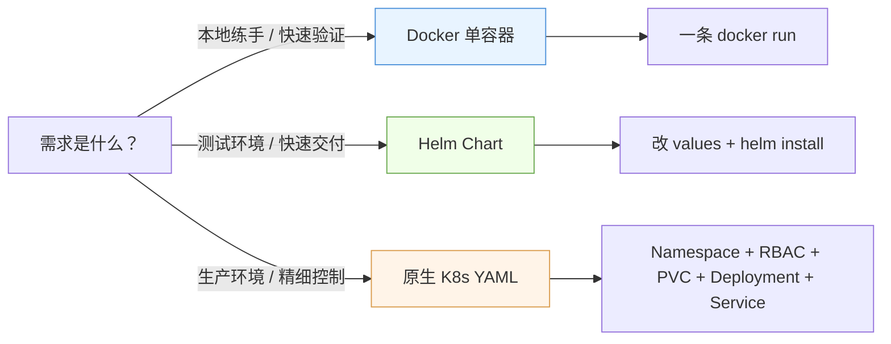
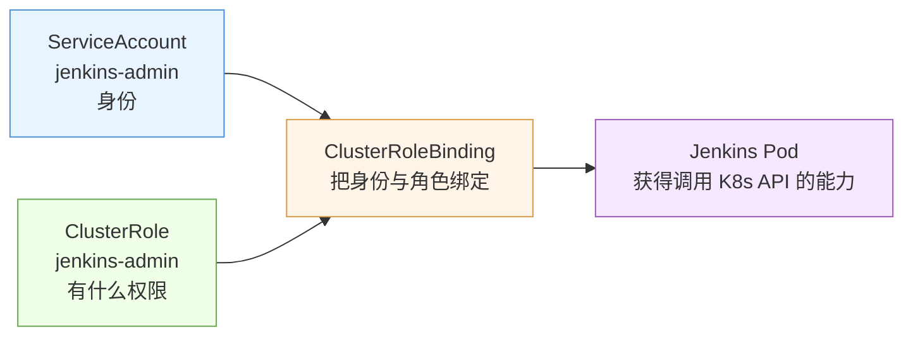
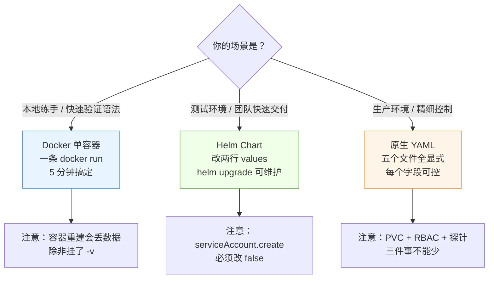

## 纲要

- **三种方式各有定位**：Docker 最快适合练手，Helm 最省事适合测试环境，原生 YAML 最可控适合生产——不是替代关系而是场景互补
- **Docker 部署的关键在挂载**：`jenkins_home` 持久化、`docker.sock` 让 Jenkins 能调 Docker、`JAVA_OPTS` 定编码与时区，三件事漏一件就出问题
- **两个端口别搞混**：8080 是 Jenkins Web 程序端口，50000（YAML 里是 31000）是 **JNLP 代理端口**，供 Slave 节点连回来
- **Helm 部署只需改两行**：`storageClass` 指定持久化存储类、`serviceAccount.create` 改 false 用手动建的 SA
- **RBAC 是 K8s 部署的必修课**：ServiceAccount + ClusterRole + ClusterRoleBinding 三件套，Jenkins 要靠它调 K8s API
- **初始化流程完全一致**：找初始密码 → 装推荐插件 → 建 admin 账户，三种方式都是这套
- **生产环境必须配持久化**：不挂 PVC，Pod 一重建所有 Job 配置与构建历史全部丢失

## 一、三种方式怎么选

| 维度 | Docker 单容器 | Helm Chart | 原生 YAML |
| --- | --- | --- | --- |
| 上手速度 | **最快**（一条命令） | 快（改 values 即可） | 慢（要理解每个字段） |
| 可控性 | 低 | 中 | **最高** |
| 持久化 | 需手动 `-v` | values 里配 | 显式 PVC |
| 适合场景 | 本地练手、快速验证 | 测试环境、快速交付 | **生产环境** |
| 升级维护 | 手动 | `helm upgrade` | 手动改 YAML |

**选型建议**：本地学语法用 Docker；团队测试环境用 Helm；**生产环境用原生 YAML**，因为每个字段你都清楚，出问题能定位。



## 二、方式一：Docker 部署（最快）

前提是已安装 Docker。直接执行课件提供的 `install.sh`：

```bash
docker run --name jenkins -itd \
       -p 80:8080 \
       -p 50000:50000 \
       -v /data/jenkins:/var/jenkins_home \
       -v /var/run/docker.sock:/var/run/docker.sock \
       -v /bin/docker:/usr/bin/docker \
       -v /etc/localtime:/etc/localtime:ro \
       -e JAVA_OPTS="-Dsun.jnu.encoding=UTF-8 -Dfile.encoding=UTF-8 -Duser.timezone=Asia/Shanghai" \
       --restart=always \
       --user=root \
       --privileged=true \
       jenkins/jenkins:lts
```

### 2.1 逐参数拆解（这张表值得背下来）

| 参数 | 值 | 作用 | 漏了会怎样 |
| --- | --- | --- | --- |
| `--name` | `jenkins` | 容器名 | 多实例时难管理 |
| `-p 80:8080` | 宿主 80 → 容器 8080 | **Jenkins Web 程序端口** | 访问不了界面 |
| `-p 50000:50000` | 50000 → 50000 | **JNLP 代理端口** | Slave 节点连不上 |
| `-v /data/jenkins:/var/jenkins_home` | 数据目录挂载 | **持久化所有配置与历史** | 容器重建后配置全丢 |
| `-v /var/run/docker.sock:...` | Docker socket | 让 Jenkins 能调 Docker | 流水线里 `docker build` 失败 |
| `-v /bin/docker:/usr/bin/docker` | docker 命令 | 容器内能执行 docker | 同上 |
| `-v /etc/localtime:...:ro` | 时区文件 | 构建日志时间正确 | 日志时间差 8 小时 |
| `-e JAVA_OPTS` | 编码 + 时区 | **中文不乱码、时区为上海** | 中文乱码、时间错 |
| `--restart=always` | 重启策略 | 宿主机重启后自动拉起 | 机器重启 Jenkins 没了 |
| `--user=root` + `--privileged` | 权限 | 避免 Volume 权限问题 | 启动报权限错 |

### 2.2 两个端口到底干什么

这是新手最容易混淆的地方：

- **8080 —— Web 程序端口**：你浏览器访问的就是它，映射到宿主机 80；
- **50000 —— JNLP 代理端口**：Jenkins 有一个**代理节点（Slave/Agent）**机制，代理节点启动时也需要起一个端口，通过这个端口连回主控节点。下面讲 Slave 节点配置时会详细展开。

> **一句话**：8080 给人用，50000 给节点用。

### 2.3 初始化流程（三种方式通用）

**① 找初始密码。** Jenkins 首次启动会生成一个初始化密码，存放在 `JENKINS_HOME` 下的 `secrets/initialAdminPassword` 文件里。

由于我们已经把 `/data/jenkins` 挂载成了 `jenkins_home`，所以直接在宿主机上看：

```bash
cat /data/jenkins/secrets/initialAdminPassword
```

**② 安装插件。** 把密码粘进去点继续，进入插件安装页。这里**选"安装推荐的插件"**。

为什么选推荐？因为 **Jenkins 是插件化的，所有功能都需要插件来完成**。推荐插件集覆盖了最常用的能力：

- 绿色 = 安装成功
- 红色 = 安装失败
- 转圈 = 正在下载

如果你后面需要某个功能（比如 Git、Pipeline、Kubernetes），**再单独装对应的插件即可**。也可以选"自定义安装"精确控制，但新手没必要。

**③ 创建管理员账户。** 插件装完后进入账户创建页，可以直接用默认的 `admin` 账户继续，也可以设置自己的账户密码。保存并完成，点击"开始使用 Jenkins"，安装即完成。

> **建议**：第一件事就是点右上角用户名 → 设置 → 改一个强密码。课件里为了演示用了弱密码，生产环境绝不能这么干。

## 三、方式二：Helm 部署（最省事）

Helm 方式只需三步：**建命名空间 → 建 SA → 改 values 后 install**。

### 3.1 创建命名空间

```bash
kubectl create namespace jenkins
```

### 3.2 手动创建 ServiceAccount（关键）

课件里的 `jenkins-sa.yaml` 定义了完整的 RBAC 三件套：

```yaml
---
apiVersion: v1
kind: ServiceAccount
metadata:
  name: jenkins
  namespace: jenkins

---
apiVersion: rbac.authorization.k8s.io/v1
kind: ClusterRole
metadata:
  name: jenkins
rules:
  - apiGroups: [""]
    resources: ["*"]
    verbs: ["*"]

---
apiVersion: rbac.authorization.k8s.io/v1
kind: ClusterRoleBinding
metadata:
  name: jenkins
roleRef:
  apiGroup: rbac.authorization.k8s.io
  kind: ClusterRole
  name: jenkins
subjects:
  - kind: ServiceAccount
    name: jenkins
    namespace: jenkins
```

**为什么要手动建 SA？** 因为 Jenkins 在流水线里要调用 K8s API（动态起 Pod、查 Pod 状态、执行 `kubectl apply`），这些操作都需要 RBAC 授权。不授权，流水线一到 K8s 相关步骤就报 `Forbidden`。

> **生产提示**：课件这里为了演示给了 `resources: ["*"]` + `verbs: ["*"]` 的 ClusterRole，等于集群管理员权限。生产环境应按最小权限原则收窄到具体资源与动作。

### 3.3 修改 jenkins-values.yaml（只需两处）

**第一处：`storageClass`（约 904 行）。** 定位到 `storageClass` 配置，填上你的存储类名字，例如 `nfs-client`。

```yaml
persistence:
  storageClass: nfs-client
```

**为什么要配？** 因为要做持久化存储。定义了这个 storageClass 之后，Helm 会为 Jenkins 创建一个 PV 以及 PVC，保证 Jenkins 数据不随 Pod 重建而丢失。

**第二处：`serviceAccount.create`（约 944 行）。** 把默认的 `true` 改成 `false`：

```yaml
serviceAccount:
  create: false
  name: jenkins        # 必须与 jenkins-sa.yaml 里定义的 SA 名一致
```

**为什么改 false？** 因为我们已经手动创建了 SA 并绑定了权限。如果让 Helm 自动创建，它会建一个**没有任何权限**的空 SA，流水线调 K8s API 时会失败。`name` 字段要与手动建的 SA 名对齐。

### 3.4 部署与访问

```bash
# 添加 Jenkins Helm 仓库
helm repo add jenkins https://charts.jenkins.io
helm repo update

# 指定 values 文件 + chart 仓库，部署到 jenkins 命名空间
helm install jenkins -n jenkins -f jenkins-values.yaml jenkins/jenkins

# 查看部署状态
kubectl get pod -n jenkins

# 获取访问地址（NodePort 或 LoadBalancer）
kubectl get svc -n jenkins
```

获取登录密码：

```bash
# 方式一：从 Pod 里直接取
kubectl exec -n jenkins $POD_NAME -- cat /var/jenkins_home/secrets/initialAdminPassword

# 方式二：Helm 常见做法，通过 secret 输出
kubectl get secret -n jenkins jenkins -o jsonpath='{.data.jenkins-admin-password}' | base64 -d
```

默认管理员账号是 `admin`。登录成功后同样建议立刻改密码。

## 四、方式三：原生 K8s YAML（最可控，推荐生产）

原生方式把每个资源都显式写出来，一共五个文件。**这是最值得逐行读一遍的方式**，因为你能看到 Helm 帮你封装起来的所有细节。

### 4.1 namespace.yaml —— 隔离资源

```yaml
apiVersion: v1
kind: Namespace
metadata:
  name: devops-tools
```

把 Jenkins 放到独立命名空间，避免与业务应用混在一起，也方便做资源配额与网络策略。

### 4.2 volume.yaml —— 持久化声明

```yaml
apiVersion: v1
kind: PersistentVolumeClaim
metadata:
  name: jenkins-pv-claim
  namespace: devops-tools
spec:
  storageClassName: nfs-client
  accessModes:
    - ReadWriteOnce
  resources:
    requests:
      storage: 10Gi
```

**PVC 是生产部署的核心**。没有它，Pod 重建后所有 Job 配置、构建历史、凭据全部丢失。`nfs-client` 是 NFS 提供的 StorageClass，`10Gi` 按团队规模调整。

### 4.3 serviceAccount.yaml —— RBAC 授权

```yaml
---
apiVersion: rbac.authorization.k8s.io/v1
kind: ClusterRole
metadata:
  name: jenkins-admin
rules:
  - apiGroups: [""]
    resources: ["*"]
    verbs: ["*"]

---
apiVersion: v1
kind: ServiceAccount
metadata:
  name: jenkins-admin
  namespace: devops-tools

---
apiVersion: rbac.authorization.k8s.io/v1
kind: ClusterRoleBinding
metadata:
  name: jenkins-admin
roleRef:
  apiGroup: rbac.authorization.k8s.io
  kind: ClusterRole
  name: jenkins-admin
subjects:
  - kind: ServiceAccount
    name: jenkins-admin
    namespace: devops-tools
```

三件套的协作关系：



### 4.4 deployment.yaml —— 核心工作负载

```yaml
apiVersion: apps/v1
kind: Deployment
metadata:
  name: jenkins
  namespace: devops-tools
spec:
  replicas: 1
  selector:
    matchLabels:
      app: jenkins-server
  template:
    metadata:
      labels:
        app: jenkins-server
    spec:
      securityContext:
        fsGroup: 1000
        runAsUser: 1000
      serviceAccountName: jenkins-admin
      containers:
        - name: jenkins
          image: jenkins/jenkins:lts
          env:
            - name: JAVA_OPTS
              value: "-Dorg.apache.commons.jelly.tags.fmt.timeZone=Asia/Shanghai"
          resources:
            limits:
              memory: "2Gi"
              cpu: "1000m"
            requests:
              memory: "500Mi"
              cpu: "500m"
          ports:
            - name: httpport
              containerPort: 8080
            - name: jnlpport
              containerPort: 31000
          livenessProbe:
            httpGet:
              path: "/login"
              port: 8080
            initialDelaySeconds: 90
            periodSeconds: 10
            timeoutSeconds: 5
            failureThreshold: 5
          readinessProbe:
            httpGet:
              path: "/login"
              port: 8080
            initialDelaySeconds: 60
            periodSeconds: 10
            timeoutSeconds: 5
            failureThreshold: 3
          volumeMounts:
            - name: jenkins-data
              mountPath: /var/jenkins_home
      volumes:
        - name: jenkins-data
          persistentVolumeClaim:
            claimName: jenkins-pv-claim
```

**六个必须看懂的点：**

| 配置 | 值 | 为什么 |
| --- | --- | --- |
| `image` | `jenkins/jenkins:lts` | **LTS 长期支持版**，生产别用 weekly |
| `serviceAccountName` | `jenkins-admin` | 挂上前面建的 SA，否则无 K8s 权限 |
| `ports` | 8080 + **31000** | 程序端口 + JNLP 代理端口（YAML 里用 31000，Docker 里是 50000） |
| `resources` | requests 500Mi/500m，limits 2Gi/1000m | 防止 Jenkins 内存溢出拖垮节点 |
| `livenessProbe` / `readinessProbe` | `/login` 探测 | **存活探针**决定是否重启，**就绪探针**决定是否接流量 |
| `volumeMounts` + `volumes` | 挂 `jenkins-pv-claim` | 数据持久化，Pod 重建不丢配置 |

**探针的 `initialDelaySeconds` 为什么差这么多？** 就绪探针 60 秒、存活探针 90 秒。这是有意的：Jenkins 启动较慢，如果存活探针太激进会在启动过程中反复重启；就绪探针先接流量，存活探针给更宽的容忍窗口。

### 4.5 service.yaml —— 暴露服务

```yaml
apiVersion: v1
kind: Service
metadata:
  name: jenkins-service
  namespace: devops-tools
spec:
  selector:
    app: jenkins-server
  type: NodePort
  ports:
    - name: httpport
      port: 8080
      targetPort: 8080
      nodePort: 30080
    - name: jnlpport
      port: 31000
      targetPort: 31000
      nodePort: 31000
```

Service 同时暴露 8080 和 31000 两个端口，供外部访问与 Slave 节点接入。

### 4.6 一键部署与初始化

```bash
# 按依赖顺序创建（Namespace → PVC → RBAC → Deployment → Service）
kubectl apply -f namespace.yaml
kubectl apply -f volume.yaml
kubectl apply -f serviceAccount.yaml
kubectl apply -f deployment.yaml
kubectl apply -f service.yaml

# 查看启动状态
kubectl get pod -n devops-tools -w

# 获取节点 IP（NodePort 方式通过 节点IP:30080 访问）
kubectl get node -o wide

# 获取初始密码
kubectl exec -n devops-tools $POD_NAME -- \
  cat /var/jenkins_home/secrets/initialAdminPassword
```

之后的流程与 Docker 方式完全一致：**粘密码 → 装推荐插件 → 建 admin 账户 → 改强密码**。

## 五、三种方式对比与选型决策



## 六、常见报错与排查

| 现象 | 根因 | 解法 |
| --- | --- | --- |
| 浏览器打不开 | 端口映射错或 Pod 未 Ready | `docker ps` / `kubectl get pod` 确认 |
| 中文乱码 | 缺 `JAVA_OPTS` 的 `file.encoding=UTF-8` | 补 `-Dfile.encoding=UTF-8` |
| 日志时间差 8 小时 | 缺时区配置 | Docker 挂 `/etc/localtime`；K8s 设 `timeZone=Asia/Shanghai` |
| 容器起不来，报权限错 | Volume 目录权限 | 加 `--user=root` / 调 `fsGroup` |
| Pod 反复重启 | 存活探针太激进或内存不足 | 加大 `initialDelaySeconds` 与 `resources.limits` |
| 流水线报 `Forbidden` | SA 未绑定权限 | 检查 ClusterRoleBinding 的 `subjects` |
| 重建后 Job 全丢 | 没配持久化 | Docker 加 `-v`；K8s 挂 PVC |
| Helm 部署后无 K8s 权限 | `serviceAccount.create` 还是 true | 改 `false` 并指定 `name` |

## 七、面试考点与追问

**Q1：Jenkins 的 8080 和 50000 端口分别做什么？**
8080 是 Web 程序端口，供用户访问界面与 API；50000（K8s YAML 里常配 31000）是 JNLP 代理端口，供 Slave/Agent 节点连回主控节点。两者用途完全不同，漏配后者会导致分布式构建无法工作。

**Q2：为什么 K8s 部署 Jenkins 必须配 ServiceAccount？**
因为 Jenkins 流水线要调用 K8s API（动态起 Pod、查状态、`kubectl apply`）。Pod 默认使用 `default` SA，权限极弱，会报 `Forbidden`。需要 ServiceAccount + ClusterRole + ClusterRoleBinding 三件套显式授权。

**Q3：`serviceAccount.create: false` 这个配置的意义是什么？**
Helm Chart 默认会自动创建一个 SA，但那个 SA 是空的、无任何权限。设 `false` 表示不自动创建，改用手动建好的、已绑定 RBAC 的 SA，并通过 `serviceAccount.name` 指定。这是 Helm 部署 Jenkins 最常踩的坑。

**Q4：livenessProbe 和 readinessProbe 在 Jenkins 部署中的区别？**
livenessProbe（存活探针）失败会**重启容器**，这里探测 `/login` 给 90 秒初始延迟，避免 Jenkins 启动慢被误杀；readinessProbe（就绪探针）失败会**摘除 Service 端点**，给 60 秒，保证流量只在真正可用后才进来。两者阈值策略不同，不能混用。

**Q5：生产环境部署 Jenkins，哪三件事绝对不能少？**
**持久化**（PVC 或 `-v`，否则 Pod 重建丢全部配置）、**RBAC**（SA + ClusterRole + Binding，否则流水线调不了 K8s）、**资源限额与探针**（requests/limits 防资源争抢，liveness/readiness 保证自愈与流量正确）。

**Q6：三种部署方式如何选型？**
本地练手与快速验证用 Docker 单容器；测试环境或需要频繁升级用 Helm（改 values + `helm upgrade`）；**生产环境推荐原生 YAML**，因为所有字段显式可控，出问题能定位到具体资源。

## 📎 文本↔代码关联

本篇对应课件源码（`code/3-基础-Jenkins/部署/`，已做去品牌化处理）：

| 代码文件 | 正文提及 | 内容 |
| --- | --- | --- |
| `code/3-基础-Jenkins/部署/docker-jenkins/install.sh` | 第二节 | 完整 `docker run` 命令，含双端口、四个挂载、`JAVA_OPTS` |
| `code/3-基础-Jenkins/部署/helm-jenkins/jenkins-sa.yaml` | 第三节 | ServiceAccount + ClusterRole + ClusterRoleBinding 三件套 |
| `code/3-基础-Jenkins/部署/helm-jenkins/jenkins-values.yaml` | 第三节 | Helm values，重点看 `storageClass` 与 `serviceAccount.create` 两处 |
| `code/3-基础-Jenkins/部署/kubernetes-jenkins/namespace.yaml` | 第四节 | `devops-tools` 命名空间 |
| `code/3-基础-Jenkins/部署/kubernetes-jenkins/volume.yaml` | 第四节 | PVC，`nfs-client` SC + 10Gi |
| `code/3-基础-Jenkins/部署/kubernetes-jenkins/serviceAccount.yaml` | 第四节 | RBAC 三件套（管理员权限演示版） |
| `code/3-基础-Jenkins/部署/kubernetes-jenkins/deployment.yaml` | 第四节 | Deployment，含探针、资源限额、双端口、PVC 挂载 |
| `code/3-基础-Jenkins/部署/kubernetes-jenkins/service.yaml` | 第四节 | Service，暴露 8080 + 31000 |
| `code/3-基础-Jenkins/部署/kubernetes-jenkins/README.md` | 第四节 | 课件清单目录的说明文件（原生 YAML 部署套件的索引说明） |

**技术点总结**：三种部署方式是场景互补而非替代——Docker 最快适合练手、Helm 最省事适合测试环境、原生 YAML 最可控适合生产。三个必懂知识点：双端口分工（8080 给人、50000/31000 给节点）、RBAC 三件套（SA + ClusterRole + Binding，否则流水线调 K8s 报 Forbidden）、生产三件套不能少（持久化 PVC + RBAC + 资源限额与探针）。Helm 部署最易踩的坑是 `serviceAccount.create` 未改 `false` 导致 SA 无权限。
