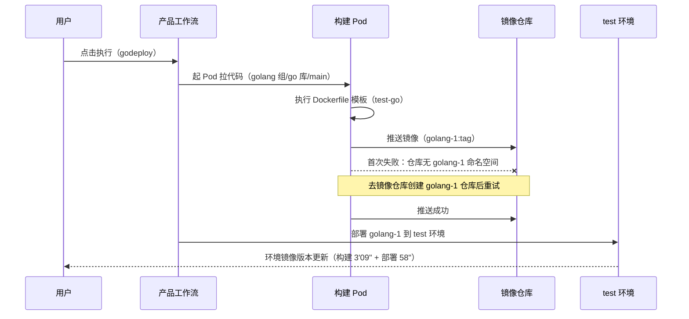

## 纲要

- **产品工作流 = 组装式交付**：一个工作流自带**构建、部署、测试、版本**四大能力，勾选即用——适合「快速跑通标准路径」的团队
- **自定义工作流 = 阶段化编排**：自己定义阶段（构建 → 人工审批 → 部署）、每阶段的任务与顺序，**每步成败清晰可见**——补上产品工作流「看不到走到哪一步」的短板
- **构建没建，工作流就选不动**：「不存在可构建的服务组件」的真相是服务有了但**构建还没建**——先去构建里建，再回工作流选
- **镜像版本回退是产品工作流独有能力**：运行状态 + 测试结果满足回退策略时，**镜像版本自动回退到上一个版本**
- **部署任务必须显式选「其他任务输出 → build」**：不选全局变量/任务输出，部署任务拿不到上一阶段的镜像——这是自定义工作流最容易踩的坑
- **触发器 + 通知是自动化的双翼**：代码提交/合并自动触发；构建前/完成/成功/失败四类事件接钉钉/企业微信等 Webhook 报警

## 一、场景引入：两种工作流，两种哲学

到这一节，Zadig 的平台骨架（集群、仓库、模板、服务、环境）已全部就位，终于到了**把一切编排成流水线**的时刻。Zadig 给两条路，课程把分工讲得很清楚：

- **产品工作流**：平台预组装好的交付流水线——「拥有组装构建、部署、测试和版本的交付能力」，创建一个产品工作流，这些功能**全带上**；
- **自定义工作流**：「需要我们自定义工作流的步骤，以及它的一个执行顺序，还有我们的任务的自定义——每一个步骤、每一个任务」自己定义。

选型逻辑课程也点透了——产品工作流有个**可观测性短板**：

> 「产品工作流它有一个问题，就是说它这个构建整个流程我都看不出来，它到了哪一步，然后是哪一步不行的……但是在 Zadig 的产品工作流这里完全没有体现。」

类比：产品工作流是**「一键美颜」**——效果快、门槛低，但中间发生了什么你看不见；自定义工作流是**「专业修图」**——每一步（构建/审批/部署）单独成阶段，哪步挂了点哪步。**先产品后自定义**是课程的隐含路径：用产品工作流把 CI/CD 跑起来，需要过程可视与人工卡点时上自定义。

## 二、产品工作流：四能力组装式交付

### 2.1 创建主链路

路径：**项目 → 工作流 → 新建工作流 → 产品工作流**。课程完整走了一遍，关键决策点逐个看：

| 步骤 | 课程操作 | 说明 |
| --- | --- | --- |
| 工作流名称 | `go 部署的项目` | — |
| 部署环境 | 选 `test` | 工作流绑定目标环境 |
| **并发执行** | 可选 | 开了之后构建时可**选多个服务并发构建** |
| **镜像版本回退** | 课程不需要，跳过 | 见 2.3 |
| 构建部署 | 选构建 + 部署服务 | 见 2.2 的前置条件 |

### 2.2 第一个坎：构建没建，工作流就空转

课程实拍了一个**新手必遇的坑**：进了「构建部署」页，发现构建名称里只有个「AA」、什么都没有，刷新后甚至提示**「不存在可构建的服务组件，让去项目服务中创建服务」**——可项目里明明已经有服务了。课程的诊断一针见血：

> 「但其实我们已经有服务，只不过还没有构建。所以在这边我们需要创建一个构建。」

即：**服务 ≠ 可构建**。服务只定义了「部署形态」，构建才定义「生产形态」（拉哪个仓库、跑什么脚本、用哪个 Dockerfile 模板）。解法是回头去**构建**里新建：

1. 输入构建名称；
2. 选要构建的服务（如 `golang-1`）；
3. 选代码源 → 组（`golang`）→ 代码库（`go`）→ 默认分支（`main`）；
4. 构建方式选「执行镜像构建」：指定**构建上下文目录**，Dockerfile **选之前建的模板**（如 `test-go`）；
5. 立即创建 → 得到构建 `go-dockerfile`。

回到工作流重填：名称 `godeploy`、环境 `test`、构建部署里这时**默认出现构建 `go-dockerfile`、部署服务 `golang-1`** → 保存。**「先去建构建，再建工作流」是固定次序**，反了就是对着空构建列表发呆。

### 2.3 产品工作流的四能力与附加件

主链路之外，产品工作流面板上还有一排能力，课程逐个过：

| 能力 | 说明 |
| --- | --- |
| **交付物部署** | 用**现有镜像/交付物**直接部署——不走构建，适合「镜像已在仓库，只换环境」的场景 |
| **测试** | 配置自动化测试；没添加过用例时为空（测试用例在测试中心建） |
| **镜像版本回退** | **当运行状态和测试结果满足回退策略的设定，镜像版本自动回退到上一个版本**——产品工作流独有的安全网 |
| 分发部署 / 扩展 | 课程标注「暂时都用不到」 |
| **触发器** | 某分支的**提交或合并事件自动触发**工作流 |
| **通知** | 构建前/构建完成/构建成功/构建失败四类事件，接钉钉、企业微信等 Webhook |

「镜像版本回退」值得多说：它把「发布失败自动撤退」做成了产品能力——新版本部署后健康检查不过或测试翻车，平台按策略自动把镜像 tag 退回上一个已知良好版本。**没有它，回滚靠人盯；有它，回滚是策略**。这是产品工作流相对自定义工作流的独有价值。

### 2.4 执行与观测

保存后在工作流卡片可直接**执行**；历史任务列表展示**构建状态（颜色标识）、平均执行时间、成功率、最近执行**；支持复制流水线、删除、编辑（齿轮）、**新建视图**（如按「测试工作流」分视图）。执行时有多个服务可**勾选多个同时构建**（并发执行的用武之地）。

课程的执行过程实拍 = 一份活的排查教材：

1. 任务启动：准备环境 → 拉代码 → 服务名 `golang-1` → 镜像信息 → 构建日期 → **构建次数 1**（第几次构建）→ 分支；
2. 集群侧：`zadig` 命名空间下 `go-deployment-1` Pod 运行，**每跑一次构建就起一个 Pod**；
3. **拉镜像失败 → 步骤停止**：用了 `golang` 镜像但镜像仓库里没有这个镜像；
4. 解法：去镜像仓库**创建名为 `golang-1` 的仓库**、配好账户密码 → 重新执行；
5. 二次执行：初始化 → 拉 go 仓库 → 执行 Dockerfile → 拉 golang 镜像 → 一系列 build → 构建完成 → 部署成功；
6. 验收：构建耗时 3 分 9 秒、部署 58 秒、工作流总时长 4 分 7 秒；环境里服务镜像版本已更新为本次构建产物。

### 2.5 多服务配置

多服务工作流：编辑（齿轮）→ 构建部署 → **选择多个构建配置**——每个服务一个构建配置，工作流统一编排。配合 2.1 的「并发执行」，就是 Zadig 并发构建的落地形态。

## 三、自定义工作流：阶段化编排与过程可视

### 3.1 为什么需要它

产品工作流把「构建 → 部署」打包成一个黑盒；自定义工作流把它拆成**显式阶段**，课程的目标很明确：**每一步成功/失败都看得见**（对标 Jenkins 的步骤视图）。

### 3.2 三阶段实战：构建 → 人工审批 → 部署

路径：**工作流 → 新建工作流 → 自定义工作流**。课程搭了一条带人工卡点的标准流水线：

**阶段一「构建」**：

- 添加阶段 → 命名「构建」→ 可选**并发执行 / 人工审批**（此阶段不需要审批）；
- 阶段内添加任务 → 类型选**构建** → 链路名称 → 选仓库（`to-fucket`）→ 选服务（`golang-1`）→ 确定；
- 同阶段可继续添加多个构建任务（多服务并行构）。

**阶段二「部署」带人工审批**：

- 新增阶段 → **打开人工审批** → 配**超时时间** → 选**审批人**（如 `root`）——「需要审核才能执行」；
- 阶段内任务选**部署** → 命名 `deploy` → 部署环境 `test` → 服务组件 `golang-1`；
- **关键一步**（课程反复强调：「我们在这里一定要选择全局变量，其他任务输出，然后选择 build」）——部署任务的镜像来源必须选**上一阶段 build 任务的输出**：

> 「这边选择 build 这一块的意思就是说我要用上一个阶段构建出来的产物来进行部署到我们的集群当中。我们上一个阶段通过 build 这个构建任务构建出来的镜像就会传给我们的 deployment 这个任务里面。我们拿到这个镜像，我们就可以把它部署到集群当中。」

**这一行是自定义工作流的灵魂**：阶段间的**产物传递**靠「任务输出」显式声明，而不是隐式约定。不选 = 部署任务不知道用哪个镜像 = 流程断裂。

**阶段三扩展**：还能继续加代码扫描、测试等阶段；变量、触发器（代码触发器：名称 + 代码库分支 + 触发场景「合并/提交」+ 触发组件）、通知（Webhook 类型 + 地址 + 事件）与产品工作流同款。

### 3.3 高级配置：并发与共享目录

- **并发执行**：多个任务产生时并发跑；
- **共享目录**：添加共享目录并指定挂载位置——「两个不同阶段之间的任务来进行共享……我们两个阶段的构建任务，都可以通过这个共享目录来进行共享」。

共享目录解决的是**跨阶段文件传递**（如构建阶段产的二进制包给测试阶段用），与 #73 要讲的「多任务共享存储」是同一机制的不同入口（工作流里配 vs 任务高级配置里配）。

### 3.4 执行效果：步骤清晰 + 缓存加速

保存后执行：默认选中服务、选分支 → 执行。课程的运行过程把自定义工作流的价值演示得淋漓尽致：

- **第一步**：拉代码 → 构建 Dockerfile；
- **第二步**：拿 build 阶段产出的镜像 → 部署到集群；
- 「因为我们的内容没有修改，所以**直接使用缓存**了，所以这次特别快」——构建缓存（#73）让二次构建近乎瞬间完成；
- 人工审批阶段作为卡点清晰展示；第一次构建的产物版本号带 `-1` 后缀（第几次构建），环境里同步更新。

最后课程演示了**视图分离**：多个工作流各建视图分开展示，工作流面板不打架。

## 四、两种工作流对照与选型

| 维度 | 产品工作流 | 自定义工作流 |
| --- | --- | --- |
| 能力装配 | 构建/部署/测试/版本**开箱即带** | 自己组装阶段与任务 |
| 过程可视 | 黑盒（看不到每步成败） | **每阶段、每任务清晰可见** |
| 人工卡点 | 无原生审批 | **人工审批阶段**（超时 + 审批人） |
| 镜像版本回退 | **独有**（运行状态 + 测试结果驱动自动回退） | 需自行搭 |
| 任务间产物传递 | 隐式 | **显式**（选「其他任务输出 → build」） |
| 触发/通知 | 支持 | 支持（同款） |
| 上手成本 | 低（勾选） | 中（编排） |
| 适用 | 标准路径快速跑通 | 需要审批门禁、过程审计、复杂阶段依赖 |

**选型结论**：标准「构建 + 部署」用产品工作流，十分钟跑通；一旦出现**人工卡点（审批上生产）、阶段间产物传递、过程可视化排障**三类需求，立刻切自定义。两者可在同一项目共存——产品工作流管日常、自定义工作流管发布。

## 五、生产实践要点

1. **先建构建再建工作流**：服务只是部署形态，构建才是生产形态；顺序反了会撞「不存在可构建的服务组件」。
2. **部署任务必须显式选任务输出**：自定义工作流里，部署任务的镜像来源选「其他任务输出 → build」，漏选 = 流程断在最后一公里。
3. **人工审批按环境分级**：测试环境全自动、生产环境必经审批阶段——审批超时要配（防人等睡了流水线挂整晚）。
4. **镜像版本回退策略先演练再依赖**：自动回退是安全网也是双刃剑——策略误判会把好版本退下去；先在测试环境演练回退触发条件。
5. **通知四事件全接**：构建前（预告）、完成（中性）、成功（放行）、失败（告警）分别接不同 Webhook 级别，失败事件必须 @ 到人。
6. **触发器按分支设防**：`main` 合并且自动部署测试环境可以；`main` 自动上生产必须配审批阶段或关闭触发器——**自动化的边界是审批，不是分支名**。
7. **共享目录按需用**：跨阶段传文件才配；无脑全开共享目录会让缓存语义复杂化，反受其乱。
8. **多服务并发配合视图管理**：并发构建 + 多构建配置 + 视图分离，是工作流数量上去后唯一不乱的排布。

## 六、报错排查表

| 现象 | 根因 | 解法 |
| --- | --- | --- |
| 构建部署里没有可选的构建 | 只建了服务没建构建 | 去构建里新建（选服务/代码源/Dockerfile 模板） |
| 提示「不存在可构建的服务组件」 | 同上，服务无构建配置 | 同上 |
| 部署阶段拉不到镜像 | 部署任务没选「其他任务输出 → build」 | 编辑部署任务，镜像来源选上一阶段 build 输出 |
| 构建步骤中途停止、日志「拉镜像失败」 | 镜像仓库没有对应仓库/命名空间 | 去镜像仓库创建仓库（如 golang-1）、配凭证，重新执行 |
| 工作流执行后环境镜像没变 | 部署环境选错 / 服务组件选错 | 核对工作流绑定的环境与服务 |
| 人工审批一直不通过、任务挂起 | 审批人不在线 / 超时配太长 | 配审批超时；审批人设组而非单人 |
| 触发器不触发 | 分支/事件配错，或代码源未授权 | 核对触发器的分支与事件（提交/合并） |
| 通知收不到 | Webhook 地址错或事件没勾 | 核对 Webhook 与通知事件 |

## 七、面试考点与追问

**Q1：Zadig 产品工作流与自定义工作流的区别？如何选？**
产品工作流是预组装（构建/部署/测试/版本开箱即用、有镜像版本自动回退），但过程黑盒；自定义工作流自建阶段与任务（过程可视、支持人工审批、显式产物传递）。标准路径用产品工作流快速跑通；有审批门禁、阶段依赖、过程审计需求时用自定义。

**Q2：为什么「建了服务工作流还是选不到构建」？**
服务只定义部署形态（K8s YAML），构建才定义生产形态（拉代码/跑脚本/打镜像）。没建构建 = 没有可构建的服务组件。必须先建构建。

**Q3：自定义工作流中，部署任务如何拿到上一阶段构建的镜像？**
在部署任务的配置里选「全局变量 → 其他任务输出 → build」——把上一阶段 build 任务的镜像输出作为本任务的部署输入。这是阶段间产物传递的唯一显式通道。

**Q4：人工审批怎么配？**
在阶段上打开「人工审批」，配置超时时间与审批人（可指定具体用户）。审批通过阶段才继续执行。

**Q5：镜像版本回退是什么？谁能用？**
产品工作流独有能力：当新版本的运行状态与测试结果满足回退策略设定时，平台自动把镜像版本回退到上一个版本。是发布安全网，策略需先演练。

**Q6：工作流的触发器与通知分别管什么？**
触发器管「什么时候自动跑」——某分支的提交/合并事件触发工作流；通知管「跑的时候怎么让人知道」——构建前/完成/成功/失败四类事件接钉钉、企业微信等 Webhook。

**Q7：多服务工作流如何配置？并发执行开在哪里？**
编辑工作流 → 构建部署 → 配置多个构建（每服务一个）；并发执行开关在工作流创建/编辑页，开启后执行时可勾选多个服务同时构建。工作流多了用视图分离管理。

## 📎 文本↔代码关联

本篇工作流引用的构建资产即 #71 构建模板篇的模板文件（产品工作流的「Dockerfile 来源选模板库」、自定义工作流构建任务的脚本段均直接引用它们；test-node.sh 同时是 #73 构建缓存篇持久化目录策略的载体）：

| 代码文件 | 正文提及 | 内容 |
| --- | --- | --- |
| `code/9-Zadig/模板/Dockerfile/go` | 2.2 建构建选模板、2.4 执行过程 | 产品工作流构建配置里「Dockerfile 来源 = 模板库」所引用的 Go 多阶段构建模板 |
| `code/9-Zadig/模板/Dockerfile/node` | 2.2 建构建选模板 | Node 项目构建模板，前端服务工作流引用 |
| `code/9-Zadig/模板/K8S-YAML/backend` | 3.2 部署任务服务组件 | 部署阶段服务组件的 K8s 资源模板（`$T-Service$` 变量化），部署任务把 build 输出镜像写入该模板渲染后的 Deployment |
| `code/9-Zadig/模板/K8S-YAML/node` | 3.2 部署任务服务组件 | 前端服务部署模板，同上 |
| `code/9-Zadig/模板/Build-script/test-node.sh` | 3.2 构建任务脚本段 | 自定义工作流构建任务执行的构建脚本（`npm install --registry=npmmirror` → `npm run build`），与 #73 持久化实战同一脚本 |

**技术点总结**：Zadig 工作流双轨制——产品工作流是**组装式交付**：构建/部署/测试/版本四能力开箱即用、镜像版本回退做安全网，十分钟跑通标准路径，代价是过程黑盒；自定义工作流是**阶段化编排**：构建 → 人工审批 → 部署的每步成败可见、审批卡点可配（超时 + 审批人）、阶段间产物靠「其他任务输出 → build」显式传递。两条铁律贯穿全篇：**先建构建再建工作流**（服务≠可构建）、**部署任务必须显式选任务输出**（漏选即断链）。生产落地的分级建议：测试环境产品工作流全自动，生产环境自定义工作流 + 审批阶段 + 失败告警 @ 到人——**自动化的边界是审批，不是分支名**。
