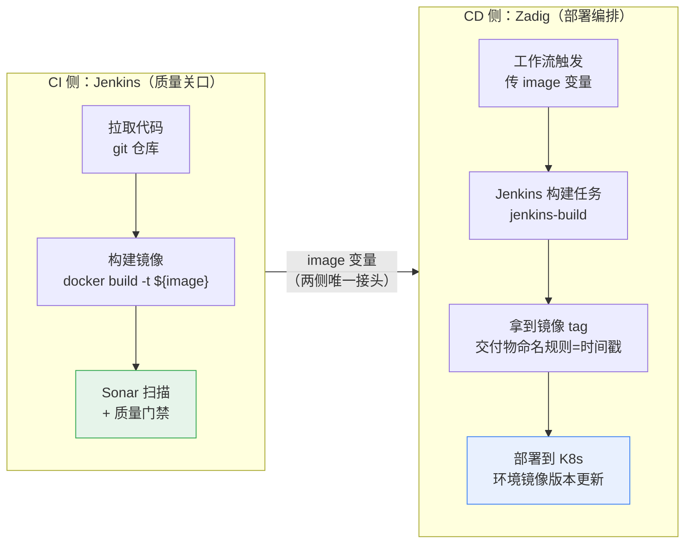

## 纲要

- **测试集成要测试同学配合**：Zadig 里配「测试执行环境镜像 + 代码源 + 脚本指令 + 报告目录」四件套，**脚本由测试同学提供**——平台只负责执行与报告展示
- **pytest 双报告机制**：执行 `pytest` 生成 `junit.xml` 与 `report.html`，指定报告目录后可在 Zadig 页面直接查看测试报告与用例
- **Sonar 集成的两步**：Sonar 侧生成 token → Zadig「系统集成 → Sonar 集成」填地址 + token；扫描参数只需 `projectKey`/`projectName`/`sonar.sources` 三个核心项
- **社区版的能力边界**：Zadig 社区版**没有质量门禁**——扫描结果要人肉看、不能嵌进流水线、不能失败即终止部署
- **补齐方案 = Jenkins 前置扫描**：把「构建 + 代码扫描 + 质量门禁」放 Jenkins，Zadig 只拿镜像 tag 做部署——CI/CD 职责重新分工
- **Jenkins 构建集成三要素**：系统设置配 Jenkins（地址 + 用户名 + API token）→ 构建方式选 Jenkins 构建（选 job + 传 image 变量）→ 工作流自动关联

## 一、场景引入：社区版 Zadig 的三块短板

到本篇，Zadig 的构建、模板、工作流、缓存都已就位，但课程连讲两节「测试/扫描」与「集成 Jenkins」，原因只有一个：**社区版 Zadig 有三块能力短板**，必须用生态组合补齐：

| 短板 | 课程原话 | 后果 |
| --- | --- | --- |
| **无质量门禁** | 「社区版的话，它没有办法帮我们做质量预控制」 | 扫描完要自己看结果，无法及时感知 |
| **扫描不能入流水线** | 「也没有办法把它放在我们的流水线步骤里面」 | 扫描发现问题**不能终止部署** |
| **扫描失败无感知** | 「没有办法提醒我们，就是说这个代码有问题」 | 坏代码可能被部署上线 |

课程的补齐思路非常清晰：

> 「如果想要实现这个功能的话，那我们就必须要集成 Jenkins 来进行做代码扫描的这一块的功能。这样就相当于把我们的一个 Jenkins 用来做我们的一个系统集成、做构建、做代码扫描，然后使用 Zadig 来进行部署。」

即 **CI 归 Jenkins、CD 归 Zadig**——Jenkins 前置做「构建 + Sonar 扫描 + 质量门禁」，Zadig 后置拿镜像 tag 部署。这是 Zadig 社区版落地最常见的架构分工，本篇把两侧配置一次讲透。



分工的边界感来自「能力在哪一侧」：质量门禁、扫描失败终止这类**强 CI 诉求**在社区版 Zadig 里是企业版墙，而 Jenkins 天生为这类任务设计；Zadig 的强项是**部署编排**（环境、服务、模板、工作流），让专业工具干专业事，两边都用得舒服。

## 二、测试集成：pytest 的四件套配置

### 2.1 配置全流程

路径：**项目 → 测试 → 创建测试**。课程演示用 pytest，四个配置项：

| 配置项 | 课程填法 | 说明 |
| --- | --- | --- |
| 测试名称 / 描述 | 自定义 | — |
| 测试执行环境（操作系统） | **pytest 镜像**（可自定义操作系统，添加带 pytest 的镜像） | 测试跑的容器环境 |
| 代码源 | 测试同学提供的代码库 + 主仓库 + 分支 | **脚本必须先在代码源里存放好** |
| 测试脚本指令 | 进仓库目录执行 `pytest` | 指令由测试同学提供 |
| 报告目录 | 指定报告所在目录 | 见 2.2 |

课程对分工的定位很坦诚：「具体这个代码仓库下存放的一个脚本，是由我们的测试人员给我们去提供的。我们只需要在 Zadig 里面配置代码仓库的一个目录分支，然后输入测试人员给我们提供的一个脚本指令，指定一个测试报告的配置就可以。」——**Zadig 在测试环节是执行器与展示台，不是测试框架**。

### 2.2 pytest 双报告：junit.xml + report.html

执行 `pytest` 生成两个文件：

- `junit.xml`：机器可读的结果文件（CI 系统解析用）；
- `report.html`：人可读的可视化报告。

指定报告目录后，执行完成即可在 Zadig 的**测试报告**入口点击查看——页面自动跳转测试报告。测试中心里还能看用例明细：课程实拍显示「两个测试用例成功、测试用时」，可展开查看每个用例。

实战篇的配置细节（项目实战会用到）：测试镜像在**自定义镜像管理**里预先定义（含 python + pytest 环境）；代码源指向 pytest 仓库（内含两个 python 脚本——一个走成功路径、一个走失败路径，失败脚本可注释掉用于演示）。

### 2.3 在工作流中引用测试

自定义工作流里加一个**测试阶段**，任务类型选「测试」→ 选已创建的测试配置（如 `UITest`）→ 保存。执行工作流时该阶段自动跑测试，报告回链到工作流详情。

## 三、代码扫描：Sonar 集成与三个核心参数

### 3.1 Sonar 集成（系统级，一次配好）

1. **Sonar 侧生成 token**：登录 Sonar → 右上角账号 → 安全 → 生成 token（输入名字 → 生成 → 拷贝）；
2. **Zadig 侧填入**：系统设置 → 系统集成 → Sonar 集成 → 访问地址 + token → 保存（保存成功即连通）。

### 3.2 代码扫描配置（项目级）

路径：**项目 → 代码扫描 → 新建**：

| 字段 | 课程填法 |
| --- | --- |
| 名称 / 描述 | 自定义 |
| 扫描工具 | **SonarQube**（默认） |
| 扫描环境 | 默认 |
| 扫描地址 | 3.1 集成的地址 |
| 代码源 | 要扫描的仓库 + 组 + 代码库名称 + 分支 |
| 参数配置 | `projectKey`、`projectName`、`sonar.sources` |

**参数配置的精简技巧**（课程从官方文档挖出来的）：官网文档 → 功能介绍及最佳实践 → 测试与代码扫描 → 代码扫描，有现成配置块可整段粘贴。三个核心项：

- `projectKey` / `projectName`：一般改成与项目名同名；
- `sonar.sources`：代码目录——`$WORKSPACE/<仓库名>`（代码拉在 workspace 下，与 #71 的 `$REPONAME_0` 同一路径体系）；
- **语言、编码可不输**；
- **token 执行时自动补充**，不用手动加。

### 3.3 触发器、通知与策略

- **触发器**：配置代码仓库的提交/合并动作，事件发生后自动触发扫描；
- **通知**：扫描完成后发通知（课程注明**通知需企业版**）；
- **策略配置**：代码扫描超时时间 + 执行资源配置（CPU/内存）。

### 3.4 质量门禁：社区版的墙

课程反复演示这块边界，结论必须记住：

> 「在这最下边它有一个质量门禁检查，但是这个是企业版的功能，所以我们没有办法实现这个功能……我们的流水线就没有办法在部署的时候实现自动化扫描，然后自动化停止我们的过程。」

即社区版能做到的极限是：**提交/合并时自动扫描 + 人肉看结果**。要「扫描失败即终止部署」的门禁效果，只能走 Jenkins 路线（下面）。

课程实拍还留了个坑：代码扫描 Pod **拉不到镜像导致扫描失败**，Pod 已删除——排查方式是去终端看 Pod 状态与日志；并再次强调 **1.18 或以下版本才有模板管理等完整功能**，更高版本大量功能转企业版。

## 四、集成 Jenkins 构建：CI/CD 职责重分工

### 4.1 系统级集成 Jenkins

路径：**系统设置 → CICD 工具 → 配置 → 添加 Jenkins**：

- Jenkins 访问地址；
- 用户名；
- **API token**：Jenkins 页面右上角 → 设置 → API Token → 添加新 token → 复制粘贴（#69 同款流程）。

### 4.2 构建配置：选 Jenkins job + 传 image 变量

路径：**项目 → 构建 → 新建构建**：

| 字段 | 课程填法 |
| --- | --- |
| 构建方式 | **Jenkins 构建** |
| Jenkins | 选 4.1 集成的地址 |
| 构建名称 | 自定义（如 `jenkins-build-test`） |
| 服务 | 选 `golang`（该构建服务于哪个服务） |
| Jenkins job | 选 `jenkins-build`（Jenkins 侧要运行的 job） |
| 构建超时 | 默认 |
| **构建参数** | 变量名 **`image`**，值用系统内置 |

**`image` 变量是两侧的接头暗号**：Jenkins 的 Jenkinsfile 里定义 `image` 参数（值空），Zadig 把镜像地址通过这个变量传进去，Jenkins 构建时用该地址打/推镜像。

**镜像 tag 从哪来**：服务 → 策略 → 交付物命名规则——Jenkins 构建默认规则是**时间戳**，即 `image` 的值 = 仓库地址 + 命名空间 + 版本 + 时间戳 tag（在环境里把鼠标悬停镜像处可见完整一串）。

### 4.3 工作流关联与执行

回工作流 → 产品工作流 → 齿轮 → 构建部署：**自动关联** `jenkins-build-test` 构建（服务与构建名称已绑定）。执行时选 `golang` 服务，Zadig 把 `image` 变量值传给 `jenkins-build` job。

Jenkinsfile 侧（课程仓库实拍）：

```groovy
pipeline {
  agent any
  stages {
    stage('拉取代码') {
      steps { git url: 'http://git.example.com/group/golang.git', branch: 'main' }
    }
    stage('构建镜像') {
      steps {
        // 指定镜像仓库 + 密钥信息
        withCredentials([usernamePassword(credentialsId: 'registry', usernameVariable: 'USER', passwordVariable: 'PASS')]) {
          sh 'docker build -t ${image} . && docker push ${image}'
        }
      }
    }
  }
}
```

关键行 `docker build -t ${image}`——`image` 的值由 Zadig 传过来（仓库+命名空间+时间戳 tag）。执行效果（课程实拍）：Zadig 触发 → Jenkins 第 32/33 次构建 → 镜像构建完成（如 `0623-030903`）→ Zadig 拿到 tag 部署 → 环境镜像版本更新为 `20240623-030903`。**「构建在 Jenkins、部署在 Zadig」的闭环成立**。

## 五、生产实践要点

1. **CI/CD 分工先定再配**：社区版 Zadig 做 CD；Sonar 质量门禁这种 CI 强诉求放 Jenkins。分工不清会导致「想在 Zadig 里做门禁」反复碰壁。
2. **测试镜像走自定义镜像管理**：把 python + pytest + 依赖打进镜像预定义，测试执行环境选它——避免每次测试现装环境，报告目录固定约定。
3. **`sonar.sources` 指向 `$WORKSPACE/<仓库名>`**：与构建的 `$REPONAME_0` 同一路径体系，别写死绝对路径。
4. **`image` 变量名两侧必须一致**：Jenkinsfile 的参数名与 Zadig 构建参数名对不上，传参静默失败（构建照跑，tag 不对）。
5. **Jenkins job 提前存在**：Zadig 里选 job 是下拉框，job 不存在=构不出；先 Jenkins 后 Zadig 的次序再次应验。
6. **扫描 Pod 拉不到镜像先查仓库**：扫描环境用的镜像要在镜像仓库可达（课程实拍的失败根因）；1.18 版本模板功能完整，别盲目追高。
7. **通知能力按版本规划**：扫描完成通知等是企业版能力；社区版用 Jenkins 侧的后置动作（webhook/邮件）补。
8. **测试脚本与生产用例分库**：演示用的成功/失败双脚本仓库不要当生产用例库——生产用例由测试团队在自己的仓库维护，Zadig 只挂代码源；演示库的目的是验证平台链路。
9. **镜像仓库凭证在 Jenkins 侧管**：Jenkinsfile 里 `withCredentials` 引注册表凭据（#30 的 docker-config 模式），Zadig 只传地址不碰密钥——密钥不出 CI 侧，CD 侧无凭据也可部署（凭据只用于拉镜像）。
10. **交付物命名规则按环境区分**：时间戳 tag 无法区分环境，多环境同服务时在命名规则里加环境变量段（`{{.环境}}-{{.时间戳}}`），回滚时肉眼可辨。
11. **Jenkins 侧保留构建历史**：Zadig 触发的是 Jenkins job，构建日志、制品、失败堆栈都在 Jenkins——排障时两侧对照：Zadig 看部署状态，Jenkins 看构建细节。
12. **社区版升级节奏要评估**：1.18 以上大量功能转企业版（模板管理、质量门禁、通知）；升级前先列出团队依赖的功能清单，别为追新丢能力。

## 六、报错排查表

| 现象 | 根因 | 解法 |
| --- | --- | --- |
| 测试执行失败、找不到报告 | 报告目录与脚本输出目录不一致 | 核对脚本生成 `junit.xml`/`report.html` 的路径与配置的报告目录 |
| 测试报「没有这样的文件或目录」 | 报告文件未生成（脚本报错中断） | 看测试日志定位脚本问题；演示用失败脚本先注释 |
| Sonar 集成保存失败 | 地址带尾斜杠 / token 错 | 去尾斜杠；重新生成 token |
| 扫描 Pod 拉镜像失败 | 镜像仓库不可达/无凭证 | 查镜像仓库连通性；换可达基础镜像 |
| 扫描结果无人感知 | 社区版无质量门禁、无通知 | Jenkins 侧做门禁；或人肉巡查扫描记录 |
| Jenkins 构建关联不到工作流 | 服务与构建名称未绑定 | 构建配置里选对服务；回工作流刷新 |
| 镜像 tag 是时间戳而非语义版本 | 交付物命名规则用的默认规则 | 服务 → 策略 → 交付物命名规则自定义 |
| Jenkinsfile 里 `${image}` 为空 | Zadig 传参失败/变量名不一致 | 核对两侧 `image` 变量名；确认工作流执行时选了服务 |

## 七、面试考点与追问

**Q1：Zadig 社区版做代码扫描有什么局限？怎么补？**
局限：无质量门禁（企业版）、扫描不能嵌流水线、失败不能终止部署、无通知。补法：构建与扫描移到 Jenkins（Jenkins 做 CI + Sonar + 门禁），Zadig 只做部署——拿 Jenkins 产出的镜像 tag 部署到 K8s。

**Q2：Zadig 集成 pytest 测试需要哪些配置？**
测试名称/描述、测试执行环境镜像（含 pytest）、代码源（测试同学提供脚本的仓库+分支）、测试脚本指令（如 `pytest`）、报告目录（`junit.xml` + `report.html`）。脚本由测试同学提供，Zadig 负责执行与报告展示。

**Q3：Sonar 扫描参数配置的核心三项是什么？**
`projectKey`、`projectName`（一般与项目名同名）、`sonar.sources`（代码目录 `$WORKSPACE/<仓库名>`）。语言/编码可省，token 执行时自动补充。

**Q4：Zadig 集成 Jenkins 构建时 `image` 变量起什么作用？**
它是两侧的传参接头：Jenkinsfile 定义 `image` 参数（值为空），Zadig 执行工作流时把完整镜像地址（仓库+命名空间+时间戳 tag）通过该变量传给 Jenkins job，Jenkinsfile 用它 `docker build -t ${image}` 打推镜像。两侧变量名必须一致。

**Q5：交付物命名规则默认是什么？怎么改？**
Jenkins 构建默认用**时间戳**规则生成镜像 tag；可在服务 → 策略 → 交付物命名规则里自定义（变量+常量组装，同 #70 镜像名称规则）。

**Q6：为什么说 Zadig 在测试环节是「执行器与展示台」？**
因为测试脚本、用例全由测试同学在代码库提供，Zadig 只配置「代码源+指令+报告目录」，负责跑和展示——它不生产测试能力，只编排测试能力。

**Q7：1.18 与更高版本的 Zadig 在功能上有什么分水岭？**
1.18 及以下有完整的模板管理等功能；1.18 以上大量功能（质量门禁、通知等）转企业版付费。学习与社区部署锁 1.18。

## 📎 文本↔代码关联

本篇工作流与构建配置引用的模板资产（测试执行环境镜像、node 构建脚本与 Dockerfile）来自课件模板库，如实关联：

| 代码文件 | 正文提及 | 内容 |
| --- | --- | --- |
| `code/9-Zadig/模板/Build-script/test-node.sh` | 2.1 测试执行环境、4.2 构建脚本段 | node 项目构建/测试脚本：`npm install --registry=https://registry.npmmirror.com` → `npm run build`，可被测试任务引用执行 |
| `code/9-Zadig/模板/Dockerfile/go` | 4.2 构建镜像阶段 | Go 多阶段构建模板，Jenkins 构建方式之外 Zadig 原生构建引用的 Dockerfile |
| `code/9-Zadig/模板/Dockerfile/node` | 4.2 构建镜像阶段 | Node 构建模板，前端服务构建引用 |
| `code/9-Zadig/模板/K8S-YAML/backend` | 4.3 部署阶段 | 部署任务服务组件的 K8s 模板（`$T-Service$` 变量化） |
| `code/9-Zadig/模板/K8S-YAML/node` | 4.3 部署阶段 | 前端服务部署模板 |

**技术点总结**：本篇是 Zadig 社区版的能力边界说明书 + 补齐方案。测试集成 = 四件套配置（执行镜像 + 代码源 + 脚本指令 + 报告目录），脚本归测试同学、平台归执行展示；代码扫描 = Sonar token 集成 + 三个核心参数（projectKey/projectName/sonar.sources），但**质量门禁、入流水线、失败终止、通知四样全是企业版墙**。补齐方案清晰利落：**CI 归 Jenkins**（构建 + Sonar + 门禁），**CD 归 Zadig**（拿 `image` 变量传过来的镜像 tag 部署）——`image` 变量是两侧唯一接头，名字必须对齐。配合 1.18 版本锁定，这就是社区版 Zadig 生产落地的最优分工。
