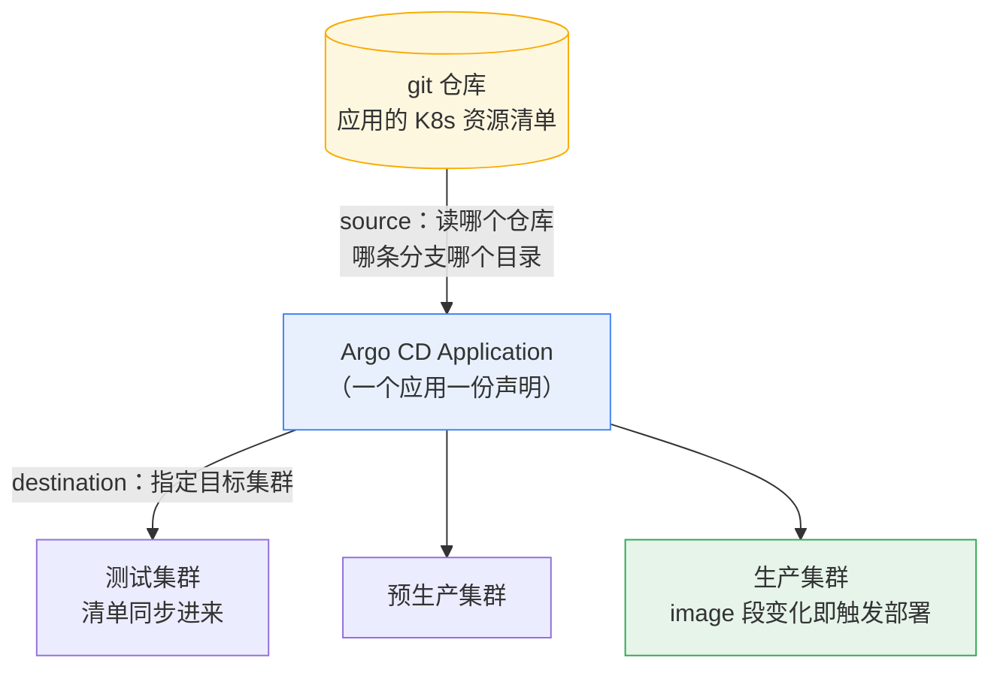
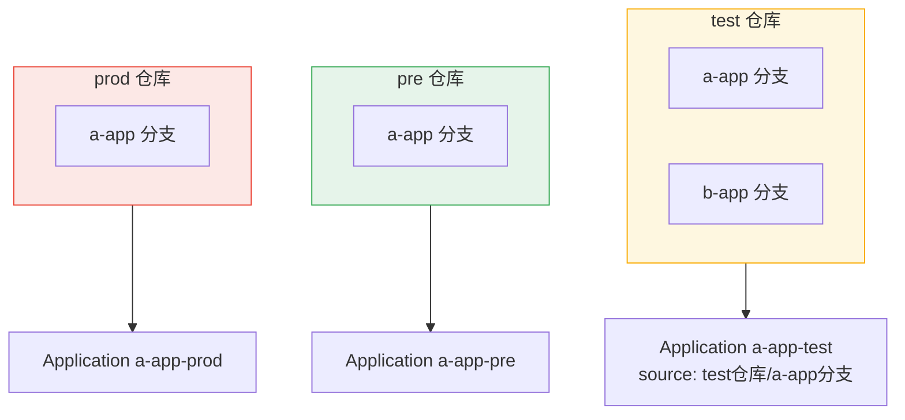
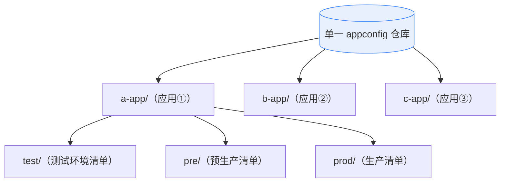

## 纲要

- **Application 是 Argo CD 的核心概念**：一个 Application = 一份「git 仓库哪个路径的清单 → 同步到哪个集群哪个命名空间」的声明，**source + destination 两块必配**
- **接入三件套前置**：`argocd cluster add` 接集群、`argocd repo add` 接仓库、project 做分类——三者齐了 Application 才能 apply
- **三种存储模式按维护性取舍**：对应分支（回滚安全、跨仓维护难）→ 对应目录（通用修改快、回滚影响面大）→ 按需选择
- **多来源 Application**：`sources` 列表可同时挂 Helm chart 仓库 + git 路径，`$values` 还能引用外部 values 文件仓库
- **同步是显式动作**：默认只检测 diff 不自动同步——点 sync（或开自动同步策略）才把 git 状态推到集群
- **缺失/不同步状态可自愈**：集群资源被删显示 Missing，仓库变了显示 OutOfSync——sync 一下就拉回一致

## 一、场景引入：Application 到底「应用」的是什么

Argo CD 装好了（#76），但它现在是个空转的控制器——不知道去哪读清单、往哪部署。**Application 就是给它下达的第一份作业单**。课程的定义：

> 「我们这个应用它是 Argo CD 的一个核心概念。那我们就是通过它来实现将我们 git 仓库中的一个资源清单来同步到 K8s 集群中。它的主要职责就是定义 K8s 资源的**来源**和**目标**。」

- **来源（source）**：git 仓库中 K8s 资源清单配置文件所在的**路径**；
- **目标（destination）**：要部署的 **K8s 集群 + 命名空间**。

一句话：**Application = 一份从「git 某路径」到「某集群某命名空间」的同步契约**。多个应用就配多个 Application。

课程给了一张「Application 与 K8s 的关系图」，信息量很大，先用一张 mermaid 还原它：



图里三个层次各司其职：**仓库存清单**（Deployment/Service 等 YAML）、**Application 做路由**（source 指仓库、destination 指集群）、**集群是落点**。应用指定同步到哪个目标集群，哪个集群的清单就变化；指定生产集群时，生产集群里清单的 image 段一改，应用就开始执行部署。这就是「#77 之前为什么要先讲接入集群和接入仓库」的答案——Application 只是路由规则，两端不通它就是个空壳。

## 二、前置三件套：集群、仓库、项目

### 2.1 接入 K8s 集群

```bash
# ① 在要接入的集群上获取执行上下文（kubeconfig 的 context 名）
kubectl config get-contexts

# ② 登录 Argo CD（IP:端口，不加协议；从 Argo CD 所在服务器执行）
argocd login node1.example.com:31650 --username admin

# ③ 把上下文加入 Argo CD（--upsert 覆盖式添加，不加可能添加失败）
argocd cluster add $CONTEXT_NAME --name local-k8s --upsert

# ④ 查看集群列表（不知道子命令直接回车可看帮助）
argocd cluster list
```

课程实拍：`argocd cluster list` 显示两个集群——默认的本机集群（`https://kubernetes.default.svc`）+ 添加的本地集群。**Argo CD 所在集群默认就在管理列表里**，这也是「接入自己的集群」的最短路径。Settings → Clusters 页面同样能看到这两个集群——页面与终端是同一份数据的两面。

### 2.2 接入 git 仓库

```bash
# 添加仓库（地址 + 用户名密码 + 起名）
# ⚠️ 凭据不要走位置参数——位置参数会进 shell history，也会被同机其他用户从 ps 看到；
# 用 --username/--password flag，密码建议从环境变量传入；更稳妥的做法是走 Argo CD 页面添加（存为 Server Secret）
argocd repo add http://git.example.com/argocd/appconfig.git --username "$GIT_USER" --password "$GIT_PASSWORD" --name appconfig

# 查看 / 详情 / 删除
argocd repo list
argocd repo get http://git.example.com/argocd/appconfig.git
argocd repo rm http://git.example.com/argocd/appconfig.git
```

页面同样可操作：Settings → Repos → Add（课程实拍：初始 repos 列表为空，添加后状态显示成功）。课程还演示了一个小坑——**仓库 IP 填错**（63 写成别的），添加不成功，改成正确地址后即刻成功；这也说明 `repo add` 是带连通性验证的，填错当场报错，不会留个假成功。**「集群接入 + 仓库接入」是 apply 任何 Application 前的两个硬前置**——课程反复强调：「要放在我们部署的 Argo CD 集群当中，然后现在我们来运行一下……在部署之前，我们必须要把这个集群给它添加到 Argo CD 集群当中，以及这个要读的仓库地址，必须要添加到我们的集群当中。」

### 2.3 项目（Project）

Projects 是 Application 的分类容器，默认只有一个 `default`。Application YAML 里 `spec.project: default` 即隶属它；Settings → Projects 可添加新项目名。**不分类就全落 default**——小团队够用，多团队/多环境建议按项目分（#81 的 RBAC 授权也以 project 为粒度）。

## 三、资源清单的三种存储模式

课程用两节篇幅讲「git 仓库怎么组织应用清单」，这是 Argo CD 落地的**架构级决策**，直接决定维护性与回滚安全性。

### 3.1 模式一：对应分支（一仓库一环境）



- 结构：**一个仓库对应一个部署环境**（test 仓库、pre 仓库、prod 仓库——课程原话「比如说 test 它就对应一个仓库……我们有四个环境，那我们就需要创建四个仓库」），仓库内**不同分支对应不同应用**；
- 好处：**回滚方便且不影响其他应用**——分支级回退，隔离性最好；
- 坏处：应用多了不好管理；**通用性改动要进不同仓库的不同分支反复修改**（如全局改个 label，四个环境四个仓库各改一遍）。

### 3.2 模式二：对应目录（一仓库多环境）



- 结构：**多环境配置存一个仓库**；**根目录对应一个应用**；应用下**子目录区分环境**（`a-app/test`、`a-app/pre`、`a-app/prod`）；
- 好处：**通用修改极快**——所有环境所有应用的清单都在一个仓库里，找文件、批量改都容易；
- 坏处：**回滚影响面大**——一回滚可能牵连其他应用跟着回滚。课程原话：「这种存储方法的好处就是说当我要修改通用的一个清单文件内容的时候，我们所有环境的所有应用，它的一个清单文件都需要修改，那我们就可以很快的在这边找到文件来修改……但是它的坏处就是说回滚多少回滚，因为你一回滚可能会影响到其他的应用也跟着回滚。」

### 3.3 模式三：按需选择

课程的结论：「每一种方法都是有利有弊的，这个主要看我们的需求。」选型矩阵：

| 维度 | 对应分支 | 对应目录 |
| --- | --- | --- |
| 回滚隔离性 | **好**（分支级，不波及他人） | 差（仓库级，易牵连） |
| 通用配置修改 | 差（多仓库多分支） | **好**（一处改全局） |
| 应用规模扩展 | 差（仓库/分支膨胀） | **好**（目录自然扩展） |
| 权限粒度 | 仓库级（天然隔离） | 目录级（需额外管控） |
| 适用 | 应用少、环境差异大、回滚频繁 | 应用多、配置同构、追求维护效率 |

生产常见混合策略：**跨环境用目录（同构高效），跨应用/跨团队用仓库或 project 隔离**。

## 四、Application YAML 详解：从单来源到多来源

### 4.1 单来源最小配置

```yaml
apiVersion: argoproj.io/v1alpha1
kind: Application
metadata:
  name: guestbook
  namespace: argocd
spec:
  project: default
  source:
    repoURL: http://git.example.com/argocd/appconfig.git  # 来源仓库
    targetRevision: HEAD                                   # 目标版本（分支/tag/commit）
    path: guestbook                                        # 仓库内的清单目录
  destination:
    server: https://kubernetes.default.svc                 # 目标集群
    namespace: default                                     # 目标命名空间
```

字段逐个拆：

| 字段 | 含义 | 课程实战值 |
| --- | --- | --- |
| `spec.project` | 隶属项目（分类 + RBAC 粒度） | `default` |
| `spec.source.repoURL` | 清单所在仓库 | `http://git.example.com/argocd/appconfig.git` |
| `spec.source.targetRevision` | 目标版本 | `HEAD`（或 `main` 分支名） |
| `spec.source.path` | 仓库内清单目录 | `guestbook` |
| `spec.destination.server` | 目标集群 API 地址 | `https://kubernetes.default.svc` |
| `spec.destination.namespace` | 目标命名空间 | `default` |

**source + destination 是两块必配**（课程原话：「有两个配置，它是必须会配的，一个是 source，一个是 destination」），project 不配则落 default。再补三个容易忽略的细节：

- **apiVersion 固定 `argoproj.io/v1alpha1`**：Application 是 Argo CD 的 CRD，版本写错 apply 直接报 no matches；
- **namespace 必须是 `argocd`**：这份 YAML 是 apply 给 Argo CD 自己消费的，写到业务命名空间 Argo CD 看不见；
- **targetRevision 三种写法**：分支名（`main`）、tag（`v1.2.3`）、commit SHA——课程演示用 `HEAD` 图省事，生产必须锁死（见第六节）。

### 4.2 多来源配置（sources 列表）

```yaml
spec:
  sources:
    - chart: elasticsearch                    # 来源①：Helm chart 仓库
      repoURL: https://helm.elastic.co
      targetRevision: 8.5.1
    - repoURL: https://github.com/argoproj/argocd-example-apps.git   # 来源②：git 路径
      path: guestbook
      targetRevision: HEAD
```

**什么时候用多来源**：一个应用 = Helm chart（第三方依赖，如 ES/Redis）+ 自有配置（git 里的 ingress/配置项）。课程实战即此形态：chart 装 elasticsearch 8.5.1，git 路径装 guestbook。多来源的三个实战价值：

> ⚠️ **chart 仓库在国内的可达性**：`https://helm.elastic.co` 是 Elastic 官方境外源，国内同步常常超时，表现是 Application 卡在 `Unknown`/`ComparisonError`。三条出路：① 配镜像加速器或用国内 chart 镜像站；② 把 chart 拉下来推到内网 chart 仓库（Harbor 的 chartmuseum / 对象存储），`repoURL` 改内网地址；③ **直接把 chart 渲染后的 YAML 进 git**——最省事，也最符合 GitOps（少一层外部依赖）。**生产上更推荐 ③**：Argo CD 调和时不再依赖境外网络，发布可复现性也最好。

- **依赖与自有分源**：chart 走 Helm 仓库（版本语义清晰），自有配置走 git（评审走 PR）——两类资产的变更流程各得其所；
- **版本分别锁定**：chart 的 `targetRevision` 锁 chart 版本，git 路径锁 commit——升级 ES 不用动业务仓库；
- **`$values` 再拆一层**：values 文件也能独立成仓（见 4.3），配置与代码彻底分离。

### 4.3 外部 values 文件仓库（$values）

更精细的 Helm 场景——chart 与 values 分仓：

```yaml
spec:
  sources:
  - repoURL: 'https://prometheus-community.github.io/helm-charts'
    chart: prometheus
    targetRevision: 15.7.1
    helm:
      valueFiles:
      - $values/charts/prometheus/values.yaml   # 引用下面的 values 仓库
  - repoURL: 'https://git.example.com/org/value-files.git'
    targetRevision: dev
    ref: values                                   # 这个仓库被标记为 values 源
```

`ref: values` + `$values/...` 是 Argo CD 的多源引用语法：values 文件单独一个仓库管理（可版本化、可跨 chart 复用），dev 分支的 `charts/prometheus/values.yaml` 喂给 prometheus chart。课程对这块的定位是「简单了解一下」——进阶能力，知道有这招即可。

这套机制解决的是 Helm 使用的经典矛盾：**chart 是通用的，values 是个性化的**。把 values 从 chart 仓库剥出来独立版本化后：① 同一个 chart 多套 values（dev/staging/prod 各一份）互不干扰；② values 的变更走 git 评审，不用改 chart；③ chart 升级时 values 仓不动，升级面收敛。`ref` 的名字可以自定义（不叫 `values` 也行），但 `$values/` 前缀必须与 `ref` 名对应——这是唯一的「魔法字符串」。

## 五、实战全流程：从 apply 到架构图

课程的实战是一条完整动线，按顺序复盘：

**① apply Application**：`kubectl apply -f application-1.yaml`（**这份 YAML 本身要 apply 到 Argo CD 所在集群**，不是目标业务集群——`namespace: argocd`）。

**② 页面出现应用**：guestbook 应用出现，Argo CD **每 3 分钟读一次仓库**，发现变化就显示 diff。同步前先看一眼仓库里的清单内容——课程实拍：appconfig 仓库的 `guestbook` 目录在 main 分支下有两个文件，`deployment.yaml` + `service.yaml`，Argo CD 两个都会读，最终部署出一个 `guestbook-ui` Deployment 和一个 Service。此时集群里既没有 guestbook 的 Service 也没有 Deployment——**「从无到有」正是 sync 要干的事**。

**③ 同步是显式动作**：默认「同步策略」没开——Argo CD 只检测不一致，**不自动推**。左边（集群现状）是空的，右边（git 期望）有清单 → 点 **sync** 才同步部署。课程原话：「刚才他只是帮我们检测到有这个文件发生变化……但是他不会帮我们自动同步，他只是检测到不一样。」

**④ 部署过程与验收**：点 sync 后状态转「部署中」→ 集群里出现 `guestbook-ui` Deployment 与 Service → **应用架构图**展示 Service/Deployment 资源树 → 点进资源可看：源类型、名称、创建时间、状态、健康状态、事件、**Pod 日志**、endpoint、副本数、RS、Pod 及其所在节点。

**⑤ 删除应用**：页面点删除即可（注意与 #80 讲的「页面删 vs 终端删」差异）。

**⑥ 多来源与同名坑**：apply `application-2.yaml`（多来源）时课程踩了**同名坑**——与已有应用重名导致状态异常，改名 `guestbook-2` 重新 apply 才正常。**应用名在 Argo CD 实例内必须唯一**。

**⑦ 缺失状态自愈**：`guestbook-2` 一度显示「缺失（Missing）」——集群里没有而仓库里有的资源；点 diff 确认 → 点 sync → 拉回一致。随后两个副本、PVC 等资源正常显示；个别资源「裂开」图标点进去看事件，最终正常。

**⑧ 页面即终端**：以上动作在页面都能做，终端 `argocd app` 命令同样覆盖（`#80`/`#81`）——页面适合观察（架构图、diff、资源树），终端适合脚本化。

## 六、生产实践要点

1. **存储模式先定后干**：对应分支 vs 对应目录是架构决策——应用少回滚频繁选分支，应用多同构选目录；混合策略（跨环境目录 + 跨团队仓库）最常见。
2. **targetRevision 别用 HEAD**：生产锁分支名或 tag——HEAD 漂移会让「昨天还好好的今天变了」无法追溯。
3. **同名唯一性**：Application 名在实例内唯一，重名 apply 会状态异常；命名规范建议 `<应用>-<环境>`。
4. **集群/仓库接入是硬前置**：先 `cluster add` + `repo add` 再 apply Application，次序反了就是「应用出来了但一直 OutOfSync/缺失」。
5. **默认不同步是安全特性**：没开自动同步前，git 变化只出 diff——利用它做「变更预览」，确认无误再 sync。
6. **多来源管理第三方依赖**：ES/Redis 这类 Helm 依赖用 sources 挂 chart，自有配置走 git 路径——应用清单的「依赖」与「自有」分源清晰。
7. **project 早分群**：RBAC 以 project 为粒度（#81），多团队环境从一开始就按 project 分，别全堆 default。
8. **Application YAML 也要版本化**：apply 到 argocd 命名空间的 Application 本身建议也存 git（「管理管理器的仓库」），误删后一条 apply 就能恢复——这正是 App of Apps 模式的思想：用一个根 Application 管理所有子 Application 的 YAML。
9. **资源清单与代码仓分离**：appconfig 这类纯清单仓库与业务代码仓库分开——业务仓 CI 改镜像 tag 后向清单仓提 PR，评审动作天然落在部署变更上。
10. **sync 粒度按变更范围选**：全局 sync 一把推 vs 单资源 sync（#80）——大集群全量 apply 压力大，局部变更走资源级 sync。
11. **3 分钟轮询 + webhook 组合**：默认轮询保底（git 挂了也不会丢变化），webhook（#80）提效——两条路都通才不怕单点失效。
12. **架构图是排障入口**：应用页的资源树（Service → Deployment → RS → Pod）比 `kubectl get all` 更贴合「这个应用到底健康吗」的视角——教团队先从架构图看起，再决定跳哪个资源。
13. **diff 页是变更评审台**：sync 前先看 diff（左边集群现状 vs 右边 git 期望），确认变的只有预期字段再推——尤其多来源应用，chart 升级带来的隐性变更全在 diff 里现形。

## 七、报错排查表

| 现象 | 根因 | 解法 |
| --- | --- | --- |
| 应用一直 OutOfSync | 没开自动同步 | 点 sync，或配 syncPolicy.automated（#79） |
| 资源显示 Missing | 集群资源被删/未部署 | 点 sync 拉回；查是否误删 |
| apply 后应用状态异常 | **应用名重名** | 改唯一名重新 apply |
| 读不到仓库清单 | 仓库未接入 / 凭证错 | `argocd repo add`；核对用户名密码 |
| 目标集群不对 | destination.server 配错 | 核对 `argocd cluster list` 的地址 |
| 同步了但 Pod 起不来 | 清单本身有问题（镜像/资源） | 看应用内资源事件与 Pod 日志 |
| values 不生效 | `$values` 引用路径错 / ref 未标 | 核对 `ref: values` 与 `$values/...` 路径 |
| `repo add` 报验证失败 | 仓库地址错/不可达 | 核对 IP 与协议（课程实拍改对地址即成功） |
| `cluster add` 不成功 | 漏加 `--upsert` | 命令补 `--upsert` 重试 |
| apply 报 no matches for kind | apiVersion 写错 / YAML 落在错命名空间 | Application 固定 `argoproj.io/v1alpha1` + `namespace: argocd` |

## 八、面试考点与追问

**Q1：Application 的两块必配是什么？各自定义什么？**
source（定义资源清单来源：仓库地址 + targetRevision + path）与 destination（定义部署目标：集群 server + namespace）。project 不配落 default。

**Q2：Argo CD 接入集群和仓库的命令？**
`argocd cluster add <context> --name xxx --upsert`（先 `kubectl config get-contexts` 拿上下文）；`argocd repo add <url> <user> <pass> --name xxx`；查看用 `argocd cluster list` / `argocd repo list`，删除 `argocd repo rm`。

**Q3：资源清单两种存储模式及取舍？**
对应分支（一仓一环境、分支对应用）：回滚隔离好、通用修改难；对应目录（一仓多环境、根目录对应用、子目录对环境）：通用修改快、回滚影响大。按应用规模与回滚频率选。

**Q4：多来源 Application 解决什么？**
一个应用同时依赖 Helm chart（如 ES）与 git 内的自有配置——`sources` 列表挂多个源；`ref: values` + `$values/...` 进一步把 values 文件独立成仓。

**Q5：为什么 apply 后应用不同步？sync 是自动的吗？**
默认没开自动同步策略，Argo CD 只检测 diff 不推送——这是安全特性（变更预览）。点 sync 手动同步，或配 `syncPolicy.automated` 自动同步（#79）。

**Q6：Missing 与 OutOfSync 状态分别意味着什么？**
Missing：仓库有声明的资源但集群里缺失（被删或没部署过）；OutOfSync：集群现状与 git 期望不一致。两者都点 sync 拉回一致（若开了 selfHeal 则自动修复）。

**Q7：guestbook 目录里的清单会部署出什么？**
仓库 `guestbook` 目录（main 分支）下有 `deployment.yaml` + `service.yaml` 两份清单，Argo CD 都会读取，sync 后集群里出现 `guestbook-ui` Deployment 与对应 Service——**仓库里有什么就部署什么，目录即应用**。

**Q8：Application YAML 本身要不要管理起来？**
要。apply 到 argocd 命名空间的 Application 是「集群里的资源」，误删后应用就没了。生产上用 App of Apps 模式：一个根 Application 管理所有子 Application 的 YAML 仓库，恢复只是一条 apply 的事。

**Q9：`argocd cluster add` 为什么要加 `--upsert`？**
它表示「覆盖式添加」——同名上下文已存在时更新而不是报错。不加在重复添加场景下会失败，课程实拍明确要求加上才添加成功。

**Q10：页面能做的事终端都能做吗？两者怎么分工？**
核心动作（接集群/仓库、apply、sync、删除）两边都覆盖。分工上：页面强在观察（架构图、diff 可视化、资源树），终端强在脚本化（CI 里 login + app sync/get）。生产运维两个都要会。

**Q11：多来源 Application 里 chart 与 git 路径的 targetRevision 为什么要分开锁？**
两类资产的发布节奏不同：chart（如 ES）跟着上游版本走，git 路径跟着业务变更走。分开锁才能做到「升 ES 不动业务仓、发业务不动 chart 版本」，升级面各自收敛——这也是依赖与自有分源的价值。

## 📎 文本↔代码关联

| 代码文件 | 正文提及 | 内容 |
| --- | --- | --- |
| `code/10-Argocd/application/application-1.yaml` | 4.1 单来源最小配置、第五节实战 | 最小可用 Application：`guestbook` 应用，source 指向 `http://git.example.com/argocd/appconfig.git` 的 `guestbook` 目录（targetRevision HEAD），destination 为默认集群 `default` 命名空间，project default——正文字段拆解表的原样 |
| `code/10-Argocd/application/application-2.yaml` | 4.2 多来源配置 | 多来源 Application：sources 列表挂 Helm chart `elasticsearch 8.5.1`（helm.elastic.co）+ git 路径 `guestbook`（argocd-example-apps 仓库），对应正文「chart + git 路径」组合 |
| `code/10-Argocd/application/application-3.yaml` | 4.3 外部 values 文件仓库 | 多源 + `$values` 引用：prometheus chart 15.7.1 + `ref: values` 的 value-files 仓库（dev 分支 `charts/prometheus/values.yaml`），外部 values 管理的完整样例 |

**技术点总结**：Application 是 Argo CD 的核心契约——**source（git 仓库哪个路径）+ destination（哪个集群哪个命名空间）**两块必配，project 做分类。落地三件套前置：`cluster add` 接集群、`repo add` 接仓库、project 分群，三者齐了才 apply。清单组织两种模式按维护性取舍：对应分支（回滚隔离好）vs 对应目录（通用修改快）；高阶玩法用多来源（Helm chart + git 路径）与 `$values` 外置 values。行为特征牢记：**默认只检测 diff 不自动同步**（安全特性，可做变更预览），sync 是显式动作；Missing/OutOfSync 都能靠 sync 拉回一致；应用名实例内唯一，重名必坑。
