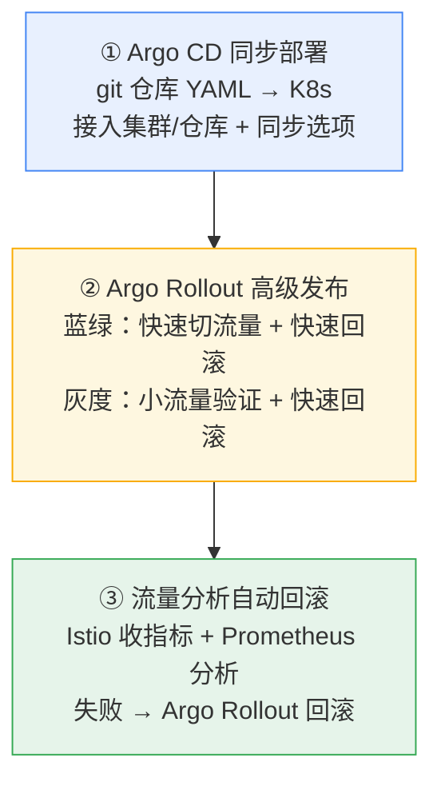
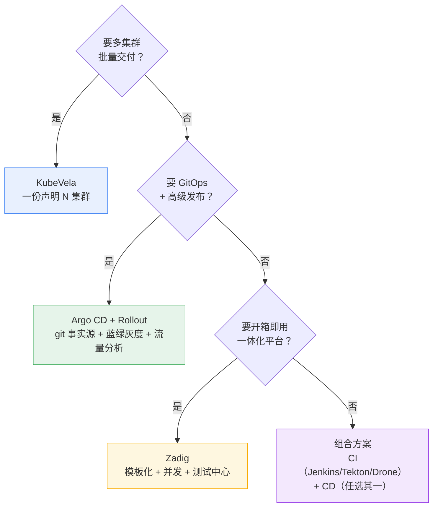

## 纲要

- **三大 CD 工具三种哲学**：KubeVela = 抽象层（多集群交付）、Zadig = 平台层（CI/CD/测试一体）、Argo CD = GitOps 层（声明式同步 + 高级发布）
- **选型第一问：要不要多集群交付**——要，KubeVela；要 GitOps + 蓝绿灰度，Argo CD；要开箱即用全家桶，Zadig
- **能力边界表**：三家都**没有构建功能**——CI 靠 Jenkins/Tekton/Drone，接缝是「git 里的 image tag」或「传参」
- **Argo CD 的独占能力**：GitOps 同步、配 Argo Rollout 的蓝绿/灰度、配 Istio + Prometheus 的流量分析自动回滚、应用架构图
- **Zadig 的独占能力**：模板化流水线、并发构建、测试中心、缓存加速——代价是核心功能大量付费墙
- **本章三掌握**：Argo CD 同步部署、Argo Rollout 高级发布、流量分析自动回滚——整章的能力收口

## 一、场景引入：工具学了六个，到底怎么选

课程至此，六大 CI 工具（Jenkins/Drone/Tekton）与三大 CD 工具（KubeVela/Zadig/Argo CD）全部讲完。工具越多，选型越焦虑。课程的对比不讲参数讲**场景**——先给结论，再看差异。

## 二、三大 CD 工具对比：一张表 + 三个场景

### 2.1 总览对比表

| 维度 | KubeVela | Zadig | Argo CD |
| --- | --- | --- | --- |
| **定位** | K8s 之上的**抽象层**（OAM） | **交付平台**（CI/CD/测试一体） | **GitOps 部署工具** |
| **多集群交付** | **强项**（一份声明多集群） | 支持（接入多集群） | 支持（ApplicationSet） |
| **构建功能** | 无 | **无**（靠集成 Jenkins） | 无 |
| **高级发布** | 工作流（含灰度步骤） | 基础部署 | **蓝绿/灰度 + 流量分析自动回滚**（配 Argo Rollout + Istio + Prometheus） |
| **配置方式** | OAM 抽象（组件/特征/策略/工作流） | **模板化 + 页面点选** | 声明式 YAML + git |
| **测试集成** | 无内置 | **测试中心内置** | 无 |
| **上手成本** | 中（要懂 OAM） | **低**（页面化） | 中（要懂 GitOps） |
| **主要代价** | 抽象层学习曲线 | **大量功能付费墙**（社区版缺质量门禁等） | 无构建、无测试能力 |
| **生态出身** | 阿里云 + CNCF | 数智科技（KodeRover） | Argo 项目（CNCF） |

### 2.2 三个场景对号入座

课程给三个典型场景，直接对工具：

**场景一：多地域多集群部署**——「当我们的应用的并发很大，它分别部署在了多个不同的 K8s 集群之上。这个时候我们可以使用 KubeVela，因为它支持多集群交付。它可以把我们的应用同时更新部署在我们三个不同地域的 K8s 集群（上海/深圳/广州）。」

→ **KubeVela**：一份应用声明 + 多个交付目标，多集群差异化配置（A 集群 3 副本、B 集群 2 副本）声明在同一份 YAML 里。

**场景二：快速搭建一体化平台**——「Zadig 它可以将我们的服务快速部署到我们的集群当中，并且它支持了 CI 的功能，而且测试的功能，它也可以集成到我们的流水线当中，相当于是集成了 CI/CD、测试、快速部署的功能。」

→ **Zadig**：模板化 + 并发构建 + 测试中心 + 缓存加速，一个平台全包；团队不想拼工具、想快速起步的首选。

**场景三：GitOps + 高级发布**——「Argo CD 它提供了 GitOps 的功能，并且它可以和 Argo Rollout 配合来实现蓝绿灰度等高级发布功能。而且我们的 Argo Rollout 还可以结合 Istio、Prometheus 来实现流量分析、自动回滚的功能。Argo CD 还提供了我们的应用架构图。」

→ **Argo CD**：git 即事实源 + 蓝绿/灰度 + 流量分析自动回滚 + 架构图，对发布可靠性要求高的团队。

### 2.3 本章最后补充的第四视角：优缺点复盘

课程本章结尾又从「优缺点」视角复盘了一遍：

| 工具 | 优点 | 缺点 |
| --- | --- | --- |
| **Argo CD** | GitOps 部署；配 Argo Rollout 有蓝绿/灰度高级发布 | **没有构建功能**，只做持续部署 |
| **KubeVela** | 更抽象的方式配置 YAML；**支持多集群交付** | 同样**没有构建功能**，专注部署 |
| **Zadig** | 集成测试、代码扫描、多种工具；CI/CD 全做；快速拉起流水线、配置简单、模板功能 | **很多功能商业付费** |

三家共同的「没有构建功能」再次印证：**CD 工具的边界是部署，CI 归 Jenkins/Tekton/Drone**——课程的 #89 综合实战全是「CI 工具 + CD 工具」的组合拳。

## 三、本章总结：三块必须掌握的内容

课程的收口非常明确，三块顶梁柱：

1. **Argo CD 同步部署**：把集群、git 仓库接入 Argo CD，利用 GitOps 把仓库里的 YAML 同步部署到 K8s——同步部署功能是本章着重内容；
2. **Argo Rollout 高级发布**：蓝绿（快速切流量、快速回滚）与灰度（先小流量打新服务，有问题快速切回旧版本）——**提高发布可靠性**是核心价值；
3. **流量分析自动回滚**：Istio 收集指标数据 → Prometheus 分析判断 → 成功继续部署、失败 Argo Rollout 回滚——无人值守发布的终极形态。

## 四、选型决策框架（课程思想的工程化扩展）

把课程的场景思维整理成可操作的决策树：

四个落地原则：

1. **没有银弹**：课程原话「这些工具，我们需要根据我们公司不同的业务，不同的场景来去选择合适我们的一个工具」；
2. **组合是常态**：三家 CD 都没构建功能，实际架构几乎都是「CI 工具 + CD 工具」；
3. **付费墙早评估**：Zadig 社区版功能边界（质量门禁、通知、多提供商集群）要在选型期摸清，别等上线才发现；
4. **可靠性优先看 Argo CD**：流量分析自动回滚这套组合是三家独一份——对发布事故零容忍的团队，Argo CD + Rollout 是默认答案。

## 五、面试考点与追问

**Q1：三大 CD 工具的定位差异？**
KubeVela = K8s 之上的抽象层（OAM，多集群交付）；Zadig = 交付平台（CI/CD/测试一体、模板化）；Argo CD = GitOps 部署工具（声明式同步 + 高级发布）。

**Q2：什么场景选 KubeVela？**
应用并发大、需同时部署到多个地域/集群（上海/深圳/广州），且要差异化配置——一份应用声明 + 多个交付目标。

**Q3：什么场景选 Zadig？**
想快速搭建一体化平台：模板化流水线、多服务并发构建、测试中心、缓存加速，配置简单不写大量 YAML——团队起步与中小规模的首选；注意大量功能付费墙。

**Q4：什么场景选 Argo CD？**
要 GitOps 部署（git 事实源、可审计可回滚）+ 高级发布（蓝绿/灰度 + 流量分析自动回滚）——对发布可靠性要求高的团队。

**Q5：三家 CD 工具的共同短板是什么？怎么补？**
都没有构建功能——CI 靠 Jenkins/Tekton/Drone，接缝是「git 里的 image tag」（Argo CD/KubeVela 路线）或「传参」（Zadig 集成 Jenkins）。

**Q6：本章要求掌握的三块内容？**
① Argo CD 同步部署（接入集群/仓库 + GitOps 同步）；② Argo Rollout 高级发布（蓝绿/灰度）；③ 流量分析自动回滚（Istio + Prometheus + Rollout）。

## 📎 文本↔代码关联

本篇为**对比与总结篇**，无新增代码（课件未提供对比类代码文件，如实标注）。本篇是对前三章（#54~#65 KubeVela、#66~#75 Zadig、#76~#86 Argo CD/Argo Rollout）全部代码资产的总回顾：

- `code/8-Kubevela/` —— KubeVela 的 OAM 应用（first-app/canary/gitops 等）
- `code/9-Zadig/` —— Zadig 的安装脚本与四类模板
- `code/10-Argocd/` —— Argo CD 的 Application/ApplicationSet/同步选项 + Argo Rollout 的蓝绿/灰度/分析模板

**技术点总结**：三大 CD 工具是三种哲学而非三个竞品——**KubeVela 抽象**（多集群交付，一份声明 N 集群）、**Zadig 平台**（CI/CD/测试一体，模板化开箱即用，代价是付费墙）、**Argo CD 同步**（GitOps 事实源 + 蓝绿灰度 + 流量分析自动回滚的可靠性天花板）。选型三问：多集群吗（KubeVela）→ 要 GitOps + 高级发布吗（Argo CD）→ 要一体化平台吗（Zadig）。三条铁律：**没有银弹、组合是常态（三家都没构建）、付费墙选型期评估**。本章三掌握——Argo CD 同步部署、Argo Rollout 高级发布、流量分析自动回滚——就是整章的能力坐标。
