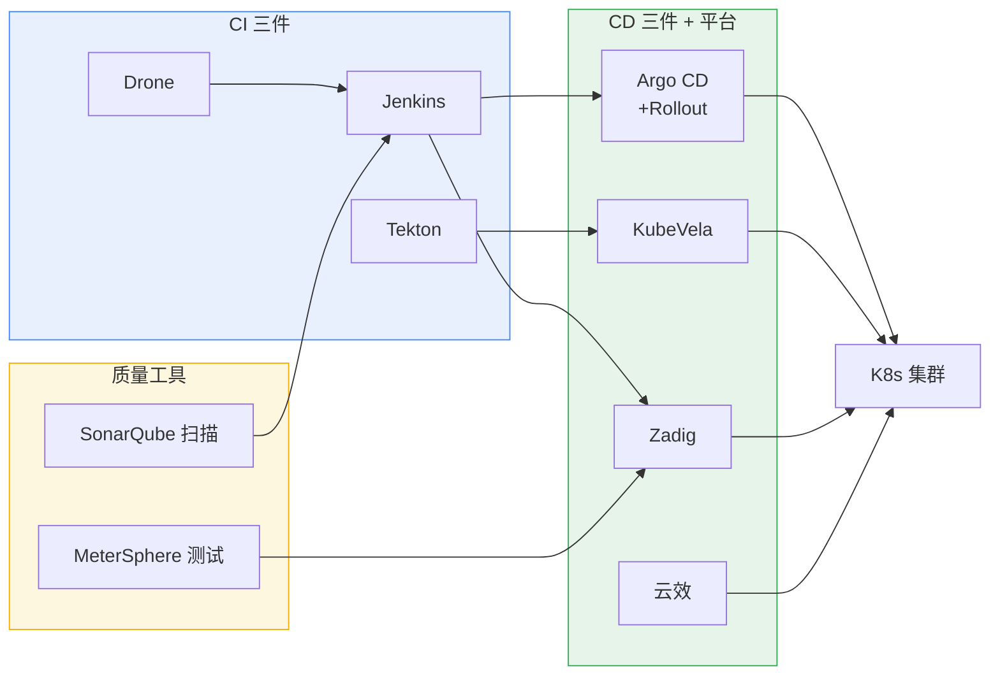
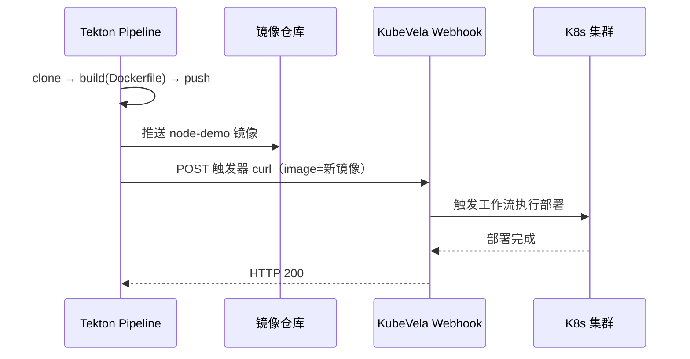

## 纲要

- **项目 5 = Zadig + KubeVela**：Zadig 侧照旧扫描 + 门禁 + 构建，新增一步「改 KubeVela 配置仓库」——拉 YAML、改 image、push，KubeVela **每分钟轮询**发现变化自动部署，发布方式配成**灰度**
- **项目 6 = Tekton + KubeVela**：比项目 5 更简单——不推 git，改推 **Webhook**：KubeVela 建触发器拿到一串 curl，Tekton 最后一步把 build 传来的 image 填进去，POST 即部署
- **项目 7 = 云效**：SaaS 化流水线，内置扫描/测试模板，**收费且代码必须入云效**——课程定位「了解即可」，工作中不强制
- **三大 CD 终局对比**：Argo CD（GitOps、CNCF、同家族 Rollout 补高级发布、无构建）、KubeVela（专注部署、Application 抽象、多集群交付）、Zadig（测试+扫描+构建一条龙、模板化、商业版收费）
- **全课程六工具**：CI 三件 Jenkins / Drone / Tekton，CD 三件 Argo CD / Argo Rollout / KubeVela，外加测试 MeterSphere、扫描 SonarQube——**全部要能集成起来综合使用**

## 一、场景引入：最后三块拼图，一张毕业合照

前述到此进入尾声。上篇（#89）讲完项目 1~4，本篇收尾项目 5~7，再把前述的课程总结一并收了——**七个实战项目全部讲完，六个工具全部归位**。

先回顾项目 5~7 在矩阵里的位置：

| 项目 | CI | CD | 发布方式 | 关键集成招 |
| --- | --- | --- | --- | --- |
| 5 | Zadig 内置 | **KubeVela** | GitOps + **灰度** | 改 KubeVela 配置仓库 → push |
| 6 | **Tekton** | KubeVela | **Webhook 触发** | curl 调 Webhook 改 image |
| 7 | — | **云效** | 内置/自定义模板 | SaaS 闭环 |

三个项目恰好覆盖三种集成姿势：**项目 5 推 git、项目 6 推 Webhook、项目 7 什么都不推**。课程的潜台词是——集成没有银弹，只有「你的 CD 吃什么，你就喂什么」。

## 二、核心概念与原理

### 2.1 项目 5：Zadig + KubeVela，「改配置仓库」换个 CD 照样成立

课程原话：「KubeVela 实战同样我们会使用 Zadig + SonarQube + KubeVela 来进行实现。KubeVela 部署的方式会使用 GitOps 加灰度发布的方式，将我们的项目部署到 K8s 集群。」

架构拆两半：

- **Zadig 侧（CI）**：Sonar 扫描 → 质量门禁 → 构建镜像。这部分前面全讲过，**一行不用改**；
- **KubeVela 侧（CD）**：配置仓库里的 Application YAML 配成**灰度发布**方式，CI 只改 image 字段。

集成方式和「Jenkins + Argo CD」一模一样——课程原话：「集成方式都是一样……我们只需要把 KubeVela 的一个配置文件，它的配置仓库的 YAML 文件拉下来之后，然后我们修改它的 image，然后再提交，这样 KubeVela 就会进行自动部署。」

唯一的机制差异在**同步触发方式**：Argo CD 靠 webhook 秒级触发，KubeVela 这里是 GitOps 轮询——「因为我们是使用 GitOps 的方式，所以我们需要拉取它的一个配置仓库，修改好之后，**每隔一分钟它会检测一次有没有发生变化**。当 YAML 文件发生变化之后，它就会执行部署。」

### 2.2 项目 6：Tekton + KubeVela，Webhook 触发更直接

「这边我们就换成 Tekton 的方式。换 Tekton 方式之后，这边会使用 KubeVela Webhook 的方式来进行部署，把我们的 node 项目部署。这个就更简单了——我们在 Tekton 里面对 node 项目进行构建，然后把这个项目 push 到我们的镜像仓库之后，我们就通过 Webhook 的方式来进行触发，我们的 KubeVela 进行部署。」

与项目 5 的差别只有一句话：**项目 5 推 git 等 KubeVela 来拉，项目 6 主动 POST 让 KubeVela 来部署**。少一个配置仓库，少一层 git 中转，链路更短。

Webhook 触发的操作全貌（课程演示）：

1. KubeVela 控制台**新增触发器**：起名称、绑定可执行的工作流、创建；
2. 创建后得到**一串 curl 指令**，复制下来；
3. 改这串指令：**唯一必须改的是 `image` 字段**，改成构建出来的镜像名称；其余可选（commit 内容、分支、用户），可加可不加；
4. Tekton Pipeline 最后一步从「执行命令行/部署」换成 **Web 触发 task**，填这条 curl，把前面 build 步骤传来的 image 参数替换进去。

### 2.3 项目 7：云效，一个「了解即可」的 SaaS 选项

课程对项目 7 的定性非常直白：「这个项目我们只需要了解一下即可。因为这个项目我们要操作的话是非常简单，主要是让我们去深入学习……他在工作中用的可能不会有那么多，**因为它这个毕竟是要收费的**。另外一个呢，就是我们的**代码也需要放到云效那边才可以**。如果我们设施的话，部署用其他云的话，我们也没有办法来去使用这个产品。」

云效的能力画像：

- **内置模板开箱即用**：已内置代码扫描与测试功能，「我们只需要在内置模板里面添加我们所需要的一个内置模板就可以」；
- **自定义模板兜底**：内置模板不满足需求时，用自定义模板灵活配置流水线步骤——「把我们代码扫描、测试、部署以及其他的一些功能，把它加上来，**或者集成 Jenkins，也可以实现**」。

注意这两条硬约束——**收费 + 代码入云效**——它决定了云效适合「已经在阿里云体系内、且愿意接受 SaaS 绑定」的团队，而不是放之四海皆准的默认解。

### 2.4 三大 CD 工具优缺点终表

课程压轴对比（前述总结原话整理）：

| 工具 | 定位 | 优点 | 缺点 |
| --- | --- | --- | --- |
| **Argo CD** | GitOps 部署工具 | 通过 Git 方式部署；**CNCF 旗下**，生态正统；同家族 **Argo Rollout** 可实现蓝绿/灰度等高级发布 | **没有构建功能**，只能做持续部署 |
| **KubeVela** | 声明式应用交付 | 同样专注部署；提供**更抽象的方式**配置应用（Application 模型）；**支持多集群交付**——把应用部署到多个不同环境的集群 | 没有构建功能 |
| **Zadig** | 云原生交付平台 | 集成测试、代码扫描及多种工具，**CICD 一条龙都帮做了**；快速拉起流水线、**配置简单**，不用写大量 YAML 文件和构建脚本，提供模板功能 | **很多功能商业付费** |

读表要点：**三者都自觉放弃了「构建」**（Argo CD / KubeVela 干脆不做，Zadig 把构建包进平台但高级功能收费）——这反证了 CI 与 CD 分离是云原生时代的默认架构：构建归 Jenkins/Tekton/Zadig，部署归 Argo CD/KubeVela，中间用「改 git」或「传 image」握手。

### 2.5 七项目全景与课程总结



前述课程总结原话：「回顾一下我们前面所学习的一个 CICD 工具，总结起来一共有六个，包括 CI 工具有 Jenkins、Drone 以及 Tekton。CD 工具有 Argo CD、Argo Rollout，还有我们的 KubeVela。我们需要将这些工具来进行灵活运用，并且把它们进行集成起来，综合使用。还有我们课程中所讲到的一个测试工具，以及扫描工具的使用——测试工具我们讲到了 MeterSphere，扫描工具我们使用了一个 SonarQube。这些工具都需要我们学会使用，并且将他们与我们的一个 CI 工具进行集成。」

一句话收束全课程：**CI 三件产镜像，CD 三件管部署，测试+扫描守质量，七项目示范怎么拼**。

## 三、动手实践

### 3.1 项目 5：Zadig 工作流的「修改 KubeVela 配置」步骤

Zadig 侧流水线在前四步（拉代码 → Sonar 扫描 + 质量门禁 → 构建镜像 → 推送镜像）之外，**只加一步**：

```bash
# ① 拉取 KubeVela 配置仓库（独立仓库，与业务代码仓分离）
git clone -b main http://git.example.com/kubevela/appconfig.git
cd appconfig

# ② 修改 Application 的 image 字段（两种手法，同 Argo CD 篇）
# 手法 A：yq（路径精确，推荐）
yq eval '.spec.components[0].properties.image = "harbor.example.com/go-demo:v2.1"' -i apps/go-demo.yaml
# 手法 B：sed（简单直接）
sed -i "s|image:.*|image: harbor.example.com/go-demo:v2.1|" apps/go-demo.yaml

# ③ 提交推送——KubeVela 每分钟轮询到变化即自动部署
git add . && git commit -m "release go-demo v2.1" && git push
```

Zadig 工作流步骤清单：

| 步骤 | 内容 | 与常规流水线的差异 |
| --- | --- | --- |
| 1 | 拉取代码 | 无差异 |
| 2 | Sonar 扫描 + 质量门禁 | 无差异 |
| 3 | 构建镜像 | 无差异 |
| 4 | 推送镜像 | 无差异 |
| 5 | **修改 KubeVela 配置** | **实战新增步**：git clone + yq/sed 改 image + push |

课程强调「构建完成之后，这些内容我们都不需要（动），只需要加一步修改 YAML 配置」——**新增知识只有这一招**。

### 3.2 项目 5：KubeVela 侧的灰度发布配置

KubeVela 侧要提前把 Application 配成灰度发布方式（沿用课程 `canary-app-two.yaml` 的 `canary-deploy` 工作流），CI 只碰 image 一行：

```yaml
apiVersion: core.oam.dev/v1beta1
kind: Application
metadata:
  name: canary-demo
  namespace: test-app
  annotations:
    app.oam.dev/publishVersion: v2
spec:
  components:
    - name: canary-demo
      type: webservice
      properties:
        image: harbor.example.com/canarydemo:v2   # ← CI 唯一要改的字段
        ports:
          - port: 8090
      traits:
        - type: scaler
          properties:
            replicas: 3
        - type: gateway
          properties:
            domain: canary-deploy.example.com
            http:
              "/version": 8090
  workflow:
    steps:
      - type: canary-deploy
        name: rollout-20
        properties:
          weight: 20
      - name: suspend-1st
        type: suspend
      - type: canary-deploy
        name: rollout-50
        properties:
          weight: 50
      - name: suspend-2nd
        type: suspend
      - type: canary-deploy
        name: rollout-100
        properties:
          weight: 100
```

字段拆解：

| 字段 | 值 | 作用 |
| --- | --- | --- |
| `metadata.annotations["app.oam.dev/publishVersion"]` | `v2` | 标记发布版本，UI 版本页据此对比 v1/v2 差异 |
| `spec.components[0].properties.image` | `harbor.example.com/canarydemo:v2` | **CI 通过 yq/sed 改的就是这一行** |
| `traits[].type: gateway` | 域名 + 路由 | 流量入口，灰度比例经它生效 |
| `workflow.steps[].type: canary-deploy` | `weight: 20/50/100` | 按权重迁移流量（需金丝雀发布插件） |
| `workflow.steps[].type: suspend` | — | 批次间暂停，等待人工审核 |

同步机制：KubeVela 以 GitOps 方式**每隔一分钟检测配置仓库**，「当发生不一样之后，它会自动执行同步」——**从 push 到部署生效，最坏延迟约 1 分钟**，排障时要把这段轮询窗口算进去。

### 3.3 项目 6：Tekton Pipeline 的四步骨架

Tekton 侧流水线（课程演示路径：project → pipeline）：

```yaml
apiVersion: tekton.dev/v1beta1
kind: Pipeline
metadata:
  name: node-build-deploy
spec:
  params:
    - name: git-url
      value: http://git.example.com/frontend/node-demo.git
    - name: image-name
      value: harbor.example.com/node-demo:latest
  workspaces:
    - name: source
  tasks:
    - name: clone
      taskRef:
        name: git-clone
      params:
        - name: url
          value: $(params.git-url)
      workspaces:
        - name: output
          workspace: source
    - name: build
      runAfter: [clone]
      taskRef:
        name: buildah          # Dockerfile 构建（课程用 dogfile build 步骤）
      workspaces:
        - name: source
          workspace: source
      params:
        - name: IMAGE
          value: $(params.image-name)
    - name: push
      runAfter: [build]
      taskRef:
        name: buildah
      workspaces:
        - name: source
          workspace: source
      params:
        - name: IMAGE
          value: $(params.image-name)
    - name: webhook-trigger
      runAfter: [push]
      taskRef:
        name: kubevela-webhook   # 自定义 Task：执行 curl 触发 KubeVela
      params:
        - name: image
          value: $(params.image-name)
```

步骤对照（课程原话：「看到这一步是拉起我们的低代码三段代码，然后我们就会执行一个 build 的操作，将我们克隆下来的一个代码，然后对它进行 Dockerfile build 操作。接着我们再进行一个 push 操作。那在最后一步，我们就执行……由于我们现在换成了 KubeVela，所以这一步就要换成一个 Web 触发的操作」）：

| 步骤 | 动作 | 与前序项目的差异 |
| --- | --- | --- |
| `clone` | 拉取 node 项目代码 | 无差异 |
| `build` | Dockerfile 构建镜像 | 无差异 |
| `push` | 推送到镜像仓库 | 无差异 |
| `webhook-trigger` | **POST KubeVela Webhook** | **替换了原「执行命令行/部署」步骤** |

### 3.4 项目 6：KubeVela 触发器与 Web 触发 Task

KubeVela 控制台新增触发器后得到的 curl 串，改法就一条铁律——**只改 image，其他可选**：

```bash
# KubeVela 控制台「新增触发器」生成后复制的原始指令
curl -X POST 'http://kubevela-api.example.com/api/v1/.../trigger' \
  -H 'Content-Type: application/json' \
  -d '{
    "image": "harbor.example.com/node-demo:latest",   # ← 唯一必须修改的字段
    "commit": "a1b2c3d",                               # 可选： commit 内容
    "branch": "main",                                  # 可选：分支
    "user": "tekton-bot"                               # 可选：用户
  }'
```

Tekton 侧 `webhook-trigger` Task 把 curl 包起来，image 从前序步骤传参：

```yaml
apiVersion: tekton.dev/v1beta1
kind: Task
metadata:
  name: kubevela-webhook
spec:
  params:
    - name: image
      description: 构建产出的镜像地址（由 build/push 步骤传来）
  steps:
    - name: trigger
      image: curlimages/curl:8.8.0
      script: |
        #!/bin/sh
        curl -sS -X POST 'http://kubevela-api.example.com/api/v1/.../trigger' \
          -H 'Content-Type: application/json' \
          -d '{"image": "$(params.image)"}'
```

课程原话：「我们只需要从前面 build 步骤，把 image 字段的值传参过来，然后我们把它替换掉，这样我们就可以触发 KubeVela 执行部署。」



## 四、生产实践要点

1. **「改配置仓库」是通用招，触发方式按 CD 选型**：Argo CD 用 webhook 秒级触发（记得开自动同步），KubeVela GitOps 默认 1 分钟轮询——**评估发布时效时要把这 1 分钟算进 MTTR**。
2. **配置仓库独立 + 权限最小化**：KubeVela/Argo CD 的配置仓与业务代码仓分离，CI 只授予配置仓的写权限（甚至只写 image 行），部署审计看配置仓 log 一目了然。
3. **灰度配置先行，CI 只改 image**：KubeVela 侧的 `canary-deploy + suspend` 工作流提前配好，CI 流水线保持「无脑改 image」的简单形态——**发布策略的复杂度留在 CD 侧，不污染 CI**。
4. **Webhook 串进版本库管理**：项目 6 的 curl 指令含触发器地址与 Token，属敏感资产，**不要明文写进 Jenkinsfile/Tekton YAML 提交到公开仓库**，用 Secret 挂载（Tekton 侧可参考 `code/6-Tekton/secret/` 的用法）。
5. **云效的两条硬约束先过审**：收费 + 代码须入云效——选型前先确认预算与代码托管策略，避免做到一半被 SaaS 绑定卡住。
6. **六工具不必全会上，但要懂边界**：生产上一个团队通常 CI 一件 + CD 一件 + 质量两件足矣；课程教六件是为了让你看懂**别人的架构图**，并能在换工具时快速迁移方法论。
7. **从「一把梭」到「组合拳」的迁移路径**：先上「Jenkins + Argo CD + 改 git」最小闭环，再按需引入 Rollout 灰度、Zadig 平台化、KubeVela 多集群——**每加一个工具都要能回答「它替代了哪道手工工序」**。

## 五、报错排查表

| 现象 | 可能原因 | 定位与修复 |
| --- | --- | --- |
| push 配置仓库后 KubeVela 不部署 | 超过 1 分钟轮询窗口 / 仓库凭证失效 | 等满 1 分钟再看；检查 KubeVela 配置仓库的访问令牌 |
| KubeVela 部署了但镜像没变 | yq/sed 路径写错，改到了别的字段 | `git diff` 复核只改了 `spec.components[0].properties.image` |
| 灰度流量不按权重走 | 未启用金丝雀发布插件 | KubeVela 先装 canary 插件，工作流里 `canary-deploy` 才生效 |
| `suspend` 步骤卡住不动 | 设计如此——等人工审核 | 控制台工作流点「继续」，或 `vela workflow resume` |
| Tekton Webhook 触发返回 4xx | 触发器地址/Token 错，或 JSON 字段名不对 | 核对控制台生成的原始 curl；确认必填字段是 `image` |
| Webhook 通了但部署的是旧镜像 | Tekton 传参断裂，`$(params.image)` 没解析 | 检查 PipelineRun 参数传递；`tkn pipelinerun logs` 看 trigger 步骤入参 |
| 触发器 curl 泄露到公开仓库 | 敏感串明文提交 | 立即重置触发器；改用 Secret + `$(params)` 注入 |
| 云效自定义模板不会配 | 内置模板不熟 | 从内置模板复制改起；或按课程思路集成 Jenkins 做 CI 段 |

## 六、面试考点

**Q1：项目 5 的 CI/CD 集成点是什么？和 Argo CD 方案有何异同？**
Zadig 构建后新增「修改 KubeVela 配置仓库」步骤：git clone + yq/sed 改 image + push。相同点：都是「改 git 触发 CD」的 GitOps 模式；差异：Argo CD 靠 webhook 秒级触发，KubeVela 走 1 分钟轮询，且 KubeVela 侧直接配 `canary-deploy` 灰度工作流。

**Q2：项目 6 为什么用 Webhook 而不是推 git？**
链路更短——Tekton 构建完直接 POST 触发器，省掉配置仓库中转与轮询等待。代价是触发器地址/Token 成了敏感资产，且缺失 git 的版本审计轨迹，适合内部系统或对时效敏感的场景。

**Q3：KubeVela Webhook 触发 curl 里哪个字段必填？**
`image`。commit/branch/user 都是可选元信息，加了利于审计，不加也能触发部署——「最主要就是修改这个 image，当 image 修改之后，应用就会执行部署」。

**Q4：项目 7（云效）为什么课程只说「了解即可」？**
两个硬约束：收费，且代码必须托管在云效。若团队用其他云或不接受 SaaS 绑定，该产品无法使用；加上操作本身简单（内置模板 + 自定义模板），深度投入产出比低。

**Q5：三大 CD 工具（Argo CD / KubeVela / Zadig）核心差异？**
Argo CD：GitOps + CNCF 生态，同家族 Rollout 补高级发布，无构建；KubeVela：Application 抽象 + 多集群交付，专注部署，无构建；Zadig：测试/扫描/构建一条龙 + 模板化配置简单，但高级功能商业付费。

**Q6：全课程六个工具怎么分工？记忆框架是什么？**
CI 三件（Jenkins 生态最全、Drone 容器原生轻量、Tekton K8s 声明式）负责「拉代码→扫描→构建→推镜像」；CD 三件（Argo CD GitOps、Argo Rollout 高级发布、KubeVela 多集群抽象）负责「部署」；质量两件（SonarQube 扫描、MeterSphere 测试）挂在 CI 流水线上做门禁。**骨架一句话：CI 产镜像，CD 管部署，质量守门禁**。

**Q7：七个实战项目共同的最小骨架？**
CI（Jenkins/Tekton/Zadig）产出镜像 → 交接（改配置仓库 image / Webhook 传 image / 平台内变量）→ CD（Argo CD/KubeVela/Zadig/云效）按策略（灰度/蓝绿/普通）部署。组合不同，骨架同一。

## 📎 文本↔代码关联

本篇为**综合实战收官篇**，项目 5~7 无新增专属代码资产（课程未随课提供新文件），实战复用的全是前面章节已关联的真实资产，此处点明对应关系（不新增虚构路径）：

- `code/8-Kubevela/canary-app-one.yaml` —— 项目 5 的 KubeVela 灰度应用 v1（3 副本 + gateway 域名）
- `code/8-Kubevela/canary-app-two.yaml` —— 项目 5 的 v2 灰度配置（`publishVersion: v2` + `canary-deploy` 20/50/100 + `suspend` 审核），**CI 只改其中的 image 行**
- `code/8-Kubevela/go-deploy.yaml` —— KubeVela `webservice` 组件 + 工作流参考（探针、scaler、topology 策略）
- `code/6-Tekton/pipeline/pipeline2-git-clone.yaml` —— 项目 6 Tekton 侧的 git-clone 步骤
- `code/6-Tekton/trigger/triggertemplage.yaml` —— Tekton 触发器模板（与 KubeVela Webhook 触发思路同源）
- `code/9-Zadig/模板/K8S-YAML/backend` —— 项目 5 Zadig 侧的部署模板资产
- `code/10-Argocd/canary/Canary-Deploy.yaml` —— 项目 1 灰度策略（与项目 5 的灰度思路互为参照）

**技术点总结**：综合实战到此收官。项目 5（Zadig + KubeVela）把「改配置仓库」的集成招平移到第二套 CD——拉 YAML、yq/sed 改 image、push，KubeVela 每分钟轮询自动部署，灰度由 `canary-deploy` 工作流负责；项目 6（Tekton + KubeVela）再简化一步——KubeVela 建触发器拿 curl，Tekton 末步从「执行命令行」换成「Web 触发」，把 build 传来的 image 填进 POST body；项目 7（云效）作为 SaaS 选项了解即可——内置扫描/测试模板 + 自定义模板兜底，但**收费与代码入云效**两条硬约束决定了它的适用边界。三大 CD 终局：Argo CD 赢在 GitOps 生态与 CNCF 正统，KubeVela 赢在 Application 抽象与多集群交付，Zadig 赢在测试/扫描/构建一条龙与模板化简易——**三者都放弃了构建，印证 CI/CD 分离是默认架构**。全课程六工具（CI：Jenkins/Drone/Tekton；CD：Argo CD/Argo Rollout/KubeVela）+ 质量两件（SonarQube/MeterSphere）的记忆框架只有一句：**CI 产镜像，CD 管部署，质量守门禁，七项目示范怎么拼**。工具会过时，这条骨架不会。
