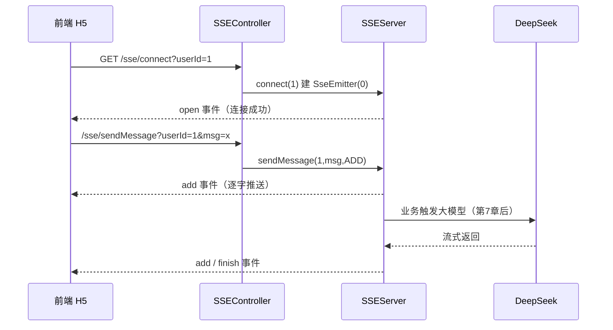

## 纲要

- **SSE 是什么**：Server-Sent Events，服务端单向把消息推给客户端（H5/App/小程序都算客户端），HTML5 原生 API
- **与 WebSocket 区别**：SSE **单向**（服务→客户端），适合「大模型逐字输出」这类只下行场景；要双向才用 WebSocket
- **事件类型**：`open`（连接建立）/ `message`（默认消息）/ `add`（流式逐字追加，首选）/ `custom`（自定义，如 `orderPay`）/ `finish`（完成）/ `done`（某些模型如 ChatGLM v4 用）
- **服务端核心**：`SseEmitter`（设超时 `0`=永不超时，默认 30s）、三个回调（timeout/error/completion 都做 `removeUser`）、`ConcurrentHashMap<String,SseEmitter>` 存所有客户端
- **客户端连接**：Controller 返回 `SseEmitter`，`produces = TEXT_EVENT_STREAM_VALUE`；前端 `EventSource` 监听各事件；host 写**内网 IP 非 localhost**
- **发送消息**：`SseEmitter.send(SseEmitter.event().id(userId).data(msg).name(type))`；枚举 `SSEMessageType` 前后端对齐
- **跨域 CORS**：`WebMvcConfigurer.addCorsMappings` 配 `allowedOrigins`（白名单，**新 Spring Boot 不允许 `*`**）+ 方法 + headers + maxAge

> 本章代码基于课程标准工程（`com.itzixi` 包）按课程口径重构，外部代码卷暂未挂载，重挂后可切换为逐文件提取的真实代码。

## 一、为什么本篇要引入 SSE

前述大模型调用只在 Java 服务端和 DeepSeek 之间流动，还没有前端。要让用户在前端看到「逐字蹦字」，需要把 Java 服务端的流式输出再一跳一跳推给浏览器。SSE 就是干这个的——它让 Java 这一端（相对 H5 是服务端）把消息持续推给客户端。

> 课程老师强调：这里有**两对客户端/服务端**的相对关系——Java 相对 DeepSeek 是客户端，H5 相对 Java 是客户端。SSE 解决的是「Java → H5」这一跳的单向推送。

## 二、SSE 原理与事件机制

### 2.1 单向推送

SSE 所有箭头都是**服务端 → 客户端**，不可逆。客户端只能收、不能经 SSE 发（要发用普通 HTTP 请求或 WebSocket）。这就是它和 WebSocket 最本质的区别。

### 2.2 事件类型（前后端约定的枚举）

| 事件 | 触发时机 | 用途 |
|---|---|---|
| `open` | SSE 连接第一次建立 | 前端提示「连接成功」 |
| `message` | 默认消息事件 | 单次普通消息 |
| `add` | 流式逐字推送 | **首选**，大模型逐字输出 |
| `custom` | 自定义（如 `orderPay`） | 业务自定义（支付回调跳转等） |
| `finish` | 流结束 | 前端收尾（转 HTML 等） |
| `done` | 部分模型（ChatGLM v4）用字符串 `done` | 兼容老模型 |

> 老师吐槽：ChatGLM 早期 v3 用 `add`+`finish` 符合 SSE 规范，v4 抽风改成最后发个字符串 `done`（连类型都不是），所以课程序号里单独把 `done` 拿出来判断。后端发什么 `name`，前端按同名事件监听即可。

### 2.3 适用场景

实时通知、单向聊天、大屏数据推送、实时监控——只要「服务单向推」就用 SSE，比 WebSocket 轻。

## 三、服务端：构建 SSE Server（SseEmitter）

放在 `mcp-client` 模块（用户端与整个后端交互都走 client 端）。新建 `util` 包下的 `SSEServer`：

```java
// com.itzixi.util.SSEServer
package com.itzixi.util;

import org.springframework.web.servlet.mvc.method.annotation.SseEmitter;
import java.util.Map;
import java.util.concurrent.ConcurrentHashMap;

public class SSEServer {

    // 存所有客户端：userId <-> SseEmitter
    private static final Map<String, SseEmitter> clients = new ConcurrentHashMap<>();

    /** 建立连接：返回 SseEmitter，超时 0 = 永不超时（默认 30s 未完成会抛异常） */
    public static SseEmitter connect(String userId) {
        SseEmitter emitter = new SseEmitter(0L);   // 0L 永不过期

        // 三个回调：超时 / 错误 / 完成，最终都移除用户
        emitter.onTimeout(timeoutCallback(userId));
        emitter.onError(errorCallback(userId));
        emitter.onCompletion(completionCallback(userId));

        clients.put(userId, emitter);
        return emitter;
    }

    // 超时回调
    private static Runnable timeoutCallback(String userId) {
        return () -> {
            log.info("SSE 超时，移除用户ID={}", userId);
            removeUser(userId);
        };
    }
    // 完成回调
    private static Runnable completionCallback(String userId) {
        return () -> {
            log.info("SSE 完成，移除用户ID={}", userId);
            removeUser(userId);
        };
    }
    // 错误回调（Throwable）
    private static org.springframework.web.servlet.mvc.method.annotation.SseEmitter.SseEmitterExceptionConsumer errorCallback(String userId) {
        return (Throwable t) -> {
            log.info("SSE 异常，移除用户ID={}", userId);
            removeUser(userId);
        };
    }

    /** 移除用户连接（public 可被外部强制中断调用） */
    public static void removeUser(String userId) {
        clients.remove(userId);
        log.info("SSE 连接被移除，用户ID={}", userId);
    }
}
```

> 老师强调 `removeUser` 单独抽成 **public** 方法，因为超时/错误/完成三个回调都要调它，且外部可能要强制中断连接。超时设 `0L` 表示永不过期；默认 30 秒，超时未完成任务会抛异常。

## 四、客户端连接：Controller 返回 SseEmitter

```java
// com.itzixi.controller.SSEController
@RestController
public class SSEController {

    @GetMapping(value = "/sse/connect", produces = MediaType.TEXT_EVENT_STREAM_VALUE)
    public SseEmitter connect(@RequestParam String userId) {
        return SSEServer.connect(userId);
    }
}
```

> 关键：`produces = TEXT_EVENT_STREAM_VALUE` 才是 SSE 协议（Spring 自动补全写死字符串也行，但枚举更规范）。前端用 `EventSource` 连 `/sse/connect?userId=xxx`。

**前端 H5（VSCode + Live Server）**：

```html
<script>
  const userId = 'client-1';   // 随机生成或取自你的系统
  const source = new EventSource('http://192.168.1.4:9090/sse/connect?userId=' + userId); // ⚠️ 写内网IP，非 localhost
  source.addEventListener('open', () => console.log('连接成功'));
  source.addEventListener('add', e => console.log('收到:', e.data));   // 流式逐字
  source.addEventListener('finish', () => console.log('完成'));
  source.addEventListener('customEvent', e => console.log('自定义:', e.data));
  source.addEventListener('error', e => console.log('错误', e));
</script>
```

> 老师提醒：前端 host **必须写服务端内网 IP**（如 `192.168.1.4`），不要写 `localhost`——localhost 指向客户端自己（前述内网互通讲过）。后端启动后 `install` 时 JUnit 会跑，建议点 `Skip Tests` 跳过。

## 五、消息类型枚举（前后端对齐）

```java
// com.itzixi.enums.SSEMessageType
public enum SSEMessageType {
    MESSAGE("单次普通消息"),
    ADD("消息追加，适用于流式 string 推送（首选）"),
    FINISH("完成事件"),
    DONE("部分模型结束标记（如 ChatGLM v4）"),
    CUSTOM_EVENT("自定义事件");

    private final String description;
    SSEMessageType(String d) { this.description = d; }
    public String getDesc() { return description; }
}
```

## 六、发送消息：emitMessage + sendMessage

```java
// SSEServer 内新增
public static void emitMessage(String userId, String message, SSEMessageType type) {
    try {
        SseEmitter emitter = clients.get(userId);
        emitter.send(SseEmitter.event()
                .id(userId)
                .data(message)
                .name(type.name()));   // ⚠️ 用 name() 不是 type 字段！
    } catch (Exception e) {
        log.error("SSE 异常: {}", e.getMessage());
        removeUser(userId);            // 发送失败移除
    }
}

/** 业务层调用：判断客户端存在才发 */
public static void sendMessage(String userId, String message, SSEMessageType type) {
    if (clients.isEmpty()) return;            // 无客户端直接返回（无感知）
    if (!clients.containsKey(userId)) return; // 该用户没连也不发
    emitMessage(userId, message, type);
}
```

> 老师踩坑：通义灵码自动生成的代码把 `.name(type)` 误写成 `.data(type.getValue())`，导致前端 `add` 事件收不到——**必须用 `.name(type.name())`**。这种 AI 助手小错要自己打断点核对（IDEA 断点逐步调，是程序员必备技能）。

### 6.1 Controller 暴露发送（仅内部调用，private 最佳）

```java
@GetMapping("/sse/sendMessage")
public String sendMessage(@RequestParam String userId, @RequestParam String message) {
    SSEServer.sendMessage(userId, message, SSEMessageType.MESSAGE);
    return "ok";
}
```

## 七、跨域 CORS 配置（解决 Access-Control-Allow-Origin）

前端在 `:5501`、后端在 `:9090`，IP/端口不同浏览器禁止访问。后端加配置类：

```java
// com.itzixi.config.CorsConfig
@Configuration
public class CorsConfig implements WebMvcConfigurer {
    @Value("${website:http://192.168.1.4:5501}")   // 动态配置前端地址
    private String website;

    @Override
    public void addCorsMappings(CorsRegistry registry) {
        registry.addMapping("/**")               // 所有路径开放
                .allowedOrigins(website)         // 白名单（新 Spring Boot 不允许写 "*"）
                .allowedMethods("*")             // 所有方法
                .allowCredentials(true)          // 携带 cookie
                .allowedHeaders("*")             // 头信息（token 等）
                .maxAge(60 * 60);               // 预检缓存 1 小时
    }
}
```

> 早期 Spring Boot 允许 `allowedOrigins("*")` 匹配所有域名；**新版本不允许**，必须写具体白名单（如 `http://192.168.1.4:5501`）。`website` 用 `@Value` 从 yml 读，生产/本地不同环境分开配。`maxAge(3600)` 让浏览器缓存预检，减少 OPTIONS 请求。

## 八、关联代码文件（本章重构）

| 文件 | 作用 |
|---|---|
| `mcp-client/.../util/SSEServer.java` | SseEmitter 连接/发送/移除，clients Map |
| `mcp-client/.../enums/SSEMessageType.java` | 前后端事件类型枚举 |
| `mcp-client/.../controller/SSEController.java` | `/sse/connect` `/sse/sendMessage` |
| `mcp-client/.../config/CorsConfig.java` | 跨域白名单 |
| `mcp-client/.../resources/application.yml` | `website` 前端地址 |

## 九、连接-推送-接收时序图



## 十、与 WebSocket 深度对比

| 维度 | SSE | WebSocket |
|---|---|---|
| 方向 | **单向**（服务→客户端） | 双向 |
| 协议 | HTTP（长连接 `text/event-stream`） | WS 独立协议（握手升级） |
| 自动重连 | 浏览器原生 `EventSource` 支持 | 需自己实现 |
| 复杂度 | 低，HTTP 栈即可 | 高，需 WS 服务端 |
| 适用 | 通知/流式下行/监控 | 聊天室/游戏/协作 |
| 代理/CDN | 友好（HTTP） | 部分代理不支持 |

> 大模型逐字输出是典型「只下行」场景，SSE 是**最佳解**；要用户边输边收（如协同编辑）才上 WebSocket。

## 十一、生产加固（连接管理）

- **心跳保活**：服务端定时 `send` 空 `comment` 事件（`\n\n`）防中间代理断连；前端定时 ping。
- **合理超时**：演示用 `0L` 永不过期，生产应设 30–60s，避免连接泄漏拖垮内存。
- **连接数限额**：单用户单连接，Map 容量监控；超阈值拒绝或踢最旧。
- **优雅关闭**：应用停机前遍历 Map 发 `finish` 并 `complete()`，减少前端重连风暴。
- **鉴权**：连接接口加 token 校验（结合前述 `.env` 外的密钥/网关），防匿名长连接耗尽资源。

## 十二、排错 SOP

1. **前端 open 不触发**：后端 `/sse/connect` 是否 `produces=TEXT_EVENT_STREAM`；host 是否内网 IP 非 localhost。
2. **add 收不到**：后端 `.name(type.name())` 是否被 AI 写成 `.data(...)`；事件名前后端是否一致。
3. **跨域报错**：`Access-Control-Allow-Origin` —— 配 `CorsConfig.allowedOrigins` 白名单（新版本禁 `*`）。
4. **群发少端**：部分客户端连接时端口/ID 不对，刷新重连后再发。
5. **重启卡顿**：SSE 关闭旧连接耗时，属正常，可强杀进程。

## 十三、FAQ

**Q1：SSE 和 WebSocket 怎么选？**
只下行推送（如大模型输出、通知）用 SSE，简单、HTTP 原生、自动重连；需双向实时（聊天室、游戏）用 WebSocket。

**Q2：SseEmitter 超时设 0 有风险吗？**
0 = 永不过期，连接常驻占资源；生产应设合理超时（如 30–60s）并配合心跳，避免连接泄漏。课程为演示设 0。

**Q3：前端为什么收不到 add 事件？**
最常见是后端 `.name(type.name())` 写成 `.data(...)`（AI 生成坑）；其次事件名前后端不一致；或跨域阻断（看 console 的 origin 报错）。

**Q4：allowedOrigins 写 `*` 报错？**
新版 Spring Boot 不允许 `*` 匹配所有源，必须列具体白名单域名。

**Q5：localhost 连接失败？**
前端 `EventSource` 的 host 写 `localhost` 指向客户端自己；必须写服务端内网 IP（前述内网互通）。

**Q6：每次重启卡十几秒？**
SSE 要把旧连接逐个切断关闭，正常现象；不想等直接多次点 Stop 强杀进程。

## 十、面试高频问答

**1. SSE 的工作机制与适用场景？**
服务端通过 `text/event-stream` 长连接单向推送事件（open/message/add/finish 等）；适合服务端→客户端实时下行（大模型流式、通知、监控）。双向通信用 WebSocket。

**2. SseEmitter 的核心 API 与超时管理？**
`new SseEmitter(timeout)`，`onTimeout/onError/onCompletion` 注册回调，`send(SseEmitter.event().id().data().name())`。超时 0 永久，生产应设阈值 + 心跳防泄漏。

**3. 多个客户端如何管理？**
`ConcurrentHashMap<userId,SseEmitter>` 存连接；群发遍历 map 给每个 emitter send；断线/超时被回调 `remove`。

**4. 跨域 CORS 怎么配？**
`WebMvcConfigurer.addCorsMappings` 配 `allowedOrigins`（白名单，新版本禁 `*`）、`allowedMethods`、`allowCredentials`、`allowedHeaders`、`maxAge`。

**5. 前端如何消费 SSE？**
`new EventSource(url)` 监听 `open/add/finish/customEvent/error`；host 用服务端 IP 非 localhost；`mark()` 等库把 markdown 转 HTML 渲染。

**6. 大模型流式如何经 SSE 到前端？**
后端 `chatClient.prompt().stream().content()` 得 `Flux<String>`，`map` 逐个 `SSEServer.sendMessage(userId,content,ADD)`，结束发 `FINISH`——第 6-B 章详述。

## 十一、ops 提示（安全与网络）

> **连接泄漏**：SseEmitter 不移除会常驻内存，务必在 timeout/error/completion 三处都 `removeUser`；生产加心跳 + 合理超时。
>
> **内网 IP**：前端 `EventSource` 用服务端内网 IP，别 localhost；云上同私有网络。
>
> **跨域白名单**：`allowedOrigins` 列具体前端域名，别图省事开 `*`；生产配合网关统一域名。
>
> **重启卡顿**：SSE 关闭旧连接耗时，CI/开发可强杀；监控连接数防膨胀。
