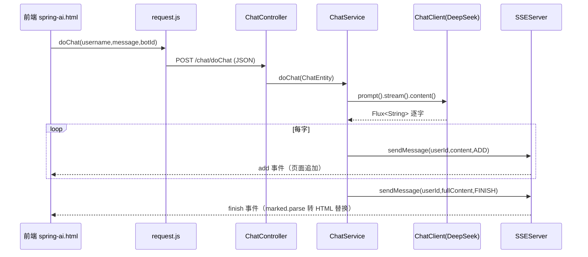

## 纲要

- **群发消息**：遍历 `clients` Map 给所有 `SseEmitter` 发送；群组=按群主 ID 关联的子集发送
- **前后端联调（核心）**：前端 `doChat` → 后端 `ChatController.doChat`（`@PostMapping`，`@RequestBody ChatEntity`）→ `ChatService.doChat` 用 `chatClient.prompt().stream().content()` 得 `Flux<String>` → `map` 逐个经 SSE 发 `ADD` → 结束发 `FINISH`
- **ChatEntity**：`username` / `message`（前端问题）/ `botMessageId`（前端定位用）三字段
- **MD 转 HTML**：大模型默认 markdown 输出，前端 `finish` 事件里用 `marked.parse()` 把整段转 HTML 渲染；后端额外拼 `fullContent` 经 `ChatResponseEntity` 以 `FINISH` 事件回传
- **前端改两处**：`EventSource` 端口改后端端口、`request.js` 的 `baseUrl` 改后端端口；host 写内网 IP 防跨域

> 本章代码基于课程标准工程（`com.itzixi` 包）按课程口径重构，外部代码卷暂未挂载，重挂后可切换为逐文件提取的真实代码。

## 一、群发消息（广播）

单个发送用 `userId` 定位一个客户端；群发遍历整个 `clients` Map：

```java
// SSEServer 内新增
public static void sendMessageToUsers(String message) {
    if (clients.isEmpty()) return;
    clients.forEach((userId, emitter) -> {
        try {
            emitter.send(SseEmitter.event()
                    .id(userId)
                    .data(message)
                    .name(SSEMessageType.MESSAGE.name()));
        } catch (Exception e) {
            removeUser(userId);
        }
    });
}
```

```java
@GetMapping("/sse/sendMessageToAll")
public String sendMessageToAll(@RequestParam String message) {
    SSEServer.sendMessageToUsers(message);
    return "ok";
}
```

> 老师演示：本地开 `client-1/2/3` 三个 H5（复制 `client.html` 改 ID）模拟多端，群发后三端都收到。`forEach` 那行通义灵码自动生成省略了括号，老师建议补 `{}` 提升可读性。群组（微信群）原理一样：群主 ID 关联若干 emitter，取子集再发。

**模拟流式（循环 + sleep）**：

```java
@GetMapping("/sse/sendAdd")
public String sendAdd(@RequestParam String userId) throws InterruptedException {
    for (int i = 0; i < 10; i++) {
        SSEServer.sendMessage(userId, "测试消息" + i, SSEMessageType.ADD);
        Thread.sleep(200);   // 模拟逐字
    }
    return "ok";
}
```

> 前端 `add` 事件逐条接收，呈现「几条几条蹦出来」效果。课后作业：把类型改 `CUSTOM_EVENT` 验证前端自定义事件。

## 二、前后端联调：把大模型接入聊天页面

前端 `spring-ai.html` 是真正用的页面，`doChat` 把消息包裹成对象 POST 后端：

```javascript
// 前端 doChat：封装 username(=userId) / pendingMessage(问题) / botMessageId
function doChat() {
  fetch('/chat/doChat', {
    method: 'POST',
    headers: {'Content-Type': 'application/json'},
    body: JSON.stringify({ username: userId, message: pendingMessage, botMessageId: botId })
  });
}
```

### 2.1 后端接收对象 ChatEntity

```java
// com.itzixi.entity.ChatEntity
@Data
@AllArgsConstructor
@NoArgsConstructor
@ToString
public class ChatEntity {
    private String username;     // 用户名=userId
    private String message;      // 用户问题
    private String botMessageId; // 前端定位消息用的 ID
}
```

### 2.2 ChatController

```java
// com.itzixi.controller.ChatController
@RestController
@RequestMapping("/chat")
public class ChatController {

    @Resource
    private ChatService chatService;

    @PostMapping("/doChat")
    public void doChat(@RequestBody ChatEntity entity) {
        chatService.doChat(entity);   // 无需返回，流式经 SSE 推回
    }
}
```

> 课程老师把原来测试用的 HelloController 改成了 ChatController，`/doChat` 对应前端 `doChatApi`；前端是 POST，后端必须 `@PostMapping`；用 `@RequestBody` 收 JSON。

### 2.3 ChatService.doChat（流式 → SSE）

```java
// ChatServiceImpl 新增
@Override
public void doChat(ChatEntity entity) {
    String userId = entity.getUsername();
    String prompt = entity.getMessage();
    String botId  = entity.getBotMessageId();

    Flux<String> flux = chatClient.prompt(prompt).stream().content();  // Flux<String>

    flux.map(content -> {                          // 逐字处理
            log.info("content={}", content);
            SSEServer.sendMessage(userId, content, SSEMessageType.ADD);  // 发 ADD
            return content;
        })
        .collectList()                             // 汇成 List<String>
        .subscribe(list -> {
            String fullContent = list.stream().collect(Collectors.joining(""));
            log.info("执行完毕，耗时统计见 AOP 切面，fullContent 长度={}", fullContent.length());
            // 如需落库保存对话：把 fullContent 存 DB（课程不展开）
        });
}
```

> 老师强调：这是真正和大模型交互的地方——`stream().content()` 得 `Flux<String>`，`map` 里每个 string 经 SSE 发 `ADD`；`collectList` 汇总成完整内容，结束可发 `FINISH`。`.map` 里的箭头函数是 JDK8 特性（JDK21 也能用）。最终联调实测一次交互约 4.4 秒。

### 2.4 前端两处必改

1. `EventSource` 端口改后端 `9090`；
2. `request.js` 里 `baseUrl` 改后端 `9090`；

两者 host 都写**内网 IP**（防跨域）。改完刷新页面，问「你是谁」即流式输出，后端日志见 `content` 逐条打印。

## 三、MD 转 HTML 优化渲染

大模型默认输出 **markdown**，前端直接显示是一大段难读文本。在 `finish` 事件用 `marked` 库转 HTML：

```html
<!-- 前端 finish 事件 -->
source.addEventListener('finish', e => {
  const data = JSON.parse(e.data);          // 后端发来的 ChatResponseEntity
  const html = marked.parse(data.message);   // marked.min.js 转 HTML
  document.getElementById(data.botMessageId).innerHTML = html;  // 按 botMessageId 替换
});
```

### 3.1 后端拼 fullContent 并以 FINISH 回传

```java
// ChatServiceImpl.doChat 内 collectList 之后
.subscribe(list -> {
    String fullContent = list.stream().collect(Collectors.joining(""));
    // 构造回传对象
    ChatResponseEntity resp = new ChatResponseEntity(fullContent, botId);
    SSEServer.sendMessage(userId, JSON.toJSONString(resp), SSEMessageType.FINISH);  // 发 FINISH
});
```

```java
// com.itzixi.entity.ChatResponseEntity
@Data
@AllArgsConstructor
public class ChatResponseEntity {
    private String message;       // 完整 markdown 内容
    private String botMessageId;  // 闭环节点：前端据此后端回传的 ID 替换页面
}
```

> `botMessageId` 形成闭环：前端发过来 → 后端处理 → 再以 FINISH 把它和 fullContent 发回，前端按 ID 把页面上的临时消息替换成渲染好的 HTML。顺序注意：`new ChatResponseEntity(fullContent,botId)` 先内容后 ID。

### 3.2 效果

问「请用 Java 写九九乘法表」，流式输出后最终 `finish` 事件把 markdown 转成带代码块/列表的 HTML，页面美观可读，比裸文本强太多。换行符等非 markdown 内容 `marked` 也会正确解析。

## 四、关联代码文件（本章重构）

| 文件 | 作用 |
|---|---|
| `mcp-client/.../util/SSEServer.java` | 新增 `sendMessageToUsers` 群发 |
| `mcp-client/.../entity/ChatEntity.java` | 前端请求体 username/message/botMessageId |
| `mcp-client/.../entity/ChatResponseEntity.java` | FINISH 回传 fullContent + botMessageId |
| `mcp-client/.../controller/ChatController.java` | `/chat/doChat` POST |
| `mcp-client/.../service/impl/ChatServiceImpl.java` | `doChat`：stream→SSE(ADD)→FINISH |
| 前端 `spring-ai.html` / `request.js` | `doChat` / `EventSource` / `baseUrl` / `marked.parse` |

## 五、doChat 全链时序图



## 六、ChatServiceImpl.doChat 完整代码

```java
@Service
public class ChatServiceImpl implements ChatService {

    private final ChatClient chatClient;
    public ChatServiceImpl(ChatClient.Builder builder) {
        this.chatClient = builder.defaultSystem("你叫拉狗狗...").build();
    }

    @Override
    public void doChat(ChatEntity entity) {
        String userId = entity.getUsername();
        String prompt = entity.getMessage();
        String botId  = entity.getBotMessageId();

        chatClient.prompt(prompt).stream().content()   // Flux<String>
            .map(content -> {
                SSEServer.sendMessage(userId, content, SSEMessageType.ADD);
                return content;
            })
            .collectList()
            .subscribe(list -> {
                String fullContent = list.stream().collect(Collectors.joining(""));
                ChatResponseEntity resp = new ChatResponseEntity(fullContent, botId);
                SSEServer.sendMessage(userId, JSON.toJSONString(resp), SSEMessageType.FINISH);
            });
    }
}
```

## 七、生产考量

- **背压/批量**：`map` 内逐个 `send` 高频 IO；高并发可攒批（如每 N 字或每 50ms 发一次）降 IO。
- **单请求超时**：大模型长思考可能超 SSE 超时，按模型调；reasoner 模型设更长。
- **落库**：`fullContent` 可存 DB 做对话历史（结合 Redis 会话），课程未展开。
- **错误兜底**：`stream()` 异常时发错误事件 + `removeUser`，前端提示「服务异常」。

## 八、排错 SOP

1. **页面无输出**：前端两处端口（EventSource + baseUrl）是否都改 9090；host 是否内网 IP。
2. **跨域报错**：CorsConfig 白名单含前端域名；前端 host 非 localhost。
3. **marked 未定义**：前端 `marked.min.js` 是否引入（CDN/本地），断网会导致。
4. **finish 不替换**：`ChatResponseEntity` 构造顺序（content,botMessageId）别反；前端按 `botMessageId` 定位节点。
5. **后端 content 不打印**：`chatClient` 是否注入、key/base-url 是否生效（前述）。

## 九、FAQ

**Q1：群发和单发代码区别？**
单发按 `userId` 从 Map 取一个 emitter；群发 `clients.forEach` 全发；群组按群主 ID 关联的子集发。

**Q2：ChatController 为什么返回 void？**
流式经 SSE 已推回前端，无需 HTTP 响应体；返回 OK 也行，但 void 更贴切。

**Q3：前端两处端口都要改？**
是的——`EventSource`（连 SSE）和 `request.js` 的 `baseUrl`（发 doChat POST）都指向后端 9090，host 写内网 IP。

**Q4：botMessageId 干嘛用？**
前端用它定位页面上的消息节点；后端 FINISH 回传同 ID，前端 `innerHTML` 替换成渲染好的 HTML，形成闭环。

**Q5：marked 库是什么？**
`marked.min.js`，把 markdown 文本转 HTML 的 JS 库，前端 `finish` 事件里 `marked.parse()` 用，免后端处理格式。

**Q6：collectList 后为什么用 subscribe？**
`Flux` 是响应式，需 `subscribe` 触发执行（或 `block()`，但流式场景用 subscribe 非阻塞）；课程在 subscribe 里发 FINISH。

## 六、面试高频问答

**1. 如何把大模型流式输出推到前端？**
后端 `chatClient.prompt().stream().content()` 得 `Flux<String>`，`map` 逐个 `SseEmitter.send(ADD)`，`collectList` 汇总后 `send(FINISH)`；前端 `EventSource` 监听 `add`/`finish` 渲染。

**2. SSE 群发与单发实现差异？**
单发 `map.get(userId).send()`；群发遍历 `ConcurrentHashMap.forEach` 给每个 emitter send；需注意并发安全（用 ConcurrentHashMap）。

**3. 为什么 ChatController 收 `@RequestBody` 而非 `@RequestParam`？**
前端 POST JSON（username/message/botMessageId 包裹体），`@RequestBody` 反序列化成 ChatEntity；`@RequestParam` 只适合表单/查询参数。

**4. markdown 输出如何优雅呈现？**
前端 `finish` 事件用 `marked.parse()` 转 HTML 渲染；后端把流式片段 `collectList` 汇成 `fullContent` 经 `FINISH` 回传，前端按 `botMessageId` 替换节点。

**5. Flux 的 collectList 与 subscribe 作用？**
`collectList` 把逐字流汇成 `List<String>`；`subscribe` 触发响应式链执行并注册完成回调（发 FINISH/落库）。

**6. 跨域在 SSE 联调中的坑？**
前端端口/域名与后端不同触发 CORS，需 `WebMvcConfigurer` 配 `allowedOrigins` 白名单；前端 host 写内网 IP 而非 localhost。

## 7、ops 提示（安全与联调）

> **端口两处一致性**：`EventSource` 与 `baseUrl` 都指向后端端口（9090），host 写服务端内网 IP，否则跨域+连不上双重报错。
>
> **FINISH 闭环**：`ChatResponseEntity` 构造顺序（content,botMessageId）别反，前端靠 ID 替换，错了页面不刷新。
>
> **marked 加载**：前端引 `marked.min.js`，断网/未引会导致 `marked.parse` 未定义；可用 CDN 或本地引入。
>
> **流式中转开销**：`map` 里逐个 `send` 频繁 IO，高并发考虑批量/背压；生产加超时与连接数限额。
