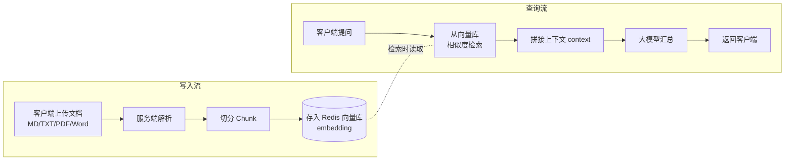
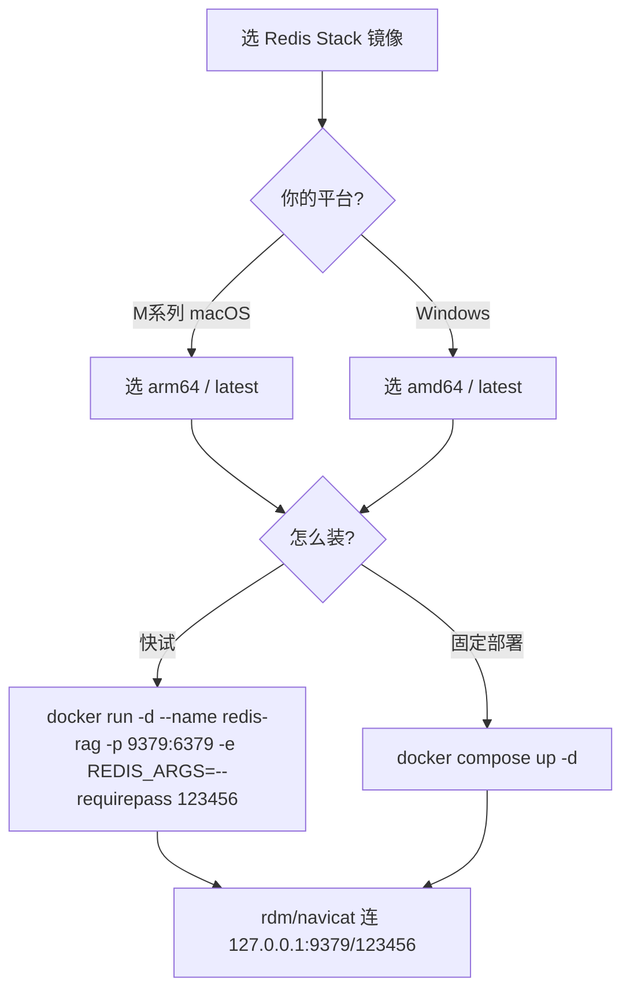

## 纲要

- **RAG 是什么**：Retrieval-Augmented Generation（检索增强生成）——给大模型「外挂」一个专属知识库，弥补它不懂垂直/私有业务的短板
- **RAG 闭环**：上传文档 → 解析 → 存入 Redis 向量库 → 用户提问 → 从向量库检索相似片段 → 喂给大模型汇总 → 返回客户端
- **为什么用向量库**：存进向量的不是原文，而是「人看不懂、AI 才认」的 embedding 向量；相似度搜索靠向量距离而非关键词
- **Redis Stack 角色**：课程用 Redis Stack（**不是普通 Redis**），同时充当缓存库与向量库（含 RediSearch 模块）
- **Docker 安装**：平台选型（M 系列 arm64 / Windows amd64）、端口 `9379`、密码 `123456`、docker run 与 docker-compose 两种方式、可视化 RDM / Navicat
- **项目集成**：引入 maven 坐标（vector-store / redis-store / transformers-embedding / document-reader-tika）、`application.yml` 配置（spring.data.redis + spring.ai.vectorstore.redis 的 index-name / prefix 单引号坑）

> 本章代码基于课程标准工程（`com.itzixi` 包）按课程口径重构，外部代码卷暂未挂载，重挂后可切换为逐文件提取的真实代码。

## 一、为什么本篇要引入 RAG

前述大模型调用、前述 SSE 流式推送，解决的都是「**通用问答**」——问常识，大模型直接答。但一旦遇到**垂直领域 / 私有业务**（如某公司《员工入职手册》《iPhone 说明书》），大模型本来就不懂，硬问只会胡编。

解决办法就是 **RAG**：把私有文档「外挂」给大模型。用户提问时，先去知识库里把相关片段捞出来，连同问题一起交给大模型，让它基于这些片段汇总成通顺答案。这是当下企业私有化部署最常见的形态。

> 老师用一个通俗比喻：把大模型比作父母，客户端比作小朋友。常识问题（十万为什么）父母直接答；垂直问题（动物骨骼、医疗）父母也不懂，就得「先查资料 → 自己消化吸收成白话 → 再讲给小朋友听」。RAG 就是「查资料 + 消化吸收」这一段。

## 二、RAG 全流程闭环

整章要落地的就是下面这条链路，分两条子流程：



| 子流程 | 步骤 | 关键动作 |
|---|---|---|
| **写入流**（7-4~7-5） | 上传 → 解析 → 切分 → 落库 | `TextReader` 读取、`CustomTextSplitter` 按空行切分、`vectorStore.add()` 存 Redis |
| **查询流**（7-6~7-7） | 提问 → 检索 → 拼上下文 → 大模型输出 | `similaritySearch` 相似度检索、`stream().map().joining("\n")` 拼上下文、组装 RAG 提示词 |

> 老师强调：客户端**不是**直接和大模型问私有问题，而是**先去资料库查**，再把查到的资料交给大模型「翻译/汇总」成人话返回。这形成完整的「检索增强生成」闭环。

## 三、为什么向量库存的是「看不懂的数据」

文档存入向量库后，本质会被大模型/embedding 模型识别成一组**高维向量**（一串数字），人看不懂，只有向量库和模型认得。我们完全不用管中间形态，交给框架解析即可。

- **相似 ≠ 关键词命中**：向量检索靠「语义距离」，提问「入职流程是什么」能拉出含「入职」的片段，哪怕措辞不同。
- **分数（score）**：每条命中带相似度分值（如 0.819 / 0.7），分越高越贴合；但最终答案仍要靠大模型二次汇总，单纯按分高低并不保证最准。

## 四、Redis Stack 安装（Docker）

### 4.1 选镜像前先看平台

打开 Docker Hub 搜 `redis/redis-stack`：

| 标签 | 适用平台 | 说明 |
|---|---|---|
| `redis/redis-stack` 含 arm64 | **Apple M 系列芯片（macOS）** | 选同时带 arm64 + amd64 的 latest |
| `redis/redis-stack` 含 amd64 | **Windows** | M 系列不支持纯 amd64；Windows 不支持 arm64 |
| `latest` | 两者都支持 | 推荐直接拉 latest |

> 老师提醒：**M 系列（arm64）和 Windows（amd64）镜像不通用**，挑的时候看清楚操作系统支持列，选 arm64+amd64 都有的 `latest` 最稳。

### 4.2 方式一：docker run（课程首选）

```bash
# 后台运行，命名 redis-rag，端口 9379（避免和本机其它 redis 冲突），设密码 123456
docker run -d \
  --name redis-rag \
  -p 9379:6379 \
  -e REDIS_ARGS="--requirepass 123456" \
  redis/redis-stack:latest
```

> 老师踩坑提示：本机可能装过很多 redis（他本地一堆测试实例），**端口必冲突**，所以课程把默认 `6379` 改成 `9379`。如果你没装过，保持 `6379` 也行；想和老师一致就用 `9379`。密码随你定，课程统一用 `123456` 演示。
>
> 关于密码的写法：Redis Stack 官方通过环境变量 `REDIS_ARGS="--requirepass 123456"` 传启动参数；若用普通 redis 镜像则是 `-e REQUIREPASS=123456`。两者都能工作，关键是**一定要设密码**（见文末 ops 提示）。

跑完 `docker ps` 看到 `redis-rag` 容器 UP 即成功。

### 4.3 方式二：docker-compose（适合固定部署）

课程提供的 `docker-compose.yml`：

```yaml
services:
  redis-rag:
    image: redis/redis-stack:latest
    container_name: redis-rag
    ports:
      - "9379:6379"      # 向量库服务端口
      - "8639:8001"      # Redis Insight 可视化 UI（可选，个人习惯可不暴露）
    volumes:
      - ./redis-rag-data:/data     # ⚠️ 本地磁盘映射，注意写 /data 不是 /neta
    environment:
      - REDIS_ARGS=--requirepass 123456
    restart: unless-stopped          # 重启策略：除非手动停，否则总是拉起
```

> 老师原话里路径笔误成 `/neta`，正确应是 `/data`（Redis 数据目录）。本地目录自己定，先 `mkdir` 出来再挂。
>
> 启动：在 compose 文件所在目录打开终端执行 `docker compose up -d` —— **必须进到该目录**再执行，否则 compose 找不到文件。

### 4.4 可视化连接（两种工具）

**RDM（Redis Desktop Manager / 类 Redis Insight 工具）**
- 名称：`redis-rag`
- Host：`127.0.0.1`
- Port：`9379`
- Password：`123456`
- 测试连接成功 → OK

**Navicat（之前讲 MySQL 用过）**
- 新建连接 → 选 **Redis**
- 连接名：`redis-rag`
- Host：`127.0.0.1`，Port：`9379`
- 鉴权：密码 `123456`
- 连接测试成功即可

> 两类工具任选其一，都能看到后面写入的向量数据。老师验证落库时就用 RDM / Navicat 刷出 `embedding` 字段确认成功。

## 五、项目集成 Redis 向量库（maven + yml）

### 5.1 引入 maven 坐标（mcp-client 的 pom.xml）

```xml
<!-- 1. 向量库抽象层 -->
<dependency>
    <groupId>org.springframework.ai</groupId>
    <artifactId>spring-ai-vector-store</artifactId>
</dependency>

<!-- 2. Redis 向量库具体实现（依赖上面的抽象） -->
<dependency>
    <groupId>org.springframework.ai</groupId>
    <artifactId>spring-ai-redis-store</artifactId>
</dependency>

<!-- 3. 嵌入式文本 embedding 模型（本地/离线文本向量化） -->
<dependency>
    <groupId>org.springframework.ai</groupId>
    <artifactId>spring-ai-transformers-embedding</artifactId>
</dependency>

<!-- 4. 文档读取（Tika 解析 PDF/Word/MD/TXT 等） -->
<dependency>
    <groupId>org.springframework.ai</groupId>
    <artifactId>spring-ai-document-reader-tika</artifactId>
</dependency>
```

> Spring AI 1.0 推荐用 **starter** 形式：`spring-ai-starter-vector-store-redis` 一个坐标即可替代上面 1+2。课程用的是「抽象 + 具体实现」分写方式，两者等价。
>
> `transformers-embedding` 首次运行会从 **HuggingFace（爆脸）** 远程下载模型，**首次很慢**，要有等待心理准备。

### 5.2 application.yml 配置

```yaml
spring:
  # —— 缓存库用的 Redis（spring-data-redis）——
  data:
    redis:
      host: 127.0.0.1
      port: 9379            # ⚠️ 本地改成了 9379，别照抄默认 6379
      password: 123456

  # —— 向量库用的 Redis（spring-ai 专用）——
  ai:
    vectorstore:
      redis:
        initialize-schema: true     # 是否初始化所需索引模式，开启
        index-name: rag-index       # 索引名，自定义
        prefix: 'rag:'              # ⚠️ 含冒号必须加单引号！
```

> 老师两大坑点：
> 1. **端口改 9379**：本地装的是 `9379`，yml 里必须同步改，否则连不上。
> 2. **prefix 单引号**：`prefix` 值带冒号 `rag:`，YAML 里**必须加单引号**包成字符串。不加引号 YAML 无法识别冒号语义，会导致拼接失败；加了才能在 RDM/Navicat 里以 `rag:xxx` 树形展开，否则所有 key 平铺一堆、极易搞混。
>
> 另：`spring.data.redis` 是**缓存库**，`spring.ai.vectorstore.redis` 是**向量库**——两套 redis 配置共存，别混。

### 5.3 验证集成

`mvn install` 保证编译通过 → 启动 `mcp-client` → 控制台无报错即代表 Redis 向量库集成成功。后续逐步把知识库链路补全。

> `TransformerEmbeddingModel` 首次启动会下载模型，日志里能看到相关提示，慢属正常。

## 六、关联代码文件（本章重构）

| 文件 | 作用 |
|---|---|
| `mcp-client/pom.xml` | 新增 4 个坐标：vector-store / redis-store / transformers-embedding / document-reader-tika |
| `mcp-client/.../resources/application.yml` | `spring.data.redis`（缓存）+ `spring.ai.vectorstore.redis`（向量库，index-name/prefix） |
| `docker-compose.yml`（本地） | Redis Stack 容器定义（端口/密码/卷/restart） |
| 可视化连接配置 | RDM / Navicat 连 `127.0.0.1:9379` 密码 `123456` |

## 七、平台选型 × 安装方式 决策图



## 八、排错 SOP

1. **容器起不来**：`docker ps` 看状态；端口冲突（本机已有 redis 占 6379）→ 改用 `9379`；镜像平台不匹配（M 装了 amd64）→ 换 latest。
2. **连不上 Redis**：yml `port` 是否改成 `9379`；密码 `123456` 是否和启动参数一致；`prefix` 冒号是否加了单引号。
3. **启动卡在下载模型**：`TransformerEmbeddingModel` 首次从 HuggingFace 拉模型，慢是正常的，耐心等或挂代理。
4. **compose 执行报错**：必须 `cd` 到 compose 文件目录再 `docker compose up -d`；卷路径写 `/data` 非 `/neta`。
5. **RDM/Navicat 刷不出数据**：先确认 7-5 已 `vectorStore.add()` 写入；连接参数 host/port/password 三件套核对。

## 九、FAQ

**Q1：普通 Redis 能不能当向量库？**
不能。向量检索依赖 RediSearch 模块，普通 Redis 镜像没有；必须装 **Redis Stack**（`redis/redis-stack`），它内置 RediSearch + RedisJSON。

**Q2：为什么端口改成 9379？**
老师本机装过很多 redis 测试实例，默认 `6379` 必然冲突；课程统一演示用 `9379`。你没冲突可保留 `6379`。

**Q3：prefix 为什么必须加单引号？**
值含冒号 `rag:`，YAML 默认把冒号当键值分隔符；不加引号无法识别为字符串，拼接会失败。加单引号后才能在可视化工具里树形展开。

**Q4：transformers-embedding 第一次特别慢？**
它要从 HuggingFace 下载嵌入式文本模型，首次慢属正常；后续本地缓存就快了。可提前下好或配国内镜像源。

**Q5：docker run 和 compose 选哪个？**
临时试手用 `docker run` 一条命令；长期固定部署用 `docker-compose.yml`（含卷映射、restart 策略，重启不丢数据）。

**Q6：缓存库和向量库都叫 redis，会冲突吗？**
不会。它们是 Redis 的**两种用法**：`spring.data.redis` 走 spring-data 做缓存，`spring.ai.vectorstore.redis` 走 spring-ai 做向量库，连的是同一个 Redis 实例的不同数据结构。

## 十、面试高频问答

**1. 什么是 RAG？解决什么问题？**
检索增强生成：给大模型外挂私有知识库，弥补其不懂垂直/私有业务的短板。流程 = 文档向量化入库 → 提问时检索相似片段 → 拼接上下文喂给大模型汇总作答。

**2. 为什么检索用向量库而非关系库？**
向量库按 embedding 语义距离做相似度搜索，能命中同义不同词的片段；关系库只能关键词精确匹配，语义召回弱。

**3. Redis Stack 和普通 Redis 区别？**
Redis Stack 内置 RediSearch / RedisJSON / RedisTimeSeries 等模块，支持向量索引与语义检索；普通 Redis 无此能力。

**4. Spring AI 怎么声明向量库？**
引入 `spring-ai-starter-vector-store-redis`（或 vector-store + redis-store 双坐标），yml 配 `spring.ai.vectorstore.redis` 的 index-name / prefix / initialize-schema，注入 `RedisVectorStore` 即可 `add()` / `similaritySearch()`。

**5. YAML 里 prefix 带冒号为什么要加引号？**
YAML 把未引号冒号当键值分隔符，值 `rag:` 会被误解析；加单引号显式声明为字符串，保证 key 正确拼接与树形展开。

**6. embedding 模型首次慢怎么优化？**
首次从 HuggingFace 下载模型慢；可预下载模型到本地、配置离线路径，或用国内镜像 / Ollama 本地 embedding 替代。

## 十一、ops 提示（安全与网络）

> **弱口令风险**：课程演示密码 `123456` 仅为教学；生产 Redis 务必设强密码 + 不暴露公网端口，Redis 无认证被扫是高频入侵入口。
>
> **端口冲突**：本机多 redis 实例时显式指定非默认端口（如 `9379`），避免「连错库 / 起不来」互相踩踏。
>
> **数据持久化**：compose 务必挂 `/data` 卷，否则容器重建向量数据全丢；`restart: unless-stopped` 保证意外退出自拉起。
>
> **prefix 引号**：带冒号的 prefix 不加单引号会导致 YAML 解析异常、key 拼接失败，属典型「配置坑」，上线前核对。
>
> **镜像平台**：M 系列（arm64）与 Windows（amd64）镜像不互通，选错直接跑不起来；统一用 `latest` 最稳。
