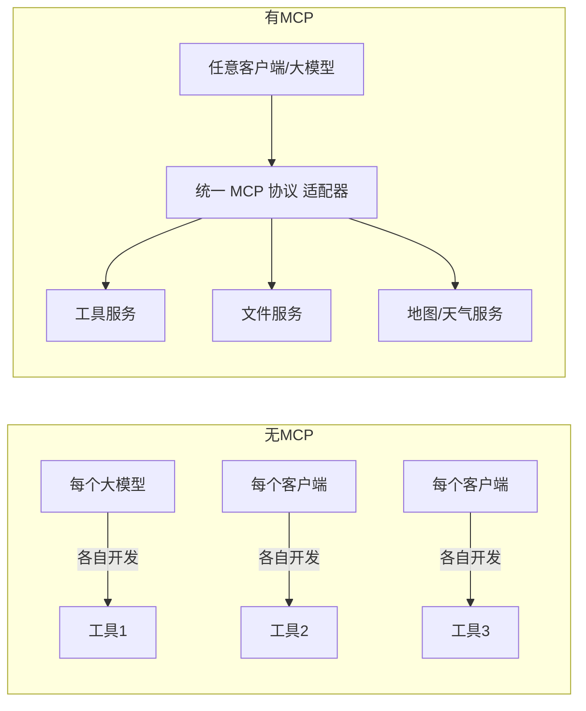
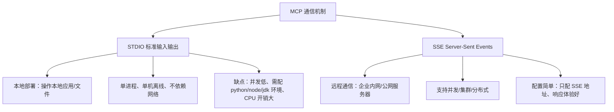
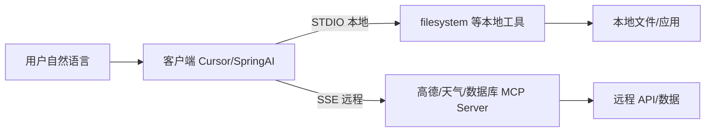

## 纲要

- **MCP 是什么**：Model Context Protocol（模型上下文协议），2024 年开放的**标准协议**，让 LLM 用统一方式连接外部工具 / 数据源
- **解决什么**：大模型不懂实时信息（时间/天气）与本地操作（写文件/查库），MCP 让它「调外部工具」获得无限可能
- **一句话总结**：用自然语言让大模型**自动编排调用工具链**（查 SQL、发邮件、写本地文件、出报表、做攻略…）
- **使用场景**：编程智能体、数据分析、企业知识库、自动化工作流、设计创意、AI 机器人
- **两种通信机制**：`STDIO`（标准输入输出，本地、单进程、离线、并发低、配置繁）vs `SSE`（远程、支持并发/集群、配置简，课程主用）；未来 `HTTP stream`
- **服务平台**：官方 MCP Servers(github)、awesome-mcp-servers、魔搭社区(ModelScope)、阿里云百炼、mcp.so（1.5万+工具）；配置即一个大 JSON（`mcpServers` 下挂多个 server），docker/NPX 两种部署
- **Cursor 集成**：本地（filesystem + NPX，配目录，11 工具）→ 远程（高德地图 SSE，注册开发者+key，15 工具）→ agent 模式自然语言建 HTML

> 本章代码基于课程标准工程（`com.itzixi` 包）按课程口径重构，外部代码卷暂未挂载，重挂后可切换为逐文件提取的真实代码。

## 一、为什么本篇要引入 MCP

前几章的搜索（联网/知识库/普通）都是**我们在本地写死**的功能。但大模型本身有盲区：问「现在几点」「明天南京天气」，它只会凭训练数据瞎编（如回 2023 年某天）。MCP 就是让大模型能**调用外部工具/API** 补齐这些能力的标准协议。

> 老师原话总结：**MCP 让你用自然语言描述，就能让大模型自动调用一整套工具链**——查 SQL、项目发布、网页分析生成报表发邮件、写本地文件、做市场调查、规划旅游攻略（天气/高铁/航班），一句话达成。

## 二、什么是 MCP（协议视角）

- **没 MCP 时**：N 个客户端 × M 个工具 = N×M 套对接（「一把锁一把钥匙」），极其繁琐。
- **有 MCP 后**：工具只需实现**一次** MCP Server，所有符合规范的客户端（Mac/Windows/外星人笔记本）都能即插即用——连线从「多对多」变「星形」，大幅简化。

> 老师类比：**MCP 的 P 就是 Protocol，和 TCP-IP、HTTP 一样是协议**。我们以前用 Java 写接口走 HTTP/RESTful 调外部 API；现在不过是把「本地系统」换成「本地大模型」，让大模型去调外部 MCP 工具——**换汤不换药，本质都是发请求调接口**，只是大模型更智能、更自动。

官方支持语言：**Python / TypeScript / Java**（课程用 Java + Spring AI 集成，比早期手撸 SDK 方便太多）。

## 三、MCP 使用场景

| 场景 | 说明 | 例子 |
|---|---|---|
| **编程智能体** | 操作本地文件增删改查、代码生成、改 bug、API 集成、CI/CD | Cursor / Claude / VS Code 插件 / 通义灵码 / Blackbox AI |
| **数据分析** | 自然语言查库 → 生成柱状/饼/折线图 | 大屏报表、一句话出图 |
| **企业知识库管理** | 比自研知识库更强：文档(Word/PPT/Excel)生成分析 + 收发邮件 + 隐私保护 | 企业内部档案知识库 |
| **自动化工作流** | 多节点/多系统协调，自动编排成链路（跨系统协同） | coze / defin 类工作流 |
| **设计创意** | 3D 建模（建筑/飞机/汽车）、PS 修图、UI 设计、图标 | 专业软件自然语言驱动 |
| **AI 机器人** | 自定义扩展 MCP 后能力无限（有服务就能做） | 未来落地的具身智能 |

> 老师强调：AI 智能体元年，MCP 让「想得到就能落地」，结合鼠标键盘等创意都能赚到风口的钱。

## 四、MCP 通信机制（STDIO vs SSE）

| 维度 | STDIO | SSE |
|---|---|---|
| 部署 | 本地（客户端与服务同机） | 远程（跨网络/地域） |
| 并发 | 单进程，**并发低** | 支持并发/集群 |
| 网络依赖 | 无，可离线单机 | 需网络 |
| 配置 | 繁（装 python/node/jdk + 命令） | 简（只配地址） |
| 课程地位 | 本地调试 | **主用**（生产级） |

> 老师补充：未来还会推 `HTTP stream`（流式，和 SSE 类似）。**只要客户端和 MCP 同机，STDIO 或 SSE 都行**；生产多客户同时使用必选 SSE。

## 五、MCP 服务平台一览

| 平台 | 特点 |
|---|---|
| **官方 MCP Servers**（GitHub） | 分类全（filesystem 等），纯英文，看点赞/下载量甄别 |
| **awesome-mcp-servers** | 支持中英文，有教程，社区常用 |
| **魔搭社区 ModelScope** | MCP 广场，可自创上传，老师做工作流常用（如 12306 查票 MCP） |
| **阿里云百炼** | 支付宝/纹身图/数字人视频等官方 MCP，需开通 |
| **mcp.so** | 老师第一个用的，英文，1.5 万+工具，日增几十到几千，看 logo 辨官方 |

**配置核心**：一个大 JSON，根节点 `mcpServers`，下面**每个 server 一个 key**（多个用逗号隔开）。一个连接能识别该 server 提供的几十个工具。部署形式：`docker` 或 `NPX`（基于 Node 环境）或 Java 构建后 docker/SSE。

> 老师提醒：同功能 server 全球有几十到几百个重复，优先选大厂、点赞/收藏/下载高的。

## 六、Cursor 集成本地 MCP（filesystem，STDIO/NPX）

1. 下载安装 **Cursor**（支持 Mac/Windows/Linux，安装时可集成 VS Code 插件）。
2. 设置 → **Tools** → **Add Custom MCP** → 编辑 JSON。
3. 从魔搭社区复制 **filesystem** 的 `NPX` 配置（TS/Node 环境），改本地目录参数（如把桌面换成你的 `docker` 文件夹路径，可配多个）。
4. 保存 → 关闭再开启 Tools → 小圆点变**绿色**即可用；filesystem 提供 **11 个工具**（读/写/改文件等）。
5. 切到 **Agent 模式**（非 Ask）→ 输入「在目录下创建 HTML 文件，内容 helloworld」→ 模型调用 `write_file` → `run tool` → 再 `read_file` 验证，文件创建成功。

> 关键：**必须选 Agent 模式**才能调 MCP 工具；配置后刷新生效。

## 七、Cursor 集成远程 MCP（高德地图，SSE）

1. 高德开放平台 → 注册开发者 + **实名认证** → 应用管理 → 创建应用 → 添加 **Key**（注意保密，泄露有风险）。
2. 复制高德 MCP 的 SSE 接入文本，贴到 Cursor 的 MCP JSON 里——**注意在已有配置后加逗号，保持 JSON 合法**。
3. 把 Key 填进配置，保存刷新 → 两个小点都绿 → 高德提供 **15 个工具**。
4. 测试：「帮我制定去北京游玩的两天攻略，用漂亮 HTML+CSS 写入某目录，文件名 北京.html」→ 模型调工具生成美观页面。

> 老师提示：SSE 配置本质就是一个**地址 + key**，和前端配 URL 一样简单；本地 STDIO 与远程 SSE 两种方式都已实战打通。

## 八、MCP 生态地图

## 九、排错 SOP

1. **Cursor 工具不生效**：是否切到 **Agent 模式**（Ask 模式不调工具）；JSON 逗号/格式是否合法；保存后刷新等小点变绿。
2. **STDIO 起不来**：本地环境（Node/python/JDK）是否装好；命令路径/参数是否正确。
3. **SSE 连不上**：Key 是否填对/泄露失效；地址是否完整（含 `/sse` endpoint）；网络是否可达。
4. **高德注册失败**：需实名认证 + 创建应用 + 添加 Key 三步齐全。
5. **工具发现了但没用**：必须把 `toolCallbackProvider` 的工具通过 `.defaultTools()` 给到 ChatClient（「买了玩具要交给熊孩子」）。

## 十、FAQ

**Q1：MCP 和 Function Calling 什么关系？**
MCP 是**标准化协议**，统一了「大模型 ↔ 外部工具」的通信；Function Calling 是某模型厂商的能力。MCP 让不同模型/客户端都能即插即用同一套工具服务，避免 N×M 重复对接。

**Q2：STDIO 和 SSE 怎么选？**
本地单机调试/离线用 STDIO；生产多客户并发、跨网络用 SSE。课程主用 SSE。

**Q3：Cursor 集成 MCP 必须 Agent 模式？**
是。Ask（问答）模式只聊天不调工具；Agent 模式才会自动编排调用 MCP 工具。

**Q4：mcp.so / 魔搭怎么挑工具？**
看 logo（官方）、点赞率、下载/浏览量；同功能重复多，优先大厂高人气。

**Q5：高德 MCP 为什么要 Key？**
远程服务需鉴权，Key 标识你的应用；泄露会被盗用，务必保密。

**Q6：一个 MCP 配置能挂多个 server？**
能。JSON 根 `mcpServers` 下每个 server 一个 key，逗号分隔，一个连接识别几十个工具。

## 十一、面试高频问答

**1. 什么是 MCP？解决什么问题？**
Model Context Protocol，2024 开放标准，统一 LLM 与外部工具/数据源的通信。解决大模型盲区（实时信息、本地操作），让其通过自然语言自动编排调用工具链。

**2. MCP 相比各自对接的优势？**
将 N 客户端×M 工具的多对多对接，收敛为「工具实现一次 MCP Server，所有客户端即插即用」的星形架构，大幅降低集成成本。

**3. STDIO 与 SSE 的区别与选型？**
STDIO：本地、单进程、离线、并发低、配置繁；SSE：远程、支持并发/集群、配置简。生产级首选 SSE。

**4. MCP 配置长什么样？**
一个大 JSON：`{ "mcpServers": { "filesystem": {...},"amap": {...} } }`，每 server 一 key，逗号分隔；部署用 docker/NPX/Java。

**5. 如何在客户端接入 MCP？**
Cursor：设置→Tools→Add Custom MCP→贴 JSON→刷新变绿→Agent 模式调用。Spring AI：引 mcp-client 依赖 + yml 配 `spring.ai.mcp.client` + 把 `toolCallbackProvider` 经 `.defaultTools()` 注入 ChatClient。

**6. MCP 常见服务平台？**
官方 MCP Servers(github)、awesome-mcp-servers、魔搭社区、阿里云百炼、mcp.so（1.5万+）。

## 十二、ops 提示（安全与网络）

> **Key 保密**：高德等远程 MCP 的 Key 等同 API 凭证，泄露会被盗用产生费用；别硬编码进仓库，走环境变量/配置中心。
>
> **JSON 合法性**：多 server 配置必须逗号分隔、结构合法，否则客户端解析失败、工具全失效。
>
> **本地目录暴露**：filesystem 类 STDIO 工具会获得配置目录的读写权，路径范围按最小权限给，别开根目录。
>
> **生态甄别**：平台上海量重复/低质 server，优先官方 logo、高点赞下载量，防恶意工具。
>
> **离线 vs 在线**：STDIO 离线可用但需本地运行时；SSE 依赖网络可达，防火墙/跨域需放行。
