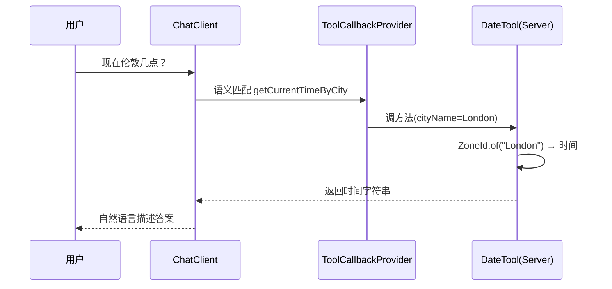

## 纲要

- **SpringAI 接入双类型 MCP**：客户端引 `spring-ai-mcp-client-spring-boot-starter` + `spring-ai-mcp`（提供 `@Tool` / `ToolCallbackProvider`）；yml 配 `spring.ai.mcp.client`（enabled + name + type=ASYNC + sse 多 server + stdio classpath json）；`resources` 根放 `mcp-server.json`。
- **最关键：「发现 ≠ 使用」**：必须把 `ToolCallbackProvider` 经 `ChatClient.Builder.defaultTools(provider)` 注入 ChatClient（老师比喻：买了玩具要交给熊孩子），还可用 `defaultAdvisors(MessageChatMemoryAdvisor)` 挂记忆。
- **手写第一个 MCP Server 模块 `mcp-server`**：依赖 `spring-ai-mcp-server-webflux-spring-boot-starter`（SSE 版）；yml 配 `spring.ai.mcp.server`（name/version/type=ASYNC/sse-endpoint=/sse/port）；`@Component` + `@Tool(description=...)` 暴露方法；`@Bean MethodToolCallbackProvider` 注册。
- **第一个工具 DateTool**：`getCurrentTime()` 返回格式化本地时间；`@Tool` 让大模型按语义匹配调用。
- **自动编排（核心威力）**：升级 `getCurrentTimeByCity(cityName)` → 大模型自动提取「伦敦」为参数、自动把城市名转 `ZoneId`，无需手写 switch-case；多工具按顺序串联成工作流。
- **协议层（深度）**：MCP 基于 JSON-RPC 2.0 over STDIO/SSE；握手 `initialize` → `tools/list` → `tools/call`，工具以 schema 形式暴露给模型。
- **完整工程结构 + 启停顺序 + curl 验证 SSE 端点**。

> 本章代码基于课程标准工程（`com.itzixi` 包）按课程口径重构，外部代码卷暂未挂载，重挂后可切换为逐文件提取的真实代码。坐标与配置以课程口径（`...-webflux-...` / `...-mcp-client-...`）为准，与 Spring AI 1.x 早期 starter 命名一致。

## 一、在 SpringAI 中接入第三方 MCP（STDIO + SSE）

MCP 在 Spring AI 里分两端：**客户端（mcp-client）** 把远端/本地工具拉进来交给 ChatClient；**服务端（mcp-server）** 自己暴露工具。客户端既可连别人家的 server（如高德 SSE），也可连自己写的 server（STDIO 本地或 SSE 远程）。

### 1.1 客户端模块完整 pom.xml

```xml
<!-- mcp-client/pom.xml（节选关键依赖；父工程已管版本） -->
<dependencies>
    <!-- Spring AI 对话模型：以 OpenAI 兼容接口接 DeepSeek / 通义千问 -->
    <dependency>
        <groupId>org.springframework.ai</groupId>
        <artifactId>spring-ai-starter-model-openai</artifactId>
    </dependency>

    <!-- MCP 客户端 starter：负责连接 sse / stdio 类型的 server，并产出 ToolCallbackProvider -->
    <dependency>
        <groupId>org.springframework.ai</groupId>
        <artifactId>spring-ai-mcp-client-spring-boot-starter</artifactId>
    </dependency>

    <!-- MCP 核心：提供 @Tool / @ToolParam / ToolCallbackProvider 等注解与类型 -->
    <dependency>
        <groupId>org.springframework.ai</groupId>
        <artifactId>spring-ai-mcp</artifactId>
    </dependency>

    <!-- Web 层：对外暴露 SSE 推送与 HTTP 接口 -->
    <dependency>
        <groupId>org.springframework.boot</groupId>
        <artifactId>spring-boot-starter-web</artifactId>
    </dependency>

    <!-- 记忆：ChatMemory 实现，支撑多轮对话 -->
    <dependency>
        <groupId>org.springframework.ai</groupId>
        <artifactId>spring-ai-advisors-vector-store</artifactId> <!-- 或 spring-ai-core 自带 InMemoryChatMemory -->
    </dependency>

    <dependency>
        <groupId>org.projectlombok</groupId>
        <artifactId>lombok</artifactId>
        <optional>true</optional>
    </dependency>
    <dependency>
        <groupId>org.springframework.boot</groupId>
        <artifactId>spring-boot-starter-test</artifactId>
        <scope>test</scope>
    </dependency>
</dependencies>
```

> 版本由父 `pom` 的 `spring-ai` BOM 统一管理（课程用 Spring AI 1.x 早期版本，starter 命名为 `spring-ai-mcp-client-spring-boot-starter`；若你用 1.0 GA 之后版本，坐标可能是 `spring-ai-mcp-client`（去掉 `-spring-boot-starter` 后缀），以你工程里实际能拉到的为准）。

### 1.2 客户端 yml 配置（sse 远程 + stdio 本地）

```yaml
server:
  port: 9090

spring:
  application:
    name: springAI-MCPclient
  ai:
    # 对话模型（OpenAI 兼容端点，接 DeepSeek / 通义千问，详见第 5 章）
    openai:
      base-url: https://api.deepseek.com
      api-key: ${DEEPSEEK_API_KEY}
      chat:
        options:
          model: deepseek-chat
          temperature: 0.7

    mcp:
      client:
        enabled: true
        name: springAI-MCPclient
        type: ASYNC                 # ASYNC：非阻塞连接，启动快；SYNC 亦可
        sse:                        # 远程 SSE 类 server（高德 / 自研 server）
          - url: https://amap-mcp-host/sse
            # 高德：url 后拼 /sse + key 组合成完整 SSE server
          - url: http://localhost:9060
            endpoint: /sse          # 自研 server 的 SSE 端点（课程 mcp-server 默认 9060）
        stdio:                      # 本地 STDIO 类 server（如 filesystem）
          - service-configuration: classpath:mcp-server.json
```

> `mcp-server.json` 放在 `mcp-client/src/main/resources/` 根（即 classpath 根），结构与 Cursor 一致（本例去掉高德——已在上面 sse 配置，避免重复）；可继续往里加逗号挂更多本地 NPX 工具。

### 1.3 classpath 的 mcp-server.json（STDIO 示例）

```json
{
  "mcpServers": {
    "filesystem": {
      "command": "npx",
      "args": [
        "-y",
        "@modelcontextprotocol/server-filesystem",
        "/Users/yourname/docker"
      ]
    }
  }
}
```

> 注意：STDIO 的 server 由客户端**本地拉起子进程**执行 `command`（`npx`/`python`/`java`），因此本机必须装好对应运行时（Node / Python / JDK）。SSE 则只配 URL，server 已独立部署在远端，客户端纯连。

## 二、把工具「交给」ChatClient（最关键一步）+ 记忆

光 `spring.ai.mcp.client.enabled=true` 只会让框架**发现**工具并装进 `ToolCallbackProvider` 容器；模型并不知道有这些工具，必须显式注入。

```java
package com.itzixi.config;

import org.springframework.ai.chat.client.ChatClient;
import org.springframework.ai.chat.client.advisor.MessageChatMemoryAdvisor;
import org.springframework.ai.chat.memory.ChatMemory;
import org.springframework.ai.chat.memory.InMemoryChatMemory;
import org.springframework.ai.tool.ToolCallbackProvider;
import org.springframework.context.annotation.Bean;
import org.springframework.context.annotation.Configuration;

@Configuration
public class ChatClientConfig {

    /** 多轮记忆：同一个 conversationId 上下文连续 */
    @Bean
    public ChatMemory chatMemory() {
        return new InMemoryChatMemory();
    }

    @Bean
    public ChatClient chatClient(ChatClient.Builder builder,
                                 ToolCallbackProvider toolCallbackProvider,
                                 ChatMemory chatMemory) {
        return builder
                // ① 发现工具 ≠ 使用工具：必须把 provider 经 defaultTools 注入 ChatClient
                .defaultTools(toolCallbackProvider)
                // ② 挂记忆顾问，让模型记得上一轮说了啥
                .defaultAdvisors(MessageChatMemoryAdvisor.builder(chatMemory).build())
                .build();
    }
}
```

> 老师经典比喻：**「买了玩具放家里，但不交给熊孩子，孩子不会玩」**。`toolCallbackProvider` 里能看到 `serverInfo`（如 `amap` / `filesystem` 0.2.0 / 自研 `springAI-MCPserver` v1.0.0）。断点进 `toolCallbackProvider` 可见每个 server 的工具清单。
>
> 测试：页面问「在目录创建 abc.html，内容无锡一天旅游攻略（CSS+HTML）」→ 模型自动调 filesystem 工具生成美观页面。

### 2.1 调用侧代码（Controller）

```java
@RestController
@RequestMapping("/chat")
@RequiredArgsConstructor
public class ChatController {

    private final ChatClient chatClient;

    @GetMapping("/ask")
    public String ask(@RequestParam String message,
                      @RequestParam(defaultValue = "default") String cid) {
        return chatClient.prompt()
                .user(message)
                .advisors(a -> a.param("conversationId", cid)) // 多轮记忆 key
                .call()
                .content();
    }
}
```

## 三、开发自己的第一个 MCP Server（DateTool）

### 3.1 新建 mcp-server 模块 + 完整 pom.xml

```xml
<!-- mcp-server/pom.xml -->
<dependencies>
    <!-- SSE 版 server starter（远程/流式）。要 STDIO 本地版换成 spring-ai-mcp-server-stdio-spring-boot-starter -->
    <dependency>
        <groupId>org.springframework.ai</groupId>
        <artifactId>spring-ai-mcp-server-webflux-spring-boot-starter</artifactId>
    </dependency>

    <!-- 邮件工具章节用：Spring Mail -->
    <dependency>
        <groupId>org.springframework.boot</groupId>
        <artifactId>spring-boot-starter-mail</artifactId>
    </dependency>

    <!-- 邮件正文 MD→HTML 用：CommonMark -->
    <dependency>
        <groupId>org.commonmark</groupId>
        <artifactId>commonmark</artifactId>
        <version>0.21.0</version>
    </dependency>

    <dependency>
        <groupId>org.projectlombok</groupId>
        <artifactId>lombok</artifactId>
        <optional>true</optional>
    </dependency>
    <dependency>
        <groupId>org.springframework.boot</groupId>
        <artifactId>spring-boot-starter-test</artifactId>
        <scope>test</scope>
    </dependency>
</dependencies>
```

> 老师提醒：**SSE 和 STDIO 坐标不同**！要 SSE（流式/远程）用 `...-webflux-...`；要 STDIO（本地）用 `...-stdio-...`。课程统一做 SSE server，便于多客户端并发与生产部署。

### 3.2 server 端 yml

```yaml
server:
  port: 9060                 # 老师偏好端口；客户端 sse 配置须对应
spring:
  application:
    name: springAI-MCPserver
  ai:
    mcp:
      server:
        name: springAI-MCPserver
        version: 1.0.0
        type: ASYNC
        sse-endpoint: /sse    # 客户端连 http://localhost:9060/sse
```

### 3.3 启动类 + 工具注册

```java
package com.itzixi;

import org.springframework.ai.mcp.MethodToolCallbackProvider;
import org.springframework.ai.tool.ToolCallbackProvider;
import org.springframework.boot.SpringApplication;
import org.springframework.boot.autoconfigure.SpringBootApplication;
import org.springframework.context.annotation.Bean;

@SpringBootApplication
public class McpServerApplication {

    public static void main(String[] args) {
        SpringApplication.run(McpServerApplication.class, args);
    }

    /** 把 @Component 扫描到的工具注册进容器，供客户端发现 */
    @Bean
    public ToolCallbackProvider registerMCPTools(DateTool dateTool,
                                                  EmailTool emailTool) {
        // 原理类似拦截器：收集所有 @Tool 方法，封装成 ToolCallback
        return MethodToolCallbackProvider.builder()
                .toolObjects(dateTool, emailTool)   // 可变参数，可放多个工具对象
                .build();
    }
}
```

### 3.4 DateTool（第一个工具）

```java
package com.itzixi.mcp.tool;

import org.springframework.ai.tool.annotation.Tool;
import org.springframework.stereotype.Component;
import lombok.extern.slf4j.Slf4j;

import java.time.LocalDateTime;
import java.time.format.DateTimeFormatter;

@Component
@Slf4j
public class DateTool {

    @Tool(description = "获取当前时间")     // 大模型据此语义匹配「现在几点」
    public String getCurrentTime() {
        log.info("========== 调用 MCP 工具：获取当前时间 ==========");
        LocalDateTime now = LocalDateTime.now();
        DateTimeFormatter fmt = DateTimeFormatter.ofPattern("yyyy-MM-dd HH:mm:ss");
        return now.format(fmt);                 // 返回给大模型识别
    }
}
```

### 3.5 验证

- 启 server → 浏览器/ curl 访问 `http://localhost:9060/sse` 能刷出 SSE 流（或 `curl -N http://localhost:9060/sse` 看到 `event:endpoint` / `data:...`）即 server 启动成功。
- client yml 里加第二台 server（本地 9060，去掉 `/sse` 后缀，endpoint 另配）→ 启 client → 控制台看到 `springAI-MCPserver v1.0.0` 被发现。
- 页面问「现在几点了」→ 后台打印「调用 MCP 工具」→ 正确返回时间。
- **启动顺序**：先 server 后 client（client 启动会检查 server，server 没起会报错）。
- IDEA 把两个 run config 重命名为 `SSE-client` / `SSE-server` 便于管理。

```bash
# 验证 SSE 端点是否存活（应看到 endpoint 事件）
curl -N -m 3 http://localhost:9060/sse

# 若用 stdio，验证子进程能否拉起（以 filesystem 为例）
npx -y @modelcontextprotocol/server-filesystem /Users/yourname/docker
```

## 四、大模型的自动编排能力（升级 DateTool）

### 4.1 带城市参数的时间工具

```java
@Component
@Slf4j
public class DateTool {

    @Tool(description = "获取当前时间")
    public String getCurrentTime() {
        return LocalDateTime.now()
                .format(DateTimeFormatter.ofPattern("yyyy-MM-dd HH:mm:ss"));
    }

    @Tool(description = "根据城市所在的时区ID获取当前时间")
    public String getCurrentTimeByCity(String cityName) {   // 大模型自动提取「伦敦」为城市
        log.info("调用 MCP 工具，参数 cityName={}", cityName);
        // 老师核心点：不用 switch-case 硬匹配城市→时区，直接让大模型把城市名转 ZoneId
        ZoneId zoneId = ZoneId.of(cityName);                // 伦敦→Europe/London
        ZonedDateTime time = ZonedDateTime.now(zoneId);
        return time.format(DateTimeFormatter.ofPattern("yyyy-MM-dd HH:mm:ss"));
    }
}
```

### 4.2 实测自动编排

- 「现在北京时间是几点」→ 正确。
- 「现在伦敦的时间是几点」→ 后台 `cityName=London`，`ZoneId=Europe/London`，返回伦敦时间（与权威时间核对一致）。
- 「现在美国洛杉矶几点」→ `ZoneId=America/Los_Angeles`，凌晨时间准确。

> 老师讲解：**大模型自动编排**——多个工具时，模型内部把工具串成工作流按顺序调（如创建文件→生成 HTML→写入→读取→校验）。甚至「城市名→ZoneId」这种常识映射也让模型做，不用手写 if-else。脱离 Spring AI 用纯 Java 撸 MCP 协议要写大量 SDK 代码，Spring 封装让开发极简。

### 4.3 多工具串联示例（工作流）

当用户说「帮我查下现在柏林时间，并把结果发邮件给我」，模型会自动：
1. 调 `getCurrentTimeByCity(cityName=Europe/Berlin)` 拿到时间；
2. 把结果拼进邮件正文，调 `EmailTool.sendEmail(...)` 发出。
开发者无需写任何流程编排代码——只要两个 `@Tool` 描述清晰，模型自行决定顺序与参数。

## 五、MCP 协议层（深度）：JSON-RPC 握手与工具 schema

理解底层能帮你排错。MCP 是**基于 JSON-RPC 2.0** 的协议，STDIO 用标准输入输出传 JSON 文本，SSE 用 `POST /messages?sessionId=...` 发请求、`GET /sse` 收服务端推送。

典型握手流程：

```text
客户端                                         服务端(mcp-server)
  │  --- initialize {protocolVersion, caps} --> │
  │  <-- initialized + serverInfo ------------  │
  │  --- tools/list       ------------------>  │
  │  <-- [{name, description, inputSchema}] --  │   ← 工具以 JSON Schema 暴露
  │  --- tools/call {name, arguments} ------>  │
  │  <-- {content:[{type:text, text:...}]} --  │   ← 工具执行结果
```

`inputSchema` 就是 `@Tool(description)` + `@ToolParam(description)` 编译出的 JSON Schema，模型靠它决定「哪个工具、填什么参数」。这也是为什么 `description` 写得越准确，模型命中越准。

```json
{
  "name": "getCurrentTimeByCity",
  "description": "根据城市所在的时区ID获取当前时间",
  "inputSchema": {
    "type": "object",
    "properties": {
      "cityName": { "type": "string", "description": "城市或时区ID，如 London / Europe/Berlin" }
    },
    "required": ["cityName"]
  }
}
```

## 六、完整工程结构树

```text
springai-mcp-rag-dev/
├── pom.xml                      # 父工程（packaging=pom，modules: mcp-client, mcp-server）
├── mcp-client/
│   ├── pom.xml
│   └── src/main/
│       ├── java/com/itzixi/
│       │   ├── Application.java
│       │   ├── config/ChatClientConfig.java     # defaultTools + 记忆
│       │   ├── controller/ChatController.java
│       │   ├── service/ChatService.java (+impl)
│       │   ├── service/DocumentService.java     # 第 7 章 RAG
│       │   ├── service/SearXNGService.java      # 第 8 章联网
│       │   └── utils/SSEServer.java             # 第 6 章 SSE
│       └── resources/
│           ├── application.yml
│           └── mcp-server.json                  # STDIO 本地 server 配置
└── mcp-server/
    ├── pom.xml
    └── src/main/
        ├── java/com/itzixi/
        │   ├── McpServerApplication.java        # 注册 ToolCallbackProvider
        │   └── mcp/tool/
        │       ├── DateTool.java                # 时间工具
        │       ├── EmailTool.java               # 邮件工具
        │       └── ProductTool.java             # 数据库工具（第 10 章）
        └── resources/application.yml
```

## 七、MCP 工具开发流程时序图



## 八、排错 SOP

1. **工具发现了但不调用**：漏了 `.defaultTools(toolCallbackProvider)` 注入 ChatClient（「熊孩子没拿到玩具」）。
2. **client 启动报错**：server 没先起；client 启动会检查 server，先启 server 再启 client。
3. **SSE 访问空白**：server 端口/endpoint（`/sse`）是否与 client 配置一致；yml 高德 url 是否拼全。
4. **STDIO 不加载**：`mcp-server.json` 是否在 classpath 根；JSON 逗号/格式是否合法；本机 Node/python/JDK 是否装好。
5. **坐标报错**：SSE 用 `webflux` 版、STDIO 用 `stdio` 版，别混。
6. **server 多工具没生效**：`MethodToolCallbackProvider.builder().toolObjects(...)` 漏把新工具加进可变参数。

## 九、FAQ

**Q1：SpringAI 怎么接 MCP？**
引 `spring-ai-mcp-client-spring-boot-starter` + `spring-ai-mcp`；yml 配 `spring.ai.mcp.client`（enabled/sse/stdio）；把 `ToolCallbackProvider` 经 `.defaultTools()` 注入 ChatClient。

**Q2：为什么工具发现了却不用？**
发现只是「识别到」，必须 `chatClient.builder().defaultTools(provider)` 显式交给模型，否则模型不知道有这工具。

**Q3：SSE server 和 STDIO server 坐标区别？**
SSE（远程/流式）用 `spring-ai-mcp-server-webflux`；STDIO（本地）用 `spring-ai-mcp-server-stdio`。课程统一 SSE。

**Q4：@Tool 的 description 有什么用？**
大模型靠 description 做语义匹配——用户问「现在几点」会近似命中「获取当前时间」，无需关键字完全对应。底层即 JSON-RPC 的 `tools/list` 返回的 `inputSchema.description`。

**Q5：城市→时区为什么要让大模型转？**
模型训练含常识，能直接把「伦敦」→`Europe/London`，省去手写 switch-case 映射；这是 MCP 自动编排的典型体现。

**Q6：多工具怎么串成工作流？**
模型根据用户意图自动编排调用顺序（创建文件→写内容→读→校验→发邮件），开发者只需暴露合适工具 + 描述。

**Q7：MCP 底层是什么协议？**
JSON-RPC 2.0。STDIO 走进程标准输入输出；SSE 走 `GET /sse` 收流 + `POST /messages` 发请求。工具以 JSON Schema 暴露给模型。

## 十、面试高频问答

**1. Spring AI 如何接入 MCP 工具？**
客户端引 `spring-ai-mcp-client` starter + yml 配 `spring.ai.mcp.client`（sse/stdio 地址）；服务端引 `spring-ai-mcp-server-webflux`；`@Tool` 标注方法、`MethodToolCallbackProvider` 注册；客户端 `defaultTools(provider)` 注入 ChatClient。

**2. 工具发现与使用的区别？**
发现是框架加载到 `ToolCallbackProvider`；使用需把 provider 注入 ChatClient 的 `defaultTools`，模型才能在推理时调用。

**3. @Tool / @ToolParam 作用？**
`@Tool(description)` 供模型语义匹配；`@ToolParam(description)` 描述参数，模型据此自动填充入参（字符串/枚举/近似语义映射）。底层编译为 `inputSchema`。

**4. MCP 自动编排是什么？**
多工具场景中，大模型根据用户意图自动决定调用哪些工具、按什么顺序串联成工作流，无需硬编码流程。

**5. STDIO 与 SSE server 适用？**
STDIO 本地单进程、需本机运行时；SSE 远程流式、支持并发集群。坐标分别是 `...-stdio-...` 与 `...-webflux-...`。

**6. 自定义 MCP server 的最小步骤？**
① 引 server-webflux starter；② yml 配 `spring.ai.mcp.server`（name/version/type=ASYNC/sse-endpoint）；③ `@Component` 类写 `@Tool` 方法；④ `@Bean MethodToolCallbackProvider` 注册；⑤ 先启 server 后启 client。

**7. MCP 与 Function Calling 关系？**
MCP 是标准化协议（传输 JSON-RPC），统一「模型↔工具」；Function Calling 是厂商能力。MCP 让不同模型/客户端即插即用同一套工具服务。

## 十一、ops 提示（安全与网络）

> **defaultTools 必加**：漏掉是最高频「工具不生效」根因；CI/代码评审把 ChatClient 装配纳入检查。
>
> **启动顺序**：client 依赖 server，务必先 server 后 client，否则 client 启动检查失败。
>
> **端口管理**：多 server（client 9090 / server 9060…）run config 重命名，避免同名 application 混淆。
>
> **坐标选错**：SSE↔STDIO starter 混用会直接报错，按通信方式选对。
>
> **JSON 合法**：stdio 的 `mcp-server.json` 多 server 逗号分隔、结构合法，否则本地工具全失效。
>
> **STDIO 运行时**：STDIO 工具靠本机 Node/python/JDK 子进程执行，生产容器里要预装对应运行时，否则拉不起。
>
> **SSE 鉴权**：自研 SSE server 若暴露公网，建议加 token/网关，别裸奔。
