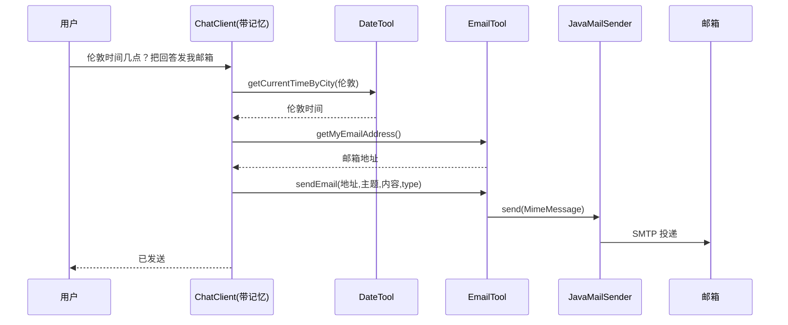

## 纲要

- **配置邮箱**：引 `spring-boot-starter-mail`；yml 配 `spring.mail`（host=网易163 SMTP、开启 POP3/SMTP/IMAP、短信授权、**授权密码非登录密码**、端口 465、UTF-8、SSL socketfactory、SASL）。
- **邮件工具 EmailTool**：`@Component` + `@Tool(description="给指定邮箱发送邮件信息")`；内部类 `EmailRequest`（email/subject/message/contentType）+ `@ToolParam(description)` 字段映射；注入 `JavaMailSender` + `from`；`MimeMessage` + `MimeMessageHelper(true)` → setFrom/To/Subject/Text → `send`。
- **自动编排实战**：「伦敦时间几点，把回答发邮件到 X，主题你定」→ 模型先调时间工具再调 sendMail，`EmailRequest` 据 description 自动填充。
- **MD 转 HTML**：引 `flexmark-all`；`convertToHtml(md)` 用 `MutableDataSet` + `Parser` + `HtmlRenderer`；`setText(html,true)` 让邮件优雅。
- **记忆功能**：`ChatMemory` + `.defaultAdvisers(MessageChatMemoryAdvisor.builder(chatMemory).build())` 注入 ChatClient；新增 `getMyEmailAddress` 无参工具（下章可改数据库按 userID 查）；支持「把刚才回复发我邮箱」。
- **大模型自动匹配类型**：`contentType` 参数（@ToolParam「1=markdown 2=HTML」）让模型判断，避免 HTML 被当 MD 二次转换乱码。
- **附件 + HTML 模板 + ChatMemory 实现细节**（完整可运行）。

> 本章代码基于课程标准工程（`com.itzixi` 包）按课程口径重构，外部代码卷暂未挂载，重挂后可切换为逐文件提取的真实代码。坐标与配置以课程口径为准。

## 一、配置邮箱

### 1.1 mcp-server 完整 pom.xml（邮件 + MD 转换依赖）

```xml
<!-- mcp-server/pom.xml（节选，lux server 之上） -->
<dependencies>
    <!-- MCP SSE server -->
    <dependency>
        <groupId>org.springframework.ai</groupId>
        <artifactId>spring-ai-mcp-server-webflux-spring-boot-starter</artifactId>
    </dependency>

    <!-- Spring Mail：发信核心 -->
    <dependency>
        <groupId>org.springframework.boot</groupId>
        <artifactId>spring-boot-starter-mail</artifactId>
    </dependency>

    <!-- Markdown → HTML：flexmark 全家桶 -->
    <dependency>
        <groupId>com.vladsch.flexmark</groupId>
        <artifactId>flexmark-all</artifactId>
        <version>0.64.8</version>
    </dependency>

    <dependency>
        <groupId>org.projectlombok</groupId>
        <artifactId>lombok</artifactId>
        <optional>true</optional>
    </dependency>
</dependencies>
```

### 1.2 yml 配置（spring.mail）

```yaml
spring:
  mail:
    host: smtp.163.com                 # 用哪家邮箱配哪家（课程用网易163）
    username: your_test@163.com        # 发件人地址
    password: xxxx                     # ⚠️ 授权密码，不是登录密码！
    protocol: smtp
    default-encoding: UTF-8
    port: 465                          # 邮箱 SMTP 一般 465
    properties:
      mail:
        smtp:
          ssl:
            socketFactory:
              class: javax.net.ssl.SSLSocketFactory
          auth: true
          starttls:
            enable: true
          socketFactory:
            fallback: false
```

> 老师实操步骤（以 163 为例）：邮箱设置 → **开启 POP3/SMTP/IMAP 服务** → 短信验证 → **新增授权密码**（这是独立密码，非登录密码，泄露要重发）→ 把 host（`smtp.163.com`）、username、授权密码填进 yml。QQ/163 alike，端口统一 465。

## 二、邮件工具 EmailTool

### 2.1 完整 EmailTool.java（含 MD→HTML + 类型判断）

```java
package com.itzixi.mcp.tool;

import org.commonmark.node.Node;
import org.commonmark.parser.Parser;
import org.commonmark.renderer.html.HtmlRenderer;
import org.commonmark.variables.MutableDataSet;
import org.springframework.ai.tool.annotation.Tool;
import org.springframework.ai.tool.annotation.ToolParam;
import org.springframework.beans.factory.annotation.Value;
import org.springframework.mail.javamail.JavaMailSender;
import org.springframework.mail.javamail.MimeMessageHelper;
import org.springframework.stereotype.Component;
import jakarta.mail.internet.MimeMessage;
import lombok.Data;
import lombok.RequiredArgsConstructor;
import lombok.extern.slf4j.Slf4j;

@Component
@Slf4j
@RequiredArgsConstructor
public class EmailTool {

    private final JavaMailSender mailSender;

    @Value("${spring.mail.username}")
    private String from;

    /** 内部请求对象：字段靠 @ToolParam 描述，模型自动映射 */
    @Data
    public static class EmailRequest {
        @ToolParam(description = "收件人的邮箱")
        private String email;
        @ToolParam(description = "发送邮件的标题/主题")
        private String subject;
        @ToolParam(description = "发送邮件的消息/正文内容")
        private String message;
        @ToolParam(description = "邮件内容类型：markdown 格式则为 1，HTML 格式则为 2，纯文本则为 3")
        private Integer contentType;
    }

    @Tool(description = "给指定邮箱发送邮件信息")
    public String sendEmail(EmailRequest req) {
        log.info("调用 MCP 工具，请求 email={}, subject={}", req.getEmail(), req.getSubject());
        try {
            MimeMessage mimeMessage = mailSender.createMimeMessage();
            // 第二个参数 true = 支持附件 / 内联资源
            MimeMessageHelper helper = new MimeMessageHelper(mimeMessage, true, "UTF-8");
            helper.setFrom(from);
            helper.setTo(req.getEmail());
            helper.setSubject(req.getSubject());

            Integer type = req.getContentType();
            if (type != null && type == 1) {
                // markdown → HTML
                helper.setText(convertToHtml(req.getMessage()), true);
            } else if (type != null && type == 2) {
                // 已是 HTML，直接发
                helper.setText(req.getMessage(), true);
            } else {
                // 默认纯文本
                helper.setText(req.getMessage());
            }
            mailSender.send(mimeMessage);
            return "发送邮件成功";
        } catch (Exception e) {
            log.error("发送邮件失败: {}", e.getMessage(), e);
            return "发送邮件失败: " + e.getMessage();
        }
    }

    /** Markdown 转 HTML（flexmark） */
    public static String convertToHtml(String markdownStr) {
        MutableDataSet options = new MutableDataSet();
        Parser parser = Parser.builder(options).build();
        HtmlRenderer renderer = HtmlRenderer.builder(options).build();
        Node document = parser.parse(markdownStr);
        return renderer.render(document);
    }
}
```

> 老师强调：`EmailRequest` 的三个字段靠 `@ToolParam(description)` 让大模型**自动映射**——用户说「发到 X，主题你定，内容=回答」，模型会把 X 填 email、自提炼主题填 subject、回答填 message。**这一步理解很重要**：下章数据库交互会扩展枚举映射、近似语义映射。

### 2.2 注册 + 自动编排验证

`MethodToolCallbackProvider` 里把 `emailTool` 加进 `toolObjects`（和 DateTool 并列）：

```java
@Bean
public ToolCallbackProvider registerMCPTools(DateTool dateTool, EmailTool emailTool) {
    return MethodToolCallbackProvider.builder()
            .toolObjects(dateTool, emailTool)
            .build();
}
```

测试：「现在伦敦时间几点，把你的回答发送邮件到 xxx@yy.com，邮件主题你来决定，内容就是现在几点」→ 后台**先调时间工具**得伦敦时间 → **再调 sendMail** → 邮箱收到主题「伦敦当前的时间」、内容正确的邮件。多工具自动编排成链。

## 三、Markdown 转 HTML

问题：旅游攻略默认是 markdown，直接发邮件老板看着不规范。

`convertToHtml` 用 flexmark（见 2.1）。发送时 `helper.setText(convertToHtml(msg),true)` 第二个参数 `true` 才是 HTML 模式；否则当纯文本。flexmark 这段是通用工具，直接复制用即可，不必手写。

## 四、记忆功能

### 4.1 痛点

默认大模型**无记忆**：问「我刚才问你什么」回「你没提具体问题」。这导致「把刚才回答发我邮箱」无法实现——模型既不知上一轮问答，也不知「我的邮箱」是什么。

### 4.2 注入记忆（ChatClientConfig）

```java
@Configuration
public class ChatClientConfig {

    @Bean
    public ChatMemory chatMemory() {
        // 课程用内存实现；生产换 Redis/DB 实现以支持多用户与重启不丢
        return new InMemoryChatMemory();
    }

    @Bean
    public ChatClient chatClient(ChatClient.Builder builder,
                                 ToolCallbackProvider toolCallbackProvider,
                                 ChatMemory chatMemory) {
        return builder
                .defaultTools(toolCallbackProvider)
                .defaultAdvisers(
                        MessageChatMemoryAdvisor.builder(chatMemory).build())
                .build();
    }
}
```

> `MessageChatMemoryAdvisor` 底层也是切面实现，让 ChatClient 拥有多轮记忆。

### 4.3 查邮箱工具（替代硬编码地址）

```java
@Tool(description = "查询我的邮箱地址")
public String getMyEmailAddress() {
    return "your_test@163.com";   // 现阶段硬编码；下章可按 userID 查数据库
}
```

### 4.4 实测

- 「现在伦敦时间多少」→ 答。
- 「我刚才问你的是什么问题？」→ 能正确回溯。
- 「请把你刚才回复我的内容发送到我的邮箱」（**不指定地址**）→ 模型调 `getMyEmailAddress` → 发无锡三日游攻略到邮箱，成功。

> 老师点明：记忆 + 查邮箱工具结合，模型自动编排链路——先回忆上轮、再查地址、最后发邮件，全程自然语言驱动。

## 五、大模型自动匹配数据类型

问题：攻略已是 CSS+HTML，却因统一 `convertToHtml` 被当 markdown 二次转换，邮件乱码。

做法：新增 `contentType` 参数，**让大模型判断**是 1(markdown) 还是 2(HTML)，免写正则自判（代码见 2.1 的 `sendEmail` 分流）。

> 实测：CSS+HTML 攻略 → 模型判 `contentType=2` → 邮件美观；markdown 攻略 → `contentType=1` → 转换后发送。老师总结：**类型判断不必自己写代码，丢给大模型当变量分配即可**——下章数据库交互继续用枚举映射。

## 六、进阶：带附件 + HTML 邮件模板

真实业务邮件常带附件，且希望固定样式。下面补充两个能力（课程基础版未覆盖，但生产必备）：

```java
// 1) 带附件发送（MimeMessageHelper(true) 已开启）
public void sendWithAttachment(EmailRequest req, java.io.File file) throws Exception {
    MimeMessage mimeMessage = mailSender.createMimeMessage();
    MimeMessageHelper helper = new MimeMessageHelper(mimeMessage, true, "UTF-8");
    helper.setFrom(from);
    helper.setTo(req.getEmail());
    helper.setSubject(req.getSubject());
    helper.setText(convertToHtml(req.getMessage()), true);
    helper.addAttachment(file.getName(), file);   // 附件
    mailSender.send(mimeMessage);
}

// 2) HTML 邮件模板（用 thymeleaf 或字符串模板，此处示例内联样式）
public static String buildHtmlBody(String title, String content) {
    return "<!DOCTYPE html><html><head><meta charset='UTF-8'></head><body>"
         + "<div style='font-family:Arial;padding:16px;'>"
         + "<h2 style='color:#2b6cb0;'>" + title + "</h2>"
         + "<div style='line-height:1.6;'>" + content + "</div>"
         + "</div></body></html>";
}
```

## 七、邮件 MCP 全链路时序图



## 八、排错 SOP

1. **邮件发不出**：授权密码是否为「授权密码」非登录密码；POP3/SMTP 服务是否开启；host/端口(465)是否正确；SSL 配置是否齐。
2. **HTML 邮件乱码**：是否对已是 HTML 的内容二次 `convertToHtml`；用 `contentType` 让模型判型。
3. **模型说「没问问题」**：漏注入 `MessageChatMemoryAdvisor`；记忆 adviser 是否加到 ChatClient。
4. **收件人/主题空**：`@ToolParam(description)` 是否写清；模型能否据描述映射字段。
5. **多工具不串**：`toolObjects` 是否都注册进 `MethodToolCallbackProvider`；`defaultTools` 是否注入 ChatClient。

## 九、FAQ

**Q1：spring.mail.password 填什么？**
填邮箱的**授权密码**（开启 SMTP 服务后短信生成的），不是网页登录密码。

**Q2：为什么要用 MimeMessageHelper(true)？**
`true` 表示支持附件；`setText(html,true)` 的 `true` 表示内容是 HTML 格式。

**Q3：EmailRequest 字段怎么被填充？**
靠 `@ToolParam(description)` 描述，大模型按语义自动把用户话里的收件人/主题/正文映射到字段。

**Q4：记忆功能怎么加？**
ChatClient 加 `.defaultAdvisers(MessageChatMemoryAdvisor.builder(chatMemory).build())`；底层基于切面。

**Q5：HTML 内容为什么乱？**
统一 `convertToHtml` 会把已是 HTML 的内容再转一次；用 `contentType` 参数让模型判 1/2 分流。

**Q6：查邮箱硬编码怎么改进？**
现阶段返回固定地址；下章数据库交互可按 `userID` 查库返回，支持多用户。

## 十、面试高频问答

**1. Spring Mail 发信核心组件？**
`JavaMailSender` + `MimeMessage` + `MimeMessageHelper`（设 from/to/subject/text）；yml 配 `spring.mail`（host/授权密码/465/SSL）。

**2. 大模型如何自动填充邮件参数？**
`@ToolParam(description)` 描述每个字段，模型按语义映射用户自然语言中的收件人/主题/正文，无需正则解析。

**3. 怎么给 ChatClient 加记忆？**
`.defaultAdvisers(MessageChatMemoryAdvisor.builder(chatMemory).build())`，底层切面维护多轮上下文。

**4. Markdown 转 HTML 用什么？**
flexmark：`Parser.builder(options)` 解析 + `HtmlRenderer.builder(options)` 渲染；`setText(html,true)` 以 HTML 发送。

**5. 为什么让模型判内容类型而非代码正则？**
模型按 `contentType` 描述自动分配 1(markdown)/2(HTML)，省去手写正则与边界判断，更稳更智。

**6. 多工具自动编排在邮件场景的体现？**
「伦敦时间发我邮箱」→ 模型依次调时间工具、查邮箱工具、发邮件工具，串成工作流，全自然语言驱动。

## 十一、ops 提示（安全与网络）

> **授权密码泄露**：邮箱授权密码等同发信凭证，泄露会被滥发垃圾邮件；走配置中心/环境变量，别硬编码仓库。
>
> **SMTP 端口/SSL**：465 + SSLSocketFactory 是标准组合；配错发不出去或明文传输。
>
> **硬编码邮箱**：`getMyEmailAddress` 现阶段写死，生产改数据库按 userID 查，并做权限隔离。
>
> **记忆存储**：ChatMemory 默认实现可能存内存，重启丢失；多用户/持久化需换 Redis/DB 实现。
>
> **类型判断下放模型**：`contentType` 让模型判型是巧思，但模型可能判错，关键业务保留兜底默认分支。
