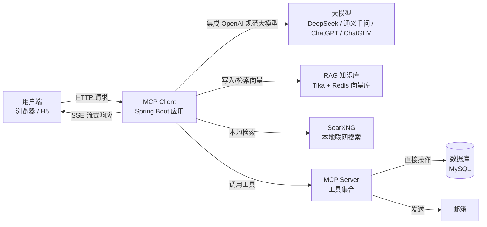

## 纲要

- **课程定位**：面向 Java 技术栈开发者，用 SpringAI 1.0.0 GA 把手把手带你打通「AI 技术闭环」——不是只调通一个 `ChatClient.call()`，而是把 RAG 知识库、实时联网搜索、MCP 工具调用三大场景真正揉进一个可运行项目
- **六大核心技术**：SpringAI 框架、RAG（文档处理 + Redis 向量库）、SearXNG 本地联网搜索、MCP 服务与工具开发、SSE 服务端推送、对话记忆（让大模型拥有「大脑般的记忆」）
- **项目形态**：纯后端开发，无需前端经验；用户端经 SSE 接收大模型流式响应，大模型集成 OpenAI 规范模型，调用自研 MCP 工具直接操作数据库（聊天即可增删改查）
- **十三章路线图**：从环境搭建一路到云服务器部署上线，循序渐进、逐模块迭代落地
- **前置基础**：Java 基础 + 了解 Spring/MyBatis/SpringBoot、MySQL、基础命令行；构建基于 OpenJDK 21 + Maven
- **学完收获**：竞争力提升、技术答疑、职业晋升、大厂敲门砖、架构式思维
- **零基础友好**：所有后端代码手把手编写，中间件安装与服务器部署逐步演示，跟着节奏走即可掌握

## 一、为什么需要这门课：AI 落地的真实痛点

2025 年 AI 技术大爆发，深刻影响了各行各业，开发者和企业都在拥抱 AI。但很多人面临一个关键矛盾：**知道 AI 强大，却不知道如何应用落地**。

这门《SpringAI 超能引擎实战》课程聚焦 Java 技术栈，把手教会你如何用 SpringAI 实现 AI 的技术闭环与高效集成。它不堆砌概念，而是围绕三个核心场景构建能力：

1. **RAG 知识库**——把私有文档（员工手册、产品文档）向量化入库，让大模型「知道自己家的事」，不再瞎编（幻觉）。
2. **实时联网搜索**——大模型训练数据有截止日期，问「今天的热点 / 某个具体人物」答不上来，本地部署的 SearXNG 弥补这一短板，且保隐私。
3. **MCP 全融合**——让大模型从「只会说」变成「能做事」：直接操作数据库、发邮件、查时间。MCP 又能和数据库对接，实现「聊天就能操作数据库」。

> **设计初衷**：引领开发者拥抱 AI，并把它和编程深度整合。课程不仅精讲技术细节，更着重培养全局架构思维——帮你突破单一功能开发的局限，学会从「业务价值」与「技术实现」双重视角出发，构建协同增效的 AI 解决方案。

## 二、你将掌握的六大核心技术

课程把庞大的 AI 工程能力收敛成六项可落地的核心技术，每一项都会亲手实现：

| # | 技术 | 解决什么问题 | 课程中的落点 |
|---|---|---|---|
| 1 | **SpringAI** | Java 领域的 AI 应用框架，统一封装大模型调用 | 全课程核心，ChatClient / Advisor / ToolCallback |
| 2 | **RAG 知识库** | 大模型知识有截止日期、会幻觉 | 文档处理（Tika）+ Redis 向量库 + 本地嵌入模型 |
| 3 | **SearXNG 联网搜索** | 实时信息缺失 | 本地部署的开源元搜索引擎，保隐私 |
| 4 | **MCP 服务与工具** | 大模型不会「做」动作 | 自研 MCP Server：数据库 CRUD、发邮件、查时间 |
| 5 | **SSE 服务端推送** | 大模型生成是流式的，需逐字返回 | SseEmitter 实现用户端 ↔ 大模型流式响应 |
| 6 | **对话记忆** | 多轮对话没有上下文 | MessageChatMemoryAdvisor 让模型拥有记忆 |

> **一个例子串起全部**：你和大模型说「请把查询到的数据发送到我的邮箱」，模型先从数据库查数据（MCP 工具）→ 归纳内容生成邮件主题 → 调 `sendMailMessage` 工具发出（MCP 工具）→ 全程带着多轮对话的上下文（对话记忆）。一次交互，六项技术同时在线。

## 三、项目全景：从零到一的架构流程图

课程的项目不是玩具 Demo，而是一个「万金油」式的 AI 中台：既能作为微服务组件嵌入现有系统，也能扩展为支撑多场景的 AI 能力中台，复用价值极高。



整个链路的关键相对关系是：**大模型对用户端是「服务端」，对 MCP Server 又是「客户端」**。理解了这种相对性，后面所有的「Client / Server」命名都不会绕晕。

## 四、开发流程：五步走通 AI 闭环

课程按真实工程顺序推进，每一步都清晰可循，即使零基础也能稳步提升：

1. **搭建项目架构**——用 Maven 构建父子分层工程（mcp-client / mcp-server 两个模块），JDK 21 + Spring Boot 3.5.0。
2. **集成 OpenAI 规范大模型**——让 Java 代码无缝调用 DeepSeek / 通义千问等，换模型只改配置不改代码。
3. **开发 SSE 服务端 + 前端联调**——实现流式信息交互，体验「字一个个蹦出来」。
4. **开发知识库（RAG）**——弥补大模型知识储备，文档切块、向量化、语义检索。
5. **实现联网搜索 + 开发 MCP 服务与工具**——让大模型自主调度各类工具（查库、发邮件、查时间），实现强大功能模块。

> **纯后端模式**：项目采用纯后端开发，你无需担心前端问题，即使没有前端经验也丝毫不影响学习。课程从零到一全程手把手教学，深入编程、逐步完成编码落地，特别注重动手实操能力培养。

## 五、十三章路线图：你要爬的每一座山

下面这张表是整个课程的知识地图，建议截图保存，每学完一章回来划掉一项：

| 章 | 主题 | 核心交付 |
|---|---|---|
| 前述 | 课程导学 | 建立 AI 落地全局观（本章） |
| 前述 | 初识 SpringAI：项目功能与架构 | 跑通五大演示 + 架构全景 + 核心编排类 |
| 前述 | 配置高效开发环境 | JDK21 / Maven / IDEA / 通义灵码 / Docker 安装 |
| 前述 | SpringBoot3 快速入门与配置管理 | 父子工程搭建 + yml 配置 + 多环境解耦 |
| 前述 | 大模型集成与高阶功能开发 | ChatClient 调用、提示词、拦截器、结构化输出 |
| 前述 | SSE 实时通信与前端联调 | SseEmitter 流式通道 + 前后端联调 |
| 前述 | 构建高效的 RAG 知识库 | Tika 解析 + 自定义切分 + Redis 向量库 |
| 前述 | SearXNG 联网搜索集成 | 本地 SearXNG + OkHttp 实时检索 |
| 前述 | 深入理解与实践 MCP 服务 | stdio/SSE 类型 MCP + 自研工具（邮件/时间/查库） |
| 前述 | 基于 MCP 的大模型与数据库交互 | 自然语言转 SQL / QueryWrapper |
| 前述 | 云服务器部署与项目上线 | 安全组 / SSH / Nginx 反向代理 / 生产参数 |
| 前述 | 多平台集成 MCP 服务与智能体 | 工作流编排 + 私有化部署 |
| 前述 | 课程总结 | 技术全景复盘 + 架构思维升华 |

## 六、前置基础与开发环境

课程对基础有要求，但门槛友好——不会的地方老师都会带你深入浅出。

**必须具备（或愿意学）：**
- Java 基础，并对 Spring / MyBatis / SpringBoot 有一定了解（不熟也没关系，会带着学）
- 了解 MySQL 等数据库基本概念
- 懂一点基础命令脚本（部署时会用到命令行，手把手演示）

**开发环境（贴合最新趋势）：**
- **OpenJDK 21**（LTS 稳定版，本地绝大多数场景 21 绝对够用；最新已到 24，但 21 足矣）
- **Maven**（课程全程用 Maven 构建；若用 Gradle 需 7.x / 8.x 以上）
- **IntelliJ IDEA**（推荐，配合通义灵码做自动补全）
- **Docker**（后面 Redis、MySQL、SearXNG、Nginx 都靠它拉起）
- **通义灵码（Tongyi Lingma）**——课程里大量使用它的代码自动补全能力，显著提升编码效率

> **讲师说明**：课程会提供「完整的项目源码」，可以通过源码快速了解架构设计细节，加速学习。但强烈建议先跟着手敲一遍，源码作为对照而非替代。

## 七、FAQ：开始之前你可能想问

**Q1：这套课程难吗？**
一点都不难。所有后端代码老师都会手把手带你编写，中间件的安装、服务器的部署也一步步详细演示。跟着节奏走就能轻松掌握。业务讲解采用循序渐进方式，模块逐一拆解，讲完一个再实现下一个，功能逐步迭代，深入浅出。

**Q2：我是零基础能学吗？**
能。课程从零到一全程手把手，即使零基础开发者也能自信入门、稳步提升。前提是愿意补一点 Java / SpringBoot 基础。

**Q3：没有前端经验怎么办？**
完全不影响。项目是纯后端开发模式，前端交互只作为演示，你不需要写前端代码。

**Q4：需要自己准备服务器吗？**
部署章节会用到云服务器，但那是前述的内容。前面所有章节都在本地完成，先用 Docker 把中间件跑起来即可。

**Q5：为什么选 SpringAI 而不是 LangChain4j / Python？**
课程定位 Java 技术栈。SpringAI 1.0.0 GA 是 Spring 官方生态的 AI 框架，和 Spring Boot / Spring Cloud 无缝集成，企业落地阻力最小。LangChain4j 是另一条路线（后续有专门课程）。

## 八、学完你能获得什么

课程以「Java 架构师体系课」的标准制作，目标是让你从「会写功能」升级到「懂架构、能落地」：

1. **竞争力提升**——快速掌握企业所需技能，轻松应对高难度挑战。
2. **技术答疑**——课程含技术答疑与知识服务，在答疑区 / 互动区 / 群里有交流。
3. **职业晋升**——构建完技术体系，可为竞聘技术 Leader、技术经理等更高阶职位打下基础。
4. **大厂敲门砖**——打造核心知识体系，帮助进入大厂并快速融入团队、接触前沿技术。
5. **架构式思路**——拓宽技术视野与思维深度，培养解决复杂业务的能力，为成为架构师铺平道路。

> **机会总是留给有准备的人。** 提前掌握体系化技术能力，能让职业道路走得更宽更顺。

## 九、自我检查清单（学完本章应能做到）

- [ ] 能说清 RAG、联网搜索、MCP 分别解决大模型的哪一类短板
- [ ] 能画出「用户端 → MCP Client → 大模型 / RAG / SearXNG / MCP Server」的相对关系
- [ ] 能列出课程六大核心技术及其落点
- [ ] 已在本机装好 JDK 21 + Maven + IDEA + 通义灵码 + Docker
- [ ] 看过十三章路线图，知道前述才会碰云服务器
- [ ] 理解「纯后端模式」意味着无需前端经验

## 十、面试高频问答（导学篇）

**1. 为什么大模型需要 RAG？**
大模型的训练数据有截止日期，且对企业私有文档一无所知，硬问就会幻觉。RAG 把私有文档向量化入库，检索相关片段喂给模型，让回答基于真实资料、不胡编。

**2. MCP 和普通的「函数调用 / Function Calling」有什么区别？**
MCP（Model Context Protocol）是一套标准化的协议，把「工具」抽象成可跨进程、跨语言、跨厂商复用的服务；普通 Function Calling 往往是模型厂商私有、紧耦合在调用代码里。MCP 让工具能被任意兼容客户端发现、调用，更接近「即插即用」。

**3. SSE 和 WebSocket 怎么选？**
SSE 是单向流（服务端 → 客户端），基于 HTTP，天然适配「大模型逐字生成」场景，更轻。WebSocket 是双向全双工，适合需要客户端频繁回传的场景。本项目只需服务端推 token，故用 SSE。

**4. 为什么联网搜索要本地部署 SearXNG 而不是调商业搜索 API？**
对政府 / 医院 / 学校等敏感场景，把用户 query 发给商业搜索 API 有隐私合规风险。SearXNG 是开源元搜索引擎，可本地部署，汇总多个搜索源结果且数据不出内网。

**5. 为什么说大模型「既是服务端又是客户端」？**
对用户端（H5/APP）它是响应用户请求的服务端；对 MCP Server 它又是发起工具调用的客户端。角色随通信对象切换。

**6. 课程为什么强调 JDK 21？**
Spring Boot 3.x 最低要求 JDK 17，而 21 是当前最稳的 LTS；课程用到的虚拟线程、Record 模式等特性在 21 上最完整。课程全程基于 21 开发。

**7. 对话记忆（Chat Memory）解决什么问题？**
没有记忆，大模型每轮都是「失忆」的，无法理解「把刚才的回答发到邮箱」里的「刚才」。记忆让多轮对话具备上下文连贯性。

**8. SpringAI 1.0.0 GA 和早期里程碑版（0.8.x）能混用吗？**
不能。里程碑版与 GA 版在依赖坐标、包名、API 上差异巨大，复制老博客代码极易踩坑。课程一律以 GA 为准。

## 十一、本章实操与下一步

**动手任务：**
1. 安装并验证环境：`java -version` 看到 21；`mvn -v` 正常；Docker 桌面端能启动。
2. 在 IDEA 装好通义灵码插件，新建一个空 Maven 项目，确认自动补全可用。
3. 用一张 A4 纸手绘「项目架构流程图」（参考本文第三节），这是后面所有章节的地图。

## 十一、环境安装速查命令（照抄即可）

下面这组命令覆盖「前置基础」一节的全部环境，建议逐个跑通再开始写代码。

**1. JDK 21（macOS / 通用）**
```bash
# macOS 用 Homebrew
brew install openjdk@21
# 验证
java -version          # 必须看到 21
# 若本机有多个 JDK，用以下方式临时指定
export JAVA_HOME=$(/usr/libexec/java_home -v 21)
```

**2. Maven**
```bash
brew install maven
mvn -v                 # 必须 >= 3.6.3
```

**3. Docker（Redis / MySQL / SearXNG / Nginx 全靠它）**
```bash
# macOS 装 Docker Desktop，启动后在终端验证
docker -v
docker run hello-world # 能拉起说明 daemon 正常
```

**4. IDEA + 通义灵码插件**
- 装 IntelliJ IDEA（Community 或 Ultimate 均可）；
- `Settings → Plugins` 搜「通义灵码 / Tongyi Lingma」安装并登录；
- `File → Project Structure → SDKs` 指向 JDK 21。

> **国内网络提示**：Maven 依赖下载慢，配阿里云镜像；Docker 镜像拉不动可换国内加速器（如 `registry.cn-hangzhou.aliyuncs.com` 等镜像代理）。

## 十二、学习节奏建议（零基础友好路线）

课程体量不小（13 章），一口气啃完容易前学后忘。建议按下面节奏走：

| 阶段 | 覆盖章节 | 目标 | 建议周期 |
|---|---|---|---|
| 筑基 | 第 1–4 章 | 环境 + 父子工程 + 配置管理跑顺 | 1–2 天 |
| 接入 | 第 5–6 章 | 大模型调通 + SSE 流式 | 2–3 天 |
| 知识 | 第 7–8 章 | RAG 知识库 + 联网搜索 | 3–4 天 |
| 工具 | 第 9–10 章 | MCP 工具 + 自然语言查库 | 3–4 天 |
| 上线 | 第 11–12 章 | 云服务器部署 + 多平台 MCP | 2–3 天 |

> **核心心法**：每章先跑通 Demo（见效果），再回头读代码（拆原理），最后自己从零敲一遍（内化）。只「看」不「敲」，学完必忘。

## 十三、常见学习误区

1. **上来就追最新版本**：JDK 24、Spring Boot 快照版看着香，但生态工具跟不上，踩坑无人可问。稳选 GA + JDK 21。
2. **只复制源码不思考**：课程给了完整源码，但「抄一遍」≠「会了」。每复制一个类，先问自己「这行在干什么」。
3. **跳过环境直接写业务**：环境（JDK / Maven / Docker）没验证就开干，后面诡异报错大半源于此。前述别跳。
4. **把 MCP 当普通函数调用**：MCP 是协议，强调「可发现、可跨进程、跨语言复用」，理解这点才能用好前述以后的内容。
5. **忽视运维与上线**：很多人学到前述就停，但「能跑在本地」和「能稳定上线」是两码事。第 11–12 章的部署、安全组、Nginx 才是生产真功夫。
6. **密码写死在代码里**：课程演示会用占位符 / `.env`，你实战时务必沿用，别把真实 Key 提交到任何仓库。

## 十五、这门课适合谁 / 不适合谁

选课前先对号入座，避免「买错课、学不下去」：

**适合：**
- Java / Spring 后端，想补齐 AI 工程能力的开发者；
- 被「大模型怎么落地到业务系统」困扰、缺完整链路实战的技术人；
- 目标做 AI 应用 / 智能体（Agent）方向的 Java 工程师；
- 想用 SpringAI 1.0 GA 对齐企业主流技术栈的团队。

**不太适合（先看替代）：**
- 纯前端 / 非 Java 技术栈，且不想碰后端——本课程是纯后端，前端只作演示；
- 只想「速成一个聊天机器人」——本课程重工程全链路，节奏比玩具 Demo 慢；
- 完全零编程基础——需要至少 Java 入门，否则前述起就会吃力；
- 想深入算法 / 训练大模型——本课程是「应用 / 集成」层，不碰模型训练。

> 如果你属于「不太适合」但方向对，建议先补 Java + SpringBoot 基础，再回头学本课，体验会好很多。

## 十六、如何把本课程变成简历项目

光学完不够，要让它成为面试里能讲的项目。建议做三件事：

1. **换皮不换骨**：把课程 Demo 的「商品库 / 邮件」换成你熟悉的领域（如内部 FAQ、工单助手、代码评审助手），技术栈原样复用。面试官看重「你独立做过」，而非「你跟着敲过」。
2. **补齐课程没讲的工程面**：加单元测试、加链路追踪（Micrometer + Prometheus）、加限流（网关 / 注解）、加配置中心。这些往往是面试官追问点，也是课程留给你的进阶空间。
3. **准备一页「架构讲解稿」**：用本文第三节的架构图，能口述「一次带工具调用的对话怎么流转、SSE 怎么推、MCP 怎么查库」。能讲清数据流，比背 API 强十倍。

> 简历写法示例：「基于 SpringAI 1.0 + Spring Boot 3.5 构建 AI 中台，集成 RAG（Tika + Redis 向量库）、本地 SearXNG 联网搜索、MCP 工具链（自然语言查库 / 发邮件），SSE 流式响应，Docker 容器化部署。」——这一句覆盖了课程六大核心技术。

## 十四、给自己的一句提醒

AI 落地不是「调通一个接口」就结束，而是把**模型能力、私有知识、实时信息、工具动作**编排成一个稳定、可观测、可上线的系统。这门课的价值，正在于它带你走完了这条完整链路，而不是停在「Hello World」。
