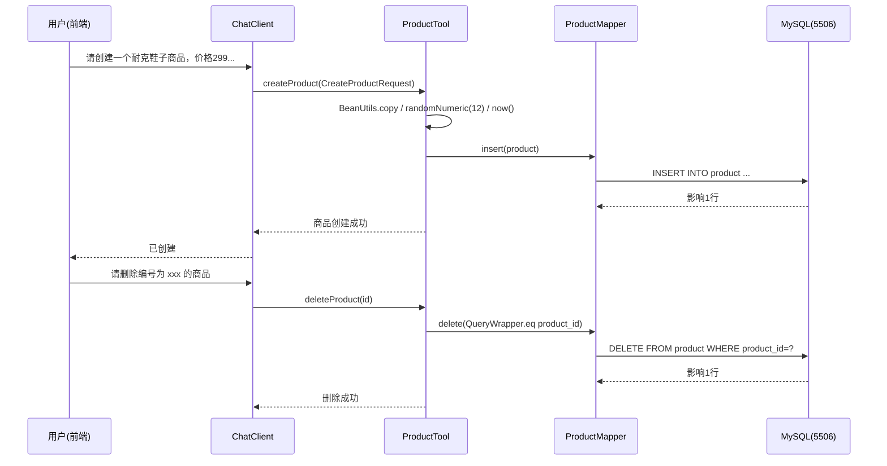

## 纲要

- **集成 MyBatis-Plus**：引 `mybatis-plus-boot-starter` + 数据库驱动；部分版本需**排除内置 `mybatis-spring` 再引新版本**否则依赖冲突报红；yml 配 `spring.datasource`（端口 **5506**、root/root、UTF-8、SSL=false、autoReconnect、HikariCP）
- **MyBatis-Plus 专属配置**：日志配置类、主键策略 `IDTYPE=AUTO`（与表字段 `bigint` 对应）、更新策略（非空才更新）、`classpath:mappers` 映射文件、`@MapperScan` 扫描 Mapper 包
- **实体与映射**：`Product` 实体 + `ProductMapper extends BaseMapper<Product>`（免写 SQL）；`BaseResultMap` 的 `property` 必须与实体属性**大小写完全一致**
- **创建商品 MCP 工具**：`CreateProductRequest`（name/brand/intro/price/stock/status 六字段 + `@ToolParam(description)`）→ `BeanUtils.copyProperties` → `RandomStringUtils.randomNumeric(12)` 生成 ID → `LocalDateTime.now()` 设时间 → `productMapper.insert`
- **状态语义映射**：上架=1 / 下架=0 / 预售=2，description 写清让模型自动映射
- **删除商品 MCP 工具**：`@Transactional` 事务 + **`QueryWrapper` 按 `product_id` 删除（坑：不能直接用 `deleteById`，它按主键 `id` 删，而表主键叫 `product_id`）**

> 本章代码基于课程标准工程（`com.itzixi` 包）按课程口径重构，外部代码卷暂未挂载，重挂后可切换为逐文件提取的真实代码。

## 一、集成 MyBatis-Plus

### 1.1 坐标与依赖冲突坑

```xml
<!-- mcp-server/pom.xml 新增 -->
<dependency>
    <groupId>com.baomidou</groupId>
    <artifactId>mybatis-plus-boot-starter</artifactId>
    <version>3.5.x</version>
    <!-- ⚠️ 部分版本内置 mybatis-spring 会冲突报红，需排除后另引新版本 -->
    <exclusions>
        <exclusion>
            <groupId>org.mybatis</groupId>
            <artifactId>mybatis-spring</artifactId>
        </exclusion>
    </exclusions>
</dependency>
<!-- 排除后单独引入一个干净的 mybatis-spring 版本 -->
<dependency>
    <groupId>org.mybatis</groupId>
    <artifactId>mybatis-spring</artifactId>
    <version>3.0.x</version>
</dependency>
<dependency>
    <groupId>com.mysql</groupId>
    <artifactId>mysql-connector-j</artifactId>
    <scope>runtime</scope>
</dependency>
```

> 老师原话：如果是一个「较好的版本」，直接写版本号即可，下面这个排除坐标不需要；老版本不排会报红，必须先排除再引新 `mybatis-spring`。

### 1.2 数据源与 MyBatis-Plus 配置 yml

```yaml
spring:
  datasource:
    driver-class-name: com.mysql.cj.jdbc.Driver
    url: jdbc:mysql://127.0.0.1:5506/springai_mcp?useUnicode=true&characterEncoding=UTF-8&autoReconnect=true&useSSL=false&allowPublicKeyRetrieval=true
    username: root
    password: root
    # SpringBoot3 默认连接池 HikariCP，“光”=快
    hikari:
      pool-name: HikariPool-SpringAI
  # ↓ MyBatis-Plus 专属配置放最下方
mybatis-plus:
  configuration:
    log-impl: org.apache.ibatis.logging.stdout.StdOutImpl   # 打印 SQL，便于联调
  global-config:
    db-config:
      id-type: auto            # 主键策略：AUTO 保证唯一（也可用 UUID）
      update-strategy: not_null # 更新时 null 字段不进 SQL
  mapper-locations: classpath:mappers/*.xml                  # 映射文件位置
```

> 关键点：课程本地装了多个数据库，**端口不是 3306 而是 5506**，务必核对；`url` 里的库名 `springai_mcp` 要和实际 Navicat 里创建的库名一致（右键编辑连接→拷贝库名→贴回代码）。

### 1.3 实体、Mapper、映射文件、启动类

```java
// com.itzixi.pojo.Product
@Data
public class Product {
    private Long productId;     // 表中字段 product_id，主键
    private String name;        // 商品名称
    private String brand;       // 品牌
    private String intro;       // 简介（可为空）
    private Integer price;      // 价格（课程用 int，生产可改 BigDecimal 分）
    private Integer stock;      // 库存
    private Integer status;     // 状态：1上架 0下架 2预售
    private LocalDateTime createTime;
    private LocalDateTime updateTime;
}
```

```java
// com.itzixi.mapper.ProductMapper
public interface ProductMapper extends BaseMapper<Product> {
    // MyBatis-Plus 已内置 insert/delete/selectList/update，无需写 SQL
}
```

```xml
<!-- classpath:mappers/ProductMapper.xml -->
<mapper namespace="com.itzixi.mapper.ProductMapper">
    <!-- BaseResultMap：property 必须与实体属性大小写完全一致 -->
    <resultMap id="BaseResultMap" type="com.itzixi.pojo.Product">
        <id column="product_id" property="productId"/>
        <result column="name" property="name"/>
        <result column="brand" property="brand"/>
        <result column="intro" property="intro"/>
        <result column="price" property="price"/>
        <result column="stock" property="stock"/>
        <result column="status" property="status"/>
        <result column="create_time" property="createTime"/>
        <result column="update_time" property="updateTime"/>
    </resultMap>
</mapper>
```

```java
// 启动类加 @MapperScan
@SpringBootApplication
@MapperScan("com.itzixi.mapper")   // 包名必须和实际 Mapper 包一致，否则扫不到
public class McpServerApplication { ... }
```

> **大小写一致是铁律**：`column` 是数据库字段，`property` 是实体属性；`productId` 不能写成 `productid`，否则映射失败、字段为空。

## 二、创建商品 MCP 工具

### 2.1 请求实体（只暴露 6 个用户输入字段）

```java
// com.itzixi.mcp.tool.ProductTool.CreateProductRequest
@Data
public static class CreateProductRequest {
    @ToolParam(description = "商品名称")            private String name;
    @ToolParam(description = "商品品牌名称")         private String brand;
    @ToolParam(description = "商品详情/简介(可为空)") private String intro;
    @ToolParam(description = "商品价格(整数)")        private Integer price;
    @ToolParam(description = "商品库存数量(整数)")     private Integer stock;
    @ToolParam(description = "商品状态：上架(1)/下架(0)/预售(2)") private Integer status;
    // ID、createTime 由程序自动生成，不暴露给用户
}
```

### 2.2 创建工具实现

```java
@Tool(description = "创建商品信息（新增商品记录到数据库）")
public String createProduct(CreateProductRequest req) {
    log.info("调用 MCP 工具，请求={}", req);
    Product product = new Product();
    BeanUtils.copyProperties(req, product);   // 左=源(req) 右=目标(product)
    // 程序生成 ID 与 时间
    product.setProductId(Long.parseLong(RandomStringUtils.randomNumeric(12))); // 阿帕奇 commons-lang3
    product.setCreateTime(LocalDateTime.now());
    product.setUpdateTime(LocalDateTime.now());
    productMapper.insert(product);            // MyBatis-Plus 内置
    return String.format("商品信息创建成功：%s", product);
}
```

> `BeanUtils.copyProperties(req,product)` 顺序：**第一个是源对象，第二个是目标对象**。老师特意强调左右别写反。

### 2.3 状态语义自动映射

工具 description 写清「上架(1)/下架(0)/预售(2)」，用户说「预售」模型自动映射成 `2`；说「下架/上架」映射 `0/1`。甚至「请创建一个耐克鞋子的商品」——模型能识别「耐克」是品牌、「鞋子」是名称。

> **端口 8080 坑**：老师粘贴 yml 时把 `spring.ai.mcp.server` 节点错贴到 `spring` 之外，导致 server 启动端口**回退到默认 8080**，client 连不上（日志显示 8080）。修复：该节点必须放在 `spring` 下方，重启后恢复 9060。

### 2.4 注册工具

`MethodToolCallbackProvider` 的 `toolObjects` 里把 `productTool` 加进去（和 DateTool/EmailTool 并列），重启 server + client 生效。

## 三、删除商品 MCP 工具

### 3.1 第一个坑：没加事务，对话上下文失效

老师首次删除时发现 `SqlSession is not active`——因为涉及写操作，需加事务：

```java
@Transactional   // ⚠️ 写操作务必加，否则会话失效报错
@Tool(description = "根据商品ID删除商品记录")
public String deleteProduct(String productId) {
    log.info("调用 MCP 工具，参数 productId={}", productId);
    // 见 3.2
}
```

### 3.2 第二个坑：deleteById 按「主键 id」删，而表主键叫 product_id

```java
@Transactional
@Tool(description = "根据商品ID删除商品记录")
public String deleteProduct(String productId) {
    // ❌ 错误写法：deleteById 按主键 id 删，但表主键是 product_id，删不掉
    // productMapper.deleteById(productId);

    // ✅ 正确写法：QueryWrapper 按真实主键字段 product_id 删
    QueryWrapper<Product> wrapper = new QueryWrapper<>();
    wrapper.eq("product_id", productId);   // 真实主键字段
    productMapper.delete(wrapper);
    return "商品信息删除成功";
}
```

> 删除后回数据库刷新：SQL 打印 `delete from product where product_id = ?`，影响 1 条即成功。这是本章**最经典的填坑**——`deleteById` 的「ID」是 ORM 层面的主键 `id`，不是业务字段名。

## 四、商品增删 MCP 全链路时序图



## 五、排错 SOP

1. **MyBatis-Plus 报红/冲突**：老版本 `mybatis-spring` 冲突 → 排除后单独引新版本；或换「较好版本」直接写版本号。
2. **连不上数据库**：核对 yml 端口（课程 5506 非 3306）、库名、root/root；`allowPublicKeyRetrieval=true` 按需加。
3. **字段映射为空**：`BaseResultMap` 的 `property` 与实体属性大小写是否一致。
4. **server 端口变 8080**：`spring.ai.mcp.server` 节点必须置于 `spring` 下方，错贴会回退默认端口。
5. **删除失败/删不掉**：是否用 `deleteById`（按主键 id）→ 应改 `QueryWrapper.eq("product_id",...)`。
6. **删除报 SqlSession 失效**：写操作漏 `@Transactional`，补上。

## 六、FAQ

**Q1：为什么有的版本要排除 mybatis-spring？**
老版本 `mybatis-plus-boot-starter` 内置的 `mybatis-spring` 与 SpringBoot3 不兼容会报红；排除后引一个干净的 3.0.x 版本即可。新版本已修复，直接写版本号不用排除。

**Q2：课程数据库端口为什么是 5506？**
老师本机装了多个 MySQL，刻意改用 5506 避免冲突；你自己部署按实际端口改 yml。

**Q3：BeanUtils.copyProperties 谁是谁？**
第一个参数是**源**，第二个是**目标**：`copyProperties(req,product)` 把请求字段拷贝进实体。

**Q4：删除为什么不用 deleteById？**
`deleteById` 按 ORM 主键 `id` 删，而本课表主键字段名是 `product_id`（并非纯 `id`），用它会删错/删不掉；应按 `QueryWrapper.eq("product_id",id)`。

**Q5：状态 1/0/2 怎么来的？**
老师约定：上架=1、下架=0、预售=2；写在 `@ToolParam(description)` 里，模型自动把自然语言「预售」映射成 2。

## 七、面试高频问答

**1. MyBatis-Plus 如何零 SQL 增删改查？**
实体 + `XxxMapper extends BaseMapper<T>`，内置 `insert/delete/selectList/update`；复杂条件用 `QueryWrapper`。

**2. 主键策略有哪些？**
`AUTO`（自增）、`ASSIGN_ID`（雪花）、`UUID` 等；课程用 `AUTO`，保证唯一即可。

**3. 为什么写操作要加 @Transactional？**
保证事务边界与 SqlSession 有效性；本例漏加会报会话失效，删除失败。

**4. deleteById 与 QueryWrapper 删除区别？**
`deleteById` 按实体主键（默认字段名 `id`）删；自定义主键名或非主键条件必须用 `QueryWrapper.eq(...)`。

**5. 大模型如何自动填充商品状态？**
靠 `@ToolParam(description)` 的语义描述（上架/下架/预售 → 1/0/2），模型按用户话映射，无需正则。

**6. classpath:mappers 与 @MapperScan 作用？**
`mapper-locations` 指定 XML 位置；`@MapperScan` 把 Mapper 接口扫进 Spring 容器，包名务必一致。

## 八、ops 提示（安全与网络）

> **数据库口令**：root/root 仅本地教学；生产用强口令 + 配置中心/环境变量，别硬编码仓库。
>
> **端口规划**：多实例时 3306/5506 等需文档登记，避免冲突；server 的 9060、client 通信端口也要在 yml 显式固定，防回退默认 8080。
>
> **SQL 可见性**：`log-impl=StdOutImpl` 会打印完整 SQL（含参数），生产关闭或换日志文件，避免泄露表结构/数据。
>
> **事务边界**：`@Transactional` 默认只对 RuntimeException 回滚，自定义异常需 `rollbackFor`；批量删除/更新注意锁与行锁竞争。
>
> **主键设计**：业务主键 `product_id` 与 ORM 主键 `id` 不一致是常见坑；建表时统一命名可省去 QueryWrapper 绕行。
