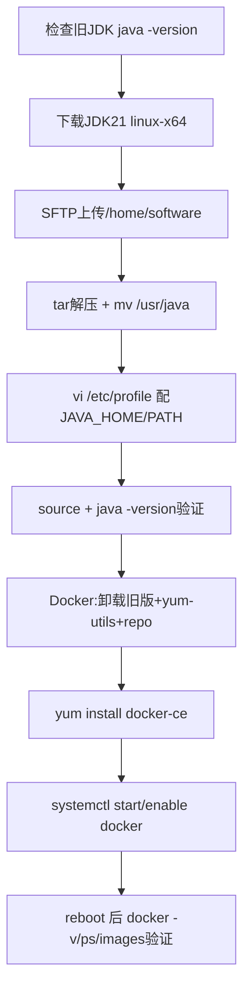

## 纲要

- **OpenJDK21 安装**：官网下载 Linux x64 包 → Electerm SFTP 上传到 `/home/software` → `tar -zxvf` 解压 → 移动到 `/usr/java` → 配 `/etc/profile` 环境变量（`JAVA_HOME`/`PATH`）→ `source` 生效 → `java -version` 验证
- **先查旧 JDK**：云服务器可能非纯净自带老 JDK，先 `java -version` 检查并卸载
- **Docker 安装**：卸载旧版 → 装 `yum-utils` → 配 Docker repo 地址 → `yum install docker-ce` → `systemctl start docker` → `systemctl enable docker`（开机自启）→ 重启验证 `docker ps`/`docker images`
- **关键命令**：`docker -v`、`docker ps`（运行容器）、`docker images`（本地镜像）最常用

> 本章代码基于课程标准工程（`com.itzixi` 包）按课程口径重构，外部代码卷暂未挂载，重挂后可切换为逐文件提取的真实代码。

## 一、OpenJDK21 安装

### 1.1 下载与上传

1. 打开 OpenJDK 官网，选 **JDK 21 GA**，操作系统 Linux、架构 x64，下载 `.tar.gz`。
2. Electerm 连服务器，左侧本地找到下载的 JDK 包，右侧进入 `/home` → 右键新建 `software` 文件夹 → 把 JDK 包拖进 `/home/software` 上传（速度取决于带宽）。

### 1.2 解压与移动

```bash
cd /home/software
ls                          # 确认 jdk-21 压缩包已上传
mkdir -p /usr/java          # 统一放 JDK 的目录，切换版本只改名
tar -zxvf jdk-21_linux-x64_bin.tar.gz
mv jdk-21 /usr/java/        # 移动到 /usr/java
cd /usr/java && pwd         # 记下绝对路径，如 /usr/java/jdk-21
```

### 1.3 配置环境变量

```bash
vi /etc/profile             # 编辑全局环境变量
# 光标到最底，英文输入法下按 a 进入编辑，粘贴：
export JAVA_HOME=/usr/java/jdk-21     # ⚠️ 目录名按你实际改，别照抄
export PATH=$JAVA_HOME/bin:$PATH
export CLASSPATH=.:$JAVA_HOME/lib
# Esc → 英文冒号 → wq 保存退出
# 误操作不想保存：Esc → :q! 退出不保存

source /etc/profile         # 刷新生效
java -version               # 看到 openjdk version 21 即成功
```

> **vi 保命操作**：编辑中改错按 `Esc` → `:q!` 退出不保存；保存是 `:wq`。老师特别强调，避免把 profile 改坏。

## 二、Docker 安装

### 2.1 卸载旧版 + 装依赖 + 配仓库

```bash
# 1. 卸载老版本（纯净版会提示 nothing to do，正常）
yum remove docker docker-client docker-client-latest docker-common docker-latest docker-latest-logrotate docker-logrotate docker-engine

# 2. 装 yum-utils（用于配 repo）
yum install -y yum-utils

# 3. 配置 Docker 仓库地址（保存成功提示 saved）
yum-config-manager --add-repo https://download.docker.com/linux/centos/docker-ce.repo
```

### 2.2 安装引擎 + 启动 + 开机自启

```bash
# 4. 安装 docker 引擎（选 y 确认）
yum install -y docker-ce docker-ce-cli containerd.io

# 5. 启动 docker 服务
systemctl start docker

# 6. 验证版本
docker -v

# 7. 开机自启动（重启 linux 后 docker 随系统起）
systemctl enable docker
```

### 2.3 重启验证

```bash
reboot                      # 重启 linux
# 重连 SSH 后：
docker -v                   # 仍有版本 → 自启生效
docker ps                   # 运行中容器（当前空）
docker images               # 本地镜像（当前空）
```

> `docker ps` 与 `docker images` 是平时最常用两条命令。

## 三、环境搭建流程图



## 四、排错 SOP

1. **`java -version` 不是 21**：旧 JDK 没卸干净或 `JAVA_HOME` 路径写错；`source` 后重试。
2. **profile 改坏系统命令失效**：`vi /etc/profile` 用 `:q!` 放弃错误编辑；若已保存错，重进改回或注释错误行。
3. **Docker 安装报依赖错**：确认 `yum-utils` 已装、repo 地址 saved 成功。
4. **`docker -v` 重启后没了**：漏 `systemctl enable docker`；补上即可。
5. **SFTP 上传慢**：带宽档位低，临时调高带宽。

## 五、FAQ

**Q1：为什么先查旧 JDK？**
云镜像可能非纯净自带老 JDK，不卸会版本冲突；先 `java -version` 检查。

**Q2：JAVA_HOME 目录名要注意什么？**
以你实际解压出的目录名为准（如 `jdk-21`），别照抄；改错 `java` 命令找不到。

**Q3：vi 怎么保存/放弃？**
编辑态 `Esc` → `:wq` 保存退出；`:q!` 不保存强制退出。

**Q4：Docker 要不要开机自启？**
生产建议 `systemctl enable docker`，否则重启后容器不自动起。

**Q5：docker ps 和 images 区别？**
`ps` 看正在运行的容器，`images` 看本地已下载的镜像；都空属正常初始态。

## 六、面试高频问答

**1. Linux 装 JDK 步骤？**
下载 tar 包 → 上传 → `tar -zxvf` 解压 → 配 `/etc/profile` 的 `JAVA_HOME/PATH` → `source` 生效 → `java -version` 验证。

**2. /etc/profile 与 source 作用？**
`/etc/profile` 是全局 shell 环境配置；`source` 让修改在当前会话立即生效，免登出重进。

**3. Docker 安装核心命令？**
`yum-config-manager --add-repo` 配仓库 → `yum install docker-ce` → `systemctl start/enable docker`。

**4. 如何验证 Docker 安装成功？**
`docker -v` 看版本；`docker ps`/`docker images` 看容器与镜像；`enable` 后 `reboot` 仍能 `docker -v`。

**5. 容器与镜像关系？**
镜像（image）是只读模板，容器（container）是镜像的运行实例；`docker run` 由镜像启动容器。

**6. 为什么生产要开机自启 Docker？**
避免主机重启后容器不自动恢复，导致服务不可用；`enable` 保证随系统拉起。

## 七、ops 提示（安全与网络）

> **JDK 来源**：从官方 OpenJDK 或 Adoptium 下载，校验 checksum，避免第三方包植入后门。
>
> **Docker 仓库**：默认用 Docker 官方 repo；内网环境可搭私有 registry 加速并审计镜像。
>
> **root 操作风险**：全程 root 操作，误执行 `rm -rf` 灾难性；生产建议普通用户 + sudo，容器跑非 root。
>
> **镜像体积**：JDK21 镜像较大，上传/拉取注意带宽与流量费；可用 `slim`/jlink 裁剪。
>
> **yum 源**：CentOS 已 EOL，默认 yum 源失效；需切换 Vault 源或迁移系统，否则 `yum install` 失败。
