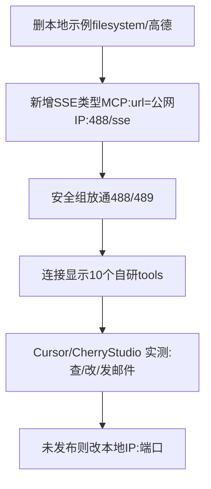

## 纲要

- **Cursor 集成**：去掉本地 filesystem/高德示例 → 新增 MCP server（类型 SSE，名字 `spring-ai-sse`，URL 改成 `http://公网IP:488/sse`）→ 云安全组放通 **488/489** → 重启连接看到 10 个自研 MCP tools → 实测「查询所有商品」「修改品牌/价格」「列表发邮箱」全通
- **CherryStudio 集成**：官网下载安装 → 设置里配大模型（DeepSeek/通义等）→ MCP 服务器页装 **uv(Python)/bun(TypeScript)** 运行时 → 快速创建选 **SSE 类型**，填 URL → 聊天时勾选自己的 MCP → 实测查询+发邮件三段链路
- **关键认知**：自研 `mcp-client` ≈ Cursor/CherryStudio 这类 MCP client——它们都内置大模型调用，只是把我们的 MCP 工具当后端能力接进来
- **未发布也能用**：若没走前述发布，把 Cursor/CherryStudio 地址改为**本地 IP:端口**即可

> 本章代码基于课程标准工程（`com.itzixi` 包）按课程口径重构，外部代码卷暂未挂载，重挂后可切换为逐文件提取的真实代码。

## 一、Cursor 集成自有 MCP

### 1.1 配置 MCP server

1. 打开 Cursor Settings → MCP，原本地配了 `filesystem` 和「高德地图」两个示例，**全部删除**。
2. 新增 MCP server：
 - 名称：`spring-ai-sse`
 - 类型：SSE
 - URL：`http://公网IP:488/sse`（把之前 https 改 http，换成云上 client 发布地址；没发布就用本地 IP:端口）

```
{
  "mcpServers": {
    "spring-ai-sse": {
      "url": "http://公网IP:488/sse"
    }
  }
}
```

> ⚠️ **安全组必须先放通 488/489**，否则 Cursor 连不上。

### 1.2 验证与实测

- 关闭再开启连接，出现 **10 个自研 MCP tools**（创建/删除/查询/修改商品、时间、邮件、枚举映射等）。
- 左侧侧边栏交互：
 - 「查询所有商品」→ 调用 MCP 工具名 → 点 run 出结果。
 - 「把编号 X 的商品品牌改成阿迪达斯、价格 399」→ 修改后自动再查一次列表，结果刷新。
 - 「查询所有商品，以列表形式发我邮箱」→ 先获邮箱地址 → 查商品 → 发邮件 → 邮箱收到列表。

## 二、CherryStudio 集成自有 MCP

### 2.1 基础配置

1. 官网下载 CherryStudio 安装（老师个人推荐，比 Cursor 顺手，内置多种助手）。
2. 设置 → 配置大模型（DeepSeek、通义千问、OpenAI 等，课前已配好）。
3. 聊天页选对应大模型即可交互（「你是谁」）。

### 2.2 配置 MCP + 运行时

- 设置 → MCP 服务器 → 默认有内置服务可删 → 点「添加服务器」。
- **装运行时**（关键）：点感叹号提示，安装 **uv（Python 运行时）** 与 **bun（TypeScript 运行时）**，本地才能跑 Python/TS 写的工具。
- 快速创建 → 类型选 **SSE**（三种：STDIO / SSE / 未来流行的 Streamable HTTP）→ 填 URL（从 Cursor 配置里复制 `http://公网IP:488/sse`）→ 保存。
- 进入工具页可见自研工具列表，说明已发现可用。

### 2.3 实测

聊天助手 → 点 MCP 服务器勾选自己的服务 → 输入「查询所有产品并以列表发我邮箱」→ 模型依次：查商品 → 获 email 地址 → 发邮件（三段 MCP 链路）→ 邮箱收到。

> **本质**：CherryStudio 作为 MCP client，内置大模型调用，与我们自研 `mcp-client` 同构——都是「大模型 + 接 MCP 工具」。

## 三、集成流程图



## 四、排错 SOP

1. **Cursor 连不上 MCP**：安全组未放通 488/489；URL 协议写错（应是 http 非 https）；server 未启动。
2. **CherryStudio 工具不显示**：uv/bun 运行时没装；URL 填错；保存后未刷新。
3. **连上但调用失败**：client 端口错（课程 489 是 client 接口，488 是 server 的 SSE）；prod 配置 IP 未改。
4. **邮件发不出**：邮件 MCP 工具在 server 端，确认 server 已起且邮件配置正确。
5. **本地调试用不了云地址**：没发布就改用本地 IP:端口（如 `http://localhost:488/sse`）。

## 五、FAQ

**Q1：Cursor 里 SSE 类型怎么填？**
类型选 SSE，URL 填 `http://公网IP:488/sse`；协议 http 不是 https；发布前用本地地址。

**Q2：CherryStudio 为什么要装 uv/bun？**
uv 跑 Python 工具、bun 跑 TS 工具，本地执行这些语言写的 MCP 工具必需运行时。

**Q3：三种 MCP 传输类型？**
STDIO（标准输入输出，本地进程）、SSE（服务端推送，本课用）、Streamable HTTP（未来更流行）。

**Q4：自研 client 和 Cursor 什么关系？**
同构：都是 MCP client + 内置大模型，区别是我们自研的接自己 server，Cursor/CherryStudio 接任意 MCP server。

**Q5：没发布能集成吗？**
能，把客户端地址从公网 IP 改成自己本地 IP:端口即可。

**Q6：安全组为什么放通 488/489？**
488 是 server 的 SSE 端口、489 是 client 接口端口；不放通外部客户端连不上。

## 六、面试高频问答

**1. MCP 客户端如何接入自建 server？**
在客户端（Cursor/CherryStudio/自研）配置 MCP server 条目，SSE 类型填 `http://host:port/sse`，客户端通过 SSE 发现并调用工具。

**2. SSE 与 STDIO 区别？**
STDIO 起本地子进程通信，适合本地工具；SSE 走 HTTP 服务端推送，适合远程/已部署的 server。

**3. 多工具自动编排体现？**
「查商品+发邮件」触发查商品→获邮箱→发邮件三段工具链，模型按语义自动串联。

**4. 安全组在 MCP 部署中的角色？**
云上 server 端口需在安全组放通，否则客户端不可达；但应最小开放、测完回收。

**5. 为什么客户端要装 Python/TS 运行时？**
部分 MCP 工具用 Python/TS 实现，客户端本地执行需 uv/bun 等运行时支撑。

**6. 自研 MCP client 价值？**
掌握 client+server 全栈，可替换商业客户端、定制大模型路由与工具权限，适合企业私有化。

## 七、ops 提示（安全与网络）

> **SSE 暴露在公网**：`http://公网IP:488/sse` 放通即任何人可探工具；生产应加鉴权（token/反向代理），别裸奔。
>
> **安全组最小开放**：仅调试时放通 488/489，长期运行考虑固定 IP 白名单而非 0.0.0.0。
>
> **客户端配置文件**：Cursor/CherryStudio 的 MCP 配置含 server 地址，别提交到公开仓库泄露内网拓扑。
>
> **运行时供应链**：uv/bun 安装的第三方 MCP 工具需审来源，避免恶意包；优先用自研/官方可信源。
>
> **协议选择**：远程 server 用 SSE/Streamable HTTP；本地工具用 STDIO，减少端口暴露。
