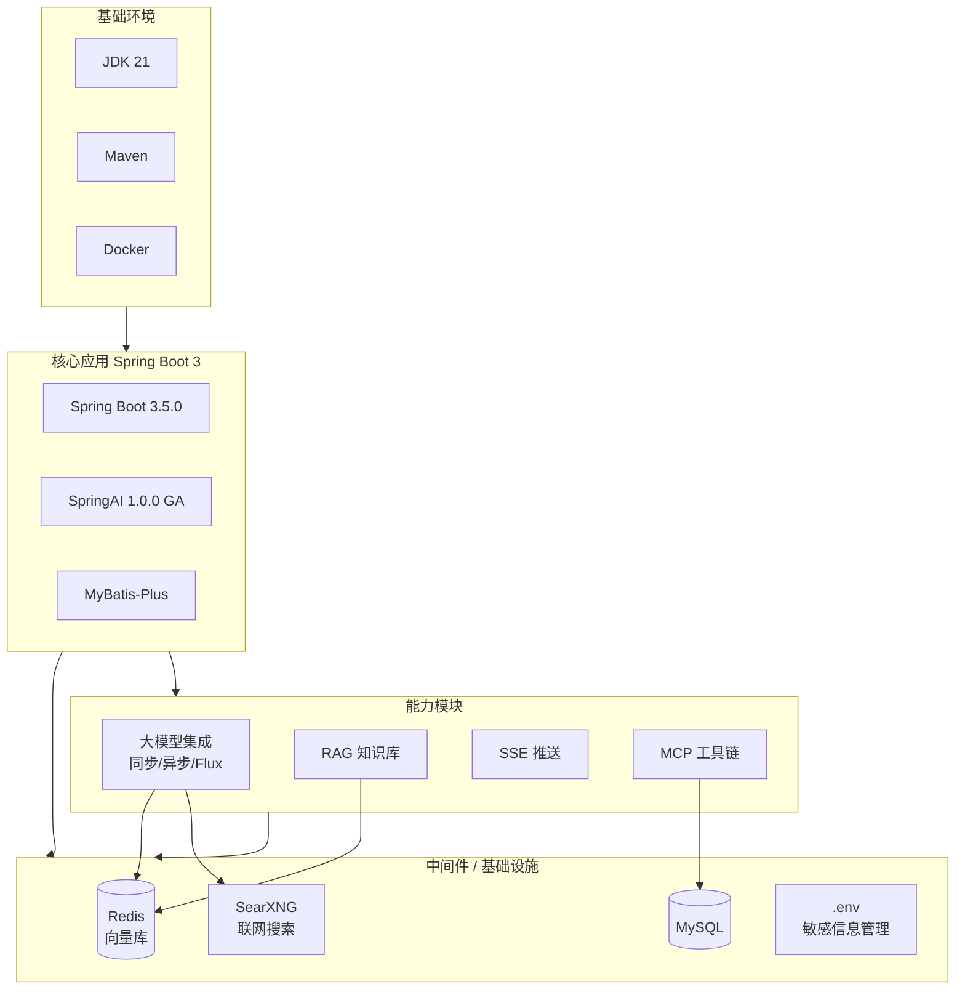

## 纲要

- **课程主线**：以 SpringAI 为核心，系统覆盖「环境搭建 → 云服务器部署上线」的全流程技术实践
- **技术底座**：Spring Boot 3 + JDK 21 + Docker + Redis + SearXNG + MCP 工具链
- **六大核心模块复盘**：大模型集成、RAG 知识库、SSE 推送、MCP 服务与工具、容器化部署、联网搜索
- **关键技术决策**：`.env` 管理敏感信息、AOP + StopWatch 统计模型耗时、Flux 响应式流式推送、嵌入式模型做向量化
- **能力目标**：培养「从需求分析到工程落地」的全流程能力，平衡技术深度与工程实践
- **未来拓展**：微服务架构、AIGC 应用开发等更广阔空间

## 一、课程技术全景回顾

整套课程围绕 SpringAI 全栈技术展开，以 SpringAI 框架为基础、以 Spring Boot 为核心，结合 JDK 21、Docker、Redis、SearXNG、MCP 工具链等技术构建。

我们用「项目驱动、项目实战」的方式，逐个掌握以下核心功能开发：

- **大模型集成**：ChatClient 同步 / 异步调用 DeepSeek，配合提示词、拦截器（Advisor）、结构化输出
- **RAG 知识库构建**：文档解析 → 文本切分 → 向量存储 → 语义检索，优化响应时间与质量
- **SSE 服务端推送**：实时流式把 token 推给前端
- **MCP 服务与工具开发**：邮件发送、Markdown 转 HTML、数据类型自动识别、私有化部署、工作流集成

> **课程不止讲 SpringAI 核心功能**：提示词、拦截器、结构化输出等都覆盖；还深入讲了 Spring Boot 容器化部署——MySQL、Redis、SearXNG 即使你以前没接触过 Docker，也能一一掌握。

## 二、技术栈与模块依赖图

## 三、核心模块逐一点评

### 1. 大模型调用：同步、异步与流式

课程详细演示了如何同步 / 异步调用 DeepSeek 模型，并通过 **AOP 切面 + StopWatch** 统计大模型调用的耗时。再结合 **Flux 流式输出** 实现响应式实时推送——这是 SSE 能「逐字返回」的底层支撑。

> **工程价值**：耗时统计不是炫技。上线后你要回答「这次问答为什么慢了 3 秒」，没有埋点就只能靠猜。AOP 统一织入，业务代码零侵入。

### 2. RAG 知识库：本地向量 + 嵌入式模型

用 **Redis 作为向量库**，配合**本地嵌入式模型**完成文本切分、向量存储与语义搜索，在保护数据隐私的同时优化了大模型的响应时间与质量。相比把文档丢给外部商业向量服务，本地化方案对政企场景更友好。

### 3. SearXNG 实时联网搜索

通过 SearXNG 实现实时联网搜索，并结合 **OkHttp** 构建实时搜索接口，再由大模型优化整体搜索结果。本地部署保证用户 query 不出内网。

### 4. MCP 工具链：本课程的核心亮点

从 MCP 的通信机制、服务部署逐步入手，引导构建自定义工具：

- 邮件发送（`EmailTool`）
- 时间显示（`DateTool`）
- 商品数据库 CRUD（`ProductTool`）
- Markdown 转 HTML、数据类型自动识别
- 通过 n8n（课程中称 Dify / 工作流）进行工作流编排，私有化部署集成 MCP 服务与工具

## 四、关键技术决策复盘

| 决策点 | 课程选择 | 理由 |
|---|---|---|
| 敏感信息管理 | `.env` 配置文件（dotenv-java） | 提升开发效率与安全性，密钥不进代码库 |
| 模型耗时统计 | AOP + StopWatch | 业务零侵入，统一埋点 |
| 流式响应 | Flux + SSE | 响应式、背压友好，适配大模型生成 |
| 向量库 | Redis | 复用现有中间件，降低部署复杂度 |
| 嵌入模型 | 本地 onnx 模型 | 数据不出本地，免 API 费用 |
| 联网搜索 | 本地 SearXNG | 隐私合规，汇总多源结果 |

## 五、从需求到工程落地的全流程能力

课程的最终目标不是「学会调 API」，而是培养**从需求分析到工程落地的全流程能力**，强调技术深度与工程实践平衡。

通过项目驱动教学，你应已能：

- 把「用户想要聊天查库」这类模糊需求，拆成 RAG / MCP / SSE 的模块组合
- 用 Spring Boot 3 + MyBatis-Plus 完成数据库操作
- 用 `.env` 管理核心敏感信息
- 用 Docker 拉起 MySQL / Redis / SearXNG
- 用 Nginx 反向代理 + 安全组把项目安全上线

## 六、云服务器上线要点回顾

课程覆盖了云服务器的配置与优化，确保「开发 → 上线」整体完整：

- **安全组设置**：只放行业务端口，缩小攻击面
- **SSH 登录**：密钥登录优于密码
- **Nginx 反向代理部署**：对外暴露统一域名 / 端口
- **生产环境参数**：JVM 堆内存、连接池、日志级别按环境区分

## 七、未来可拓展方向

AI 技术持续发展，课程能力在未来还可能延伸到：

- **微服务架构**：把 MCP Client / Server 拆成独立服务，接入 Spring Cloud 服务治理
- **AIGC 应用开发**：图像 / 音视频生成、智能体编排
- **多模态 RAG**：文档之外接入表格、图片、音视频的向量化检索

> 技术成长空间广阔，课程给你的是「方法论 + 工程手感」，而非一堆会过时的代码片段。

## 八、面试高频问答（总结篇）

**1. 你们项目为什么用 SpringAI 而不是自己封装 HTTP 调大模型？**
自己封装要重复造轮子（重试、限流、流式解析、工具调用协议），SpringAI 把这些标准化了，且与 Spring 生态无缝集成，企业落地阻力最小。

**2. RAG 的向量库为什么选 Redis？**
项目本就依赖 Redis 做缓存，复用它做向量库减少一套中间件的运维成本；SpringAI 对 Redis 向量库有官方 starter 支持。

**3. 怎么统计大模型调用耗时且不侵入业务？**
用 AOP 在 ChatClient 调用方法上织入 @Around，内部用 StopWatch 计时，业务代码无需改动。

**4. Flux 流式输出和 SSE 是什么关系？**
Flux 是 Reactor 的响应式数据流，SSE 是 HTTP 上的传输协议。项目用 Flux 生产 token 流，再经 SseEmitter 逐条推到前端，二者配合实现「逐字返回」。

**5. .env 管理敏感信息解决了什么问题？**
避免密钥（API Key、数据库密码）硬编码进代码库导致泄露；通过 dotenv-java 注入，不同环境用不同 .env，安全且灵活。

**6. MCP 工具链里数据类型自动识别有什么用？**
大模型返回的结构不固定，自动识别数据类型（文本 / JSON / 表格）后能正确路由到后续处理（如 Markdown 转 HTML 发邮件），减少人工解析。

**7. 生产环境部署你做了哪些安全措施？**
安全组最小化放通、SSH 密钥登录、Nginx 反向代理隐藏后端端口、生产环境日志级别调高（warn/error）减少噪声。

**8. 如果让你重做这个项目，你会改什么？**
会先定可观测性（链路追踪 + 调用耗时看板），再考虑是向量库的热更新、MCP 工具的权限校验，以及把 MCP Server 拆成独立微服务以便水平扩展。

## 九、学习路径建议与自测清单

**自测：学完本课程你应能——**
- [ ] 从零用 Maven 搭出父子工程并跑通 Hello World
- [ ] 用 ChatClient 调通一个 OpenAI 规范模型，拿到流式响应
- [ ] 用 Tika + 本地嵌入模型 + Redis 建起一个能问答的 RAG
- [ ] 本地起 SearXNG 并让大模型联网搜索
- [ ] 写一个 `@Tool` 注解的 MCP 工具并注册进 MCP Server
- [ ] 用 Docker 把 MySQL / Redis / SearXNG 全拉起来
- [ ] 把项目部署到云服务器并经 Nginx 对外提供服务

**下一步学习**：把本项目当作脚手架，挑一个你自己的业务场景（比如内部 FAQ、工单助手）用同样的技术栈重做一遍——这是把「课程能力」变成「你的能力」的最快路径。

## 十、常见踩坑回顾（生产化清单）

把课程 Demo 变成能上线的系统，下面这些坑几乎必踩，提前记牢：

| 踩坑点 | 现象 | 正确做法 |
|---|---|---|
| **密钥硬编码** | API Key / 密码进代码库，泄露后被迫全量轮换 | 用 `.env` + dotenv-java 注入，`.env` 进 `.gitignore` |
| **生产开 debug 日志** | 磁盘一天写满、IO 拖垮接口 | 生产 `logging.level.root=warn`，按包单独开 debug |
| **向量库无维度校验** | 换嵌入模型后检索全乱 | 固定嵌入模型版本，记录向量维度，升级前做回归 |
| **SSE 连接不关** | 内存泄漏、用户越多越卡 | `SseEmitter` 回调里必须 `remove(userId)`；设超时兜底 |
| **MCP 工具无权限校验** | 任意自然语言直接删库 | 工具内做操作白名单 + 危险操作二次确认 |
| **Redis 弱密码** | 被扫库、数据被清空 | 生产用强密码 + 绑定内网 + 关闭公网端口 |
| **Docker 镜像打进 prod 配置** | 密码随镜像扩散 | 运行时环境变量 / 配置中心注入，镜像环境无关 |
| **Nginx 未限流** | 被刷接口、账单爆涨 | 加 `limit_req` + 鉴权，暴露最小化端口 |

> 这些坑不是「理论风险」，而是课程里每一块能力一旦真上线都会遇到的真实问题。把它们当 checklist，每上线一个模块对照一遍。

## 十一、课程资源与延伸阅读

- **官方文档（第一手，永远比博客新）**：SpringAI 1.0.0 GA Reference、Spring Boot 3.5 Reference、Redis / SearXNG / Docker 官方文档。
- **项目源码**：课程提供的 `springai-mcp-rag-dev` 工程（mcp-client / mcp-server 两个模块），建议先手敲一遍再对照。
- **延伸方向**：Spring Cloud（把 MCP 服务注册治理）、LangChain4j（Java 另一条 AI 编排路线）、RAG 进阶（混合检索 / 重排 / 多模态向量）、Agent 工作流（n8n / Dify 私有化）。
- **社区**：Spring 官方 Slack、Stack Overflow 的 `spring-ai` 标签、国内 Spring Boot 技术圈。

> 课程给你的是「方法论 + 工程手感」。真正的内化发生在你用自己的业务场景重做一遍时——那才是把「课程能力」变成「你的能力」的拐点。

## 十二、一句话收尾

如果只用一句话概括这门课：**它教你的不是「怎么调一个大模型」，而是「怎么把大模型、私有知识、实时信息、工具动作，编排成一个稳定、可观测、能上线的 AI 系统」**。这条完整链路，正是当下 Java 工程师做 AI 落地最稀缺的实战能力。带着这个全景去回看每一章，你会发现它们不是孤立的知识点，而是同一个系统的不同切面。

> **附：资料获取与复用建议**：课程配套源码（`springai-mcp-rag-dev`，含 mcp-client / mcp-server 两模块）、课件与依赖坐标，建议统一归档到本地工程目录，并在 `.gitignore` 中排除 `.env` 与编译产物（`target/`）。后续做简历项目时，直接以该工程为脚手架改领域、不改架构，效率最高。另外，所有外部密钥（大模型 API Key、邮箱密码、数据库密码）一律走 `.env` 注入，绝不进仓库——这是课程反复强调、也是生产环境的最低安全线。把这条养成肌肉记忆，比多背十个 API 用法都实在。这一点务必落到每次提交与每次部署，而非仅停留在课程演示里。
