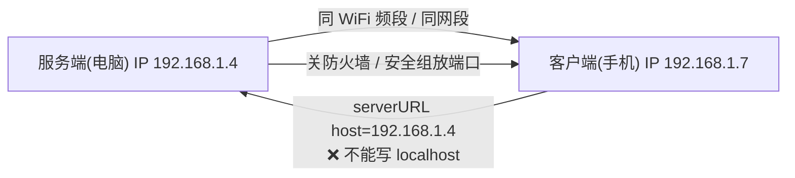

## 纲要

- **数据库选型**：课程用 **MySQL 8**；MariaDB 是 MySQL 作者的「备胎分支」，可零成本切换，作为规避 Oracle 收费风险的 hedge
- **Docker 装 MySQL**：`docker pull` + `docker run`（端口映射 / 密码 / UTF8 / 后台运行），比裸装更干净、可复现
- **Navicat 建库建表**：建 `items-mcp` 库，商品表含 编号/名称/品牌/价格/库存/简介/状态/时间
- **前端工具链**：VSCode + **通义灵码**（阿里 AI 编程插件，跨端）+ Live Server（本地 Web 服务）
- **内网互通原则**：关防火墙、连同一 WiFi 频段、同网段、前端 host 用 IP 不用 localhost、云上走私有网络
- **前瞻**：前述 RAG 知识库会用到 **Redis 向量库**，本节一并给出 Docker 起 Redis 的姿势，提前把中间件栈备齐

## 一、数据库选型：为什么是 MySQL 8

课程后端用 MySQL 8 做 MCP 数据库交互演示。老师横向对比了主流关系型库：

| 数据库 | 特点 | 适用场景 | 课程态度 |
|---|---|---|---|
| **MySQL 8** | 最主流、生态全、社区大 | 绝大多数互联网项目 | ✅ 采用 |
| **MariaDB** | MySQL 作者的分支，可零成本覆盖安装，高并发更稳 | 想规避 Oracle 风险的团队 | 强烈推荐了解 |
| **Oracle** | 强大但收费贵、服务好 | 传统企业 / 事业单位 / 金融 | 课程不用 |
| **PostgreSQL** | 功能强、JSON 友好 | 部分国外公司 | 了解即可 |
| **SQL Server** | 微软系，.NET 标配 | 桌面 / 传统小项目 | Java 几乎不用 |

> **MariaDB 的来源**：MySQL 被 Oracle 收购后存在「未来收费」的不确定性，原作者另起分支 MariaDB（小海豹 logo），可从 MySQL 直接覆盖安装迁移。国外维基百科、谷歌部分库已迁过去；国内也有团队迁移。学有余力可装 MariaDB 替代 MySQL 跑本课。课程老师本机装的就是 MariaDB，而虚拟机和 Docker 里用的 MySQL 8——两者语法几乎通用。

> **老师原话**：Oracle「每年收费价格比较贵，但服务非常好、客服质量高」，适合「稳定压倒一切、面向公众服务」的政企单位（如工商局、派出所项目）。他早期物流项目前身就用 Oracle，因为「老百姓要用，必须稳」。

### 1.1 MySQL 5.x 与 8.0 的差异（选型附加题）

老师提到 5.x 是经典老版本、很多老项目还在用。若你维护老库，需知道 8.0 的关键变化：

- **默认字符集** 8.0 起改 `utf8mb4`（5.x 默认 `latin1`），彻底告别中文乱码。
- **默认认证插件** 8.0 是 `caching_sha2_password`，老驱动（如 5.x 的 JDBC）连不上，需换 `mysql_native_password` 或升级驱动。
- **性能** 8.0 引入窗口函数、CTE（`WITH` 子句）、隐藏索引、降序索引，JSON 性能大幅提升。
- **DDL 原子性** 8.0 的 `CREATE TABLE` 等支持原子操作，中途失败不再留半残表。

> 课程统一用 8.0，正是看中 `utf8mb4` 默认与生态最新。新手别纠结 5.x。

## 二、用 Docker 安装 MySQL 8

### 2.1 先装 Docker 桌面端

- 官网 `docker.com` 下载对应系统版本，安装后桌面端可可视化管容器（Images / Containers 标签页）。
- Docker 理念：一次构建、任意 OS 运行，开发环境一致性最强。课程老师强调「开发快、任意操作系统可运行」。

### 2.2 拉取镜像

在 [hub.docker.com](https://hub.docker.com) 搜 `mysql`（官方镜像），拷贝 `docker pull` 命令。课程演示时最新是 9.3.0，本地用 8.0 也行——**8.0 是生产最稳的常见版本**：

```bash
# 推荐生产稳定版 8.0
docker pull mysql:8.0

# 验证已拉取
docker images
```

> ⚠️ **网络提示**：`docker pull` 拉境外镜像常超时，需保证网络畅通或配国内镜像加速器（如阿里云容器镜像服务代理）。课程老师也强调「务必保证网络畅通」，甚至说「科学上网开启魔法还是非常有必要的」。

### 2.3 准备数据目录（卷映射）

为让容器数据持久化到本地，先建一个空目录做挂载：

```bash
# macOS / Linux：建本地空目录
mkdir -p ~/docker/mysql8/data
```

> 每个 MySQL 容器用独立空目录，避免数据串味。老师原话：「保证每个文件夹里面都是空的」，他会在 Finder 里复制一个空文件夹改名 `mysql8` 再挂载。

### 2.4 运行容器

```bash
docker run -d \
  --name mysql8 \
  -p 5506:3306 \            # 宿主机端口:容器端口；本地若已装多个 MySQL 改宿主机端口避免冲突（默认 3306 也行）
  -e MYSQL_ROOT_PASSWORD=root \   # ⚠️ 课程演示用 root 作密码，生产务必强密码！
  -e TZ=Asia/Shanghai \
  -v ~/docker/mysql8/data:/var/lib/mysql \
  mysql:8.0 \
  --character-set-server=utf8mb4 \
  --collation-server=utf8mb4_unicode_ci
```

| 参数 | 含义 |
|---|---|
| `-d` | 后台守护进程方式运行 |
| `--name` | 容器名（后续 start/stop/restart 用它） |
| `-p` | 端口映射，外网/本地应用通过宿主机端口访问 |
| `-e MYSQL_ROOT_PASSWORD` | 初始化 root 密码（**弱密码，仅演示**） |
| `-v` | 数据目录挂载，容器删了数据还在 |
| `--character-set-server` | 字符集 utf8mb4（完整 UTF-8） |

> **端口冲突处理**：课程本地已装多个 MySQL，老师把宿主机端口改成 `5506`（映射容器内 `3306`）。首次安装保持 `3306:3306` 即可。

### 2.5 用 docker-compose 一键管理（推荐）

命令行 `docker run` 参数一长串易错，生产 / 团队推荐写成 `docker-compose.yml`，版本可控、一键起停：

```yaml
# ~/docker/mysql8/docker-compose.yml
version: "3.8"
services:
  mysql8:
    image: mysql:8.0
    container_name: mysql8
    restart: unless-stopped        # 宿主机重启自动拉起
    environment:
      MYSQL_ROOT_PASSWORD: root     # ⚠️ 演示用，生产改强密码
      TZ: Asia/Shanghai
    ports:
      - "5506:3306"
    volumes:
      - ./data:/var/lib/mysql
    command:
      - --character-set-server=utf8mb4
      - --collation-server=utf8mb4_unicode_ci
```

```bash
cd ~/docker/mysql8
docker compose up -d      # 启动
docker compose down       # 停止并删容器（数据在 ./data 保留）
docker compose logs -f    # 看日志
```

> `restart: unless-stopped` 比手动 `docker start` 省心，机器重启服务自动恢复，适合本地常驻中间件。

### 2.6 常用运维命令

```bash
docker start mysql8       # 启动
docker stop mysql8        # 停止
docker restart mysql8     # 重启（课程演示用）
docker logs mysql8        # 查日志排错（启动报错第一时间看这里）
docker ps                 # 看运行中的容器
docker exec -it mysql8 mysql -uroot -proot   # 进容器直接连 MySQL
```

> 排错第一招：`docker logs mysql8`。启动失败（如端口占用、权限）日志里都有。课程老师演示重启时用的就是 `docker restart mysql8`。

### 2.7 前瞻：Docker 起 Redis（前述 RAG 向量库要用）

课程前述 RAG 知识库会用 **Redis 存向量**（替代 pgvector / 本地文件），顺手把 Redis 也起好，中间件栈一次备齐：

```bash
docker run -d --name redis -p 6379:6379 redis:7-alpine
docker exec -it redis redis-cli ping    # 返回 PONG 即就绪
```

> 后续 RAG 章节会把文档切片后的 embedding 写进 Redis，配合 SpringAI 的 `RedisVectorStore` 做相似度检索。现在起好，省得后面再回来配环境。

## 三、Navicat 可视化建库建表

### 3.1 连本地 MySQL

- 工具 Navicat 支持 MySQL / Oracle / PostgreSQL / 云厂商库等，新建 MySQL 连接。
- 主机 `localhost`、端口填你映射的（课程用 `5506`）、密码 `root`。
- 连上后版本显示 `8.0`（或你装的版本），`Test Connection` 成功即可。

> 局域网部署时主机填**内网 IP** 而非 `localhost`——这点与第五节内网互通呼应。课程老师建连接名直接叫 `mysql8`，端口 `5506`，密码 `root`。

### 3.2 建库

新建数据库，名 `items-mcp`（后续以「商品信息」做 MCP 数据库交互演示）：

- 字符集：`utf8mb4`
- 排序规则：`utf8mb4_unicode_ci`

> 老师原话：取名 `items-mcp` 是因为「后续以商品信息为例做数据库交互，用于提供 MCP 服务」。大小写随意，但团队要统一。

### 3.3 建表（商品表）

课程准备了建表 SQL，新建查询粘贴运行即可：

```sql
CREATE TABLE `product` (
  `id`          BIGINT PRIMARY KEY AUTO_INCREMENT COMMENT '商品编号',
  `name`        VARCHAR(128) NOT NULL COMMENT '商品名称',
  `brand`       VARCHAR(64)  NOT NULL COMMENT '品牌',
  `price`       DECIMAL(10,2) NOT NULL COMMENT '销售价格',
  `stock`       INT          NOT NULL COMMENT '库存数量',
  `intro`       VARCHAR(512) DEFAULT NULL COMMENT '商品简介（可空）',
  `status`      TINYINT      NOT NULL COMMENT '状态：1上架 2下架 3预售',
  `create_time` DATETIME     NOT NULL DEFAULT CURRENT_TIMESTAMP COMMENT '创建时间',
  `update_time` DATETIME     NOT NULL DEFAULT CURRENT_TIMESTAMP ON UPDATE CURRENT_TIMESTAMP COMMENT '更新时间'
) ENGINE=InnoDB DEFAULT CHARSET=utf8mb4 COMMENT='MCP 商品服务表';
```

> **表结构要点**：`status` 三种枚举（上架 / 下架 / 预售）——这正是后面前述「自然语言查库」的关键：大模型把用户描述映射成枚举值，再据此构建查询条件。其他字段支撑「按编号 / 名称 / 品牌 / 价格区间 / 库存」等条件检索。老师强调「表结构相对简单，用于演示；想复杂也行，后续就针对这些字段做条件查询」。

### 3.4 Navicat 实操清单（图文级）

1. 连接列表点「新建连接 → MySQL」。
2. 连接名 `mysql8`；主机 `localhost`（局域网改 IP）；端口 `5506`；密码 `root` → 测试连接 → 确定。
3. 左侧连接下右键「新建数据库」：`items-mcp` / `utf8mb4` / `utf8mb4_unicode_ci` → 确定。
4. 双击库展开 → 工具栏「查询 → 新建查询」→ 粘贴上面建表 SQL → 运行。
5. 刷新「表」节点，见到 `product` → 双击查看字段，确认 9 个列齐全。
6. 可右键表「设计表」核对字段类型，或「导入向导」灌测试数据。

> 想更省事：把建表 SQL 存成 `product.sql` 文件，随项目提交，别人一键跑通，比口头描述靠谱。

## 四、前端工具链：VSCode + 通义灵码 + Live Server

课程有前端（H5）联调，需准备：

1. **VSCode**：微软开源编辑器，人手一个；支持 Windows / macOS。
2. **通义灵码（Aliyun 的 AI 编程插件）**：
 - 在 VSCode / IDEA 插件市场搜「通义灵码」安装、登录即用；
 - 跨端跨语言（Java / Python / .NET / 前端都行），可生成简单代码、解释源码、翻译异常、回答问题；
 - 免费、个人够用。课程里大量代码靠它自动补全提速，老师称其为「强烈推荐的提效工具」。
3. **Live Server**：本地 Web 服务器插件，一键把前端源码跑起来，联调 H5 必备。

### 4.1 通义灵码深度使用

- **核心能力**：行内补全（`Tab` 采纳）、选中代码「解释 / 优化 / 生成注释」、对话框问答、报错翻译。
- **典型场景**：写 Controller 时让它补 `@RequestMapping`、写 SQL 时补 MyBatis 映射、前端补 `fetch` 请求模板。
- **局限**：生成的代码需人工核对（尤其涉及业务规则、安全边界），不可盲抄；它不替代对 SpringAI / MCP 原理的理解。
- **登录**：装完插件点侧边「通义灵码」图标，用阿里云账号登录即可，IDEA 与 VSCode 通用。

### 4.2 Live Server 要点

- 装上后右下角「Go Live」一键起本地静态服务（默认 5500 端口）。
- 改前端代码自动刷新，联调后端接口时把 `serverURL` 指向后端局域网 IP（见第五节）。
- 注意：Live Server 只服务静态文件，后端 Java 接口仍由 Spring Boot（默认 8080）提供。

## 五、内网互通原则（联调前必读）

后端是服务端、前端（H5 / App）是客户端，二者必须能互访。否则「我本地能跑、手机访问不了」的坑 90% 出在这里。老师强调：「现在开发基本是分布式 / 微服务，不像早期单体 demo 本地测就行，互相必须能访问。」

### 5.1 关闭防火墙

- **本机防火墙**（macOS 设置 / Windows 安全中心）关闭——本地服务端要被其他客户端请求。老师用一个小软件直接开关本机防火墙「为了开发方便」。
- **Linux 防火墙**（虚拟机 / CentOS）**永久关闭**（`systemctl disable --now firewalld`），别只临时关，重启后又挡请求。
- **云服务器**防火墙叫「安全组」，在控制台把 `80 / 8080 / 3306 / Redis 端口` 开放即可。

```bash
# Linux 永久关防火墙（CentOS / Rocky）
sudo systemctl stop firewalld
sudo systemctl disable firewalld

# 验证状态
sudo firewall-cmd --state   # 应为 not running
```

### 5.2 同一 WiFi 频段 + 同网段

- 电脑（服务端）和手机（客户端）必须连**同一个 WiFi 频段**（都是 5G 小米，而非一个 5G 一个 2.4G）。
- 同一路由器下不同频段是**不同子网**，数据互不相通。
- 验证：`ipconfig` / `ifconfig` 看 IP——服务端如 `192.168.1.4`，客户端如 `192.168.1.7`，同 `192.168.1.x` 网段才能互拼。

> 老师实拍：他电脑 IP `192.168.1.4`、手机 IP `192.168.1.7`，同处 `192.168.1.x` 网段，互拼通；若手机选了不同频段（2.4G 而非 5G 小米），即使同一路由器也互不相通。

### 5.3 前端 host 用 IP 不用 localhost

- 前端写请求地址 `serverURL` 的 host 时，**绝不能写 `localhost`**——那指向客户端自己（手机写 localhost 请求的是手机自己，必然失败）。
- 必须写服务端电脑的 **局域网 IP**（如 `192.168.1.4`）。

```javascript
// ❌ 错误：手机上 localhost 指向手机自己
const serverURL = "http://localhost:8080/api";

// ✅ 正确：写服务端电脑局域网 IP
const serverURL = "http://192.168.1.4:8080/api";
```

### 5.4 云上走私有网络

- 云服务器的「局域网」叫**私有网络 / 专有网络**（阿里云 / 腾讯云叫法不同，本质一样）。
- 多个服务器实例务必建在**同一地域的同一私有网络**下，内网互通、免占公网带宽（公网带宽小、走公网会拖垮其他请求）。
- 只有走内网，请求才能以最快速度到达响应。



### 5.5 内网互通排错清单（实测级）

手机访问 H5 接口失败时，按序排查：

1. **拼 IP**：手机终端 `ping 192.168.1.4`，不通 → 频段 / 网段不一致（回 5.2）。
2. **查端口**：服务端 `curl http://localhost:8080/hello` 本机通，但手机不通 → 多半防火墙挡（回 5.1）或 host 写了 localhost（回 5.3）。
3. **防火墙**：`telnet 192.168.1.4 8080` 连不上 → 关本机防火墙 / 云安全组放 8080。
4. **MySQL 连不上**：确认 Navicat 用映射端口（5506）、root 密码、且 MySQL 容器在运行（`docker ps`）。
5. **云上**：安全组放行业务端口 + 实例同私有网络；公网带宽小，内网互访优先。

## 六、常见错误排查

| 现象 | 根因 | 解决 |
|---|---|---|
| 手机访问 H5 接口失败 | host 写了 localhost | 改服务端局域网 IP |
| 手机/电脑互拼不通 | 不同 WiFi 频段 / 网段 | 连同一频段、确认同网段 |
| MySQL 连不上 | 防火墙挡 / 端口错 | 关防火墙、确认映射端口 |
| `docker run` 启动即退 | 端口冲突 / 权限 | `docker logs` 看原因，换端口 |
| Navicat 连不上 | 密码 / 端口错 | 用容器映射端口，确认 root 密码 |
| 前端装了通义灵码不生效 | 没登录 / 装错市场 | 登录账号，IDEA/VSCode 都装 |
| 老 JDBC 连 MySQL8 失败 | 8.0 默认 `caching_sha2_password` | 升级驱动或改成 `mysql_native_password` |
| Redis 起不来 | 端口 6379 被占 | 换端口或停占用进程 |

## 七、面试高频问答（环境篇）

**1. MySQL 和 MariaDB 什么关系？生产怎么选？**
MariaDB 是 MySQL 原作者另起的开源分支，可零成本覆盖安装迁移。两者兼容度高；担心 Oracle 收费风险或要高并发稳定性可选 MariaDB，否则 MySQL 8 生态最省心。

**2. 为什么数据库容器要挂数据卷（-v）？**
容器本身无状态，删容器数据即失。挂载宿主机目录到 `/var/lib/mysql` 让数据持久化，容器重建数据不丢，也方便备份迁移。

**3. utf8mb4 和 utf8 有什么区别？**
MySQL 的 `utf8` 是阉割版（最多 3 字节，存不了 emoji / 部分生僻字）；`utf8mb4` 才是完整 UTF-8（4 字节）。新建库表一律 `utf8mb4`。

**4. 前端为什么不能写 localhost 访问后端？**
localhost 解析到 `127.0.0.1`（本机）。手机写 localhost 请求的是手机自己，后端在电脑上，自然连不上。必须写后端电脑的局域网 IP。

**5. 云服务器安全组和防火墙的区别？**
安全组是云厂商对「实例进出流量」的虚拟防火墙（控制台配置）；系统防火墙是 OS 层。两者都要放行业务端口，缺一个都不通。

**6. Docker 相比裸装 MySQL 的好处？**
环境一致、一条命令重建、不污染宿主机、版本隔离。本课及后续 Redis / SearXNG / Nginx 全用 Docker 拉起，是标准做法。

**7. docker-compose 相比 docker run 的优势？**
把参数固化成 `yml`，版本可控、一键 `up/down`、可纳入 git；`restart` 策略让服务随宿主机重启自动恢复，适合常驻中间件。

**8. MySQL 8 默认认证插件变了有何影响？**
8.0 默认 `caching_sha2_password`，老版 JDBC / 某些客户端连不上；升级驱动或在 `my.cnf` / 启动命令里改回 `mysql_native_password` 即可兼容老生态。

**9. 内网互通在微服务里为什么是前提？**
服务间要互相调用（如 mcp-client 调 mcp-server、后端调 MySQL/Redis），网络不通等于单点瘫痪。关防火墙、同网段、走内网是基本盘。

**10. 为什么云上要走内网而非公网互通？**
公网带宽小且计费，走公网会拖垮其他请求、增加延迟与费用；同私有网络内网互通免费且低延迟。

**11. 数据库密码写在启动命令里有何风险？**
明文暴露在进程列表 / 历史命令，泄露即中招。生产应走 `.env` / Secret / 密钥管理，绝不硬编码。

**12. 多 MySQL 实例如何避免端口冲突？**
每个容器映射不同宿主机端口（3306 / 5506 / 5507…），或不同宿主机；用 `--name` 区分，运维命令按名操作。

## 八、联调前终检清单（checklist）

- [ ] Docker 已装，`docker images` 能看到 `mysql:8.0`
- [ ] `mysql8` 容器 `docker ps` 状态为 Up
- [ ] Navicat 连 `localhost:5506` / root 成功，`items-mcp` 库 + `product` 表已建
- [ ] Redis 容器已起（前瞻，前述用），`redis-cli ping` 返回 PONG
- [ ] 本机防火墙已关 / Linux `firewalld` 已 disable
- [ ] 手机与电脑同 WiFi 频段、同网段（IP 前三段一致）
- [ ] 前端 `serverURL` host 写服务端局域网 IP，非 localhost
- [ ] VSCode + 通义灵码已登录、Live Server 可起
- [ ] 云上（若用）：安全组放行业务端口、实例同私有网络

## 九、MySQL 基础运维（备份 / 恢复 / 连接池 / 时区）

环境跑起来后，日常运维这几招必会：

### 9.1 备份与恢复（docker 场景）

```bash
# 备份 items-mcp 库到本地 sql 文件
docker exec mysql8 sh -c 'exec mysqldump -uroot -proot items-mcp' > ~/items-mcp-backup.sql

# 恢复：先连进去建库，再导入
docker exec -i mysql8 sh -c 'exec mysql -uroot -proot items-mcp' < ~/items-mcp-backup.sql
```

> 课程演示库小，全量 `mysqldump` 足够；生产大库用 `--single-transaction`（InnoDB 热备）或物理备份（xtrabackup）。

### 9.2 连接池与超时

Spring Boot 默认用 HikariCP，关键参数放 `application.yml`：

```yaml
spring:
  datasource:
    url: jdbc:mysql://localhost:5506/items-mcp?useUnicode=true&characterEncoding=utf8mb4&serverTimezone=Asia/Shanghai
    username: root
    password: root          # ⚠️ 演示；生产走配置中心
    hikari:
      maximum-pool-size: 10
      connection-timeout: 30000
```

> `serverTimezone=Asia/Shanghai` 必填，否则 8.0 常因时区不一致报错；密码生产务必外置。

### 9.3 时区与大小写敏感

- 容器已设 `TZ=Asia/Shanghai`，避免 `CURRENT_TIMESTAMP` 差 8 小时。
- Linux 下 MySQL 表名默认大小写敏感（`lower_case_table_names=0`），跨平台迁移注意；容器镜像通常已处理，裸装需显式配置。

## 十、各关系型数据库深度定位（PG / Oracle / SQL Server 实战）

选型不能只看「主流」，要看团队与场景：

| 数据库 | 实战定位 | 何时选它 | 坑点 |
|---|---|---|---|
| **MySQL 8** | 互联网 CRUD 标配 | 90% Web 项目、本课程 | 8.0 认证插件变更需升级驱动 |
| **MariaDB** | MySQL 平替、高并发稳 | 规避 Oracle 风险、高并发写 | 个别语法/函数与 MySQL 微差 |
| **PostgreSQL** | 复杂查询 / JSON / GIS | 分析型、地理、JSON 重 | 国内互联网岗位相对少 |
| **Oracle** | 政企金融关键系统 | 稳定压倒一切、预算足 | 收费贵、授权复杂 |
| **SQL Server** | .NET 生态 | 微软技术栈桌面/传统项目 | Java 几乎不用 |

> 老师早年做 Java 时 SQL Server 还没流行、MySQL 未起，用的就是 SQL Server；后来切到 MySQL 再没回去。PostgreSQL 他十年前试过又切回 MySQL。结论：**互联网 Java 项目无脑 MySQL 8，想稳可 MariaDB，其余按需**。

## 十一、Docker 网络模型与端口映射原理

理解网络才能排错。`docker run` 默认走 `bridge` 网络：

- **bridge（默认）**：容器各有独立 IP，通过 `-p` 把容器端口映射到宿主机，外部经宿主机 IP:映射端口访问。本课 MySQL 用此模式。
- **host**：容器直接复用宿主机网络栈，`-p` 失效、端口即宿主机端口；性能高但隔离差，本地联调可省映射麻烦。
- **none**：无网络，纯计算用。
- **自定义网络**：`docker network create app-net`，多容器（MySQL + Redis + 后端）加入同一网络，用**容器名**互访，免记 IP。

```bash
docker network create app-net
docker run -d --name mysql8 --network app-net ...   # 后端容器同网络即可用 mysql8:3306 访问
```

> 课程内网互通谈的是「宿主机 ↔ 手机」这一层；Docker 内部「容器 ↔ 容器」是另一层，用自定义网络解决。两层别混淆。

## 十二、生产环境安全加固完整清单

演示用 `root/root` + 暴露端口，生产必须逐项收紧：

- [ ] **强密码**：root 改随机长密码，建专用应用账号（`mcp_user`）仅授权 `items-mcp` 库，撤销 ALL PRIVILEGES。
- [ ] **不暴露公网**：MySQL 端口只绑内网 / 私有网络，云安全组不放 3306 到 0.0.0.0。
- [ ] **最小权限**：应用账号 `SELECT/INSERT/UPDATE/DELETE`，不给 DROP/GRANT。
- [ ] **配置外置**：密码进 `.env` / 配置中心 / 密钥管理（Vault），绝不硬编码、不进 git。
- [ ] **备份策略**：每日 `mysqldump` 或开启 binlog 增量，异地留存。
- [ ] **TLS 加密**：生产开启 MySQL SSL，防止凭据被 sniff。
- [ ] **审计日志**：开启 general/slow log 监控异常查询。
- [ ] **Redis 同理**：设 `requirepass`、绑内网、不暴露 6379。

## 十三、Navicat 进阶（ER 图 / 导入导出 / 数据同步）

建表只是起点，Navicat 还能做：

- **ER 图表**：右键库 → `设计表` 旁边点 `ER 图`，自动把表关系画出来，适合给同事讲表结构；外键关系一目了然。
- **数据导入向导**：表上右键 `导入向导`，支持 Excel / CSV / JSON，按列映射灌测试数据（演示前先灌几条 `product` 样例）。
- **数据导出**：结果集右键 `导出向导` 存 CSV，做数据分析或备份。
- **结构同步**：`工具 → 结构同步`，对比两个库的差异 SQL，生产灰度前先 diff，避免漏字段。
- **数据同步**：`工具 → 数据同步`，跨库搬数据，迁移时用。

> 把建表 SQL 和几条样例数据都存进项目 `docs/`，比口头描述靠谱，别人 `product.sql` 一键跑通。

## 十四、MySQL 性能入门（索引 / EXPLAIN / 慢查询）

商品表后续要做「按品牌/价格/状态查」，不懂索引会全表扫描：

- **索引**：`CREATE INDEX idx_brand ON product(brand);` 让按品牌查走 B+ 树而非扫全表。
- **EXPLAIN**：`EXPLAIN SELECT * FROM product WHERE brand='小米';` 看 `type`（`ref`/`range` 好，`ALL` 是全表扫描要警惕）、`key`（用了哪个索引）、`rows`（扫描行数）。
- **组合索引最左匹配**：`(brand,status)` 能加速 `brand=?` 和 `brand=? AND status=?`，但单独 `status=?` 用不上。
- **慢查询日志**：`my.cnf` 设 `slow_query_log=1` + `long_query_time=1`，抓超过 1 秒的 SQL 优化。

```sql
-- 给高频查询建索引
CREATE INDEX idx_brand_status ON product(brand, status);
CREATE INDEX idx_price ON product(price);

-- 看执行计划
EXPLAIN SELECT * FROM product WHERE brand='小米' AND status=1;
```

> 前述自然语言查库时，大模型生成的 SQL 也要走索引才快；理解索引能帮你判断生成的查询合不合理。

## 十五、子网与 CIDR 通识（内网互通的数学）

「同网段」到底指什么？用 CIDR 说清：

- IP 如 `192.168.1.4`，子网掩码 `255.255.255.0`（即 `/24`）表示前 24 位（前三段）是网络号，最后一段是主机号。
- 同 `/24` 的两机（`.4` 与 `.7`）网络号都是 `192.168.1`，互通；若一个是 `192.168.1.4`、另一个是 `192.168.2.7`（网络号 `192.168.2`），则需路由器转发，跨子网默认不通 → 这就是「连同一 WiFi 还不通」的根因（不同频段被分配不同子网）。
- 特殊地址：`127.0.0.1` / `localhost` 永远指向本机；`192.168.x.x` / `10.x.x.x` / `172.16-31.x.x` 是私有网段，不进公网。

> 排错时 `ifconfig`/`ipconfig` 看「IPv4 地址 + 子网掩码」，两者网络号一致才互拼；手机和电脑各看一眼，不一致就换同一频段。

## 十六、联调标准作业流程（SOP）

前后端联调按此顺序，10 分钟定位问题：

1. **后端自测**：`curl http://localhost:8080/hello` 本机通 → 后端 OK。
2. **网络层**：手机 `ping 192.168.1.4` 通 → 同网段 OK；不通回第五节 5.2。
3. **端口层**：手机 `telnet 192.168.1.4 8080` 通 → 防火墙/安全组 OK；不通回 5.1。
4. **host 层**：前端 `serverURL` 改 `http://192.168.1.4:8080` → 写死 IP 回 5.3。
5. **数据层**：Navicat 连 `192.168.1.4:5506` 通 → MySQL OK；不通回 2/3 节。
6. **端到端**：手机打开 H5 点查询，后端日志见请求 → 全链路通。

> 绝大多数「我本地能跑、手机不行」卡在 2/3/4 步，按 SOP 自顶向下查，别瞎猜。

## 十七、Docker Desktop 全平台安装步骤

Docker 是后续 MySQL/Redis/SearXNG/Nginx 的统一载体，装一次受益全课：

- **macOS**：`docker.com → Get Started → Mac` 下 Apple Silicon / Intel 版；拖进 `Applications`，首次启动需授权（内核扩展 / 隐私设置），状态栏鲸鱼图标转稳即就绪。
- **Windows**：装 `Docker Desktop for Windows`，要求 WSL2 后端（Windows 10/11 专业版开启 WSL2）；装完 PowerShell 跑 `docker version` 验证。
- **Linux（Ubuntu）**：`sudo apt install docker.io docker-compose-plugin` + `sudo usermod -aG docker $USER`（免 sudo 跑 docker，重登生效）。

```bash
docker version      # 客户端/服务端版本都出来即装好
docker run hello-world   # 拉官方测试镜像，验证 daemon + 网络
```

> 课程老师强调「开发快、任意 OS 可运行」，Docker 桌面端能可视化管 Images/Containers，新手比纯命令行友好。

## 十八、MySQL 容器内部排查命令大全

连不上了别只会 `docker logs`，进容器直接查：

```bash
docker exec -it mysql8 bash                       # 进容器 shell
mysql -uroot -proot -e "SELECT VERSION();"        # 容器内直连
mysql -uroot -proot -e "SHOW DATABASES;"          # 看库
docker inspect mysql8 | grep IPAddress            # 看容器 IP（自定义网络用）
docker stats mysql8                               # 看 CPU/内存占用
docker top mysql8                                 # 看容器内进程
```

> 连不上八成是端口映射错（用宿主机 `5506` 非容器 `3306`）、密码错、或容器没起（`docker ps` 检查）。

## 十九、字符集与排序规则深度

老师反复强调 `utf8mb4`，原理在这：

- **utf8（阉割）**：MySQL 历史遗留，最多 3 字节，存不了 emoji（4 字节）、部分生僻汉字会截断/报错。
- **utf8mb4（完整）**：真 UTF-8，4 字节，emoji/全字符集通吃。MySQL 8 默认即 `utf8mb4_0900_ai_ci`。
- **排序规则 `_ci` vs `_bin`**：`utf8mb4_unicode_ci` 大小写不敏感（查 `Apple` 能命中 `apple`）；`_bin` 二进制精确区分。业务名搜一般用 `_ci`，精确比对用 `_bin`。
- **连接层也要统一**：JDBC URL 加 `characterEncoding=utf8mb4`，否则客户端→服务端转码可能乱码。

> 库、表、列、连接四层字符集都要 `utf8mb4`，任一层漏了都可能乱码，排查时逐层看 `SHOW CREATE TABLE`。

## 二十、通义灵码高效 Prompt 技巧

装好后，用得好才提效：

- **补全采纳**：写方法签名 + 一行注释，等灰色补全，`Tab` 采纳；长逻辑分多段写更易被预测。
- **选中解释**：选中陌生代码右键「解释」，快速读懂第三方/历史代码。
- **报错翻译**：把红错贴进对话框，让它给中文原因 + 修复建议。
- **生成测试**：对 Service 类说「生成 JUnit 单测」，补覆盖率。
- **限制**：生成的代码必须人工核对业务规则与安全边界（如 SQL 注入、权限），不可盲抄；复杂 MCP/SpringAI 逻辑仍以理解原理为主。

> 课程老师称通义灵码「强烈推荐的提效工具，不装也能照敲」——它是加速器不是替代品。

## 二十一、数据库选型决策流程图

```
选数据库
├─ 互联网 Web / 本课 → MySQL 8（生态全、省心）
├─ 怕 Oracle 收费 / 高并发写 → MariaDB（平替、稳）
├─ 政企金融 / 预算足 / 稳定优先 → Oracle（贵但服务好）
├─ 复杂查询 / JSON / GIS → PostgreSQL
└─ .NET 桌面 / 传统小项目 → SQL Server
```

> 老师原话：「MySQL 5 经典，很多老项目用；8 最新；MariaDB 是作者分支，能从 MySQL 零成本覆盖安装；Oracle 贵但服务好；PostgreSQL 国外有用；SQL Server 早期 Java 用过。」一句话：无脑 MySQL 8，想稳换 MariaDB。

## 二十二、Docker 卷与网络实战对比

| 维度 | 数据卷 `-v` | 自定义网络 |
|---|---|---|
| 解决什么 | 容器删数据不丢 | 容器间用名字互访 |
| 命令 | `-v ~/data:/var/lib/mysql` | `docker network create app-net` + `--network` |
| 典型场景 | MySQL/Redis 持久化 | 后端 + MySQL + Redis 同网 |
| 坑 | 空目录挂载、权限 | 跨网络不通、端口映射概念混淆 |
| 建议 | 所有有状态服务必挂 | 多容器联动必建 |

> 两层网络别混：宿主机↔手机是物理/ WiFi 层（第五节）；容器↔容器是 Docker 网络层（本节）。各管各的。

## 二十三、联调高频 Q&A（10 条）

1. **手机能 ping 通电脑但接口不通？** 防火墙挡了 8080，关本机防火墙或放安全组。
2. **localhost 在手机上啥意思？** 指向手机自己，后端在电脑，必然失败 → 改电脑 IP。
3. **改了环境变量不生效？** macOS M 改 `.zshrc`、Intel 改 `.bash_profile`，且要 `source` / 重开终端。
4. **MySQL 容器起不来？** `docker logs mysql8` 看原因，多半端口占用 / 权限 / 数据目录非空。
5. **Navicat 连不上？** 用映射端口（5506 非 3306）、确认 root 密码、容器在运行。
6. **Docker 镜像拉不动？** 配国内加速器 / 保证网络，课程老师强调「务必网络畅通」。
7. **不同 WiFi 频段为啥不通？** 同路由不同频段=不同子网，互不相通 → 连同一频段。
8. **云上两个实例不通？** 没建同一私有网络 → 重建同地域同私有网络。
9. **Redis 连不上？** 设了 `requirepass` 就要带密码；绑了内网就别用公网 IP。
10. **前端改了 host 还不行？** 清浏览器缓存 / Live Server 重启，确认 `serverURL` 全路径含 `http://`。

## 二十四、ops 提示（部署前必看）

> **密码是头号安全隐患**：课程演示 MySQL 密码用 `root`、端口映射 `5506`，**仅限本地演示**。生产必须：强密码 + 绑定内网 + 不暴露公网 3306。任何真实项目都把密码进 `.env` / Secret，绝不硬编码。
>
> **环境即文档**：JDK / Maven / Docker 镜像版本、MySQL 端口密码、Redis 端口，写进 `README` 与团队脚手架，新人 clone 即复现，别每次从零排环境。
>
> **中间件栈一次备齐**：MySQL + Redis 都用 Docker 起、写进 `docker-compose.yml`，后续 RAG（Redis 向量）、MCP（MySQL 交互）章节直接复用，不用回头补环境。
