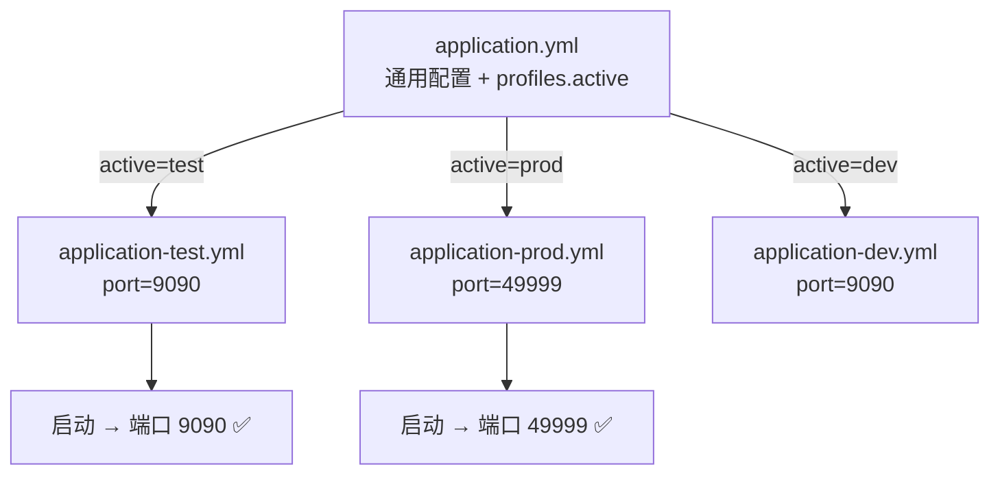

## 纲要

- **痛点**：开发 / 测试 / 预发 / 生产环境端口、IP、配置各不相同，改同一个文件既麻烦又易错
- **解法**：拆成多个配置文件，按环境切换，而非反复改一处
- **命名约定**：`application-{profile}.yml`，如 `application-dev.yml` / `application-test.yml` / `application-prod.yml`
- **激活方式**：在主 `application.yml` 里用 `spring.profiles.active=dev` 指定启用哪个环境
- **解耦原则**：会变的环境相关配置（端口等）放各环境文件；通用的（应用名、日志级别）放主文件
- **本地开发习惯**：保留 dev 环境，上生产只改 `active` 一处即可切换

## 一、为什么不能只用一个 application.yml

真实项目里，同一个配置项在不同环境取值不同：

| 配置 | 开发 (dev) | 测试 (test) | 生产 (prod) |
|---|---|---|---|
| server.port | 9090 | 9090 | 49999 |
| 数据库地址 | localhost | 测试库 | 生产库 |
| 日志级别 | debug | info | warn |

如果只有一个 `application.yml`，每次换环境都要手动改端口、改地址——**有修改就有出错的可能**。为避免这个问题，正确做法是**构建多个配置文件，按环境切换**。

## 二、拆分配置文件

在 `resources` 里复制出多份，按 `application-{环境标识}.yml` 命名。课程演示了 test 和 prod 两份：

```yaml
# application-test.yml
server:
  port: 9090
```

```yaml
# application-prod.yml
server:
  port: 49999
```

> 命名规则是 Spring 约定的：`application-` 前缀 + 自定义环境名 + `.yml`。`test` / `prod` 这个名字你自己定，但激活时要**一字不差地匹配**。

## 三、哪些放主文件，哪些放环境文件

课程里专门做了「解耦」处理：

- **应用名 `spring.application.name`**：只属于当前模块（mcp-client），和环境无关 → 抽到主 `application.yml` 即可，环境文件里删掉。
- **日志级别**：本地开发用 debug，上测试用 info，上生产用 warn/error。但课程为方便，统一在主文件保留 `info`，环境文件里只放端口做区分。
- **端口等环境相关项**：放在各自环境文件里。

主文件最终长这样（干净、与环境无关）：

```yaml
# application.yml（主文件，放通用配置）
spring:
  application:
    name: springai-mcp-client

logging:
  level:
    root: info
```

环境文件只保留差异项：

```yaml
# application-dev.yml
server:
  port: 9090
```
```yaml
# application-test.yml
server:
  port: 9090
```
```yaml
# application-prod.yml
server:
  port: 49999
```

## 四、激活指定环境

在**主文件**的 `spring` 节点下加 `profiles.active`（注意完整写法是 `spring.profiles.active`）：

```yaml
# application.yml
spring:
  application:
    name: springai-mcp-client
  profiles:
    active: test    # 激活 test 环境

logging:
  level:
    root: info
```

`active` 的值必须和某个 `application-{xxx}.yml` 的 `{xxx}` 完全一致（如 `test` / `prod` / `dev`）。写错或不写，Spring 就只用主文件、不加载任何环境文件。



## 五、切换与验证

1. `active: test` → 重启 → 控制台显示端口 **9090** → 浏览器 `localhost:9090/hello` 正常访问。
2. 改 `active: prod` → 重启 → 端口变 **49999** → `localhost:9090` 立刻失效，需改用 49999。
3. 课程还建了 `dev` 环境（端口 9090），后续开发基于 dev；上生产只把 `active` 改成 `prod` 重启即可。

> **关键体验**：切换环境你只动 `active` 这一处，不用去翻每个配置项。这就是「解耦」的价值——环境差异收敛到独立文件，主文件保持稳定。

## 六、更进阶的多环境管理

课程讲的是最基础的 profile 文件方案，生产级项目还有更优解：

| 方案 | 适用场景 | 说明 |
|---|---|---|
| `application-{profile}.yml` | 单机 / 小项目 | 简单直观，本课方案 |
| 命令行 `--spring.profiles.active=prod` | 临时覆盖 | 不打包改文件也能切环境 |
| 环境变量注入 | 容器化 / K8s | 镜像不变，环境靠变量注入 |
| 配置中心（Nacos / Apollo） | 多服务 / 微服务 | 配置集中管理、动态推送、不落代码库 |

> 容器化部署时，往往**不把 prod 配置打进镜像**，而是运行时用环境变量 / 配置中心注入，避免敏感信息（数据库密码等）进代码仓库。

## 七、常见错误

| 现象 | 根因 | 修复 |
|---|---|---|
| 切了 active 但端口没变 | 环境文件名拼错 / active 值不匹配 | 确认 `application-{xxx}.yml` 的 `{xxx}` 与 active 完全一致 |
| 启动报 `active` 找不到环境 | 只写了 active 但没建对应文件 | 补建对应 `application-{xxx}.yml` |
| 生产还是用了 dev 的端口 | 部署时忘了改 active | 用环境变量 / 启动参数强制指定，别依赖手改文件 |
| 应用名重复出现在多文件 | 没解耦，冗余且易冲突 | 通用项抽回主文件 |

## 八、FAQ

**Q1：profile 文件可以放不同内容吗，还是只能端口？**
可以放任意配置——数据源、Redis 地址、第三方 Key 等凡是环境相关的都行。原则是「差异项进环境文件，通用项留主文件」。

**Q2：dev/test/prod 之外还能加吗？**
能。预发 `application-pre.yml`、演示 `application-demo.yml` 都行，名字自定，active 对应即可。

**Q3：多个 profile 能同时激活吗？**
能，用逗号分隔：`spring.profiles.active=dev,local`，Spring 会按序叠加，后加载的覆盖先加载的同名配置。

**Q4：环境文件里的配置会覆盖主文件吗？**
会。加载顺序是主文件先加载，环境文件后加载并覆盖同名项。所以环境文件只需写「差异项」。

## 九、面试高频问答（多环境篇）

**1. Spring 的 profile 解决了什么问题？**
把不同环境的配置隔离到独立文件，避免硬编码切换带来的错误，实现「一套代码、多环境适配」，契合 12-Factor 的「配置外置」原则。

**2. 配置优先级：profile 文件 vs 命令行参数？**
命令行参数（`--spring.profiles.active=prod`）优先级高于配置文件内的设置。部署时常用命令行 / 环境变量覆盖，确保不被代码内写死的值绑架。

**3. 为什么生产配置不应打进镜像？**
镜像应环境无关、可复用；把 prod 配置（尤其密码）打进镜像会随镜像扩散泄露。正确做法是运行时注入（环境变量 / 配置中心 / Secret）。

**4. bootstrap.yml 和 application.yml 在配置中心场景有何不同？**
`bootstrap.yml` 在应用上下文最早期加载，用于连接配置中心、取回真正的配置；`application.yml` 是普通应用配置。引入 Spring Cloud / Nacos 时二者分工明确。

## 十、本章小结与章节收尾

至此，前述「SpringBoot3 快速入门与配置管理」全部走完：从版本选型、Maven 父子工程搭建、yml 基础配置，到多环境解耦（本节）。你已经具备用 Spring Boot 3.5.0 + JDK 21 从零起一个规范工程的能力。

## 十、从 profile 文件到配置中心（生产演进）

profile 文件方案适合单机和中小项目，但微服务规模下会遇到痛点：配置分散在几十个仓库、改一处要重新发版、无动态推送。于是演化出配置中心：

| 方案 | 动态推送 | 适用规模 | 说明 |
|---|---|---|---|
| `application-{profile}.yml` | ❌ 需重启 | 单机 / 小项目 | 本课方案，简单直观 |
| 命令行 `--spring.profiles.active` | ❌ 需重启 | 临时覆盖 | 部署时覆盖，不打包 |
| 环境变量注入 | ❌ 需重启 | 容器 / K8s | 镜像不变，环境靠变量 |
| **Nacos / Apollo** | ✅ 热更新 | 多服务 / 微服务 | 配置集中管理、灰度、权限、审计 |

> K8s 场景几乎都用 **ConfigMap / Secret** 注入：把配置写成 ConfigMap，Pod 以环境变量或挂载文件方式读取，更新 ConfigMap 后滚动生效，镜像完全环境无关。

## 十一、启动参数与环境变量覆盖实战

无论哪种方案，运行期覆盖都靠这两招：

```bash
# 1. 命令行参数（优先级最高之一）
java -jar mcp-client.jar --spring.profiles.active=prod --server.port=49999

# 2. 环境变量（容器化首选）
export SPRING_PROFILES_ACTIVE=prod
export SERVER_PORT=49999
java -jar mcp-client.jar
```

> 环境变量命名规则：`server.port` → `SERVER_PORT`，`spring.profiles.active` → `SPRING_PROFILES_ACTIVE`（点号转下划线、全大写）。Spring 会自动映射。

## 十二、多环境排错 checklist

- [ ] `active` 值与某个 `application-{xxx}.yml` 的 `{xxx}` 完全一致？
- [ ] 通用配置（应用名 / 日志）是否冗余写在多个环境文件？应只留主文件
- [ ] 生产是否误用了 dev 的端口 / 弱密码？用环境变量强制覆盖而非手改
- [ ] 敏感信息（密码 / Key）是否进仓库？必须走 `.env` / Secret
- [ ] 部署后访问端口是否与 `active` 对应的环境文件一致？

## 十三、真实部署配置示例（docker-compose 注入环境变量）

容器化时，环境配置几乎全靠环境变量注入，镜像里只放默认值：

```yaml
# docker-compose.yml（节选）
services:
  mcp-client:
    image: springai-mcp-client:1.0.0
    environment:
      - SPRING_PROFILES_ACTIVE=prod
      - SERVER_PORT=49999
      - SPRING_DATASOURCE_URL=jdbc:mysql://mysql:3306/ai
      # 敏感信息建议用 secrets 而非明文 environment
    ports:
      - "49999:49999"
```

> 这样同一镜像在 dev / test / prod 只需换 `environment` 即可，无需重新构建。密钥用 Docker / K8s 的 secret 机制注入，不出现在 compose 文件明文里。

## 十四、配置管理成熟度自测

- [ ] 本地开发用 dev，测试用 test，生产用 prod，互不干扰
- [ ] 改环境只动 `active` 一处，不手改具体配置项
- [ ] 敏感信息全部外置，yml / 镜像里无明文密码
- [ ] 生产变更可回滚（配置中心有版本 / Git 管理）
- [ ] 团队新人按本文档 10 分钟能配好一套新环境

## 十五、本章小结速记（背下来）

- 多环境 = 拆 `application-{profile}.yml` + 主文件 `spring.profiles.active` 指定。
- 原则：环境相关项（端口 / 地址）进环境文件，通用项（应用名 / 日志）留主文件。
- 切换只改 `active` 一处，不手改具体配置，避免出错。
- 优先级：命令行参数 > 环境变量 > 外部文件 > 打包内 profile 文件 > 打包内主文件。
- 生产用配置中心（Nacos / Apollo）或 K8s ConfigMap，镜像环境无关。
- 密钥永远外置（`.env` / Secret），不进仓库、不进镜像。

### 易错点速记（本节）
- `active` 值和文件名 `{xxx}` 拼写不一致 —— 环境文件根本不加载。
- 通用配置（应用名）重复写进每个环境文件 —— 冗余且易冲突。
- 生产忘了改 `active` 仍用 dev 端口 —— 部署后访问全 404。
- 把 prod 密码打进镜像 —— 随镜像扩散泄露，应用 Secret 注入。
- 只靠手改文件切换环境 —— 人为出错，应用环境变量 / 启动参数。
- 配置中心改了不灰度 —— 全量推送一键炸全集群，务必灰度 + 回滚。

> **📌 实践建议**：本地用 `application-dev.yml` 快速迭代，上测试 / 生产一律靠 `active` + 环境变量覆盖，绝不在不同环境间手动改同一文件。把「配置即代码、环境靠注入」养成习惯，是工程成熟度的分水岭。CI 里对 `application-prod.yml` 做必填项校验，缺了密钥或端口直接构建失败，而非上线后才暴露。

### 补充建议（落地清单）
- 环境切换封装成脚本，一条命令切 dev/test/prod，杜绝手改文件带来的笔误。
- 生产配置改动走评审流程，不个人即兴修改，保留可追溯的变更记录。
- 把「配置即代码、环境靠注入」写进团队规范，作为工程成熟度的准入门槛。
- 定期演练「从零拉起整套环境」，验证配置真的可复现，而非只在老机器上能跑。
- 密钥泄露演练：假设 `.env` 进了仓库，能否在 5 分钟内全量轮换——这是配置安全底线。
- 配置变更要有回滚预案，environment 切错或参数填错时能一键回退到上一版可用配置。
