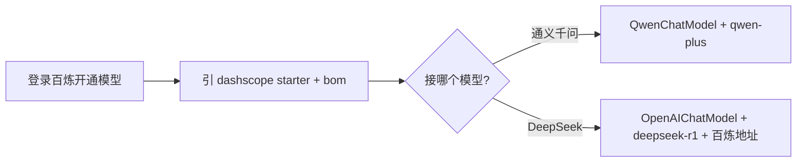

## 纲要

- **平台介绍**：阿里百炼（2023.10 推出），集成通义系列多模态模型，新用户送免费额度，落地成本低
- **接入三要素**：`api-key` / `base-url` / `model-name`（与通用模型一致）
- **通义千问**：依赖 `langchain4j-community-dashscope-spring-boot-starter` + `langchain4j-community-bom`；`base-url` 有默认值可不配
- **百炼 DeepSeek**：`base-url` 换成百炼兼容地址，`model-name=deepseek-r1`，复用 OpenAI 测试类
- **前置动作**：首次登录需在模型广场「开通模型」

> 本章覆盖百炼平台两种主流接入（通义千问 + DeepSeek），按课程口径重构；代码为课程示意，密钥脱敏。

## 一、阿里百炼平台概览

阿里百炼是阿里巴巴 2023 年 10 月推出的大模型平台，集成通义系列文本 / 图像 / 音频 / 视频多模态模型，支持按需扩容与微调。新用户注册送免费 token，落地成本低，适合国内业务首选。

**接入前必做**：首次登录百炼，需在模型广场对每个要用的模型点「**开通模型**」，否则调用会报未开通。

## 二、通义千问接入

### 2.1 依赖

```xml
<dependencyManagement>
    <dependencies>
        <dependency>
            <groupId>dev.langchain4j</groupId>
            <artifactId>langchain4j-community-bom</artifactId>
            <version>1.0-beta4</version>
            <type>pom</type>
            <scope>import</scope>
        </dependency>
    </dependencies>
</dependencyManagement>

<dependency>
    <groupId>dev.langchain4j</groupId>
    <artifactId>langchain4j-community-dashscope-spring-boot-starter</artifactId>
</dependency>
```

### 2.2 配置

```properties
langchain4j.community.dashscope.api-key=YOUR_DASHSCOPE_API_KEY
langchain4j.community.dashscope.model-name=qwen-plus
# base-url 百炼有默认值，可不配；如需指定按官方文档填
```

### 2.3 注入与调用

```java
import dev.langchain4j.community.model.dashscope.QwenChatModel;
import org.springframework.beans.factory.annotation.Autowired;

@Service
public class QwenService {
    @Autowired
    QwenChatModel qwen;

    public String ask(String q) {
        return qwen.chat(q);
    }
}
```

控制台返回「我是千问，由阿里开发……」即接入成功。

## 三、百炼 DeepSeek 接入

百炼对 DeepSeek 做了封装，可丝滑接入。模型广场选 `deepseek-r1`，把 OpenAI 配置换成百炼的：

```properties
langchain4j.openai.base-url=https://dashscope.aliyuncs.com/compatible-mode/v1
langchain4j.openai.api-key=YOUR_DASHSCOPE_API_KEY
langchain4j.openai.model-name=deepseek-r1
```

复用之前的 `OpenAIChatModel` 测试类直接重跑，模型返回即说明百炼 DeepSeek 接入完成。



## 四、FAQ

**Q1：百炼和原生 DeepSeek 区别？**
百炼对 DeepSeek 做了封装与计费聚合，国内合规与多模型统一管理更方便。

**Q2：通义千问 base-url 不配会怎样？**
使用 SDK 默认百炼地址，正常可用；跨网络或私有网关时需显式指定。

**Q3：model-name 有哪些？**
如 `qwen-plus` / `qwen-max` / `qwen-turbo`，按场景选稳定版 / 最新版 / 极速版。

## 五、面试高频问答

1. **百炼接入三要素？** `api-key` / `base-url` / `model-name`，与通用模型一致。
2. **为什么百炼 DeepSeek 能复用 OpenAI 类？** 百炼提供 OpenAI 兼容端点，改地址与 key 即可。
3. **生产用国内平台的优势？** 合规备案、免费额度、多模态与微调一体、稳定性高。

## 六、ops 提示

> **开通前置**：首次调用前务必在百炼模型广场「开通模型」，否则 `InvalidModel` 类报错。
>
> **密钥隔离**：百炼 key 与 DeepSeek 原生 key 分开管理，便于成本归集与吊销。
>
> **版本锁定**：`langchain4j-community-bom` 版本与全局 `langchain4j-bom` 对齐，避免 community 模块 API 漂移。
