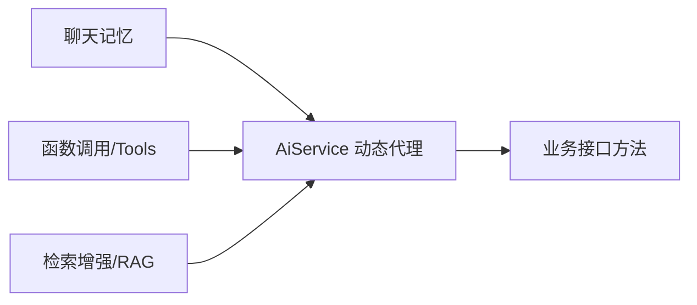

## 纲要

- **本质**：一个接口 + 动态代理，让开发者以「面向接口」方式调用大模型
- **前身**：LangChain 的「Chain（链）」概念 —— 把记忆 / 函数调用 / RAG 串成一条链
- **演进**：链不灵活 → LangChain4j 用 `AiService` 取而代之，更灵活
- **能力封装**：输入格式化、输出结构化解析，并原生支持 聊天记忆 / Tools / RAG
- **价值**：一行代码构造大模型交互，屏蔽底层细节

> 本章讲清「为什么需要 AiService」，按课程口径重构；代码为课程示意，去品牌与脱敏处理。

## 一、什么是 AiService

`AiService` 本质上是一个 **Java 接口**，框架通过 **动态代理** 在运行时生成实现类，把与大模型交互的脏活（拼请求、发 HTTP、解析响应）全部封装起来。业务方只定义接口方法，像调本地方法一样调大模型。

## 二、从 Chain 到 AiService

LangChain4j 名字里的 "Chain" 源自早期 **Chain（链）** 概念：把聊天记忆、函数调用、检索增强（RAG）等组件串成一条链完成业务。但链不够灵活，因此在框架中不再深究链，改用更灵活的 `AiService`。

## 三、AiService 封装了什么

| 能力 | 说明 |
|---|---|
| 输入格式化 | 把方法参数格式化为大模型可识别的消息 |
| 输出解析 | 把模型返回解析为 String / POJO |
| 聊天记忆 | 自动维护多轮上下文 |
| Tools（函数调用） | 让模型调用外部工具 |
| RAG | 检索增强生成 |

## 四、为什么比原生调用优雅

原生 `OpenAIChatModel.chat()` 只能拿到文本；`AiService` 通过动态代理在方法层面把上述能力编排好，业务代码只需一行构造即可获得「带记忆、带工具、带 RAG」的智能体。

## 五、FAQ

**Q1：AiService 和普通接口区别？**
普通接口需手写实现；AiService 由框架动态代理生成实现，直接对接大模型。

**Q2：动态代理难理解怎么办？**
把它当黑盒：你定义接口，框架给你一个能对话的实现类，无需关心底层 HTTP。

**Q3：链为什么被替代？**
链把组件硬编码串联，不灵活；AiService 用注解 / 接口声明能力，组合更自由。

## 六、面试高频问答

1. **AiService 的设计思想？** 接口 + 动态代理，把大模型调用抽象成普通 Java 方法。
2. **它封装了哪些高级能力？** 记忆、Tools、RAG，以及输入格式化与输出解析。
3. **和 Chain 的关系？** 框架名源于 Chain 概念，但实践中用更灵活的 AiService 替代链。

## 七、ops 提示

> **高阶依赖**：AiService 属于高阶功能，需引入 `langchain4j` 全量依赖（非仅 `langchain4j-openai`）。
>
> **版本对齐**：动态代理 API 随版本演进，写法以当前版本文档为准。
>
> **学习顺序**：先懂低阶 `ChatLanguageModel`，再学 AiService，理解成本更低。
