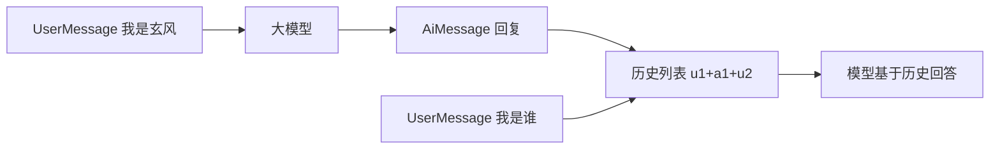

## 纲要

- **痛点**：大模型本身「无记忆」，每次 `chat()` 都是独立新会话
- **验证**：第一轮告诉名字、第二轮问「我是谁」，模型答不上来
- **手动实现**：把第一轮的请求（`UserMessage`）+ 响应（`AiMessage`）一并带入第二轮
- **底层消息**：入参包成 `UserMessage`，返回包成 `AiMessage`；消息族含 `UserMessage` / `AiMessage` / `SystemMessage` / `ToolExecutionResultMessage` / `CustomMessage`
- **局限**：轮次多了要手动拼全部历史，极其繁琐 → 引出 ChatMemory 组件

> 本章先理解「记忆为什么必要」，按课程口径重构；代码为课程示意，去品牌与脱敏处理。

## 一、大模型没有记忆

```java
// 第一轮：告诉模型名字
Response<AiMessage> r1 = model.generate(UserMessage.from("我是玄风"));
// 第二轮：问「我是谁」
Response<AiMessage> r2 = model.generate(UserMessage.from("我是谁？"));
```

第二次回答会是「我无法直接知道你的具体身份」——证明 **默认无记忆**，每轮独立。

## 二、手动带历史实现记忆

把第一轮请求 + 模型响应，连同第二轮请求一并传给模型：

```java
UserMessage u1 = UserMessage.from("我是玄风");
Response<AiMessage> r1 = model.generate(u1);

UserMessage u2 = UserMessage.from("我是谁？");
// 带上 u1 的提问 + r1 的回复 + u2 的提问
Response<AiMessage> r2 = model.generate(List.of(u1, r1.content(), u2));
```

模型基于第一轮上下文推理出「你叫玄风」，记忆达成。

## 三、底层消息封装

| 类型 | 含义 |
|---|---|
| `UserMessage` | 用户发给模型的消息 |
| `AiMessage` | 模型回复 |
| `SystemMessage` | 应用设定的系统提示词 |
| `ToolExecutionResultMessage` | 工具执行结果（Tools 章展开） |
| `CustomMessage` | 自定义消息 |



## 四、手动实现的局限

第三轮要把第一、二轮全部带入，第四、五轮同理 —— 轮次越多代码越复杂。**因此框架提供 `ChatMemory` 组件自动维护历史**，见下面。

## 五、FAQ

**Q1：为什么模型记不住上一句？**
LLM 本身无状态，每次调用独立；记忆需应用层显式维护上下文。

**Q2：手动带历史能用于生产吗？**
不推荐；上下文膨胀且易出错，应使用 ChatMemory。

**Q3：SystemMessage 算记忆吗？**
不算；它是应用设定的固定提示词，记忆指多轮 User/Ai 历史。

## 六、面试高频问答

1. **大模型为什么需要外部记忆？** 模型无状态，多轮对话需应用维护历史消息。
2. **手动实现记忆的核心？** 把历史 UserMessage + AiMessage 列表随每次请求传入。
3. **消息类型有哪些？** User / Ai / System / ToolExecutionResult / Custom。

## 七、ops 提示

> **上下文膨胀**：手动带全量历史会突破模型上下文上限，必须截断 / 摘要。
>
> **隐私**：历史消息含用户隐私，持久化前需脱敏与加密。
>
> **演进路径**：手动 → ChatMemory 自动窗口 → 自定义持久化（后章）。
