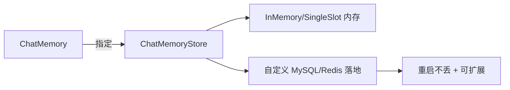

## 纲要

- **选型三件套**：MySQL（事务 / 结构化） / Redis（内存 / 高并发） / MongoDB（文档 / 半结构化）
- **选型依据**：数据结构规整度 + 性能要求 + 查询复杂度
- **切换方式**：构造 ChatMemory 时指定 `chatMemoryStore`
- **内存 Store 对比**：`InMemory` 与 `SingleSlot` 本质都是内存，结构不同（Map vs 单 list）
- **引出自定义**：内存方案有重启丢数 / 打满风险 → 实现 `ChatMemoryStore` 接口落地

> 本章讲清「存哪」与「怎么换」，按课程口径重构；代码为课程示意，去品牌与脱敏处理。

## 一、存储介质选型

| 介质 | 特点 | 适用场景 |
|---|---|---|
| MySQL | 事务、结构化、强一致 | 对话结构规整（对话ID/用户ID/时间/内容），需复杂查询统计 |
| Redis | 内存、读写极高、抗高并发 | 数据结构复杂、对话性能要求高、热点数据 |
| MongoDB | 文档（JSON）、灵活可扩 | 半结构化 / 非结构化（文本+图片+语音混排）、格式多变 |

三者覆盖绝大多数业务；Oracle 中小型公司少用，故课程聚焦前三者。

## 二、切换 Store

构造 ChatMemory 时显式指定 store 即可切换：

```java
ChatMemory memory = MessageWindowChatMemory.builder()
        .chatMemoryStore(new InMemoryChatMemoryStore())  // 指定存储实现
        .maxMessages(10)
        .build();
```

## 三、两种内存 Store 的区别

| Store | 底层 | 隔离 |
|---|---|---|
| `InMemoryChatMemoryStore` | `Map<memoryId,List>` | 支持多会话隔离 |
| `SingleSlotChatMemoryStore`（默认） | 单个 `List` | 全局共享，无隔离 |

二者都基于内存 Map / list 操作，key 即 `memoryId`，value 为消息列表。

## 四、内存方案的硬伤

- 对话多 → 内存资源打满；
- 重启 / 宕机 → 对话丢失。

因此必须 **自定义存储介质**：实现 `ChatMemoryStore` 接口，把数据落库（MySQL 等）。



## 五、FAQ

**Q1：怎么选介质？**
结构规整+统计用 MySQL；高并发+热数据用 Redis；格式多变用 MongoDB。

**Q2：切换 store 难吗？**
不难，构造时传 `chatMemoryStore` 实例即可。

**Q3：内存 Store 能上生产吗？**
不能；重启丢数据且易 OOM。

## 六、面试高频问答

1. **ChatMemory 支持的存储选型？** MySQL（结构化事务）/ Redis（高并发）/ MongoDB（半结构化）。
2. **切换存储介质的入口？** 构造 `MessageWindowChatMemory` 时的 `chatMemoryStore` 参数。
3. **为什么最终要自定义？** 内存方案重启丢数、易打满，需落库持久化。

## 七、ops 提示

> **落地优先**：生产直接规划持久化 Store，别等出问题再改。
>
> **选型匹配业务**：客服统计选 MySQL；秒杀级高并发选 Redis；富媒体对话选 MongoDB。
>
> **加密与脱敏**：持久化前对用户消息脱敏，符合隐私合规。
