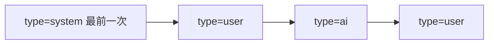

## 纲要

- **作用**：`@SystemMessage` 设定 AI 角色 / 身份，塑造专业人设
- **位置特征**：持久化 JSON 中 `type=system` 永远在最前面出现一次
- **关键陷阱**：修改系统提示词后，**已存储的历史对话会「失忆」** —— 旧上下文不再生效
- **用法**：注解直接写字符串，或结合后续的 `fromResource` 文件加载
- **验证**：DB 中可看到 `type=system` 的消息记录

> 本章讲清系统提示词的本质与坑，按课程口径重构；代码为课程示意，去品牌与脱敏处理。

## 一、@SystemMessage 设定角色

```java
@SystemMessage("你是我的好朋友，请用广东话回答我的问题")
String chat(String message);
```

模型收到系统提示词后，按指定角色（如广东话好朋友）回答。

## 二、持久化中的形态

在 MySQL（`chat_message` 表）中，系统提示词序列化为：

```json
[{"type":"system","text":"你是我的好朋友，请用广东话回答我的问题"},
 {"type":"user","text":"..."},
 {"type":"ai","text":"..."}]
```

`type=system` **永远只在最前面出现一次**，之后每轮对话不再重复。

## 三、关键陷阱：改提示词导致历史失忆

把系统提示词从「广东话」改成「东北话」后，即使旧的对话内容仍存于数据库，**模型也不再基于旧角色上下文回答**——因为系统提示词变了，旧会话的有效性随之失效。

> 启示：系统提示词是「全局人设开关」，变更需谨慎，必要时清历史或开新会话。

## 四、SystemMessage 与 UserMessage 的区别

| 维度 | SystemMessage | UserMessage |
|---|---|---|
| 粒度 | 粗（系统层） | 细（每次用户层） |
| 位置 | 所有对话前一次 | 每次用户请求附带 |
| 作用 | 设定角色 / 全局约束 | 单次角色限制 / 具体指令 |



## 五、FAQ

**Q1：系统提示词能动态改吗？**
能，但改后旧历史会话失效（失忆），需评估。

**Q2：系统提示词会每次都发吗？**
在持久化里只存一次（最前），运行时框架自动前置。

**Q3：角色约束不够强怎么办？**
叠加 `@UserMessage` 约束（见后续法律助手案例）。

## 六、面试高频问答

1. **@SystemMessage 的作用？** 设定 AI 全局角色 / 人设，塑造专业身份。
2. **为什么改系统提示词会失忆？** 系统提示词是全局上下文开关，变更使旧会话不再基于原角色生效。
3. **与 @UserMessage 区别？** 系统层一次性 vs 用户层每次；粒度与作用范围不同。

## 七、ops 提示

> **人设稳定**：生产系统提示词变更要走版本管理，避免悄悄改导致体验回退。
>
> **失忆处理**：变更人设时主动清历史或开新会话，避免用户困惑。
>
> **持久化观察**：通过 DB 中 `type=system` 校验提示词是否正确落地。
