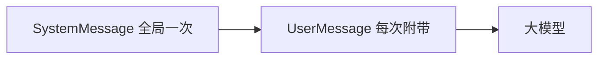

## 纲要

- **作用**：`@UserMessage` 在每次对话中附加角色 / 指令限制
- **占位符**：默认 `{{it}}` 指代单个参数；用 `@V("name")` 命名占位符提升可读性
- **多参数**：两个及以上参数用 `{{参数名}}` + `@V` 一一对应
- **与 SystemMessage 区别**：用户层粒度细、每次附带；系统层粒度粗、全局一次
- **验证**：内存级（无持久化）时打断点可见每次请求都带上 UserMessage

> 本章讲清用户提示词与占位符玩法，按课程口径重构；代码为课程示意，去品牌与脱敏处理。

## 一、单参数 @UserMessage

```java
@UserMessage("你是我的好朋友，请用上海话回答：{{message}}")
String chat(@V("message") String msg);
```

`@V("message")` 把方法参数命名，模板用 `{{message}}` 引用，比写死的 `{{it}}` 可读性更高。

## 二、多参数占位符

两个及以上参数，模板用多个命名占位符：

```java
@UserMessage("你是我的好朋友，请用上海话回答：{{message}}，年龄 {{age}}")
String chat(@V("message") String msg, @V("age") int age);
```

调用：`chat("我是谁？",38)` → 模型同时收到角色限制与业务参数。

## 三、SystemMessage vs UserMessage

- **SystemMessage**：系统层、全局、最前一次，设定人设。
- **UserMessage**：用户层、每次请求附带，做单次角色 / 指令约束。



## 四、为什么用 @V 命名

```java
// 不推荐：写死 {{it}}，可读性差
@UserMessage("回答：{{it}}")
// 推荐：@V 命名，一眼知意
@UserMessage("回答：{{question}}")
String ask(@V("question") String q);
```

## 五、FAQ

**Q1：占位符只能用 {{it}} 吗？**
不止；建议用 `@V("name")` 命名，模板写 `{{name}}`，更清晰。

**Q2：多参数顺序有要求吗？**
用命名占位符后无顺序要求，按名字匹配。

**Q3：用户提示词会被持久化吗？**
若接入持久化 ChatMemory，每次的 user/ai 消息都会落库。

## 六、面试高频问答

1. **@UserMessage 作用？** 每次对话附加角色 / 指令限制，细化交互。
2. **多参数怎么传？** `{{name}}` 占位 + `@V("name")` 绑定方法参数。
3. **为什么推荐 @V 命名？** 提升代码可读性，避免 `{{it}}` 歧义。

## 七、ops 提示

> **命名规范**：占位符名与方法语义一致（question/text/name），便于维护。
>
> **模板管理**：长提示词建议文件加载（见。
>
> **注入风险**：用户可控的占位内容注意防注入（提示词注入攻击）。
