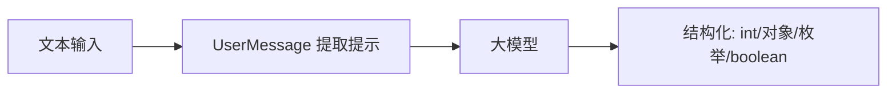

## 纲要

- **目标**：把大模型自由文本转成可程序处理的结构化数据
- **支持类型**：String / int / long / float / double / 包装类 / 集合 / 时间 / 自定义对象 / 枚举 / boolean
- **自定义对象**：用 `@Description` 描述字段，让模型精确映射
- **枚举 / boolean**：让模型返回枚举值或真值，便于分支判断
- **关键**：在 `@UserMessage` 里把提取要求写清楚

> 本章讲清 AiService 结构化输出的丰富能力，按课程口径重构；代码为课程示意，去品牌与脱敏处理。

## 一、基础类型提取

```java
@UserMessage("从文本提取金额并转为整数：{{text}}")
int extractAmount(@V("text") String text);

@UserMessage("从文本提取金额并转为 long：{{text}}")
long extractAmountLong(@V("text") String text);
```

输入「这个月转了一千块钱」→ 模型返回 `1000`（int）或对应 long。

## 二、自定义对象

```java
@UserMessage("从文本提取用户信息：{{text}}")
Person extractPerson(@V("text") String text);

class Person {
    @Description("用户姓名") String name;
    @Description("用户年龄") int age;
}
```

`@Description` 告诉模型每个字段含义，返回 JSON 精确映射到 `name` / `age`。

## 三、枚举与 boolean

```java
enum ReviewType { POSITIVE, NEGATIVE, MIXED, IRRELEVANT }

@UserMessage("分析用户评价情感：{{text}}")
ReviewType reviewType(@V("text") String text);

@UserMessage("这段评价是否为好评：{{text}}")
boolean isPositive(@V("text") String text);
```

输入「这款耳机音质一般，但佩戴不错」→ 返回 `MIXED`；判断好评返回 `true` / `false`。



## 四、FAQ

**Q1：所有类型都能直接返回吗？**
框架支持基础类型、包装类、集合、时间、自定义对象、枚举、boolean；复杂结构用对象嵌套。

**Q2：对象字段映射不准怎么办？**
加 `@Description` 描述字段语义，提升模型命中率。

**Q3：枚举值怎么约定？**
枚举常量即允许返回值；提示词写明「判断为 X/Y/Z 之一」。

## 五、面试高频问答

1. **AiService 支持哪些返回类型？** 基础类型 / 包装 / 集合 / 时间 / 自定义对象 / 枚举 / boolean。
2. **如何提升对象映射精度？** 字段加 `@Description` 说明含义。
3. **结构化输出价值？** 把自然语言转程序可用数据，便于后续逻辑分支。

## 六、ops 提示

> **容错**：模型偶尔返回非法值，生产加校验 / 重试 / 兜底默认值。
>
> **提示词精确**：提取要求写得越具体，结构化越稳定。
>
> **schema 演进**：对象字段变更需同步提示词与 `@Description`。
