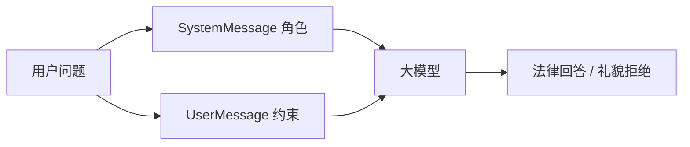

## 纲要

- **目标**：专注中国法律的 AI 助手，非法律问题礼貌拒绝
- **两个要素**：角色设定（@SystemMessage）+ 提示词模板（@UserMessage / 入参结构化）
- **踩坑**：单靠系统提示词「限制不住」非法律提问 → 必须叠加用户提示词约束
- **两种玩法**：① 入参结构化对象（LegalQuestion）② @UserMessage + @V 直传
- **验证**：问「人工智能是什么」被拒；问「著作权 LGPL 是什么」正确回答

> 本章是提示词工程的综合落地，按课程口径重构；代码为课程示意，去品牌与脱敏处理。

## 一、角色设定

```java
@SystemMessage("你是中国专业法律顾问，只回答与中国法律相关的问题；" +
        "其他领域问题请回复：抱歉，我只能回答中国法律相关问题。")
@UserMessage("如果问题与法律无关，请回答：抱歉，我只能回答中国法律相关问题。 用户问题：{{question}}")
String answer(@V("question") String question);
```

## 二、玩法一：入参结构化对象

```java
class LegalQuestion {
    @Description("依据的中国法律领域，如著作权法") String legal;
    @Description("用户想问的问题") String question;
}

@SystemMessage("你是中国专业法律顾问，只回答中国法律相关问题。")
String answer(@V LegalQuestion q);
```

调用：传 `legal="著作权法"`,`question="LGPL 是什么"`，模型基于法律领域作答。

## 三、关键踩坑：系统提示词限制不住

仅用 `@SystemMessage` 限制「只答法律」时，问「人工智能是什么」模型仍会回答。原因：模型对系统约束遵循不严格。**解决**：在 `@UserMessage` 里再叠加明确约束，双重保险后非法律提问被正确拒绝。

## 四、玩法二：@UserMessage + @V

```java
@SystemMessage("你是中国专业法律顾问...")
@UserMessage("请回答以下法律关系：{{question}}")
String answer(@V("question") String question);
```

## 五、完整示例对照

```java
@AiService
public interface LegalAdvisor {
    @SystemMessage("你是中国专业法律顾问，只回答中国法律相关问题；" +
            "其他领域请回复：抱歉，我只能回答中国法律相关问题。")
    @UserMessage("如果问题与法律无关，请回答：抱歉，我只能回答中国法律相关问题。 用户问题：{{question}}")
    String answer(@V("question") String question);
}
```



## 六、FAQ

**Q1：为什么系统提示词限制不住？**
模型对单一系统约束遵循不稳定，需用户提示词叠加。

**Q2：两种玩法怎么选？**
需强结构化入参用对象；简单直传用 @UserMessage + @V。

**Q3：拒答提示词要写在哪？**
写在 @UserMessage，与系统提示词形成双重约束更稳。

## 七、面试高频问答

1. **构建领域助手的关键？** 角色设定 + 提示词模板，且约束要多重保险。
2. **系统提示词不够怎么办？** 叠加 @UserMessage 约束提升遵循率。
3. **结构化入参价值？** 让模型理解字段语义，回答更聚焦。

## 八、ops 提示

> **双重约束**：关键业务（拒答 / 合规）务必系统 + 用户提示词双保险。
>
> **可观测**：记录拒答率，评估提示词遵循效果，持续调优。
>
> **合规兜底**：法律 / 医疗等高风险领域，模型回答需人工复核，勿直接给最终结论。
