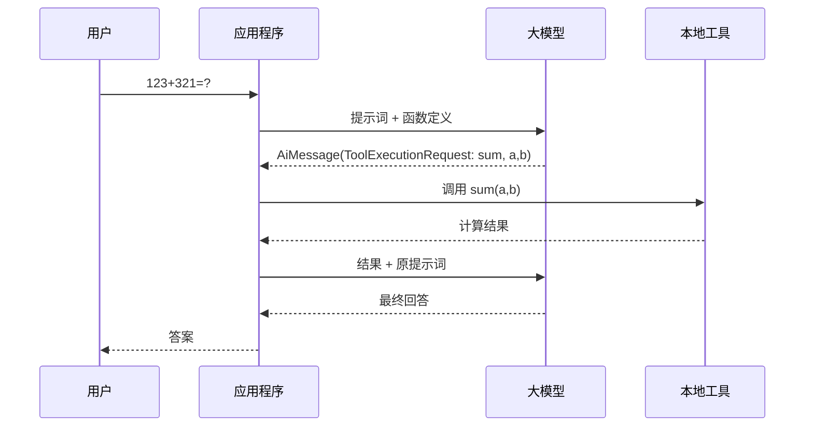

## 纲要

- **四模块**：用户输入 → 应用程序 → 大模型 → 本地工具方法
- **时序**：提示词 + 函数定义 → 大模型返回 `ToolExecutionRequest`（函数名 + 参数 + id）→ 应用解析执行本地方法 → 结果 + 原提示词再给大模型 → 最终回答
- **关键对象**：`AiMessage` 内含 `ToolExecutionRequest`；应用解析后调用对应工具
- **断点验证**：可见首轮含 user + 函数定义，次轮含工具结果与系统/用户提示词

> 本章用流程图拆穿函数调用的全链路，按课程口径重构；代码为课程示意。

## 一、四模块与时序

1. **用户输入**：如「123 加 321 等于多少」
2. **应用程序**：把提示词 + 函数定义（@Tool 信息）一并发给大模型
3. **大模型**：内部推理，返回 `AiMessage`，内含 `ToolExecutionRequest`（目标函数名 `sum`、参数 `a/b`、调用 id）
4. **本地工具**：应用解析请求 → 调用 `Calculator.sum` → 拿到结果 → 结果 + 原提示词再次发给大模型 → 模型输出最终答案

## 二、关键对象 ToolExecutionRequest

- 大模型返回的不是最终文本，而是**调用意图**：包含 `id`（调用标识）、方法名、参数。
- 应用据此找到工具类并执行；执行结果回灌模型。

## 三、断点观察

- 首轮对话：含 `UserMessage`（"123+321"）+ 一并传入的函数定义。
- 模型返回：含 `ToolExecutionRequest`（方法名 `sum`、参数、id）。
- 本地执行后：携带工具结果 + 系统/用户提示词再次请求，模型输出整合结果。

## 四、FAQ

**Q1：为什么模型不直接算？**
模型不擅长精确计算，本地工具保证结果正确。

**Q2：ToolExecutionRequest 是谁产生的？**
大模型产生，应用解析并执行。

**Q3：结果如何回到模型？**
应用把工具结果 + 原提示词再次请求大模型，由其综合作答。

## 五、面试高频问答

1. **函数调用全链路？** 提示词+函数定义→模型返调用意图→应用执行→结果回灌→最终回答。
2. **模型返回什么？** `AiMessage` 内含 `ToolExecutionRequest`（函数名/参数/id）。
3. **为什么要多一轮交互？** 应用执行本地方法后需把结果交模型综合成自然语言。

## 六、ops 提示

> **失败重试**：工具执行失败要有重试 / 兜底，并把错误回灌模型让其修正。
>
> **超时控制**：工具可能慢（查库 / 外部 API），设超时避免链路阻塞。
>
> **审计**：记录 ToolExecutionRequest 与结果，满足合规与排错需求。
