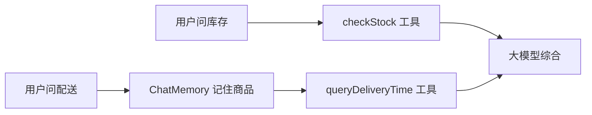

## 纲要

- **场景**：客服机器人查商品库存、配送时间，并基于多轮对话记忆
- **组合**：`@SystemMessage` 角色 + `ChatMemory` 记忆 + `@Tool` 工具
- **两个工具**：`checkStock(商品名)` 查库存、`queryDeliveryTime(商品名)` 查配送
- **数据**：用内存 `Map` 模拟商品库（生产换真实 DB）
- **验证**：问 iPhone16 库存 → 有货；再问配送时间 → 3~5 个工作日

> 本章把提示词 + 函数调用 + 聊天记忆综合落地，按课程口径重构；代码为课程示意，去品牌与脱敏处理。

## 一、角色与记忆

```java
@SystemMessage("你是电商平台机器人，帮助用户查询商品信息和配送详情；" +
        "请记住用户之前询问过的商品，以便后续对话提供相关信息。")
@AiService(tools = "productTools")
public interface ShopAssistant {
    String chat(@MemoryId String memoryId, @UserMessage String message);
}
```

## 二、工具类

```java
public class ProductTools {

    private final Map<String, ProductInfo> db = new HashMap<>();   // 生产换真实 DB

    @Tool(name = "checkStock", value = "检查商品库存")
    public String checkStock(@P("商品名称") String productName) {
        ProductInfo p = db.get(productName);
        if (p == null) return "抱歉，没有找到该商品";
        return p.inStock ? "目前有库存，欢迎下单" : "目前没有库存，我们会尽快补货";
    }

    @Tool(name = "queryDeliveryTime", value = "查询配送时间")
    public String queryDeliveryTime(@P("商品名称") String productName) {
        ProductInfo p = db.get(productName);
        return p == null ? "未找到商品" : p.deliveryTime;
    }
}
```

## 三、模拟数据

```java
class ProductInfo {
    String name;
    boolean inStock;
    String deliveryTime;   // 如 "3~5 个工作日"
}
```

初始化：`db.put("iPhone16",new ProductInfo("iPhone16",true,"3~5 个工作日"))`。

## 四、组合价值

- **记忆**：用户先问库存，后续问「配送时间」模型知道指的是哪件商品。
- **工具**：库存 / 配送来自本地数据，结果准确。
- **提示词**：角色约束让回答专业、连贯。



## 五、FAQ

**Q1：为什么用 Map 模拟？**
聚焦演示工具与模型交互，生产替换真实数据库。

**Q2：记忆在这里起什么作用？**
让模型在后续轮次知道用户指的是之前查过的商品。

**Q3：工具能直接查 DB 吗？**
能；把 `db.get` 换成 JPA / MyBatis 查询即可。

## 六、面试高频问答

1. **电商助手的组合？** 系统提示词（角色）+ ChatMemory（记忆）+ @Tool（查库）。
2. **工具数据来源？** 演示用 Map，生产用真实 DB / 接口。
3. **记忆为何必要？** 多轮上下文让模型关联前后问题，避免重复询问。

## 七、ops 提示

> **数据真实化**：把内存 Map 替换为受控查询，注意连接池与超时。
>
> **库存一致性**：查库存与下单之间需事务 / 锁，避免超卖。
>
> **工具安全**：工具可触达业务数据，加权限与审计。
