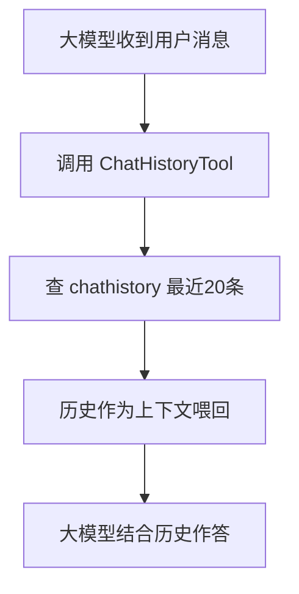

## 纲要

- **问题**：`ChatMemory` 基于内存，重启丢上下文；且同一 AiService 多方法共用内存记忆会上下文混乱
- **重构思路**：去掉内存 `ChatMemoryProvider`，改为**自定义 Tool** 从 `chathistory` 查最近 20 条，每次调用前让大模型自行读取历史
- **ChatHistoryTool**：`@Tool getChatHistory(@P sessionId)` 返回 `List<ChatHistoryDTO>`（role / content）
- **Repository 方法**：`findTop20BySessionIdOrderByldDesc(sessionId)` —— JPA 按方法名解析 SQL
- **附带收益**：历史由 DB 提供后，多个业务方法可**重新合并回同一 AiService**，不再担心上下文混乱

> 代码按课程口径重构示意。这一步把「记忆」从内存搬到数据库，是 ChatMemory 持久化的真正闭环。

## 一、为什么从内存切到 Tool

内存 `ChatMemory` 两个硬伤：重启即失；同代理多方法互相污染。把历史存进 `chathistory` 后，让大模型每次对话前**主动调用 Tool 读历史**，上下文就完全由 DB 决定。



## 二、ChatHistoryTool

```java
// tools/ChatHistoryTool.java
@Component
public class ChatHistoryTool {

    private final ChatHistoryRepository repository;

    @Tool("获取用户聊天历史对话")
    public List<ChatHistoryDTO> getChatHistory(@P("会话ID") String sessionId) {
        List<ChatHistory> list = repository
                .findTop20BySessionIdOrderByldDesc(sessionId);
        return list.stream()
                .map(e -> new ChatHistoryDTO(e.getRole(), e.getContent()))
                .collect(Collectors.toList());
    }
}
```

`@Tool` 声明这是一个可被大模型调用的函数；`@P` 标注入参语义，帮助模型理解参数含义。

## 三、Repository 方法名解析

```java
public interface ChatHistoryRepository extends BaseRepository<ChatHistory, Long> {
    // JPA 按方法名生成: SELECT ... WHERE session_id=? ORDER BY id DESC LIMIT 20
    List<ChatHistory> findTop20BySessionIdOrderByldDesc(String sessionId);
}
```

JPA 的「方法名即查询」特性：前缀 `findTop20` 限制条数，`BySessionId` 生成 WHERE，`OrderByldDesc` 生成排序，无需手写 SQL。

## 四、AiService 改造

去掉内存 `ChatMemoryProvider`，把 `ChatHistoryTool` 注入 AiService，并在提示词里要求「每次交互先调用读取历史工具」：

```java
@SystemMessage(fromResource = "prompts/system-register-lost.txt")
public interface LostRegisterAiService {
    RegisterLostOutput registerLost(
        @UserMessage String message,
        ChatHistoryTool chatHistoryTool);  // 注入记忆 Tool
}
```

由于上下文改由 Tool 提供，**原本因共享内存记忆而拆开的多个方法，可重新合并回同一 AiService**——因为每次调用都从 DB 拉最新历史，不再有「共用内存导致混乱」的问题。

## 五、FAQ

**Q1：Top20 够用吗？**
课程口径取最近 20 条；长会话可按 token 预算调大，或改用向量召回（前述 RAG）。

**Q2：为什么能合并回同一 AiService？**
上下文来源从「共享内存」变成「每次 DB 查询」，方法间不再共享可变状态，隔离问题消失。

**Q3：Tool 返回 DTO 而非实体？**
避免把 JPA 实体（含代理/懒加载）暴露给大模型序列化，DTO 干净可控。

## 六、面试高频问答

**1. 如何把 ChatMemory 持久化到 MySQL？**
两种路：实现 `ChatMemoryStore` 落库（见前述），或用自定义 Tool 查询历史喂回；本章选后者以顺带解决上下文隔离。

**2. JPA 方法名查询的边界？**
简单 CRUD/分页/排序够用；复杂联表仍需 `@Query` 写 JPQL。

**3. @Tool 与 @P 的作用？**
`@Tool` 标记可调用函数，`@P` 描述参数语义，二者配合让模型正确传参。

## 七、ops 提示（记忆重构）

> **二选一即可**：要纯记忆语义用 `ChatMemoryStore` 实现；要顺带解决隔离与可控检索用 Tool 方案（本章选它）。
>
> **方法名拼错即 SQL 错**：`findTop20BySessionIdOrderByldDesc` 中 `ld` 若是手误会生成错误列，务必对照实体字段。
>
> **提示词要显式要求调 Tool**：不写「先读历史」，模型不一定主动调，记忆等于没接上。
