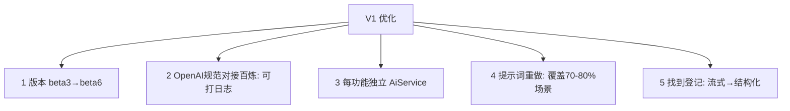

## 纲要

- **会话管理**：Controller 新增「按 userId 分页查历史（过滤非用户输入）」与「按 userId 清空历史」两个接口，直接操作 `chathistory`
- **找到登记链路**：镜像丢失登记——`FoundRegister` 实体 + `FoundRegisterTool.queryFoundPropertyByPhone` + `RegisterFoundPropertyOutput`（流式输出，要求严格 JSON）
- **业务落点**：`Flux` 收集成 StringBuilder → `JsonUtils.fromJson` 转实体 → `isComplete` 时 `save` 落 `foundregister`
- **前述五点优化**：① 版本 beta3→beta6 ② 配置改用 OpenAI 规范对接百炼（可打 request/response 日志）③ 每功能独立 AiService ④ 提示词重做 ⑤ **找到登记回退流式→结构化**（流式不适合「收完再落库」且 JSON 支持差）
- **核心结论**：提示词决定系统智能上限，需持续打磨；编码层面组件就那几个

> 代码按课程口径重构示意（外部课件代码卷未挂载）。本卡是 V1 收尾，含找到登记与优化总结。

## 一、会话记录查询/删除

两个简单接口，纯 CRUD，重点在分页与过滤：

```java
// AIController
@GetMapping("/history")
public Page<ChatHistoryVO> history(String userId, Pageable pageable) {
    // 调 repository 分页查 chathistory，过滤掉 role!=0 的非用户输入消息
    // 转 ChatHistoryVO(sessionId, content, createTime) 返回前端展示
}

@DeleteMapping("/history")
public void clearHistory(String userId) {
    chatHistoryRepository.deleteBySessionId(userId);  // 按 userId 清空
}
```

设置用户 ID 时若历史存在，前端直接回填展示，体验连贯。

## 二、找到失物登记链路

与丢失登记对称，落 `foundregister`：

```java
// entity/FoundRegister.java
@Entity
@Table(name = "foundregister")
public class FoundRegister extends BaseEntity {
    private String userName;     // 捡到者姓名
    private String phone;        // 捡到者手机号
    private String foundName;    // 捡到物品名
    private String foundFeature; // 捡到物品特征
}

// tools/FoundRegisterTool.java
@Tool("根据手机号查询找到失物登记信息")
public List<FoundRegister> queryFoundPropertyByPhone(@P("手机号") String phone) {
    return repository.findFoundPropertyByPhone(phone);
}
```

系统提示词要求：每次对话先调 `ChatHistoryTool` 结合上下文；输入手机号则调 `queryFoundPropertyByPhone` 匹配并回填 `id`；提取姓名/手机号/物品名/特征；`isComplete` 时严格按 JSON 输出。

## 三、流式输出收集与落库

```java
private Flux<String> registerFoundProperty(String userId, String message) {
    StringBuilder sb = new StringBuilder();
    return foundAiService.registerFoundProperty(userId, message)
        .doOnNext(sb::append)                    // 逐块拼接
        .doOnComplete(() -> {
            FoundPropertyOutput out = JsonUtils.fromJson(sb.toString(), FoundPropertyOutput.class);
            if (out.isComplete()) {
                FoundRegister e = new FoundRegister();
                BeanUtils.copyProperties(out, e);
                foundRegisterRepository.save(e);  // 落 foundregister
            }
        });
}
```

## 四、前述五点优化总结



**关键点 5（重要踩坑）**：找到登记原用 `StreamingChatModel` 流式，但——

1. **业务不合适**：需收完所有输出再落库/改库，流式是阶段性输出，不匹配；
2. **JSON 支持差**：流式下大模型对「严格 JSON 格式」支持不友好，可能返回非 JSON，解析失败。

→ 回退为普通 ChatModel + 结构化对象直接接收，`isComplete` 后正常 upsert。

**关键点 2（调试可观测）**：原生百炼 starter 不打请求/响应日志；改用 OpenAI 规范配置（`base-url` 映射到百炼兼容地址），可打印 `GPT-request`/`response` 参数，排错极大方便。

## 五、FAQ

**Q1：找到登记和丢失登记代码重复多吗？**
高度对称，复制改实体/提示词即可；后续可抽公共基类进一步去重。

**Q2：为什么流式回退结构化？**
业务要「收完再决策」，且流式 JSON 易失败，结构化更稳。

**Q3：OpenAI 规范对接百炼图啥？**
只为拿到请求/响应日志，便于线上排查大模型参数问题。

## 六、面试高频问答

**1. 流式输出在什么场景不合适？**
需要「收集完整结果再做后续处理（落库/改库）」或强依赖结构化 JSON 时，流式反成负担。

**2. 如何提升大模型应用的可观测性？**
用支持日志的接入方式打印请求/响应；关键 Tool 调用参数落日志；结构化输出打印原文。

**3. V1 的核心教训？**
提示词决定智能上限，需持续打磨；架构上「每功能独立 AiService + 历史 Tool 回灌」是稳定基石。

## 七、ops 提示（V1 收尾）

> **流式 vs 结构化按业务选**：纯展示用流式；要落库/校验用结构化。别为「炫」硬上流式。
>
> **日志即生产力**：对接大模型优先选能打日志的接入方式，排错效率天差地别。
>
> **提示词是长跑**：V1 提示词只覆盖 70-80% 场景，上线后持续收集 bad case 迭代。
>
> **版本跟随官网**：beta 系列 API 变动快，升级（beta3→beta6）后回归核心链路。
