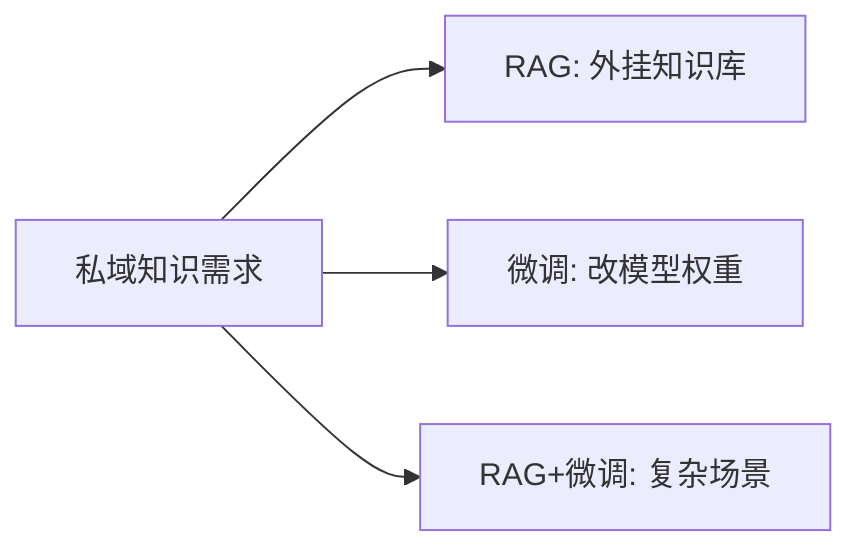

## 纲要

- **三大路线**：① RAG（检索增强生成）② 模型微调（Fine-tuning）③ 两者结合（复杂业务）
- **微调本质**：在基座模型上用小规模任务数据再训练，调整参数，使特定领域知识「融」进模型权重
- **微调优缺点**：一次调用速度快、特定领域准；但训练成本高、知识更新不及时（重训周期长）
- **RAG 本质**：用户问题先去外部知识库做相似度检索，检索结果 + 原问题 + 提示词一并喂给大模型生成答案
- **RAG 优缺点**：知识库可实时更新、不耗训练资源；但需两次查询（检索 + 生成），性能低于微调
- **选型**：知识库稳定/重风格质量 → 微调；知识库频繁更新/企业私域 → RAG

> 代码按课程口径重构示意（外部课件代码卷未挂载）。本卡是 RAG 章节的总纲，先建立「RAG 解决私域知识」的认知。

## 一、为什么需要 RAG

失物招领系统目前的知识仅来自大模型通用训练数据。当用户问「我丢的东西有没有被捡到」这类**私有业务数据**，通用模型答不了。解决方式有三：

## 二、微调（Fine-tuning）详解

- **做法**：用小规模特定任务数据在基座模型上再次训练，调整模型参数。
- **优点**：调用时数据已「融入」模型，一次调用极快；特定领域准确性/风格更好。
- **缺点**：计算资源与时间成本高；知识更新不及时——数据变了就要重训，重训周期长。

> 适用：知识库稳定、对准确性与生成风格要求高的场景（如专业文档生成、特定领域创作）。

## 三、RAG（检索增强生成）详解

- **原理**：客户端问题**不直接**发给大模型，而是先发到外部知识库做相似度匹配；把匹配到的知识 + 原问题 + 提示词结合后，再交给大模型生成自然语言答案。
- **优点**：数据存外部知识库，可实时更新；不涉及训练，省算力省时间；相当于给模型「外挂」实时数据库。
- **缺点**：检索 + 生成两次查询，后期性能低于微调。

> 适用：知识库大量频繁更新（企业客服查新闻、法律医疗知识库更新频繁）的场景。

## 四、RAG 三种检索用法

| 检索方式 | 说明 |
|---|---|
| 全文搜索 | 按关键词频率/相关性排序，类似传统搜索引擎 |
| 向量搜索（语义搜索） | 用 Embedding 模型把文本转向量，按余弦相似度捕捉语义相关 |
| 混合搜索 | 向量 + 全文组合，应用最广 |

## 五、FAQ

**Q1：RAG 和微调能一起用吗？**
能；复杂业务常把 RAG 的实时检索 + 微调的领域能力结合。

**Q2：RAG 性能差为什么还常用？**
因为企业私域数据频繁变，重训不现实；实时外挂知识库性价比最高。

**Q3：向量搜索属于 RAG 的哪一步？**
属于「检索」阶段——把问题和文档都向量化后算相似度。

## 六、面试高频问答

**1. RAG 与微调的核心区别？**
RAG 外挂知识库实时检索不改权重；微调改模型参数使知识固化，更新需重训。

**2. 何时选 RAG 不选微调？**
知识库频繁更新、数据是私域且不愿/不能重训时，RAG 是唯一现实路径。

**3. RAG 的代价？**
多一次向量检索，延迟与成本高于微调的单次调用。

## 七、ops 提示（选型红线）

> **先判更新频率**：稳定知识走微调，频繁变更走 RAG；别用微调硬扛天天变的数据。
>
> **语义检索优先**：企业问答类场景直接用向量（语义）搜索，比关键词全文更准。
>
> **混合搜索更稳**：生产可上向量+全文混合，弥补纯向量在专有名词上的短板。
